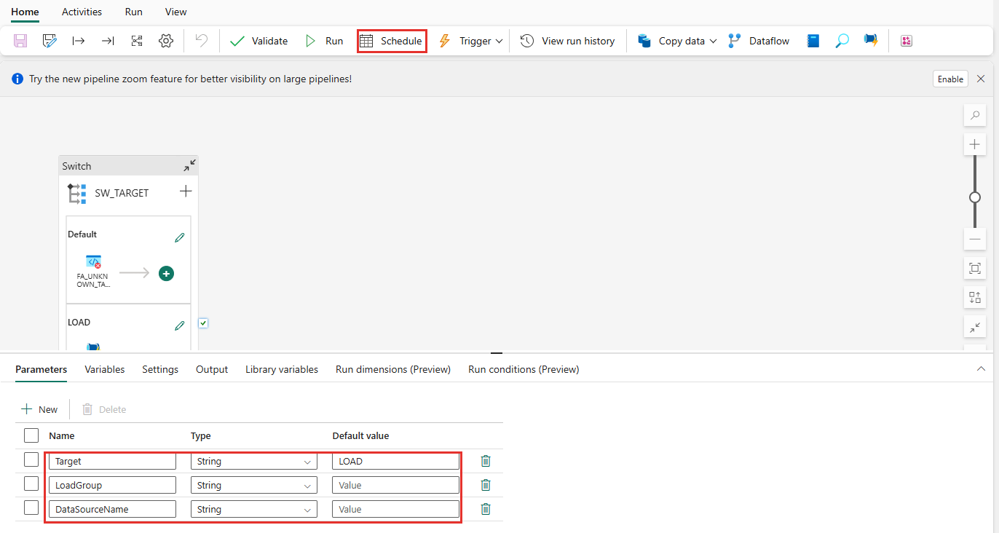
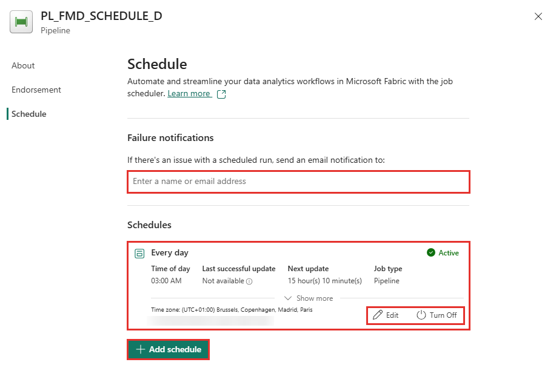
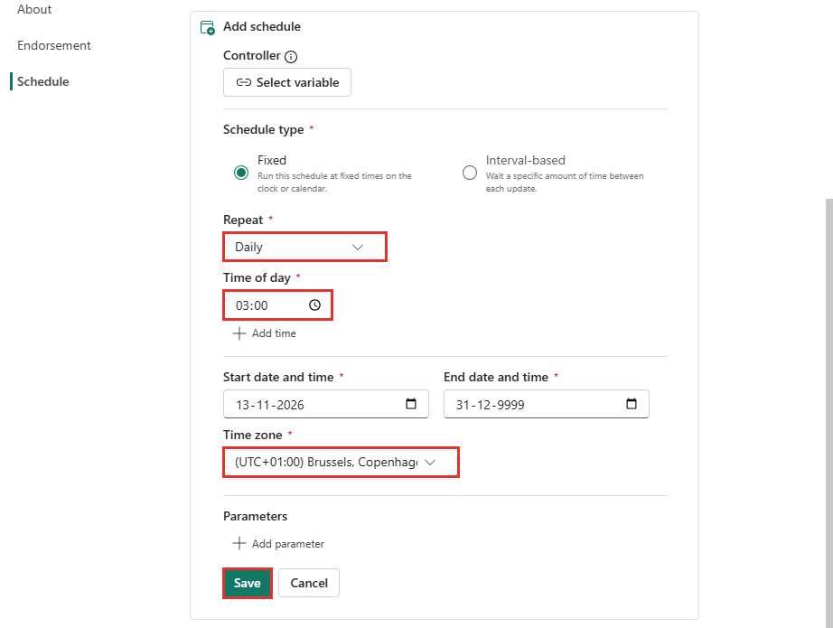
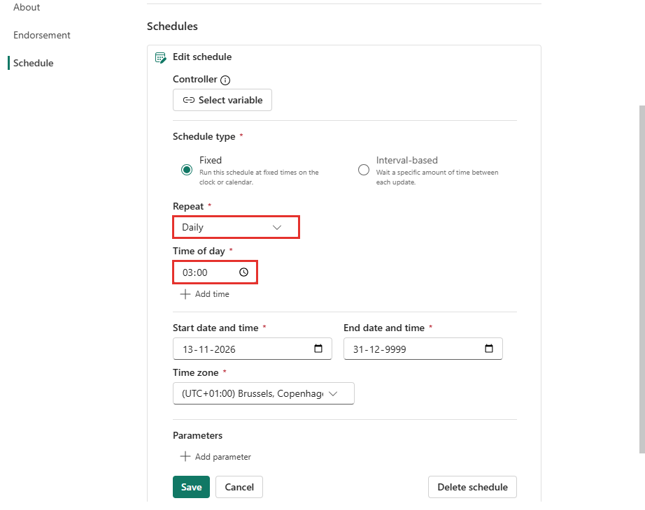
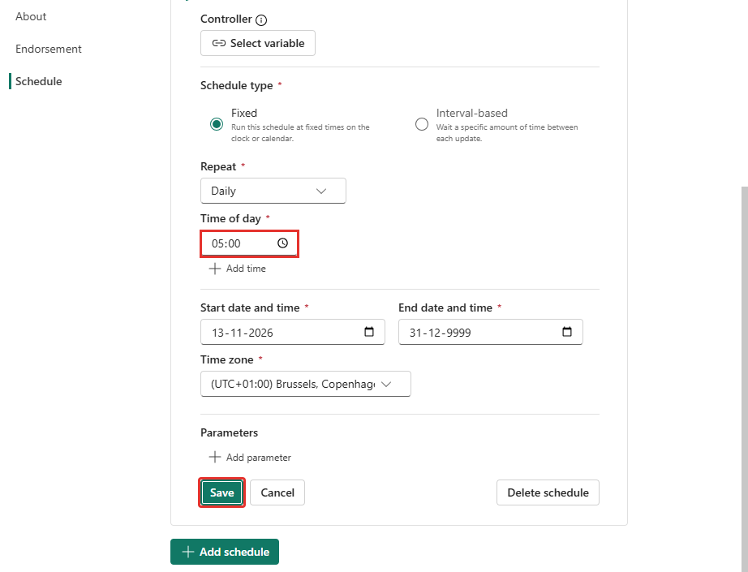
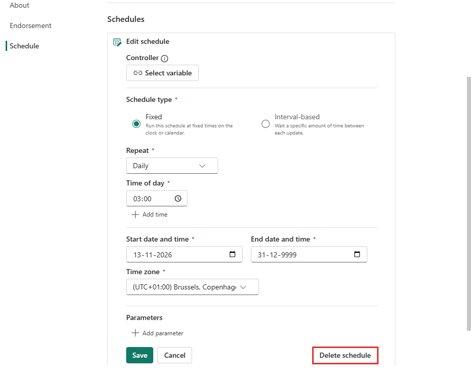
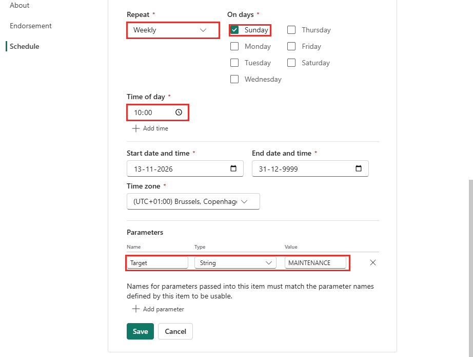

# Dagelijkse routine en schedules

Deze handleiding beschrijft hoe geplande runs in een FMD-installatie werken, wat je na elke run controleert, hoe je een schedule wijzigt en hoe je de wekelijkse maintenance plant. Gegevens van één specifieke installatie (tijden, namen, aanpassingen) horen niet hier maar in de documentatie van die installatie.

## De keten van een geplande run

Een schedule start een schedule-pipeline, die de rest aanroept:

1. `PL_FMD_SCHEDULE_<omgeving>` in de workspace INTEGRATION CONFIG start met de parameter `Target = LOAD`.
2. Die roept `PL_FMD_ORCHESTRATION` aan in de INTEGRATION CODE-workspace van de omgeving, met de parameters `LoadGroup` en `DataSourceName`.
3. De orchestratie start `PL_FMD_LOAD_ALL`: Landingzone, Bronze en Silver.
4. De setup van de business-domeinen hangt daarna per domein de Gold-pipeline `PL_<DOMEIN>_LOAD_GOLD` aan de orchestratie, met de conditie dat `PL_FMD_LOAD_ALL` **Succeeded** is. Na een fout in één entiteit draait Gold dan voor geen enkel domein. Een installatie kan die conditie aanpassen.
5. Gold draait na elke run van de orchestratie, ook na een run met een filter op `LoadGroup` of `DataSourceName`.

`PL_FMD_SCHEDULE_<omgeving>` heeft de parameters `Target` (`LOAD` of `MAINTENANCE`), `LoadGroup` en `DataSourceName`. Een andere waarde van `Target` laat de pipeline falen met `UnknownTarget`. De pipeline heeft `concurrency: 1`: een run wacht zolang een andere van dezelfde pipeline loopt.

De schedules staan op deze pipeline in CONFIG en niet op de pipelines in de CODE-workspaces. CONFIG zit in geen deployment pipeline, dus een promotie raakt de schedules niet. De setup maakt de schedule-pipelines eenmalig aan en overschrijft ze nooit. Ze staan ook niet in git.

## Dagelijkse controle

Doe dit na elke geplande run, per omgeving die je beheert. Het kost ongeveer vijf minuten.

1. **Pipelinestatus.** Open in de monitor van INTEGRATION CONFIG de laatste run van `PL_FMD_SCHEDULE_<omgeving>`. `Failed` is een incident. `Completed` of `Succeeded` is nog niet genoeg (zie stap 2).
2. **Falende entiteiten.** Het framework ketent de lagen op `Completed`, dus een groene run kan toch tabellen missen. Draai de query onder *Controleren* in [Een tabel of bron handmatig laden](handmatig-laden.md#controleren), of kijk in het FMD_Logging-rapport.
3. **Wachtrij.** Bestanden die na enkele uren nog niet zijn verwerkt, wijzen op een fout in Bronze:
   ```sql
   SELECT PLE.[LandingzoneEntityId], PLE.[FileName], PLE.[InsertDateTime]
   FROM   [execution].[PipelineLandingzoneEntity] PLE
   WHERE  PLE.[IsProcessed] = 0
     AND  PLE.[InsertDateTime] < DATEADD(HOUR, -2, SYSUTCDATETIME());
   ```
   Een entiteit die bewust is uitgezet, kan hier nog open bestanden hebben.
4. **Gold.** Controleer dat de Gold-pipeline van elk domein in de eigen omgeving `Completed` is, en dat de laatste notebook-activiteit (de refresh) is geslaagd.
5. **Duur.** Vergelijk de duur met de vorige dagen (`logging.vw_ExecutionSummary`, zie [Een tabel of bron handmatig laden](handmatig-laden.md#controleren)). Een run die ruim langer duurt, wijst op drukte op de capaciteit of op een eerste full load van een grote tabel.

## Wekelijks

- Controleer dat de maintenance-run van de afgelopen week in elke omgeving `Completed` is. Een fout laat de pipeline falen met een lijst van de fouten.
- Loop de wachtrij na op entiteiten die al meerdere dagen open staan.
- Noteer de langste run van de week. Loopt die naar het volgende schedule toe, plan dan om.
- Controleer de geldigheid van de credentials achter de connecties en de service principals (*aanbeveling*).

## Een schedule wijzigen

Doe dit in de portal, op het item `PL_FMD_SCHEDULE_<omgeving>` in INTEGRATION CONFIG, één omgeving per keer. De schermafbeeldingen zijn opgenomen in november 2026.

### Het schedule-paneel openen

1. Open het item `PL_FMD_SCHEDULE_<omgeving>` en kies op het tabblad **Home** de knop **Schedule**. Onder in beeld staan de parameters van de pipeline: `Target` (standaardwaarde `LOAD`), `LoadGroup` en `DataSourceName`. Dit zijn de namen die je in een schedule kunt meegeven.

   

2. Het paneel **Schedule** opent rechts. Bovenaan staan de *Failure notifications* (zie [Meldingen bij een gefaalde run](#meldingen-bij-een-gefaalde-run)). Daaronder staat de lijst *Schedules*: per schedule de herhaling (bijvoorbeeld *Every day*), de status *Active*, de tijd, de volgende run (*Next update*) en de tijdzone, met de knoppen **Edit** en **Turn Off**. Onder de lijst staat **Add schedule**.

   

### Een schedule toevoegen

1. Kies **Add schedule**. Kies bij **Repeat** een herhaling (*Daily* of *Weekly*; bij *Weekly* vink je de dagen aan), vul bij **Time of day** de tijd in en kies de **Time zone**. De start- en einddatum staan standaard op vandaag en 31-12-9999.
2. Laat bij een gewone load het gedeelte **Parameters** leeg.
3. Kies **Save**.



### Een schedule wijzigen of uitzetten

1. Kies bij het schedule **Edit**. Het formulier opent met de opgeslagen waarden, hier de herhaling *Daily* en de tijd 03:00.

   

2. Pas de herhaling, de tijd of de parameters aan en kies **Save**. Hier is de tijd gewijzigd naar 05:00. De lijst toont daarna de nieuwe tijd.

   

3. Wil je het schedule tijdelijk niet laten draaien, kies dan **Turn Off** in de lijst (zie de tweede afbeelding onder [Het schedule-paneel openen](#het-schedule-paneel-openen)). Wil je het definitief weghalen, kies dan in het formulier **Delete schedule**.

   

### Parameters meegeven

Voor een maintenance-schedule kies je bij **Repeat** *Weekly*, vink je een dag aan (hier *Sunday*) en vul je de tijd in. Kies daarna **Add parameter**, vul bij *Name* `Target` in, kies als *Type* **String** en vul bij *Value* `MAINTENANCE` in.



- Geef bij een load-schedule geen parameters op om alles te laden. Wil je een deel laden, vul dan `LoadGroup` of `DataSourceName` in. Zonder parameters gelden de standaardwaarden van de pipeline: `Target = LOAD` en geen filter.
- Geef bij een maintenance-schedule altijd `Target = MAINTENANCE` mee. **Zonder die parameter draait het schedule een gewone load, met Gold, in plaats van maintenance**, omdat de standaardwaarde `LOAD` is.
- De naam van een parameter moet precies overeenkomen met een parameter van de pipeline (let op hoofdletters en spelling). Het formulier waarschuwt hiervoor in een regel onder de parameters, maar controleert de naam niet bij het opslaan. Een typefout, zoals `Targe`, wordt naar verwachting genegeerd: het schedule draait dan met de standaardwaarde. Plak de naam daarom liever dan dat je hem typt, en controleer hem in het veld voor je opslaat.
- Controleer na het opslaan in de lijst de herhaling, de tijd en de volgende run (*Next update*). Open **Edit** om de parameters terug te zien.
- Een schedule heeft een eigen tijdzone. Kies bewust dezelfde tijdzone voor alle schedules van een omgeving.
- Een nieuw schedule is direct actief en start op de ingestelde tijd een echte run. Zet een schedule dat je alleen test, daarna uit of verwijder het.
- Leg elke wijziging vast: schedules staan niet in git en een promotie neemt ze niet mee. Een verwijderd of opnieuw aangemaakt schedule-pipeline-item verliest ze.

## Meldingen bij een gefaalde run

Het framework stuurt zelf geen meldingen. Fabric kan dat wel voor een **geplande** pipeline: zet op `PL_FMD_SCHEDULE_<omgeving>` onder **Home → Schedule → Failure notifications** gebruikers of groepen, één keer per omgeving. Het veld staat bovenaan het schedule-paneel (zie de tweede afbeelding onder [Het schedule-paneel openen](#het-schedule-paneel-openen)); typ een naam of e-mailadres en kies de persoon of groep uit de lijst. Omdat CONFIG in geen deployment pipeline zit, blijven de ontvangers bij een promotie staan. Een handmatige run geeft geen e-mail.

In de Monitor staat daarnaast **Configure notifications → Schedule failures (Preview)**. Of dat dezelfde melding is of een aanvulling, is niet uitgezocht.

## Maintenance plannen

`PL_FMD_MAINTENANCE` wordt gepland via hetzelfde schedule-pipeline met `Target = MAINTENANCE`. Het ruimt verwerkte leveringen in de landingzone op die ouder zijn dan de bewaartermijn en draait `VACUUM` op Bronze en Silver. Eenmaal per week volstaat.

- **Moment.** Kies een moment zonder laadrun in dezelfde omgeving, en met ruim marge voor en na de laatste en de eerste run. Een gelijktijdige schrijfactie op dezelfde tabellen kan mogelijk falen. Meestal is dat zondag, als er in het weekend niet wordt geladen.
- **Spreiding.** Plan de omgevingen op verschillende tijden als ze dezelfde capaciteit delen, zodat de Spark-sessies niet om dezelfde capaciteit strijden.
- **Duur.** De duur hangt af van het aantal tabellen en hun grootte, en is vooraf niet te schatten. De schedule-pipeline geeft maintenance een time-out van 4 uur. Draai de eerste keer met de hand, meet de duur en pas de tijd zo nodig aan.
- **Eerste run.** De opruiming van de landingzone verwijdert pas leveringen als ze ouder zijn dan de bewaartermijn (standaard 30 dagen). In een jonge installatie doet de eerste run dus waarschijnlijk niets op dat punt.
