# Een Direct Lake-model laten verwijzen naar het juiste lakehouse na promotie

Een Direct Lake-model leest uit het lakehouse waarvan het pad in de expressie staat. Promoveer je het model van Dev naar Test, dan neemt de promotie dat pad mee: het model in Test leest dan nog uit Gold van Dev. Deze handleiding beschrijft hoe je het pad in een **parameter** zet, zodat een **parameter rule** in de deployment pipeline het pad per stage kan vervangen. Je voegt de parameter toe in de TMDL view van de web-editor.

Het gaat om een model op **OneLake** (`AzureStorage.DataLake`). Voor een model op het SQL-endpoint van het lakehouse geldt een andere route, een data source rule, die hier niet wordt beschreven.

De labels *vastgesteld* (uit de definitie of de documentatie van Microsoft gelezen), *getest in eigen omgeving* (met datum) en *aanname* geven aan hoe zeker een bewering is. De schermafbeeldingen komen uit een referentie-installatie van november 2026.

## Wat vaststaat en wat niet

- **Verversen van de data werkt**, ook met de parameter actief (*getest in eigen omgeving*, 10 november 2026).
- **Promoveer alleen met de parameter actief.** Staat het letterlijke pad actief tijdens de promotie, dan herkoppelt de parameter rule niet en leest Test uit Dev (*getest in eigen omgeving*, 9 november 2026).
- **Het schema bijwerken werkt met de parameter actief** (**Refresh → Schema** en **Edit tables**), mits elke tabel in het model een `sourceLineageTag` heeft. Ontbreekt die op een tabel, dan faalt het schema verversen, met of zonder parameter (*getest in eigen omgeving*, 10 november 2026). Zie *Het schema bijwerken*.

## Vooraf

- Gold van de omgeving waar je naartoe promoveert bestaat en is gevuld. Het model in Test moet naar Gold van Test kunnen wijzen.
- Je bent eigenaar van het model. Alleen de eigenaar kan een rule maken (*vastgesteld*, Microsoft Learn, *Create deployment rules*).
- Je bent admin van de deployment pipeline van de SEMANTIC-workspace.
- Een Apply in de TMDL view kan een compatibiliteitsniveau van minimaal 1707 vragen. Het niveau verhogen is eenmalig en niet terug te draaien. Het referentiemodel stond op 1707.
- Je kent het OneLake-pad van het lakehouse `LH_GOLD_LAYER` van de omgeving, in de vorm `https://onelake.dfs.fabric.microsoft.com/<WorkspaceId>/<LakehouseId>` (het item van het type **Lakehouse**, niet het SQL-endpoint met dezelfde naam, en zonder slash aan het eind). Zo vind je het:

  1. Open de DATA-workspace van de omgeving en het lakehouse `LH_GOLD_LAYER`. Kies in het paneel *Explorer* bij de map **Tables** het menu **…** en daarna **Properties**.

     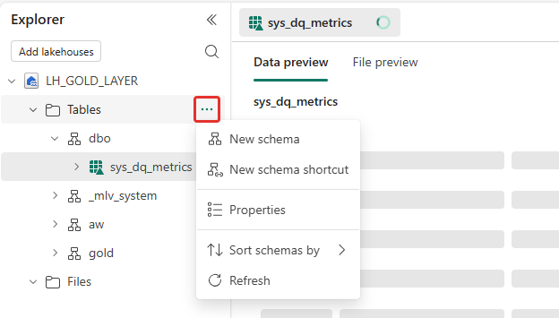

     *Afbeelding 20: kies Properties bij de map Tables.*

  2. Het paneel *Folder properties* toont de **URL**. Kies het kopieerknopje.

     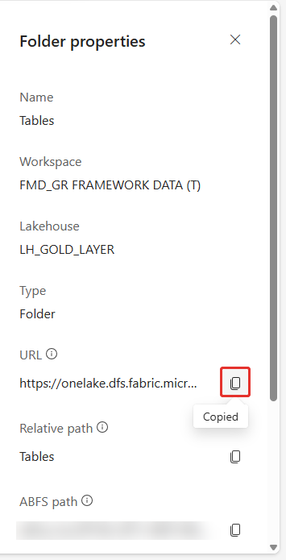

     *Afbeelding 21: kopieer de URL. Het ABFS-pad is vervaagd.*

  3. **De gekopieerde URL eindigt op `/Tables`. Haal dat deel weg**: het pad dat je in de parameter en in de rule gebruikt, eindigt op het lakehouse (`…/<LakehouseId>`). Het paneel toont de URL afgekapt; controleer het einde na het plakken. *Getest in eigen omgeving* (10 november 2026): het pad zonder `/Tables` werkte in de parameter rule.

## Stap 1: de parameter toevoegen (Dev)

1. Open het semantisch model in de bewerkmodus. Staat rechtsboven **Viewing**, kies dan het menu en daarna **Editing**. In de modus Viewing worden wijzigingen niet opgeslagen.

   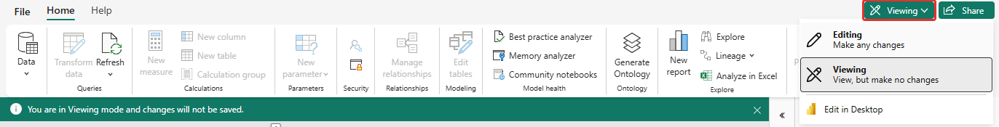

   *Afbeelding 1: schakel van Viewing naar Editing.*

2. Kies onderaan **TMDL View**. Kies rechts in het paneel **Data** het tabblad **Model** en klap **Expressions** open. Er staat één expressie: `DirectLake - LH_GOLD_LAYER`. De melding *TMDL scripts are discarded on close* betekent dat een script niet wordt bewaard als je het venster sluit.

   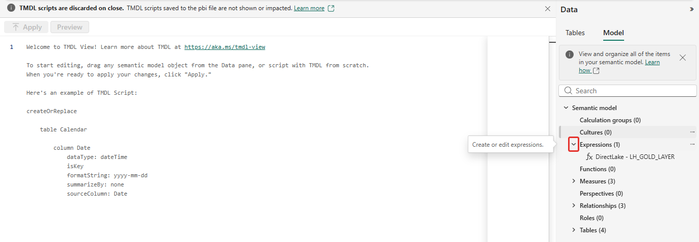

   *Afbeelding 2: TMDL View, tabblad Model, onderdeel Expressions.*

3. Sleep **Expressions** naar de editor. Het script verschijnt met de bestaande expressie.

   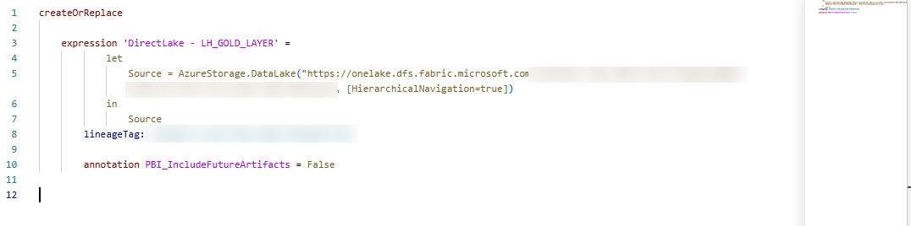

   *Afbeelding 3: het script na het slepen. Het pad in `Source` is nog letterlijk; de ID's zijn afgedekt.*

4. Voeg boven de bestaande expressie de parameter toe, en laat in de expressie `DirectLake - LH_GOLD_LAYER` het letterlijke pad staan als commentaar. Het script wordt dan:

   ```
   createOrReplace

   	expression OneLakeUrl = "https://onelake.dfs.fabric.microsoft.com/<WorkspaceId Gold Dev>/<LakehouseId Gold Dev>" meta [IsParameterQuery=true, Type="Text", IsParameterQueryRequired=true]
   	annotation PBI_ResultType = Text

   	expression 'DirectLake - LH_GOLD_LAYER' =
   			let
   				//Source = AzureStorage.DataLake("https://onelake.dfs.fabric.microsoft.com/<WorkspaceId Gold Dev>/<LakehouseId Gold Dev>", [HierarchicalNavigation=true])
   				Source = AzureStorage.DataLake(OneLakeUrl, [HierarchicalNavigation=true])
   			in
   				Source
   		lineageTag: <de bestaande lineageTag>

   		annotation PBI_IncludeFutureArtifacts = False
   ```

   Je doet het in twee delen: eerst het parameterblok toevoegen, daarna de regel `Source` aanpassen.

   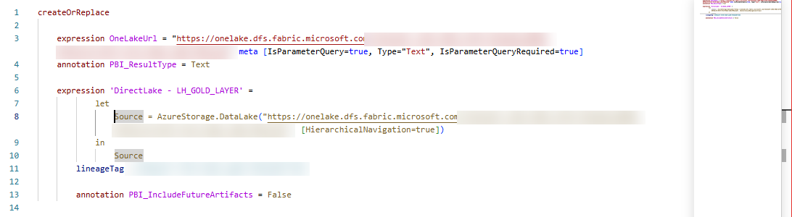

   *Afbeelding 4: het parameterblok is toegevoegd; `Source` is nog letterlijk.*

   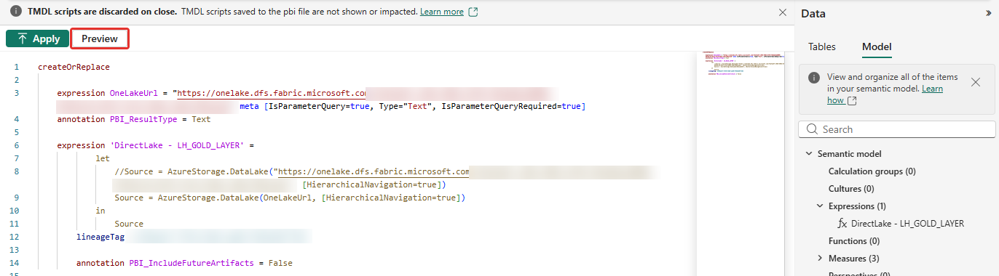

   *Afbeelding 5: `Source` gebruikt nu `OneLakeUrl`; het letterlijke pad staat in commentaar (met `//`).*

   - Laat de bestaande `lineageTag` en de annotaties (`PBI_IncludeFutureArtifacts`) staan. De editor beheert ze. Microsoft beschrijft `PBI_IncludeFutureArtifacts` niet; raak hem niet aan.
   - **De parameter moet in hetzelfde script staan** als de verwijzing erop. Staat `OneLakeUrl` niet in het model, dan geeft de Apply de foutmelding *Direct Lake mode requires a Direct Lake data source* (*getest in eigen omgeving*, 10 november 2026: die melding kwam doordat het script naar de parameter verwees zonder haar te definiëren).
   - De waarde achter het `=` bij `OneLakeUrl` is de huidige waarde van de parameter in Dev. Je hoeft hem nergens apart in te stellen.
   - Plak het script in één keer: de editor springt bij typen vanzelf in.

5. Kies **Preview** om het verschil met het model te zien, en daarna **Apply**.

   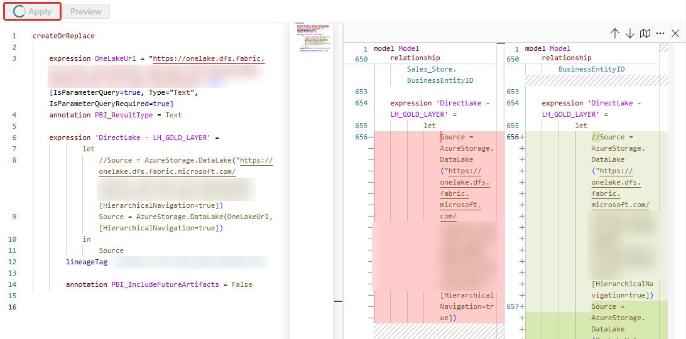

   *Afbeelding 6: Preview toont het verschil. Rood is wat verdwijnt (de actieve letterlijke regel), groen is wat erbij komt (de uitgecommentarieerde letterlijke regel en de regel met `OneLakeUrl`). De ID's zijn afgedekt.*

6. Controleer dat het model de parameter kent. Onder **Expressions** staan nu twee items (de expressie en de parameter), en de service geeft de waarde terug:

   ```
   GET https://api.powerbi.com/v1.0/myorg/groups/{ws}/datasets/{id}/parameters
   ```

   Dat toont `OneLakeUrl` met de huidige waarde (*getest in eigen omgeving*, 10 november 2026). Het eindpunt `datasources` toont voor dit model alleen het type (`AzureDataLakeStorage`) en niet het pad; gebruik het voor deze controle dus niet.

Getest in eigen omgeving (10 november 2026): de Apply slaagt, een data-verversing slaagt direct daarna (`Completed`, type `WebModeling`) en een DAX-query over het model geeft data.

## Stap 2: verversen

Kies in de modelweergave **Refresh** (het pijltje ernaast opent het menu). Er zijn drie opties:

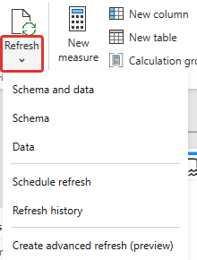

*Afbeelding 7: het menu bij Refresh.*

| Optie | Met de parameter actief |
|---|---|
| **Data** | Werkt (*getest in eigen omgeving*, 10 november 2026). |
| **Schema** | Werkt (*getest in eigen omgeving*, 10 november 2026), mits elke tabel een `sourceLineageTag` heeft; zie *Het schema bijwerken*. |
| **Schema and data** | Idem (het schema is het eerste deel). |

Tijdens een verversing kun je het model niet bekijken of bewerken, en de portal waarschuwt daarvoor.

## Het schema bijwerken

Is er in Gold een tabel of kolom bijgekomen, of wil je tabellen aan het model toevoegen, dan ververs je het schema met **Refresh → Schema** of **Edit tables**. Dat kan met de parameter actief; je hoeft hem niet uit te zetten (*getest in eigen omgeving*, 10 november 2026, op drie modellen, met en zonder parameter).

Faalt het met de melding *Underlying Error: Query Evaluation failed for query: DirectLake - LH_GOLD_LAYER*, controleer dan de tabellen in het model:

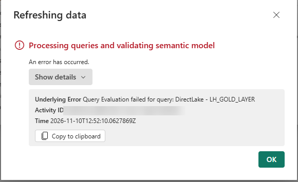

*Afbeelding 8: de melding bij Refresh, Schema. Het Activity ID is afgedekt.*

**Oorzaak: een tabel zonder `sourceLineageTag`** (*getest in eigen omgeving*, 10 november 2026). Met die tag koppelt de editor een tabel aan de tabel in het lakehouse. Een tabel die via een script of de API is aangemaakt, kan hem missen. Het gevolg: Refresh → Schema faalt met bovenstaande melding, ook als de parameter niet in het model staat. In ons referentiemodel was dat de enige afwijking: dezelfde tabel faalde zonder de tag en slaagde na het toevoegen ervan; een data-verversing slaagde in beide gevallen.

Herstel in de TMDL view (**Apply**) of via de definitie: zet de tag direct onder `lineageTag` van de tabel, in de vorm `[schema].[tabel]` van de tabel in het lakehouse:

```
table Sales
	lineageTag: <de bestaande lineageTag>
	sourceLineageTag: [gold].[f_salesorder]
```

Open het model daarna opnieuw in Editing en ververs het schema. Wijzig je het model buiten de editor om terwijl het openstaat, dan meldt de editor *The change you were making failed to apply*; sluit het model dan en open het opnieuw.

Controleer vooraf in de TMDL view (sleep **Tables** naar de editor) of elke tabel de regel `sourceLineageTag` heeft.

*Aanname:* eerdere mislukte schema-verversingen op andere modellen (26 oktober en 9 november 2026) hadden dezelfde oorzaak. Dat is niet nagegaan.

Promoveer ook hier alleen met de parameter actief: staat het letterlijke pad actief tijdens de promotie, dan herkoppelt de parameter rule niet (*getest in eigen omgeving*, 9 november 2026: het model in Test wees naar Gold van Dev).

## Stap 3: promoveren naar Test

1. Open de deployment pipeline van de SEMANTIC-workspace en kies de stage **Test**. Onder de stage staat een lijst met de items van Development en hun status. Een item dat nog niet in Test staat heeft de status *Only in source*.
2. Vink het model aan dat je wilt promoveren. Selecteer alleen dat model; andere items in de lijst blijven ongemoeid.

   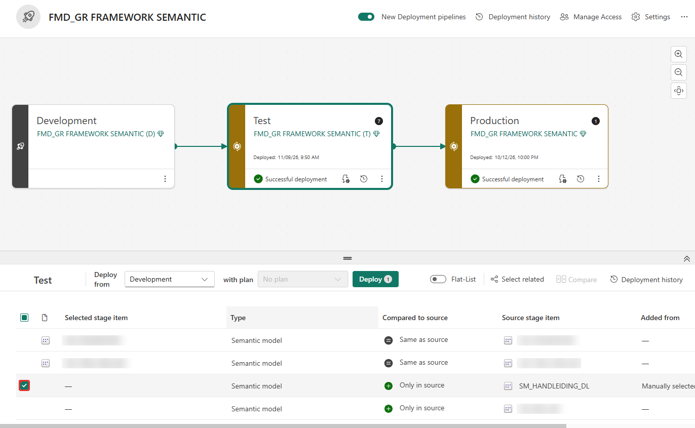

   *Afbeelding 9: het model is aangevinkt (status Only in source). De namen van andere modellen zijn vervaagd.*

3. Kies **Deploy**, vul eventueel een notitie in en bevestig in het venster *Deploy to this stage*. Onder **New (1)** staat het model.

   

   *Afbeelding 10: bevestig de deployment.*

4. Wacht op de melding *Successful deployment* bij de stage Test. Het model staat nu in Test en heeft in de lijst de status *Same as source*.

   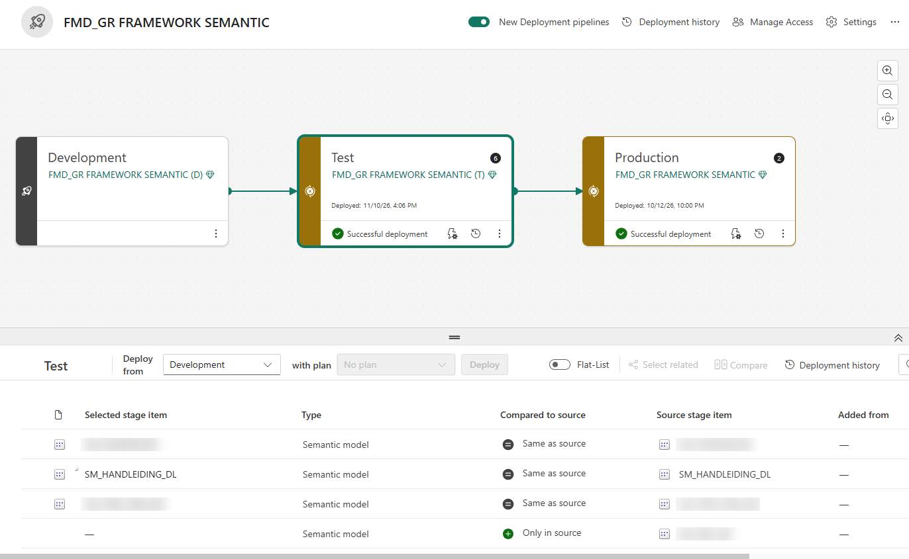

   *Afbeelding 11: de deployment is klaar.*

Een rule kan pas worden gemaakt als het model in Test bestaat. Het model moet dus eerst naar Test. *Getest in eigen omgeving* (10 november 2026, D naar T).

**Wat het model in Test nu doet.** Zonder rule neemt het model in Test de parameterwaarde van Dev mee en leest het dus uit Gold van Dev. Dat is vast te stellen in twee stappen:

- De parameter in Test heeft de waarde van Gold van Dev (*getest in eigen omgeving*, 10 november 2026, via `GET …/datasets/{id}/parameters`).
- De **item lineage** van het model toont dezelfde bron. Kies in de lijst bij het model het menu **…** en daarna **View item lineage**. Het lakehouse `LH_GOLD_LAYER` staat dan in de workspace van **Dev** (*(D)*), terwijl het model zelf in Test staat. Het lineageschema leidt deze bron af uit het pad van het model; dat is een *aanname* over hoe de portal dit bepaalt.

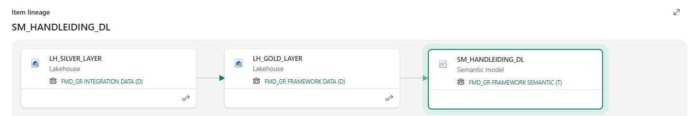

*Afbeelding 12: voor de rule. Het model in Test leest uit het lakehouse in de workspace (D).*

## Stap 4: de parameter rule in Test

Deployment rules werken pas bij de volgende deployment naar die stage (*vastgesteld*, Microsoft Learn).

1. Ga in de deployment pipeline naar de stage **Test** en kies bij de stage de knop **Deployment rules**. In de stage Development kun je geen rules maken. Er verschijnt een lijst met de items in Test; kies het model.

   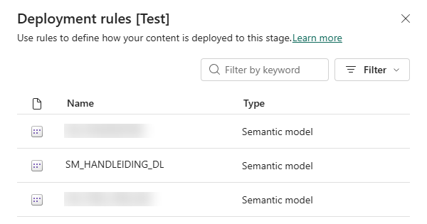

   *Afbeelding 13: kies het model in de lijst. De namen van andere modellen zijn vervaagd.*

2. Het model heeft de secties **Data source rules** en **Parameter rules**. Klap **Parameter rules** uit (niet *Data source rules*). Zonder rules staat er *No rules were added yet*. Kies **Add rule**.

   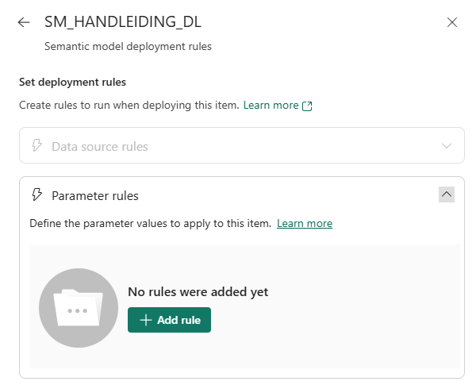

   *Afbeelding 14: de sectie Parameter rules is nog leeg.*

3. Kies bij **From** de parameter `OneLakeUrl`. Open bij **To** de keuzelijst. Daar staat de huidige waarde (het pad van Dev) en de keuze **Other**. Kies **Other** en plak het pad van Gold van Test: `https://onelake.dfs.fabric.microsoft.com/<WorkspaceId Gold Test>/<LakehouseId Gold Test>`. Zo vind je dat pad: zie *Vooraf*.

   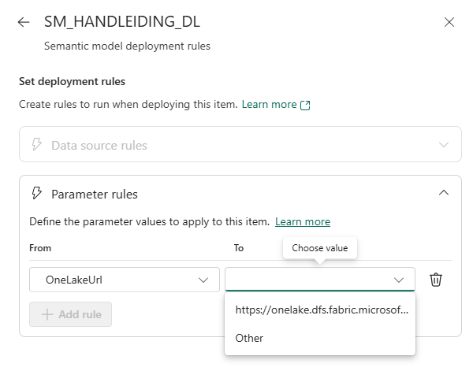

   *Afbeelding 15: kies bij To de keuze Other en vul daarna het pad van Gold van Test in.*

4. Kies **Save**. De rule staat in de lijst en het icoon bij *Parameter rules* toont dat er een rule is.

   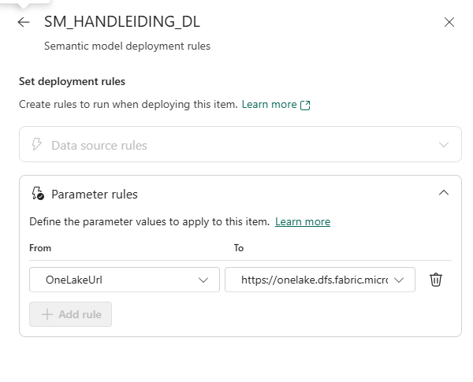

   *Afbeelding 16: de rule is opgeslagen.*

De rule wordt ongeldig als de parameter in het model wordt hernoemd of verwijderd. De deployment faalt dan (*vastgesteld*, Microsoft Learn). Microsoft Learn noemt parameters in een Direct Lake-expressie niet; dat de rule hier werkt, is alleen door onze test bevestigd (*getest in eigen omgeving*, 10 november 2026).

## Stap 5: opnieuw promoveren en controleren

1. Selecteer in de stage **Test** het model. De status is nu *Different from source*, want de rule is nieuw. Kies **Deploy** en bevestig in het venster. Onder **Different (1)** staat het model. De rule werkt bij deze deployment.

   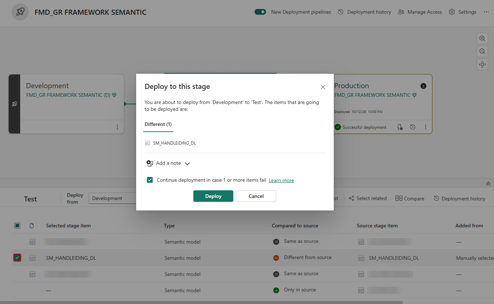

   *Afbeelding 17: deploy het model opnieuw.*

2. Wacht op de melding *Successfully deployed content to 'Test'*.

   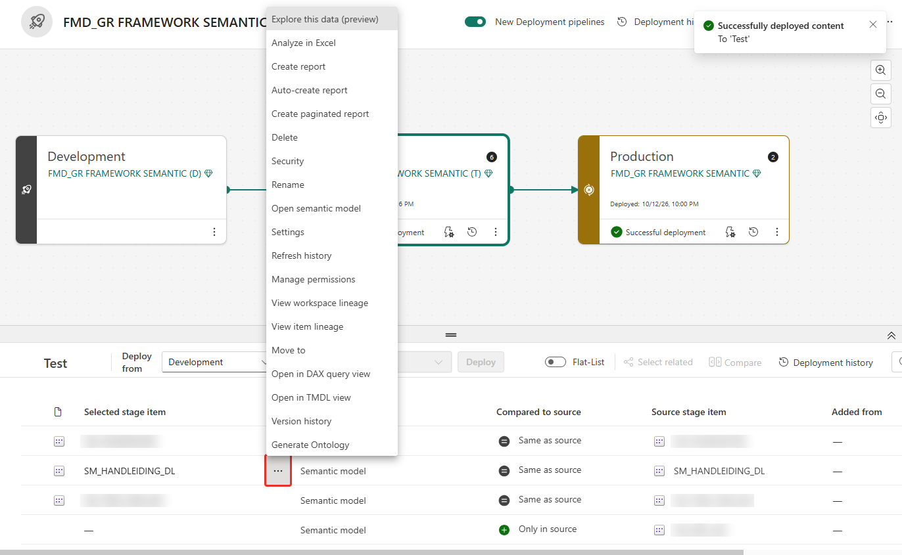

   *Afbeelding 18: de deployment is geslaagd. Het menu bij het model bevat View item lineage.*

3. Controleer dat het model in Test het pad van Gold van Test gebruikt. Bewijs dat met de parameterwaarde:

   ```
   GET https://api.powerbi.com/v1.0/myorg/groups/{ws}/datasets/{id}/parameters
   ```

   Dat gaf op 10 november 2026 het pad van Gold van Test (*getest in eigen omgeving*). Ter illustratie toont **View item lineage** nu het lakehouse in de workspace van **Test**:

   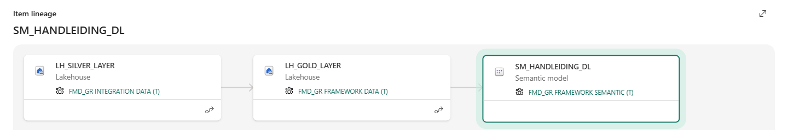

   *Afbeelding 19: na de rule. Het model leest uit het lakehouse in de workspace (T).*

4. Ververs het model in Test (**Refresh → Data**); de verversing moet `Completed` zijn. Op 10 november 2026 slaagde een verversing van het model in Test, ook zonder dat het aan een connectie gekoppeld was (*getest in eigen omgeving*; de verversing liep onder de identiteit van de gebruiker die de aanroep deed).
5. Een DAX-vergelijking bewijst alleen iets als de data in beide omgevingen verschilt. Gebruik de parameterwaarde als bewijs.
6. Promoveer een rapport pas nadat het model in Test staat. Controleer daarna dat het `datasetId` van het rapport het model in Test is.

## Stap 6: een vaste identiteit instellen met een connectie

Een Direct Lake-model op OneLake leest standaard met de identiteit van de gebruiker (*Default: Single Sign-On (Entra ID)*). Wil je dat verversingen en lezers een vaste identiteit gebruiken, bijvoorbeeld een service principal, dan koppel je het model aan een **cloud connectie**. Zonder connectie slaagde de verversing in Test wel (zie stap 5); wat er zonder connectie gebeurt bij een geplande verversing of voor rapportlezers is *niet getest* (*aanname*: dat dit een vaste identiteit vereist).

**Hoe vaak.** Maak de connectie **één keer per omgeving**: een connectie hoort bij één pad, en elke omgeving heeft een eigen lakehouse en dus een eigen pad. De connectie voor Dev wijst naar het lakehouse van Dev en is dus niet bedoeld voor Test. Koppel **elk semantisch model** vervolgens zelf aan de connectie van zijn omgeving. *Vastgesteld* (10 november 2026): na de promotie was het model in Test niet aan een connectie gekoppeld, terwijl het model in Dev het wel was. Een connectie wordt dus niet meegepromoveerd. *Aanname:* bij elk nieuw semantisch model moet je die koppeling opnieuw leggen.

**Voorwaarde.** De service principal heeft minimaal leesrechten op het lakehouse in die omgeving (een rol op de DATA-workspace). Of de tenantinstelling voor service principals aan staat, moet je zelf controleren.

1. Open in de workspace van de omgeving het model, kies **…**, daarna **Settings** en **Gateway and cloud connections**. Onder *Cloud connections* staat de data source van het model (`AzureDataLakeStorage`) met bij **Maps to** de keuze *Default: Single Sign-On (Entra ID)*. Open de keuzelijst en kies **Create a connection**.

   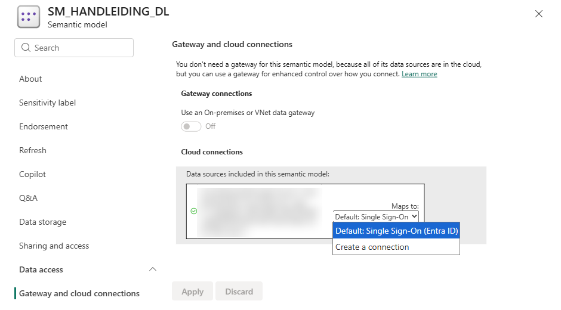

   *Afbeelding 22: kies bij Maps to de optie Create a connection. Het pad van de data source is vervaagd.*

2. Het venster **New connection** opent. Geef de connectie een naam die de omgeving noemt (bijvoorbeeld `CON_<naam>_<omgeving>`). Het connectietype is **Azure Data Lake Storage Gen2**, als server geldt `onelake.dfs.fabric.microsoft.com`, en bij **Full path** staat het pad van het lakehouse van **deze** omgeving: `/<WorkspaceId>/<LakehouseId>`.

   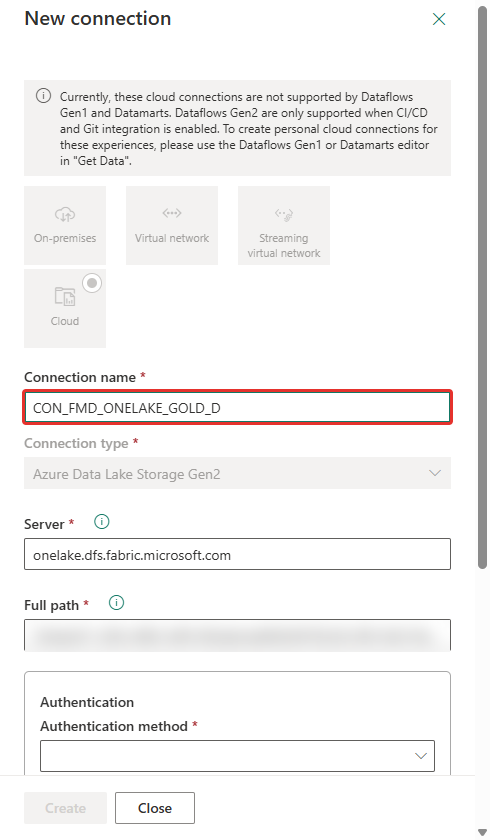

   *Afbeelding 23: naam, type, server en pad. Het pad is vervaagd.*

3. Open bij **Authentication method** de keuzelijst. De opties zijn *Key*, *OAuth 2.0*, *Shared Access Signature (SAS)*, *Service Principal* en *Workspace identity*. Kies **Service Principal**.

   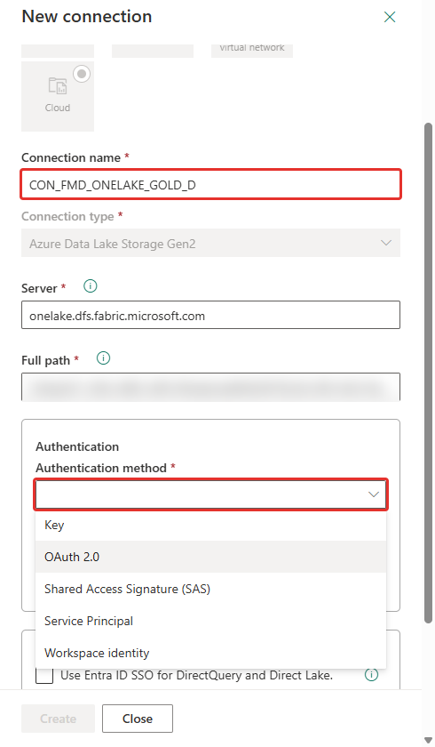

   *Afbeelding 24: kies Service Principal.*

4. Vul de **Tenant ID** en de **Service principal ID** (het client-ID van de app) in. Het **Credential type** is **Service principal key**.

   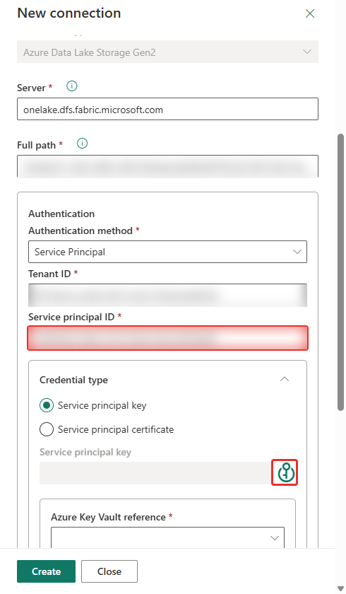

   *Afbeelding 25: tenant-ID, service principal-ID en credential type. De waarden zijn vervaagd.*

5. Geef het client secret op. In onze opname deden we dat via een **Azure Key Vault-verwijzing** (het knopje naast *Service principal key*): kies de Key Vault, vul de naam van het secret in en kies **Apply**. Zo staat het secret zelf niet in het venster. Tik het secret nooit in een veld dat je laat zien in een schermafbeelding. Of het secret ook direct in te vullen is, hebben we niet getest.

   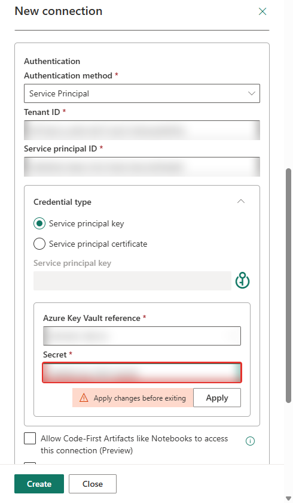

   *Afbeelding 26: de Key Vault-verwijzing. De namen zijn vervaagd.*

6. Het **Privacy level** staat op *Organizational*. Het vakje *Use Entra ID SSO for DirectQuery and Direct Lake* staat uit. Kies **Create**.

   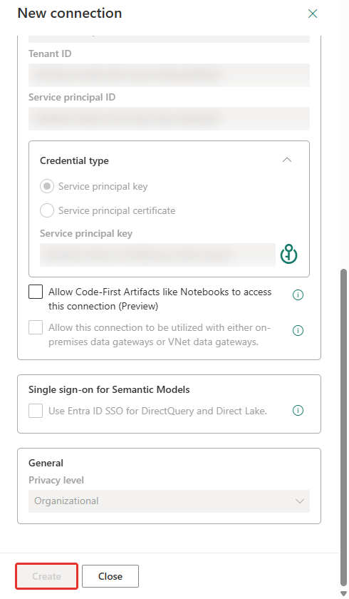

   *Afbeelding 27: controleer de instellingen en kies Create.*

7. Ga terug naar het model. Open bij **Maps to** de keuzelijst, kies de nieuwe connectie en kies **Apply**.

   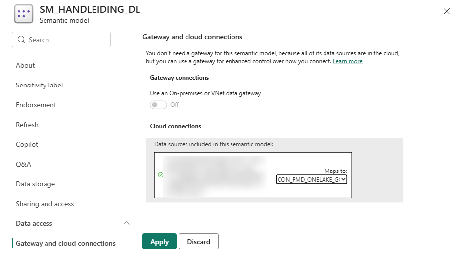

   *Afbeelding 28: kies de connectie en kies Apply.*

8. De melding *gateway connection updated* bevestigt de koppeling.

   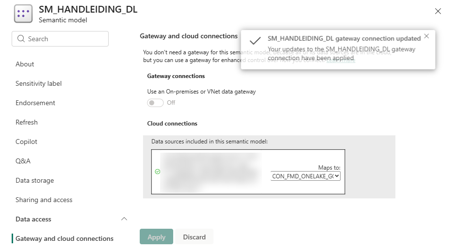

   *Afbeelding 29: de koppeling is toegepast. Dit scherm komt uit Dev; in Test koppel je de connectie van Test.*

Controle (*getest in eigen omgeving*, 10 november 2026): `GET …/datasets/{id}/datasources` toont de data source voor een gekoppeld model met een `gatewayId` en een `datasourceId`, en voor een niet gekoppeld model zonder die twee velden.

## Valkuilen

| Verschijnsel | Oorzaak en oplossing |
|---|---|
| *Direct Lake mode requires a Direct Lake data source … Failed to save modifications* bij een Apply | Het script verwijst naar `OneLakeUrl` zonder dat de parameter in het model of in hetzelfde script staat. Neem de parameter in het script op. Dezelfde melding is eerder bij andere modellen gezien; de oorzaak is daar niet vastgesteld. |
| *Query Evaluation failed for query: DirectLake - LH_GOLD_LAYER* bij **Refresh → Schema** of **Schema and data** | Een tabel mist `sourceLineageTag`. Voeg hem toe (zie *Het schema bijwerken*). De parameter is niet de oorzaak. |
| **Edit tables** faalt met *ConceptualSchemaSettings* | Op 26 oktober 2026 gezien; oorzaak niet vastgesteld. Op 10 november 2026 werkte Edit tables met de parameter actief. Controleer eerst de `sourceLineageTag` van de tabellen. |
| Het model in Test leest uit Dev | Het letterlijke pad was actief tijdens de promotie, of de rule is nog niet van kracht. Controleer de parameterwaarde in Test, zet de parameter aan in Dev en promoveer opnieuw. |
| De deployment faalt na het hernoemen van de parameter | De rule is ongeldig. Maak de rule opnieuw. |
| Parameter rules zijn niet zichtbaar | Het model is nog niet naar die stage gepromoveerd. Promoveer eerst. |
| Een verversing faalt met *We cannot access the source Delta table* | Het SQL-endpoint van het lakehouse kent de nieuwe tabellen nog niet. Ververs de metadata van het endpoint. |
| Het model in Test leest nog uit Dev terwijl de rule bestaat | Het model is na het maken van de rule nog niet opnieuw gedeployed (status *Different from source*). Deploy het model opnieuw. |
| De connectie wijst naar het lakehouse van de verkeerde omgeving | Een connectie hoort bij één pad. Maak per omgeving een eigen connectie en koppel elk model aan de connectie van zijn omgeving. |
| De gekopieerde URL werkt niet als pad | De URL uit *Folder properties* eindigt op `/Tables`. Haal dat deel weg. |
| Een Apply vraagt om een hoger compatibiliteitsniveau | Verhoog het niveau naar 1707. Dat is eenmalig en niet terug te draaien. |

## Nog niet getest of nog niet vastgelegd

- Of een geplande verversing of een rapportlezer zonder connectie werkt, en of die connectie daarvoor nodig is.
- Of de portal een connectie met het pad van een andere omgeving toelaat voor een model.
- Het koppelen van de connectie in Test: de schermafbeeldingen in stap 6 komen uit Dev; de stappen in Test zijn gelijk (*aanname*, het model in Test is nog niet gekoppeld getest).
- Promotie van Test naar Productie met dezelfde rule.
- **Edit tables** met de parameter actief na een promotie.
- Meerdere rapporten op één model.
