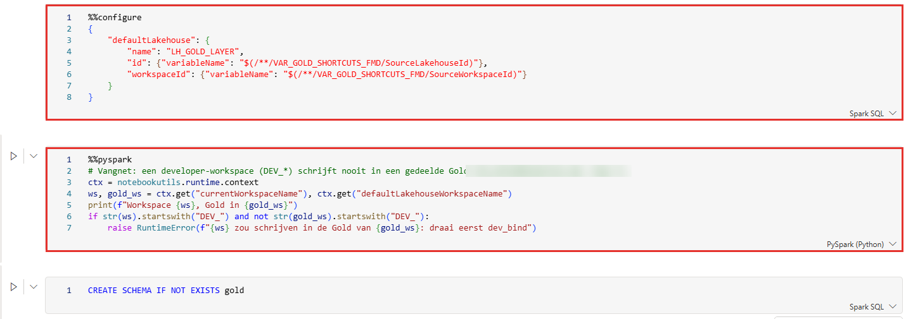
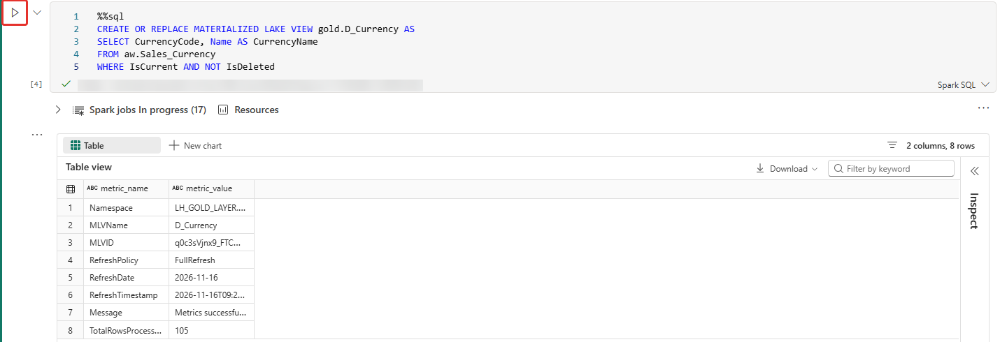
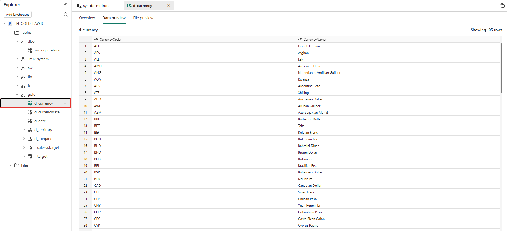
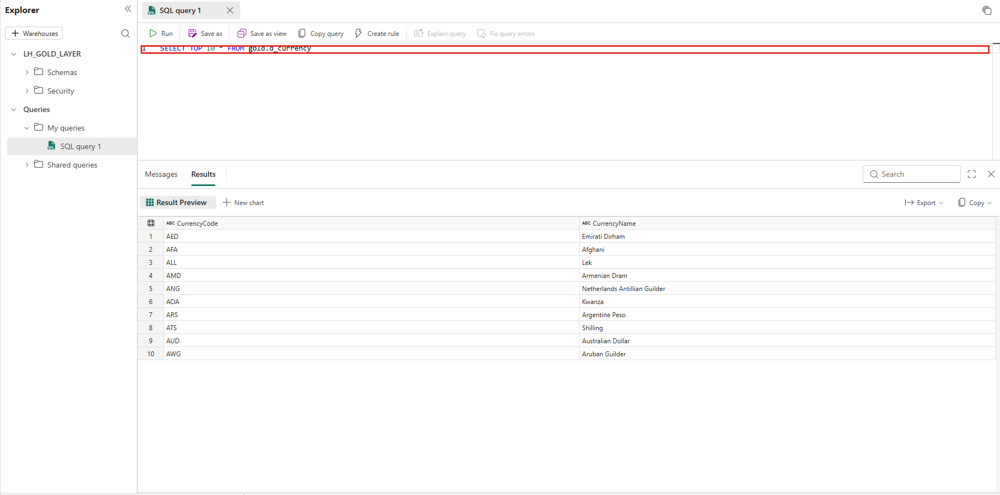
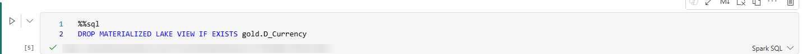

# Een nieuwe Gold-tabel (MLV) maken

De Gold-laag van een business-domein bouw je met de hand, met materialized lake views (MLV's). Een MLV is een tabel die Fabric bijhoudt op basis van een query. Landingzone, Bronze en Silver zijn config-driven; Gold niet. Er staat geen configuratie voor Gold in de configuratiedatabase. Deze handleiding laat zien hoe je een nieuwe Gold-tabel schrijft, draait en controleert, in de CODE-workspace van het domein. Het semantisch model en het rapport komen daarna. De schermafbeeldingen zijn opgenomen in november 2026.

**De volgorde is altijd: Silver → Gold → semantisch model → rapport.** Een stap verder in de keten kan pas als de stap ervoor bestaat en gevuld is, in elke omgeving.

## Voor je begint

- De brontabellen staan in Silver en zijn in Gold zichtbaar via de shortcuts. Een nieuwe bron-namespace vraagt eerst een run van `NB_CREATE_SHORTCUTS` in de CODE-workspace van het domein. In de voorbeelden hieronder staat de Silver-tabel van een bron in het schema `aw`.
- Je werkt in Dev (omgeving D) of in je eigen developer-workspace, nooit eerst in Test of Productie.
- Je mag notebooks maken in de CODE-workspace en de Gold-lakehouse in de DATA-workspace lezen.

## Stap 1: het notebook

Schrijf de MLV in het notebook `NB_MLV_EXAMPLE` van het domein, of in een eigen MLV-notebook in dezelfde CODE-workspace. Een eigen notebook maak je het eenvoudigst als kopie van een bestaand MLV-notebook, zodat de eerste cellen meekomen.

De eerste twee codecellen moeten blijven staan, in deze volgorde:

1. **`%%configure`** zet de standaard-lakehouse van het notebook op de Gold van deze omgeving. Daardoor schrijft het notebook in elke omgeving in de eigen Gold. Deze cel werkt alleen als eerste cel van een sessie.
2. **Het vangnet** stopt het notebook als een developer-workspace per ongeluk nog aan de gedeelde Gold hangt. In een gewone omgeving doet de cel niets, behalve melden in welke workspace en lakehouse het notebook draait.

Daarna volgt een cel die het schema `gold` aanmaakt als het nog niet bestaat. Elke MLV zet je in dat schema.



## Stap 2: de MLV schrijven

Voeg onder de cel met het schema een codecel toe. Begin de cel met `%%sql` en schrijf de MLV:

```sql
%%sql
CREATE OR REPLACE MATERIALIZED LAKE VIEW gold.D_Currency AS
SELECT CurrencyCode, Name AS CurrencyName
FROM aw.Sales_Currency
WHERE IsCurrent AND NOT IsDeleted
```

- **Filter op de huidige stand.** `IsCurrent` bestaat in Silver ook zonder historie. `IsDeleted` markeert rijen die in de bron zijn verwijderd. Wil je die ook zien, laat dat deel van het filter dan weg.
- **Naam.** De afspraak is `gold.D_<Naam>` voor een dimensie en `gold.F_<Naam>` voor een feitentabel. Dit is een conventie en wordt niet afgedwongen. Fabric slaat de naam op in kleine letters (`gold.d_currency`). Verwijs in SQL naar de kleine letters; de naam met hoofdletters gebruik je in het semantisch model.
- **Meerdere MLV's** zet je in aparte cellen, in de volgorde van hun afhankelijkheid: eerst de MLV die een andere nodig heeft.

## Stap 3: de MLV draaien

Voer **alleen deze cel** uit met **Run cell**. Voer niet het hele notebook uit als de refresh-cel onderaan staat: die ververst alle MLV's van de Gold-lakehouse.

De eerste keer start de sessie, wat even duurt. Daarna toont de cel de uitkomst van het aanmaken, met onder meer de naam van de MLV, het ververs-beleid en het aantal verwerkte rijen. Bij een nieuwe MLV is dat een volledige verversing van alle rijen van de bron, in het voorbeeld 105.



## Stap 4: controleren in de lakehouse

Open de Gold-lakehouse in de DATA-workspace van het domein (het type *Lakehouse*, niet het SQL-endpoint). Staat de nieuwe tabel er niet, ververs dan de lijst: kies bij **Tables** de drie puntjes en dan **Refresh**.

Onder **Tables → gold** staat de tabel in kleine letters. Open haar en kies **Data preview**: je ziet de kolommen en het aantal rijen.



Controleer dat het aantal rijen klopt met de bron. Voor een dimensie is dat het aantal actuele rijen in Silver.

## Stap 5: controleren in het SQL-endpoint

Het semantisch model en rapportlezers lezen via het SQL-endpoint. Open het SQL-endpoint van de lakehouse en maak een **New SQL query**:

```sql
SELECT TOP 10 * FROM gold.d_currency
```

De query geeft de eerste tien rijen. Een MLV die je net hebt aangemaakt of verwijderd, kan in het SQL-endpoint even achterlopen. Een verwijderde MLV staat daar dan nog een tijd in de lijst, en een nieuwe MLV kan *Invalid object name* geven tot het endpoint is bijgewerkt. Wacht even en probeer opnieuw voordat je iets aanpast.



## Stap 6: de MLV laten meedraaien in de keten

Een MLV die je in een notebook hebt aangemaakt, wordt niet vanzelf ververst als de bron verandert. De verversing van een MLV is een aparte handeling.

- **De Gold-pipeline.** `PL_FMD_LOAD_GOLD` draait eerst `NB_LOAD_GOLD` en, als dat slaagt, `NB_MLV_EXAMPLE`. Die laatste bevat onderaan een cel die de verversing van alle MLV's van de Gold-lakehouse start en wacht tot ze klaar is. De pipeline hangt aan de orchestratie van de load, dus Gold wordt na elke geplande load ververst.
- **Een eigen notebook** voeg je als notebook-activiteit toe aan `PL_FMD_LOAD_GOLD` in Dev, na de activiteit die al staat. Promoveer het notebook samen met de pipeline: een notebook dat nog niet in de doelstage staat, laat de promotie falen met *Missing Dependencies*.
- **Hernoem `PL_FMD_LOAD_GOLD` niet.** De setup koppelt de pipeline van elk domein op naam aan de orchestratie. Een hernoemde pipeline valt uit de keten.

Wil je alle MLV's met de hand verversen, bijvoorbeeld na een wijziging, draai dan de pipeline met de hand of voer de refresh-cel van `NB_MLV_EXAMPLE` uit. In de lakehouse staat ook een tabblad **Materialized lake views**; naar verwachting zie je daar de MLV's met hun afhankelijkheden en kun je ze met de hand verversen.

## Een MLV verwijderen

Verwijder een MLV met een eigen cel.

```sql
%%sql
DROP MATERIALIZED LAKE VIEW IF EXISTS gold.D_Currency
```

De cel is klaar in een paar seconden. Daarna verdwijnt de tabel uit de lakehouse.



Hangt een andere MLV, een semantisch model of een rapport van de tabel af, verwijder die dan eerst of pas ze aan. Verwijder een MLV niet in Test of Productie zonder dat de wijziging eerst in Dev is getest en gepromoveerd.

## Een MLV in PySpark

Een MLV kun je ook in PySpark schrijven, met de decorator `@fmlv.materialized_lake_view`. Het verschil doet ertoe bij de verversing: een PySpark-MLV wordt bij elke verversing opnieuw uitgevoerd vanuit het notebook waarin hij is gemaakt, in een sessie zonder `notebookutils` en zonder gemounte standaard-lakehouse.

- Zet de naam **letterlijk** in de decorator, bijvoorbeeld `@fmlv.materialized_lake_view(name="gold.d_klant")`. Met een variabele als naam vindt de verversing de cel niet.
- Bewaak elke andere cel die `notebookutils` of een bijwerking nodig heeft, bijvoorbeeld met `if "notebookutils" in globals():`. Het vangnet en de refresh-cel van het sjabloon doen dat niet.
- Het eenvoudigst is een PySpark-MLV in een eigen notebook, zonder vangnet, zonder refresh-cel en zonder invoerstappen. Maak de MLV daarna één keer opnieuw aan vanuit dat notebook.

## Valkuilen

| Verschijnsel | Oorzaak en oplossing |
|---|---|
| De tabel staat niet in de lakehouse na het draaien | De lijst is niet ververst. Kies bij **Tables** de drie puntjes en dan **Refresh**. |
| *Invalid object name* in het SQL-endpoint | Het endpoint loopt achter op de lakehouse. Wacht even en probeer opnieuw. |
| De MLV heeft oude data na een wijziging in Silver | Een MLV ververst niet vanzelf. Draai de pipeline `PL_FMD_LOAD_GOLD` of de refresh-cel. |
| Het notebook meldt een fout bij de eerste cellen | De `%%configure`-cel moet de eerste codecel van het notebook zijn. Zet geen andere cel ervoor. |
| De MLV staat in Gold van een andere omgeving | Het notebook is niet aan de Gold van deze omgeving gebonden. Controleer de `%%configure`-cel en de Variable Library van de Gold. |
| De promotie van de pipeline faalt met *Missing Dependencies* | Een notebook in de pipeline staat nog niet in de doelstage. Promoveer het notebook eerst, of in dezelfde deployment. |
| Een nieuwe bron-namespace is in Gold niet zichtbaar | Draai `NB_CREATE_SHORTCUTS` in de CODE-workspace van het domein. |
