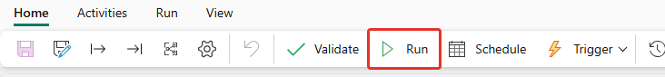
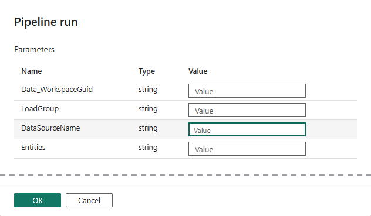
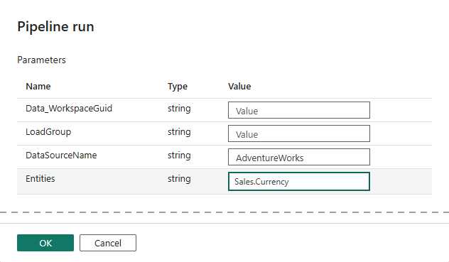
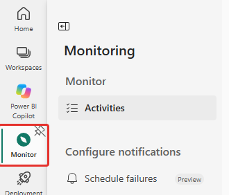
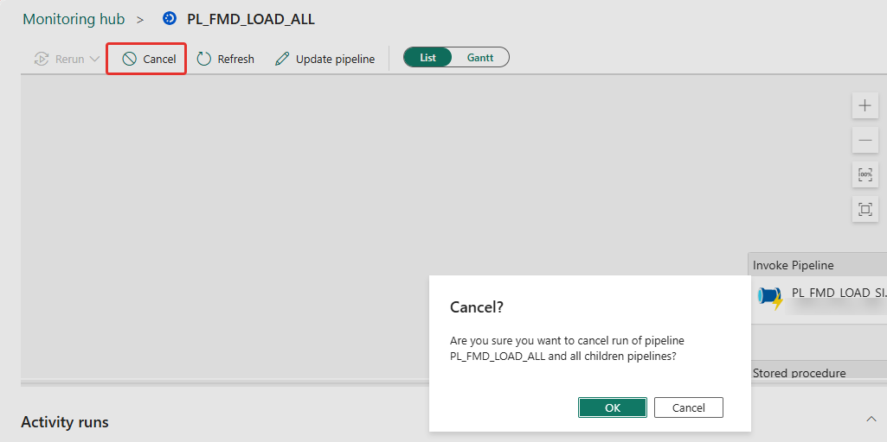

# Een tabel of bron handmatig laden

Deze handleiding beschrijft hoe je met de hand één tabel of één bron laadt, zonder te wachten op het schedule. Je start daarvoor `PL_FMD_LOAD_ALL` met de parameters `DataSourceName` en `Entities`, en volgt de run in de Monitor.

De schermafbeeldingen komen uit een referentie-installatie van november 2026. In jouw omgeving kunnen knoppen of schermen iets anders uitzien, bijvoorbeeld als Microsoft de Monitor vernieuwt.

## Wanneer gebruik je dit

- Eén tabel opnieuw laden, bijvoorbeeld na een gecorrigeerde registratie of een herstelde bron.
- Eén bron testen na een wijziging.
- Een tabel laden die niet in de nachtelijke run zit of die daar is mislukt.

Voor een geplande load gebruik je het schedule, niet deze handleiding (zie [Dagelijkse routine en schedules](dagelijkse-routine.md)).

## Hoe het filter werkt

`PL_FMD_LOAD_ALL`, `PL_FMD_LOAD_LANDINGZONE`, `PL_FMD_LOAD_BRONZE` en `PL_FMD_LOAD_SILVER` hebben deze parameters, alle standaard leeg:

| Parameter | Betekenis |
|---|---|
| `Data_WorkspaceGuid` | De DATA-workspace om in te laden. Leeg laten: de pipeline neemt de waarde van de omgeving uit de variabelebibliotheek `VAR_CONFIG_FMD`. |
| `LoadGroup` | Beperkt de run tot één laadgroep. Leeg is alle groepen. |
| `DataSourceName` | De exacte naam van één bron (`integration.DataSource.Name`). Leeg is geen filter. |
| `Entities` | Een komma-gescheiden lijst. Een item komt overeen met de `SourceName` van de tabel, of met `SourceSchema.SourceName`. Spaties rond een item tellen niet mee. Leeg is geen filter. |

- Zijn meerdere parameters gevuld, dan moeten ze alle kloppen (EN).
- De naam is de naam in de **bron**, ook voor Bronze en Silver. Het is niet de naam van de Bronze- of Silver-tabel.
- Bronze en Silver verwerken alleen wat al in de wachtrij staat. Een run met een filter laadt de tabel dus alleen opnieuw als je `PL_FMD_LOAD_ALL` start; `PL_FMD_LOAD_BRONZE` of `_SILVER` los verwerken alleen de onverwerkte bestanden.
- Een run met een filter laat de wachtrijrijen van andere tabellen met rust. Ze blijven staan tot een run zonder dat filter.

## Voor je begint

**1. Kies de omgeving.** Je start de pipeline in de CODE-workspace van de omgeving waarin je wilt laden. Dat is de workspace `<prefix> INTEGRATION CODE`, met het achtervoegsel van de omgeving:

| Omgeving | Workspace |
|---|---|
| Dev | `<prefix> INTEGRATION CODE (D)` |
| Test | `<prefix> INTEGRATION CODE (T)` |
| Productie | `<prefix> INTEGRATION CODE` (zonder achtervoegsel) |

Een eventuele extra omgeving, zoals Acceptatie, werkt hetzelfde. Laat je `Data_WorkspaceGuid` leeg, dan laadt de pipeline de DATA-workspace van diezelfde omgeving.

**2. Bepaal de twee waarden.** Zoek ze op in de configuratiedatabase:

```sql
SELECT ds.[Name] AS DataSourceName, le.[SourceSchema], le.[SourceName], le.[IsActive]
FROM   [integration].[LandingzoneEntity] le
JOIN   [integration].[DataSource] ds ON ds.[DataSourceId] = le.[DataSourceId]
WHERE  le.[IsActive] = 1
ORDER BY ds.[Name], le.[SourceSchema], le.[SourceName];
```

De kolommen zijn gecontroleerd met een `SELECT` op de configuratiedatabase van de referentie-installatie). Dezelfde tabel komt meerdere keren voor, eenmaal per omgeving. Kunnen meerdere bronnen dezelfde tabelnaam hebben, combineer dan `DataSourceName` en `Entities`.

**3. Controleer dat er geen geplande run loopt** in dezelfde omgeving, en dat de wekelijkse maintenance niet draait. Een gelijktijdige schrijfactie op dezelfde tabellen kan mogelijk falen.

## Stappen

1. Open **Workspaces** en kies de workspace van de omgeving (zie de tabel hierboven). Open het item `PL_FMD_LOAD_ALL`. Staat het niet direct in de lijst, open dan eerst de map **DataPipelines**.

2. Kies in het tabblad **Home** de knop **Run**.

   

   *Afbeelding 1: de knop Run in het tabblad Home.*

3. Er opent een paneel **Pipeline run** met vier parameters, alle vier standaard leeg.

   

   *Afbeelding 2: het paneel Pipeline run, met de parameters `Data_WorkspaceGuid`, `LoadGroup`, `DataSourceName` en `Entities`. De gestippelde lijn geeft aan dat een leeg stuk van het paneel is weggelaten.*

4. Vul `DataSourceName` en `Entities` in. Laat `Data_WorkspaceGuid` en `LoadGroup` leeg.

   

   *Afbeelding 3: voorbeeld met de demobron van de referentie-installatie (`AdventureWorks`, `Sales.Currency`). Vul je eigen bron en tabel in.*

5. Kies **OK**. Dit **start de run direct**. Er verschijnt een melding *Starting … PL_FMD_LOAD_ALL*. Kies je **Cancel**, dan start er niets.

6. Volg de run in de Monitor. Kies links **Monitor** en daarna **Activities**. Zoek `PL_FMD_LOAD_ALL` (het filterveld *Filter by keyword* helpt) en open de run met de laatste starttijd. Rechts staan de details van de run (starttijd, status, parameters) en onderaan de lijst met activiteiten.

   

   *Afbeelding 4: de Monitor in de linkernavigatie. Onder Configure notifications staat Schedule failures (preview).*

7. Wacht tot de status **Succeeded** of **Completed** is, of tot de run faalt. Je bent dan nog niet klaar met controleren:
    - `PL_FMD_LOAD_ALL` ketent de lagen op **Completed**, niet op **Succeeded**. Bronze draait dus ook als Landingzone faalde, en Silver ook als Bronze faalde. Dat isoleert fouten per tabel. Een groene run bewijst daarom niet dat elke tabel is geladen. Draai de query onder *Controleren* hieronder.
    - Een grote tabel kan lang duren. Zie *Time-outs* hieronder.

## Controleren

Deze query toont de falende entiteiten van de laatste dag, uit de logging in de configuratiedatabase:

```sql
SELECT [LogDateTime], [EntityLayer], [EntityId], [NotebookName] AS [Onderdeel], [LogData]
FROM   [logging].[NotebookExecution]
WHERE  [LogDateTime] >= DATEADD(DAY, -1, SYSUTCDATETIME())
  AND  [LogData] LIKE '%"Error"%'
UNION ALL
SELECT [LogDateTime], [EntityLayer], [EntityId], [CopyActivityName], [LogData]
FROM   [logging].[CopyActivityExecution]
WHERE  [LogDateTime] >= DATEADD(DAY, -1, SYSUTCDATETIME())
  AND  [LogType] = 'FailedCopyActivity'
ORDER BY [LogDateTime] DESC;
```

Een fout in `NB_FMD_LOAD_LANDING_BRONZE` staat per entiteit in `NotebookExecution` met `"Action": "Error"` in `LogData`, niet met een `Fail`-type. Filter je alleen op `Fail*`, dan mis je notebookfouten per entiteit.

Per laag en tabel zie je de duur, de status en het aantal rijen in `logging.vw_ExecutionSummary`:

```sql
SELECT EntityLayer, EntitySchema, EntityName, Status, DurationSeconds,
       RowsRead, RowsWritten, RowsInserted, RowsUpdated, RowsDeleted
FROM   logging.vw_ExecutionSummary
WHERE  StartTime >= DATEADD(DAY, -1, SYSUTCDATETIME())
ORDER  BY DurationSeconds DESC;
```

## Time-outs

De framework-pipelines hebben vaste time-outs). De belangrijkste:

| Waar | Time-out |
|---|---|
| `PL_FMD_LOAD_ALL` per laag (Landingzone, Bronze, Silver) | 1 uur |
| `PL_FMD_LDZ_COMMAND_*` en `PL_FMD_LDZ_COPY_FROM_*` | 1 uur |
| Notebook-cel in `NB_FMD_PROCESSING_PARALLEL_MAIN` | 10 minuten |

Een eerste full load of één grote merge kan hier tegenaan lopen. De melding is dan een time-out, geen inhoudelijke fout. Laad een grote bron de eerste keer apart, met `DataSourceName` en `Entities`. Een installatie kan deze waarden hebben aangepast; controleer ze in de pipelines van de eigen omgeving.

## Een run annuleren

Heb je de verkeerde waarden gekozen, kies dan in de Monitor de run en kies bovenin **Cancel**. Bevestig met **OK**. De dialoog meldt dat de run en alle onderliggende pipelines worden geannuleerd.



*Afbeelding 5: een run annuleren. In de dialoog kies je OK.*

- In een proef werd de run 28 seconden na de start geannuleerd. Er stond toen alleen de eerste activiteit (`SP_START_AUDIT_PIPELINE`) in de wachtrij van de activiteitenlijst onder het diagram, en er was niets geladen.
- Annuleer je later in de run, dan kunnen bestanden in de landingzone al zijn geschreven. Ze staan dan in de wachtrij met `IsProcessed = 0` en worden bij de volgende Bronze-run opgepakt (dit is niet getest met een geannuleerde run).
- De pipeline is daarna niet kapot. Je kunt hem gewoon opnieuw starten.

## Veelgemaakte fouten

| Symptoom | Oorzaak en oplossing |
|---|---|
| De run eindigt groen en er is niets geladen | De waarden komen niet overeen met een actieve entiteit (typfout, andere naam, entiteit staat uit). Controleer met de query bij *Voor je begint*. Het gedrag bij een niet-bestaande naam is niet apart getest. |
| De gewenste tabel is niet verwerkt in Bronze of Silver | Een eerder mislukt bestand van dezelfde tabel houdt de latere bestanden tegen: Bronze verwerkt de bestanden van een tabel op volgorde. Herstel de oorzaak, of sla het bestand bewust over, en start opnieuw. |
| Je hebt de verkeerde omgeving geladen | De pipeline in de workspace van die omgeving laadt de DATA-workspace van die omgeving. Annuleer de run en start hem in de juiste workspace. |
| De run duurt veel langer dan verwacht | Drukte op de capaciteit, of een eerste full load van een grote tabel. Zie *Time-outs*. |

## Nog niet getest

- Het gedrag bij een niet-bestaande `DataSourceName` of `Entities`.
- Een gelijktijdige handmatige en geplande run op dezelfde tabellen.
- Een run die laat in de keten wordt geannuleerd.
