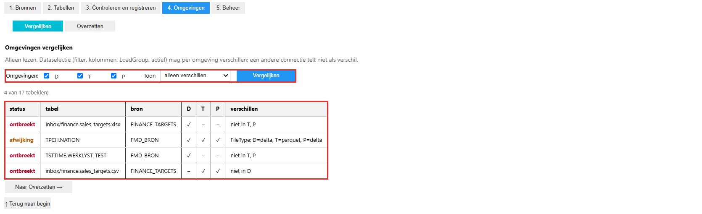
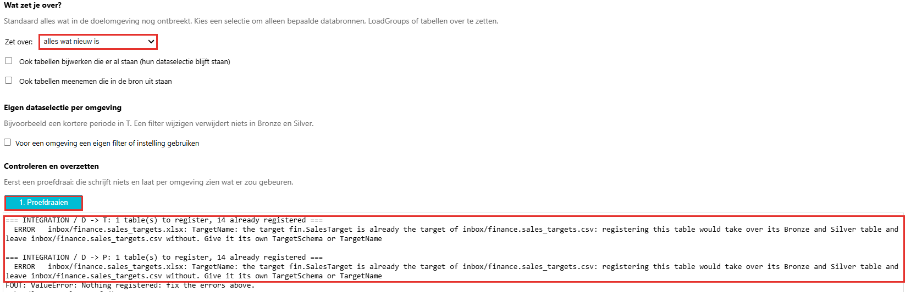
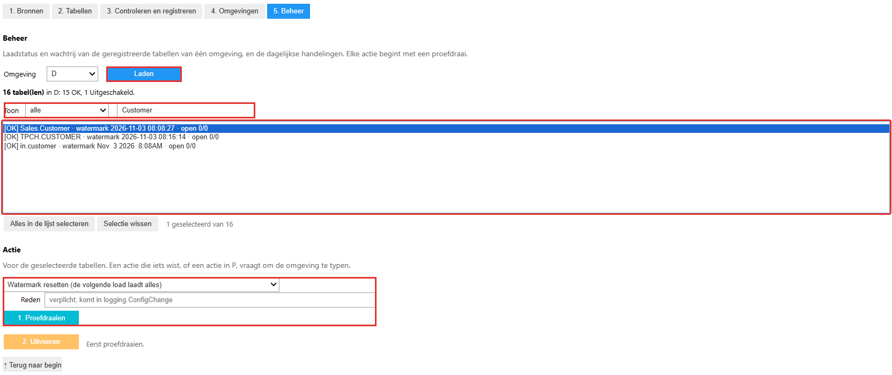
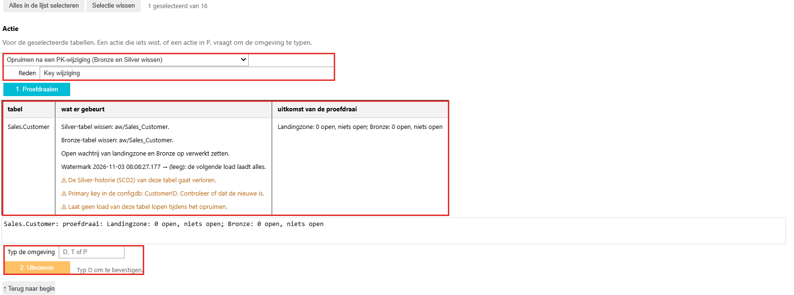
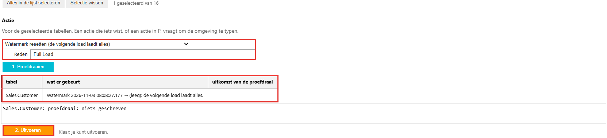

# Registratie overzetten en beheren

Een promotie neemt geen registraties mee. Wat je in Dev hebt geregistreerd, moet je dus ook in Test en Productie registreren, vóór je de DATA-workspace van een domein promoveert. Dat doe je op tab 4 van de registratie-editor. Tab 5 is voor het dagelijks beheer: de laadstatus bekijken, een watermark resetten, de wachtrij opruimen en een tabel opruimen na een wijziging van de primary key. Hoe je de editor opent en een bron registreert, staat in [Bronnen en tabellen registreren](registreren.md). De schermafbeeldingen zijn opgenomen in november 2026.

**Elke actie begint met een proefdraai.** Een proefdraai schrijft en wist niets: hij toont per omgeving of tabel wat er zou gebeuren. Pas daarna wordt de knop voor het echte werk actief.

## Omgevingen vergelijken (tab 4)

1. Ga naar tab **4. Omgevingen** en kies de weergave **Vergelijken**. Dit is alleen lezen.
2. Vink de omgevingen aan die je wilt vergelijken (D, T en P), kies bij **Toon** wat je wilt zien (*alleen verschillen*, *alles*, *ontbreekt*, *afwijking* of *dataselectie*) en klik op **Vergelijken**. *Dataselectie* toont de tabellen die alleen verschillen in filter, kolommen, LoadGroup of actief; dat mag per omgeving.
3. De tabel toont per tabel in welke omgeving ze staat. De status is *ontbreekt* (de tabel staat niet in elke omgeving, met in de laatste kolom waar ze ontbreekt) of *afwijking* (de tabel staat overal, maar een instelling verschilt, bijvoorbeeld `FileType`).

Alleen de dataselectie mag per omgeving verschillen: het bronfilter, de kolommen, de LoadGroup en of de tabel actief is. Een andere connectie telt niet als verschil.

**Naar Overzetten →** onder de tabel vult de omgevingen voor je in en start niets.

## Registratie overzetten (tab 4)

1. Kies de weergave **Overzetten**. Kies bij **Zet over** wat je overzet:
   - *alles wat nieuw is*: alle tabellen die in de doelomgeving nog ontbreken;
   - *alleen een selectie*: kies zelf databronnen, LoadGroups of tabellen.
2. Vink de doelomgevingen aan. De bronomgeving is niet te kiezen als doel.
3. Twee keuzes bepalen hoever het overzetten gaat:
   - **Ook tabellen bijwerken die er al staan** trekt bestaande tabellen gelijk met de bron. Hun dataselectie blijft in elke omgeving zoals ze is.
   - **Ook tabellen meenemen die in de bron uit staan** neemt ook uitgezette tabellen mee.
4. Wil een omgeving een andere dataselectie dan Dev, bijvoorbeeld in Test alleen een korte periode? Vink dan **Voor een omgeving een eigen filter of instelling gebruiken** aan en vul de waarden per omgeving in.
5. Klik op **1. Proefdraaien**. De uitkomst staat per omgeving onder de knop.
6. Is de uitkomst goed, vink dan de bevestiging aan en kies de knop voor het echte overzetten.

Een watermark wordt nooit meegenomen. Een nieuwe incrementele tabel in de doelomgeving laadt bij de eerste load dus alles, tenzij je bij het registreren een aantal dagen (*HistoryDays*) hebt opgegeven.

**Een fout stopt alles.** Heeft één omgeving een fout, dan wordt in geen enkele omgeving iets geschreven. De proefdraai hierboven meldt dat de nieuwe tabel hetzelfde doel (`TargetSchema` en `TargetName`) heeft als een tabel die al in het doel staat. Overzetten zou dan de Bronze- en Silver-tabel van die bestaande tabel overnemen. Geef de nieuwe tabel een eigen `TargetSchema` of `TargetName` en draai de proefdraai opnieuw.

## De laadstatus bekijken (tab 5)

1. Ga naar tab **5. Beheer**, kies de omgeving en klik op **Laden**. Dit leest uit de configuratiedatabase en schrijft niets.
2. De lijst toont per geregistreerde tabel de status (`OK` of uitgeschakeld), het watermark en het aantal open regels in de wachtrij van Landingzone en Bronze (`open 0/0`).
3. Zoek een tabel met het zoekveld, filter met **Toon**, en selecteer de tabellen waarop je een actie wilt doen. Onder de lijst staat hoeveel tabellen zijn geselecteerd.

## Acties

Onder **Actie** kies je wat je met de geselecteerde tabellen doet:

| Actie | Wat ze doet |
|---|---|
| **Watermark resetten (de volgende load laadt alles)** | Maakt het watermark leeg, zodat de volgende load de hele tabel ophaalt. De registratie blijft staan. |
| **Open wachtrij op verwerkt zetten** | Zet de open regels van de tabel in de wachtrij op verwerkt, in de gekozen laag (Landingzone, Bronze of allebei). Er wordt niets geladen. Gebruik dit om een bestand bewust over te slaan. |
| **Opruimen na een PK-wijziging (Bronze en Silver wissen)** | Wist de Bronze- en Silver-tabel, zet de open wachtrij op verwerkt en maakt het watermark leeg. De volgende load bouwt de tabel opnieuw op. |

Bij elke actie vul je een **Reden** in. Die is verplicht en wordt vastgelegd in het logboek van de configuratiedatabase.

### Een tabel opruimen

Kies de actie, vul de reden in en klik op **1. Proefdraaien**. De proefdraai toont per tabel wat er gebeurt en welke waarschuwingen er zijn, bijvoorbeeld dat de Silver-historie van de tabel verloren gaat, dat je de primary key in de configuratiedatabase moet controleren en dat er tijdens het opruimen geen load van deze tabel mag lopen. Een actie die iets wist, of een actie in P, vraagt daarna om de omgeving te typen (hier *D*). Pas dan wordt **2. Uitvoeren** actief.

### Een watermark resetten

Kies **Watermark resetten**, vul de reden in en klik op **1. Proefdraaien**. De uitkomst toont het huidige watermark en dat het leeg wordt. Meldt de proefdraai dat er niets is geschreven, dan wordt **2. Uitvoeren** actief. Klik pas op **2. Uitvoeren** als je de volgende load met alle rijen wilt.

Verwijder de watermark-rij nooit met de hand: zonder die rij komt de tabel na de volgende landing niet meer in Bronze. Bij een incrementele tabel verwijdert een volledige herlading geen rijen die in de bron zijn verwijderd; die blijven in Bronze staan. Start na het resetten de tabel met de hand, zie [Een tabel of bron handmatig laden](handmatig-laden.md).

## Valkuilen

| Verschijnsel | Oorzaak en oplossing |
|---|---|
| De proefdraai meldt een fout over een bestaand doel | Een nieuwe tabel heeft hetzelfde doel als een bestaande tabel. Geef haar een eigen `TargetSchema` of `TargetName`. |
| De proefdraai meldt *Nothing registered* | Een omgeving heeft een fout, dus is er nergens iets geschreven. Los de fout op en draai opnieuw. |
| **Uitvoeren** blijft uitgeschakeld | Je hebt nog geen proefdraai gedaan, of je hebt de selectie of de reden daarna gewijzigd. Draai de proefdraai opnieuw. |
| Na een watermark-reset laadt de tabel niet vanzelf alles | De volgende load laadt alles. Start de tabel met de hand of wacht op het volgende schedule. |
| Je wilt een tabel in P opruimen | Een actie in P vraagt om de omgeving te typen. Doe dit pas na akkoord, en laat tijdens het opruimen geen load van de tabel lopen. |
