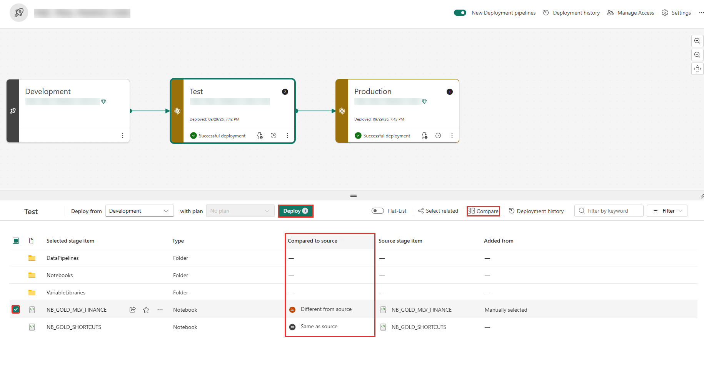
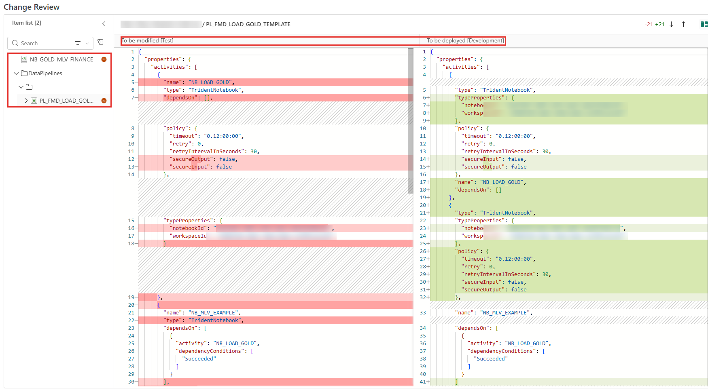
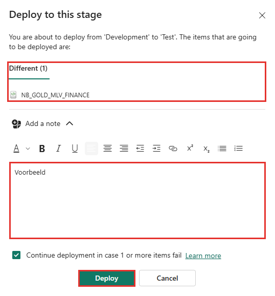
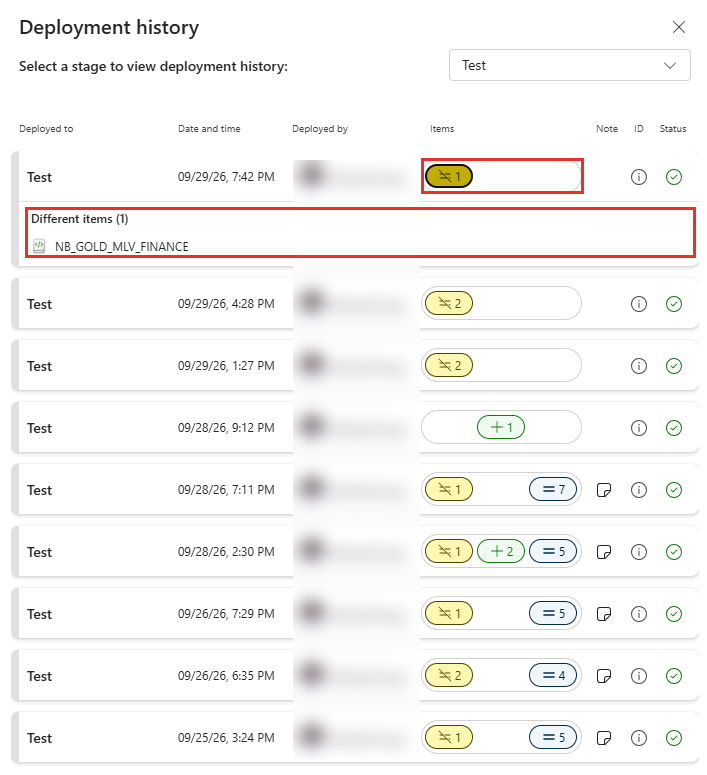
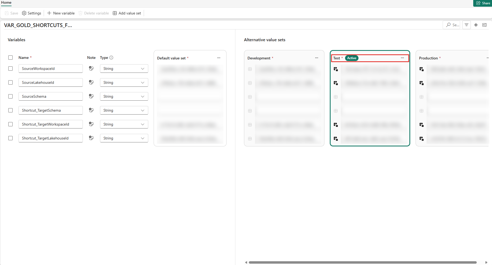

# Promoveren van Dev naar Test en Productie

Een promotie zet de inhoud van een workspace in Dev via een **deployment pipeline** door naar Test, en daarna van Test naar Productie. Test en Productie hangen niet aan git: ze krijgen hun inhoud alleen via een promotie. Deze handleiding beschrijft de volgorde van een promotie, hoe je haar in de portal uitvoert en wat je daarna controleert. Doorloop haar voor Dev naar Test, en na akkoord van de klant opnieuw voor Test naar Productie. De schermafbeeldingen zijn opgenomen in november 2026.

## Wat een promotie wel en niet doet

| Gaat mee met de promotie | Gaat **niet** mee |
|---|---|
| De definities van pipelines, notebooks, lakehouses, Variable Libraries, semantische modellen en rapporten | Data in tabellen en bestanden |
| Shortcuts in Gold (omgezet naar Silver van het doel) | Registraties in de configuratiedatabase (per DATA-workspace) |
| De default lakehouse van een notebook (omgezet naar het doel) | De configuratiedatabase zelf en de schedule-pipelines (de CONFIG-workspace zit in geen deployment pipeline) |
| Verwijzingen naar items in andere workspaces (omgezet naar de tegenhanger in het doel) | De actieve value set van een Variable Library (blijft die van het doel) |
| De standaardwaarden van een Variable Library | De koppeling van een Direct Lake-model aan Gold (alleen met een deployment rule) |

Een promotie kopieert de **actuele** toestand van de bronstage: promoveer alleen wat in de bronomgeving is gecontroleerd. Er is geen rollback naar een eerdere versie. Herstel is een fix in Dev en opnieuw promoveren.

## Vooraf

- De wijziging is in Dev geladen en gecontroleerd.
- Je weet welke workspaces gewijzigd zijn. Promoveer alleen die, en wel alles waarnaar een gewijzigd item verwijst.
- Je bent Admin van de deployment pipelines, Contributor op de bron- en de doelworkspaces, en eigenaar van de semantische modellen waarvoor je een rule moet zetten.
- Er draait geen load in de doelomgeving. Draai loads in verschillende omgevingen niet tegelijk: veel notebooks tegelijk tegen dezelfde configuratiedatabase kunnen een *Login timeout expired* geven.
- Bij Test naar Productie: een go/no-go van de klant op Test.

## De volgorde

Een omgeving heeft meerdere deployment pipelines, elk voor één workspace: INTEGRATION DATA, INTEGRATION CODE en per domein DATA, CODE, SEMANTIC en REPORTING. De volgorde hieronder bepaalt wat je eerst promoveert.

| # | Stap | Waarom op deze plek |
|---|---|---|
| 1 | Promoveer **INTEGRATION DATA**. | Lakehouses; de CODE-workspaces verwijzen ernaar. Meestal ongewijzigd: sla over als er niets veranderd is. |
| 2 | Promoveer **INTEGRATION CODE**, als het framework of een eigen INTEGRATION-item is gewijzigd. | Verwijst `PL_FMD_ORCHESTRATION` naar een Gold-pipeline die in het doel nog niet bestaat (een nieuw domein), dan faalt de promotie met *Missing Dependencies*. Doe deze stap dan na stap 6. |
| 3 | **Controleer INTEGRATION CODE in het doel:** de actieve value set van `VAR_CONFIG_FMD` is die van het doel, en de standaardwaarde van `Data_WorkspaceGuid` in `PL_FMD_LOAD_ALL` is leeg. | Een promotie overschrijft standaardwaarden, maar niet de actieve value set. Staat in `Data_WorkspaceGuid` de Dev-workspace, dan laadt het doel uit Dev. |
| 4 | **Registreer en laad in het doel.** Zet de registratie over met [Registratie overzetten en beheren](overzetten-en-beheren.md) en start daarna `PL_FMD_LOAD_ALL` in INTEGRATION CODE van het doel (zie [Een tabel of bron handmatig laden](handmatig-laden.md)). Controleer dat alleen de tabellen van het doel laden. | Registraties gaan niet mee. Zonder gevulde Silver faalt stap 5. |
| 5 | Promoveer de **DATA**-workspace van elk gewijzigd domein. | De shortcuts in Gold gaan mee en wijzen daarna naar Silver van het doel. Bestaat een Silver-tabel of -schema daar nog niet, dan faalt de promotie met *CopyOverwriteResult.GenericError*. |
| 6 | Promoveer de **CODE**-workspace van elk gewijzigd domein. | Gold-notebooks en `PL_FMD_LOAD_GOLD`. De default lakehouse van een notebook wordt omgezet naar Gold van het doel. Promoveer nieuwe notebooks samen met of vóór de pipeline die ze aanroept. |
| 7 | **Controleer de CODE-workspace van het domein in het doel:** de actieve value set van `VAR_GOLD_SHORTCUTS_FMD`. | Zelfde reden als stap 3. |
| 8 | **Bouw Gold in het doel:** start `PL_FMD_LOAD_GOLD` van het domein, of `PL_FMD_ORCHESTRATION`. Controleer in de Monitor dat de refresh van de MLV's is geslaagd. | Gold bestaat pas na een run in het doel. Een model op het SQL-endpoint ziet nieuwe tabellen pas als de metadata van het endpoint is ververst. |
| 9 | Promoveer de **SEMANTIC**-workspace. Bij een nieuw model: maak de deployment rule in de doelstage en promoveer opnieuw. Ververs het model in het doel. | Het model moet naar Gold van het doel wijzen. Een rule kan pas als het model in het doel bestaat. Zie [Een Direct Lake-model laten verwijzen naar het juiste lakehouse na promotie](direct-lake-parameter.md). |
| 10 | Promoveer **pas daarna** de **REPORTING**-workspace. | De pipeline koppelt het rapport aan het model in dezelfde stage van de SEMANTIC-pipeline. Dat model moet er dan al zijn. |
| 11 | Doe de controles na de promotie (zie onderaan). | |

Alleen model en rapport gewijzigd? Dan volstaan stap 9 tot en met 11. Alleen een nieuwe tabel in INTEGRATION, nog niet gebruikt in Gold? Dan volstaat stap 4.

## Een promotie uitvoeren in de portal

### De pipeline openen

Open de deployment pipeline van de workspace die je wilt promoveren, bijvoorbeeld de pipeline van de CODE-workspace van een domein. De pipeline toont de stages naast elkaar: **Development**, **Test** en **Production**, elk met de gekoppelde workspace, het tijdstip van de laatste deployment en de status.

Kies de stage waarnaar je wilt promoveren, hier **Test**. Onder de stages staat de lijst met items van die stage. Bij **Deploy from** staat de bronstage (hier *Development*). De kolom **Compared to source** toont per item of het gelijk is aan de bronstage (*Same as source*) of afwijkt (*Different from source*).

### De verschillen bekijken

Klik op **Compare** om de verschillen te zien. *Change Review* toont links de inhoud van het item in de doelstage (*To be modified*) en rechts de inhoud uit de bronstage (*To be deployed*), met de verschillen gemarkeerd. Kies links een item om zijn definitie te bekijken. Controleer of de wijzigingen zijn wat je wilt promoveren.

### Promoveren

1. Vink de items aan die je wilt promoveren. Een **selectieve** promotie kan, maar promoveer dan ook de items waarnaar die verwijzen; anders volgt *Missing Dependencies*. Bij voorkeur promoveer je alles wat verschilt.
2. Klik op **Deploy**. Het aantal gekozen items staat op de knop.
3. Het dialoog **Deploy to this stage** toont van welke stage naar welke stage je promoveert, en de lijst met items. Klik op **Add a note** en schrijf wat je promoveert en waarom: de notitie staat later in de deployment-geschiedenis.
4. Het vakje **Continue deployment in case 1 or more items fail** staat standaard aan. Dan gaat de promotie door met de overige items als één item faalt. Zet het uit als je wilt dat de promotie bij een fout stopt.
5. Kies **Deploy** en wacht tot de status *Successful deployment* is.

### De geschiedenis bekijken

Klik op **Deployment history** om te zien wat wanneer is gepromoveerd. Kies bovenin de stage. Per deployment staan het tijdstip, wie hem uitvoerde, het aantal items per soort (afwijkend, toegevoegd, gelijk), de notitie en de status. Klik op een regel om te zien welke items zijn gepromoveerd.

## Controles na de promotie

- **Variable Libraries.** Open in elke CODE-workspace van het doel de Variable Library. Bij de value sets staat bij de actieve het label **Active**; dat moet de value set van het doel zijn (hier *Test*). Controleer dat de waarden daarin niet leeg zijn.

  

- **Shortcuts.** Open de Gold-lakehouse van het doel en controleer dat alle shortcuts naar Silver van het doel wijzen. Ontbreken ze, draai dan het notebook dat de shortcuts maakt (`NB_CREATE_SHORTCUTS`) in het doel.
- **Orchestratie.** De Gold-activiteiten in `PL_FMD_ORCHESTRATION` van het doel wijzen naar `PL_FMD_LOAD_GOLD` van het doel.
- **Semantische modellen.** Controleer in de lineage view dat het model naar Gold van het doel wijst, dat de verversing is geslaagd en dat een controle op de data klopt.
- **Rapporten.** Elk rapport hangt aan het model in het doel, opent en toont data.
- **Schedules.** De schedule-pipeline in INTEGRATION CONFIG wordt door een promotie niet geraakt. Controleer dat de laatste geplande run (`LOAD` en `MAINTENANCE`) is geslaagd, zie [Dagelijkse routine en schedules](dagelijkse-routine.md).
- **Logging.** De eerste geplande run na de promotie is geslaagd voor alle tabellen.

## Bekende fouten

| Fout | Oorzaak en oplossing |
|---|---|
| *Missing Dependencies* | Een item verwijst naar een item in een andere workspace dat in het doel nog niet bestaat. Promoveer eerst dat item en daarna het verwijzende item. |
| *CopyOverwriteResult.GenericError* op `LH_GOLD_LAYER` | Een Silver-tabel waar een shortcut naar wijst, bestaat in het doel nog niet. Registreer en laad eerst in het doel. |
| *TargetArtifactNameConflict* | In het doel staat een item met dezelfde naam dat niet aan het bronitem gekoppeld is. Beslis welk item blijft en koppel of verwijder het andere. |
| Het doel leest data uit Dev | De actieve value set is niet die van het doel, of een model heeft geen deployment rule. Zie de controles hierboven en [Een Direct Lake-model laten verwijzen naar het juiste lakehouse na promotie](direct-lake-parameter.md). |

Meer meldingen staan in [Veelvoorkomende meldingen](veelvoorkomende-meldingen.md#een-promotie).

## Herstel

Er is geen ingebouwde rollback. Bij een fout na de promotie:

- **Een verkeerde waarde** (een Variable Library of een rule): corrigeer de waarde in het doel en herhaal de betrokken controles. Een nieuwe promotie is niet nodig.
- **Een fout in een item:** herstel in Dev, en promoveer opnieuw. De vorige versie staat in git op `dev`.
- **Een verkeerde registratie in het doel:** zet de tabellen in het doel uit en registreer opnieuw. Verwijder niets uit de configuratiedatabase.
