# Bronnen en tabellen registreren met de registratie-editor

Welke bronnen en tabellen het framework laadt, staat in de configuratiedatabase. Je vult en wijzigt die met de registratie-editor in het notebook `NB_REGISTRATIE`. Deze handleiding beschrijft de editor: een bron kiezen, een tabel selecteren en instellen, en de registratie eerst proefdraaien. Omgevingen vergelijken en overzetten en het dagelijks beheer staan in [Registratie overzetten en beheren](overzetten-en-beheren.md). De schermafbeeldingen zijn opgenomen in november 2026.

## Wat je registreert

Een bron koppelt een naam aan een connectie en een database. Per tabel registreer je hoe ze wordt geladen. Eén tabel levert drie registraties op: Landingzone, Bronze en Silver. De editor maakt ze samen aan, in één transactie per omgeving: alles lukt, of niets.

Registraties horen bij de DATA-workspace van één omgeving. Test en Productie hebben dus hun eigen registratie, ook al staat alles in dezelfde configuratiedatabase. Een promotie neemt geen registraties mee.

## Voor je begint

- De Fabric-connectie naar de bron bestaat en is geregistreerd. Hoe je dat doet, staat in [Stap 0](#stap-0-de-connectie).
- Leg per tabel vooraf vast, samen met de eigenaar van de bron:
  - de **primary key**. Zonder primary key kan Bronze niet laden. Een view of een tabel zonder PK-constraint heeft er geen in de bron; kies hem dan samen;
  - of de tabel **volledig of incrementeel** wordt geladen, en bij incrementeel de watermarkkolom: een datum of tijdstempel die bij elke wijziging oploopt;
  - of alle kolommen en rijen het platform in mogen.
- Kies per bron een korte **namespace** in kleine letters, bijvoorbeeld `aw`. Die komt in de tabelnamen in Silver en Gold en verandert daarna niet meer.
- Je hebt in de CONFIG-workspace en in de CODE-workspace van de omgeving een rol nodig waarmee je notebooks en pipelines mag uitvoeren (Contributor of hoger).

## Stap 0: de connectie

Een bron heeft een connectie nodig. Dat is eenmalig per connectie en bestaat uit twee delen: de connectie in Fabric maken, en haar registreren in de configuratiedatabase.

### De connectie in Fabric maken

1. Kies rechtsboven het tandwiel (**Settings**) en daarna **Manage connections and gateways**.

   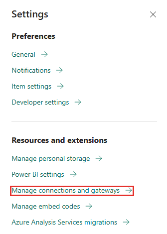

2. De lijst toont alle connecties die jij mag zien, ook die van andere projecten. Zoek een bestaande connectie met het zoekveld rechtsboven. Kies **+ New** om een connectie te maken. Naast **Connections** staan tabbladen voor gateways en voor **Azure Key Vault references**.

   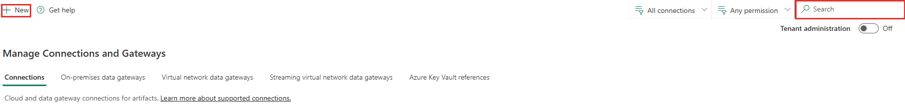

   Staat **New** er niet, maar zie je *Settings*, *Manage users* en *Delete*? Dan is er een connectie in de lijst geselecteerd. Klik op een lege plek of ververs de pagina.

3. Het paneel **New connection** staat standaard op **On-premises**. Kies **Cloud**, tenzij de bron achter een firewall staat; kies dan de on-premises data gateway.

   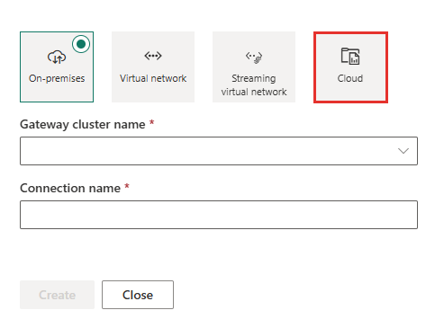

4. Vul in:
   - **Connection name**: begin met het voorvoegsel van de framework-connecties (standaard `CON_FMD_`), bijvoorbeeld `CON_FMD_ERP`;
   - **Connection type**: voor Azure SQL Database kies je *SQL Server*;
   - **Server** en **Database**.

   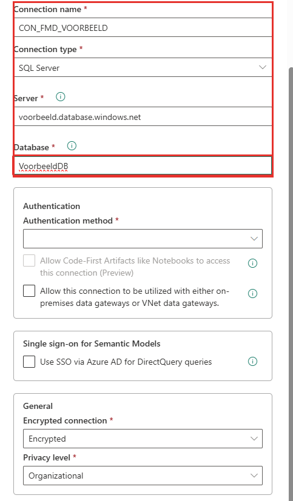

5. Kies bij **Authentication method** hoe de connectie zich aanmeldt: *Basic*, *OAuth 2.0*, *Service Principal* of *Workspace identity*. Gebruik bij voorkeur een technisch account of service principal met alleen leesrechten, niet het account van een medewerker. Een OAuth-connectie hangt aan een persoon en verloopt na 90 dagen zonder gebruik.

   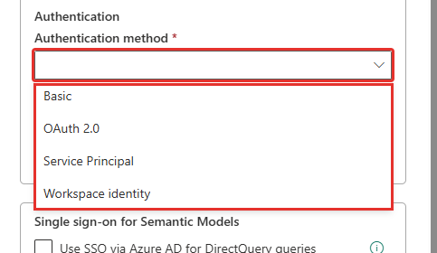

6. Bij *Service Principal* vul je het **Tenant ID**, het **Service principal ID** en de **Service principal key** in. Naast de sleutel staat een knopje voor een verwijzing naar Azure Key Vault: gebruik dat, zodat het secret zelf niet in beeld of in een document staat. Tik een secret nooit in een veld dat je in een schermafbeelding laat zien.

   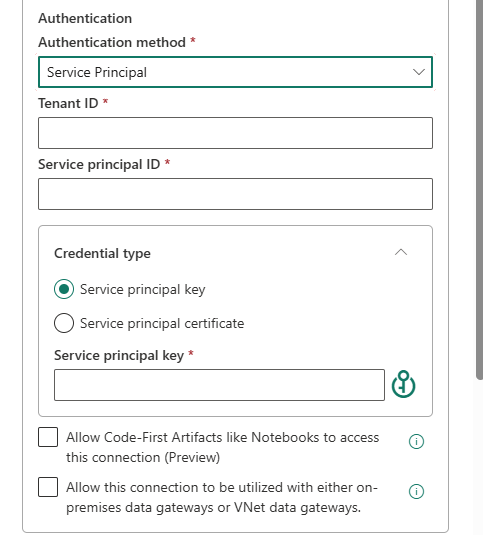

7. Kies **Create**. Geef daarna via **Manage users** de beheerdersgroep van het platform toegang, en iedereen die de laadpipelines start of plant. Wie de connectie niet mag gebruiken, kan hem ook niet registreren.

Gebruik één connectie voor alle omgevingen als Dev, Test en Productie uit dezelfde bron lezen. Moet Dev een andere (test)bron lezen, maak dan een eigen connectie per omgeving en bind die per omgeving in de registratie. Voor de brontypen `ONELAKE` en `NOTEBOOK` sla je dit over: daarvoor registreert de setup zelf een connectie (`CON_FMD_ONELAKE` en `CON_FMD_NOTEBOOK`).

### De connectie registreren

1. Open in de CONFIG-workspace het notebook `NB_REGISTRATIE` en scrol naar *Stap 1: connectie registreren*. De cel is uitgecommentarieerd.

   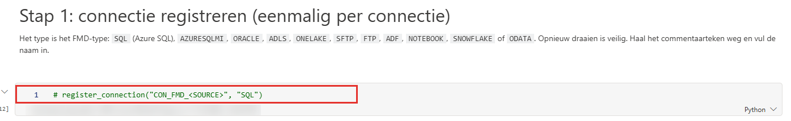

2. Haal het commentaarteken (`# `) weg en vul de naam van de connectie en het FMD-type in, bijvoorbeeld `register_connection("CON_FMD_ERP", "SQL")`. Voer de cel uit met de knop links van de cel.
3. Het type is het **FMD-type**, niet het type dat Fabric toont: `SQL` (Azure SQL Database), `AZURESQLMI`, `ORACLE`, `ADLS`, `ONELAKE`, `SFTP`, `FTP`, `ADF`, `NOTEBOOK`, `SNOWFLAKE` of `ODATA`. Azure SQL Database en SQL Managed Instance heten in Fabric allebei *SQL Server*; daarom kies je het type zelf.
4. Bij succes meldt de cel dat de connectie is geregistreerd, met het FMD-type en het type dat Fabric kent.

   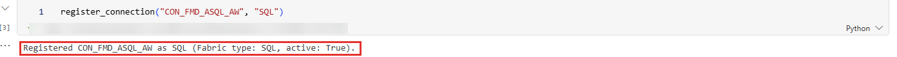

5. Is de naam niet gevonden, dan meldt de cel *Expected one Fabric connection named … that you can access, found 0*. Controleer de naam letter voor letter. Klopt hij, dan heb je geen rechten op de connectie: de lijst kent alleen connecties waar jij bij mag. Vraag de eigenaar je toe te voegen. Er is dan niets geschreven.

   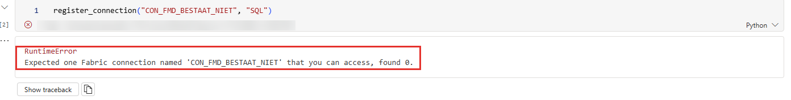

Opnieuw uitvoeren is veilig: de functie wijzigt de connectie zelf nooit, alleen de rij in de configuratiedatabase. Een verkeerd FMD-type valt pas later op, bij de proefdraai in stap 7 (*does not fit the type of connection*).

## Stap 1: de editor openen en laden

1. Open in de CONFIG-workspace (INTEGRATION CONFIG) het notebook `NB_REGISTRATIE` en voer de cel uit die de editor start (stap 2 in het notebook). Het notebook draait op een Python-kernel en start daardoor snel.
2. Kies bij **Omgeving** de omgeving waarin je werkt (`D`, `T`, `P`, of via *Andere…* een eigen developer-omgeving) en klik op **Laden uit de configdb**. De editor laadt niet vanzelf: tot je klikt staat hij leeg.
3. Bovenin staat daarna de werkruimte van de omgeving en een melding met wat er is geladen, bijvoorbeeld hoeveel bronnen en geregistreerde tabellen. Daaronder staan vijf tabs: **1. Bronnen**, **2. Tabellen**, **3. Controleren en registreren**, **4. Omgevingen** en **5. Beheer**.

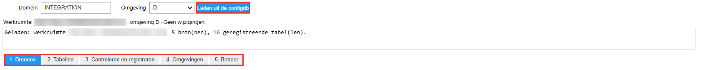

## Stap 2: een bron kiezen of toevoegen (tab 1)

Op tab **1. Bronnen** kies je een bestaande bron of voeg je een nieuwe toe. De velden:

| Veld | Betekenis |
|---|---|
| **Alias** | Een vrije, korte naam, bijvoorbeeld `AW`. De tabellen verwijzen ernaar. |
| **Connectie** | Een connectie die je hebt geregistreerd. |
| **Database** | Wat dit is, hangt af van het brontype: de database bij SQL en Snowflake, de container bij ADLS, een vrije naam bij een bestandsbron. |
| **Namespace** | Kort, in kleine letters. Hij moet in elke omgeving gelijk zijn. |
| **Brontype** | De editor toont alleen de typen die bij de connectie passen. |
| **LoadGroup** | De standaardgroep van de tabellen van deze bron. Leeg betekent: geen groep. |
| **HistoryDays** | Alleen voor een nieuwe incrementele tabel zonder watermark: de eerste load haalt alleen de laatste N dagen op. |

**Bron bewaren (in geheugen)** zet de bron in de editor. Er wordt nog niets in de configuratiedatabase geschreven; dat gebeurt pas bij het registreren in stap 7.

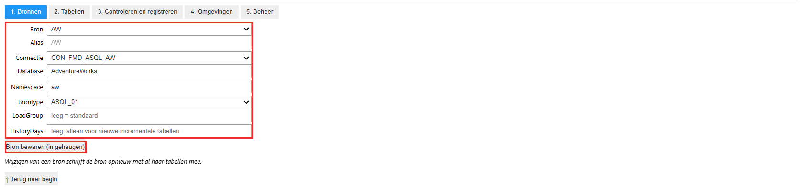

## Stap 3: de bron ontdekken (tab 2)

Bij een nieuwe bron laat je het framework eerst uitzoeken welke tabellen er zijn. Die ontdekking leest tabellen, views, kolommen en primary keys uit de bron en zet ze in de configuratiedatabase. Daarna kun je ze in de lijst kiezen en kan de editor je invoer ertegen controleren. De ontdekking registreert niets. Ze bestaat alleen voor de connectietypen `SQL` en `SNOWFLAKE`; bij andere typen sla je deze stap over.

1. Ga naar tab **2. Tabellen** en kies bij **Bron** de bron. Vóór de ontdekking toont de lijst alleen de tabellen die al geregistreerd zijn.
2. Vul eventueel een **Schemafilter** in, bijvoorbeeld `HumanResources`. Dan ontdekt de pipeline alleen dat schema; leeg betekent alle schema's. Een nieuwe ontdekking van dezelfde bron vervangt de vorige binnen het schemafilter: de ontdekte tabellen van andere schema's blijven staan.

   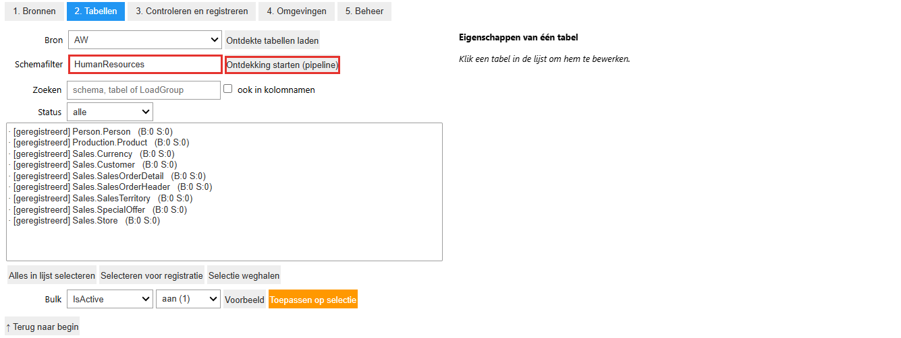

3. Klik op **Ontdekking starten (pipeline)**. De editor start de pipeline `PL_FMD_DISCOVER_SOURCE` in de CODE-workspace van de gekozen omgeving en wacht tot hij klaar is. Tijdens het wachten is de knop uitgeschakeld en meldt de editor in welke workspace de ontdekking draait, met welke connectie en voor welke database. Voor één schema duurde dit in een proef ongeveer twee minuten. Je hebt in de CODE-workspace minstens de rol Contributor nodig; anders meldt de editor dat.

   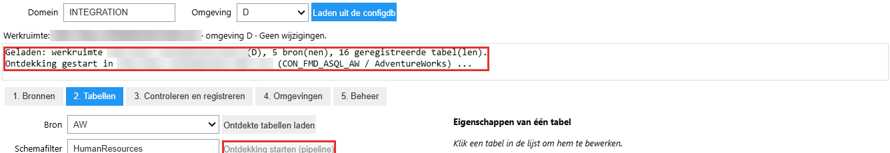

4. Is de pipeline klaar, dan laadt de editor de tabellen. De melding noemt het aantal ontdekte tabellen (van alle schema's van de bron, niet alleen van het filter), het tijdstip van de laatste ontdekking en hoeveel tabellen nog niet geregistreerd zijn (*nieuw*). De lijst toont ze. Faalt de pipeline, dan meldt de editor *Ontdekking niet gelukt*, met de status en de reden.

   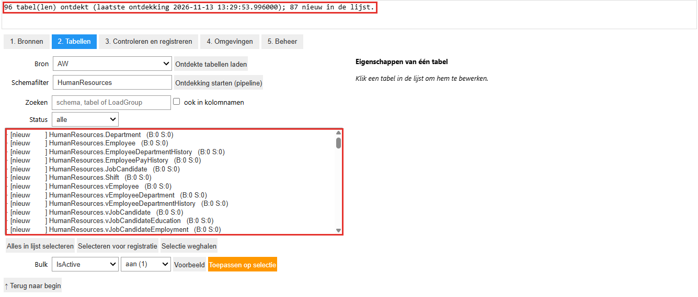

5. Wil je de run zelf bekijken? Zoek in de **Monitor** het item `PL_FMD_DISCOVER_SOURCE` en open de run (zie [Een run beoordelen en een fout herstellen](run-beoordelen.md)). De pipeline kiest op het connectietype een tak, `SQL` of `SNOWFLAKE`, leest daar de metadata en schrijft de ontdekte tabellen weg. Bij een ander connectietype faalt hij met de melding dat dat type nog geen ontdekking kent. Rechts staan de status en de drie parameters (`ConnectionName`, `DataSourceName` en `SchemaFilter`); onderaan de activiteiten.

   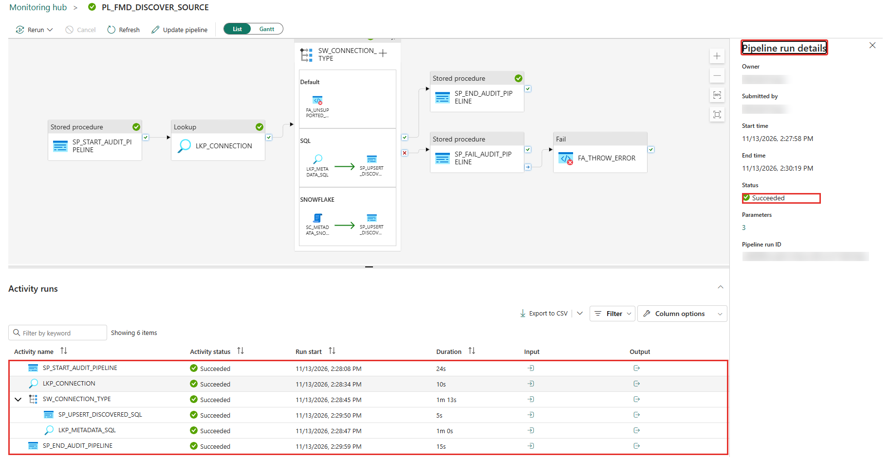

Wil je de lijst alleen verversen met wat er al ontdekt is, zonder de pipeline te starten? Klik dan op **Ontdekte tabellen laden**.

## Stap 4: de tabellen van een bron laden (tab 2)

Ga naar tab **2. Tabellen** en kies bij **Bron** de bron.

1. Klik op **Ontdekte tabellen laden**. De lijst toont de tabellen die de laatste ontdekking heeft gevonden (zie stap 3). Dit leest alleen uit de configuratiedatabase en start niets. De melding erboven noemt het aantal en het tijdstip van de ontdekking.
2. Is de bron nieuw, of is de ontdekking verouderd? Doe dan eerst stap 3. Bij andere brontypen dan `SQL` en `SNOWFLAKE` voeg je de tabellen met de hand toe.
3. Zoek een tabel met **Zoeken** (op schema, tabel of LoadGroup, eventueel ook in kolomnamen) of filter op **Status**.

Elke regel in de lijst heeft een status: *nieuw* (nog niet geregistreerd), *geselecteerd* (voor registratie gekozen), *geregistreerd* of *gewijzigd*. Achter de naam staat `(B:0 S:0)`: het aantal cleansing rules in Bronze en in Silver.

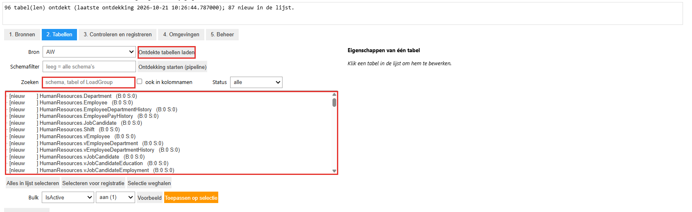

Voor veel tabellen tegelijk gebruik je **Alles in lijst selecteren** en daarna **Toepassen op selectie** met een keuze bij **Bulk** (bijvoorbeeld **IsActive**, historie of LoadGroup). **Voorbeeld** toont eerst wat er verandert.

## Stap 5: een tabel kiezen

Klik een tabel in de lijst aan. Rechts verschijnen de eigenschappen van die ene tabel.

| Eigenschap | Betekenis |
|---|---|
| **Doelschema**, **Doeltabel** | De naam in Bronze en Silver. Standaard gelijk aan schema en naam in de bron. |
| **FileName**, **FileType** | De bestandsnaam in de landing zone en het formaat. Standaard `parquet`; bij Snowflake stelt de editor `delta` voor. Bij een bestandsbron moet het formaat het echte bestandsformaat zijn. |
| **LoadGroup** | De groep van deze tabel. Leeg betekent: de groep van de bron. |
| **Actief** | Uit betekent: de tabel laadt in geen enkele laag meer. |
| **Historie in Silver** | Aan bewaart in Silver de historie van wijzigingen. Standaard uit. |
| **Incrementeel** | Laadt alleen wat sinds de vorige load is gewijzigd. Vraagt een watermarkkolom. |

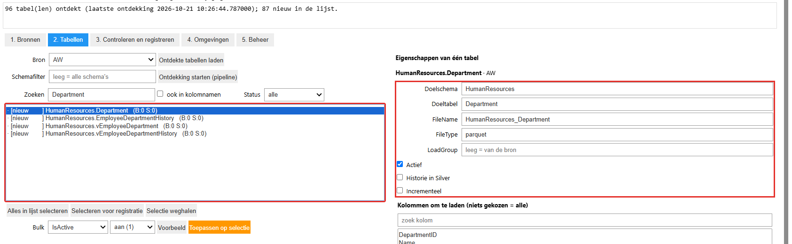

## Stap 6: een tabel instellen

1. Klik op **Selecteren voor registratie**. Een nieuwe tabel doet pas mee na deze klik; een geregistreerde tabel doet mee zodra je hem wijzigt.
2. Wil je incrementeel laden? Vink **Incrementeel** aan en kies of typ de **Watermarkkolom**.
3. Wil je een deel van de kolommen laden? Kies ze bij **Kolommen om te laden**. Niets gekozen betekent alle kolommen. De primary key en de watermarkkolom moeten erbij zitten.
4. Wil je een deel van de rijen laden? Vul een **Bronfilter** in: een voorwaarde zonder `WHERE`, bijvoorbeeld `ModifiedDate >= '2024-01-01'`.
5. Kies de **Primary key**. Die komt uit de ontdekking als de bron er een heeft, en is verplicht.
6. **Deze tabel terugzetten** maakt de wijzigingen aan deze ene tabel ongedaan.

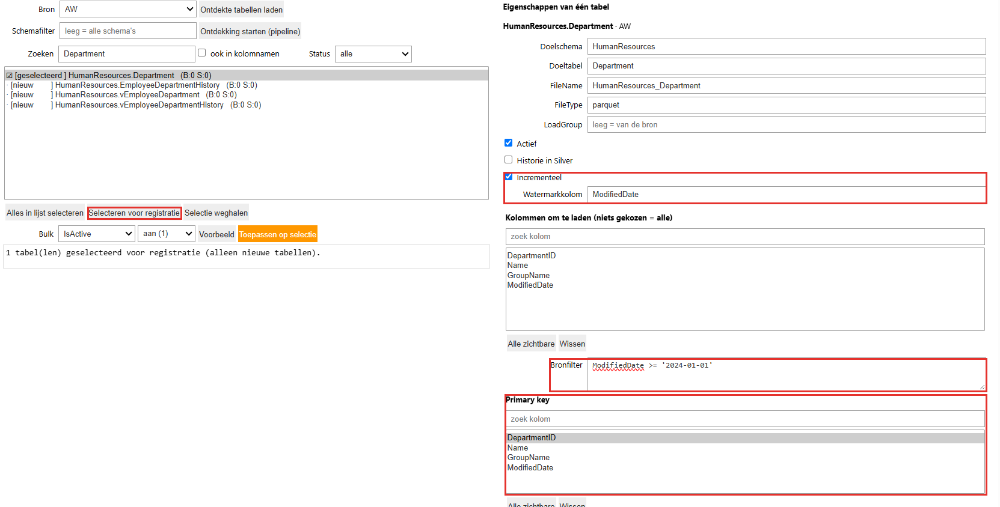

- Kolomkeuze en bronfilter bestaan alleen voor de brontypen `ASQL_01`, `ASQL_02`, `SNOWFLAKE_01` en `ODATA_01`.
- Een bronfilter wijzigen verwijdert niets uit Bronze en Silver. Sluit een nieuw filter oudere rijen in die eerder buiten beeld waren, dan haalt een incrementele tabel die niet vanzelf alsnog op: de watermark staat er al voorbij.
- Per laag kun je bij **Bronze-cleansing** en **Silver-cleansing** regels instellen: *ongewijzigd laten*, *vervangen* of *alles verwijderen*.

## Stap 7: controleren, proefdraaien en registreren (tab 3)

Ga naar tab **3. Controleren en registreren**.

1. Het overzicht toont per tabel wat er wordt geregistreerd. Een veld dat afwijkt van de huidige registratie is oranje, met de oude waarde eronder.
2. Klik op **Controleren**. Dit voert de controles van de editor uit.
3. Klik op **Proefdraaien (dry_run=True)**. Dit voert de volledige registratie uit in de database en draait die daarna terug. De uitkomst staat onder de knoppen: per tabel *New*, *Changed* of *Unchanged*, bij een wijziging wat er verandert (`oud -> nieuw`), eventuele waarschuwingen en de tabellen die in deze workspace actief zijn maar niet in je lijst staan. Die laatste blijven ongemoeid: registreren schakelt ze niet uit.
4. Lees de uitkomst. Staat er een fout, ga dan terug naar tab 1 of 2, los hem op en draai de proefdraai opnieuw. Alle fouten worden tegelijk getoond.
5. Vink de bevestiging aan en klik op **Registreren**. De knop is geblokkeerd tot er een proefdraai is gedaan op precies deze wijzigingen. Wijzig je daarna nog iets, dan is de proefdraai ongeldig.
6. Na het registreren toont de editor het resultaat als een tekst met `table("""...""")`. Bewaar die tekst in het projectlog of in git: zo is terug te vinden wat er wanneer is geregistreerd.

**Terug naar begin** gaat naar tab 1 en wist de meldingen. De wijzigingen blijven staan.

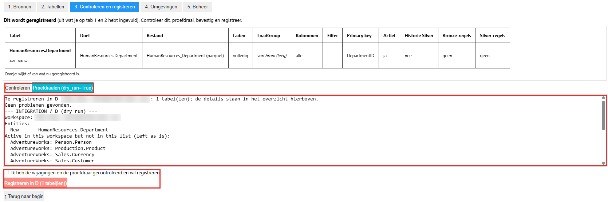

## Na het registreren

1. Laad de nieuwe tabellen en controleer ze, zie [Een tabel of bron handmatig laden](handmatig-laden.md).
2. Zet de registratie door naar Test en Productie, zie [Registratie overzetten en beheren](overzetten-en-beheren.md). Doe dat vóór je de DATA-workspace van een domein promoveert.

## Valkuilen

| Verschijnsel | Oorzaak en oplossing |
|---|---|
| De editor is leeg | Je hebt niet op **Laden uit de configdb** geklikt. |
| De knop **New** ontbreekt in *Manage connections and gateways* | Er is een connectie geselecteerd. Klik op een lege plek of ververs de pagina. |
| *Expected one Fabric connection … found 0* | De naam klopt niet, of je hebt geen rechten op de connectie. Vraag de eigenaar je toe te voegen. |
| Het paneel *New connection* vraagt om een *Gateway cluster name* | Het staat op *On-premises*. Kies *Cloud*, of kies een gateway als de bron achter een firewall staat. |
| De tabel is geregistreerd, maar er landt niets | Het brontype past niet bij het connectietype, of de tabel of een laag staat uit. Controleer het brontype en **Actief**. |
| **Registreren** blijft geblokkeerd | Je hebt na de proefdraai nog iets gewijzigd, of de bevestiging niet aangevinkt. Draai de proefdraai opnieuw. |
| Een fout in het bronfilter verschijnt pas bij de load | De proefdraai voert het filter niet uit. Test het filter in de bron. |
| De Bronze-merge faalt nadat je kolommen hebt weggehaald bij een tabel die al in Bronze staat | Verwijder eerst de Bronze- en Silver-tabel van die tabel, of kies de kolommen vóór de eerste load. |
| Een gewijzigde Silver-cleansingregel werkt alleen op rijen die daarna veranderen | Zet de tabel opnieuw in de wachtrij van Silver, zie [Een run beoordelen en een fout herstellen](run-beoordelen.md#stap-5-herstellen). |
| Je registreert een andere bron voor dezelfde tabel (bijvoorbeeld `ASQL_02` in plaats van `ASQL_01`) | Dit maakt een nieuwe registratie en laat de oude achter. Zet de oude tabel uit. |
| Een andere namespace geeft andere tabelnamen | De namespace verandert na de eerste registratie niet meer. |
