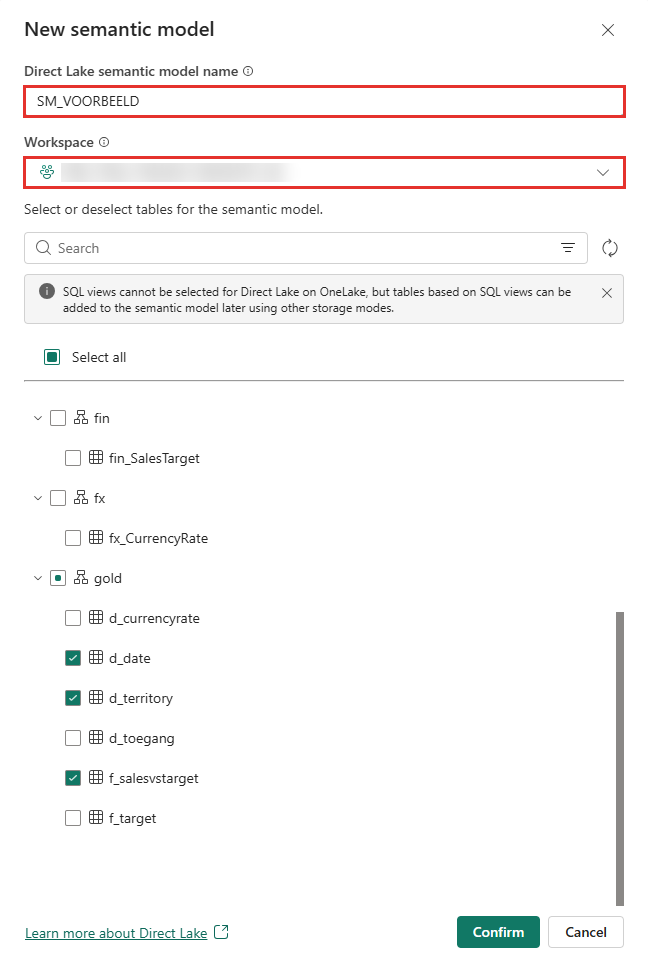
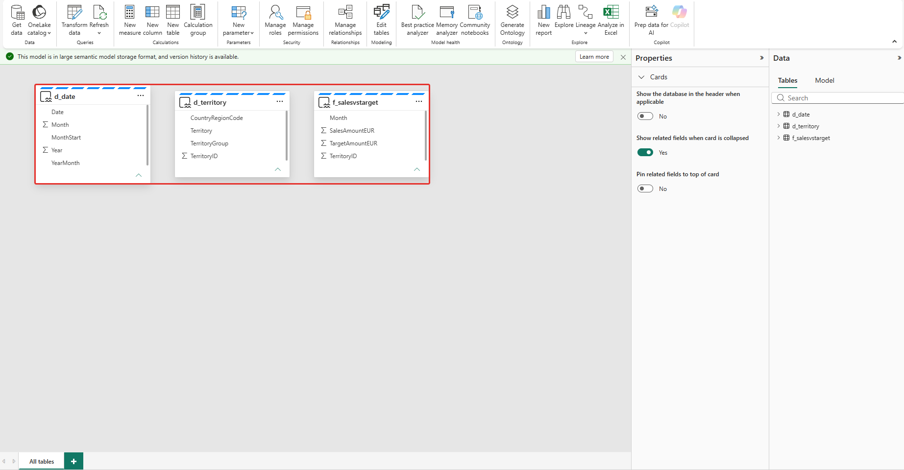
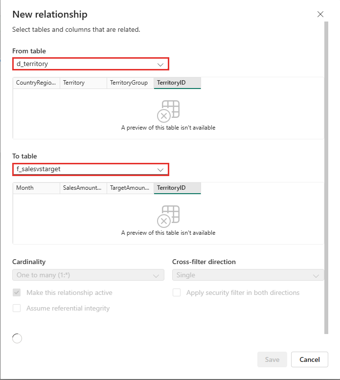
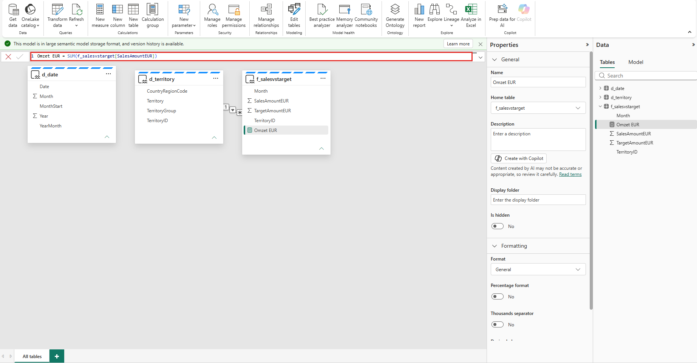
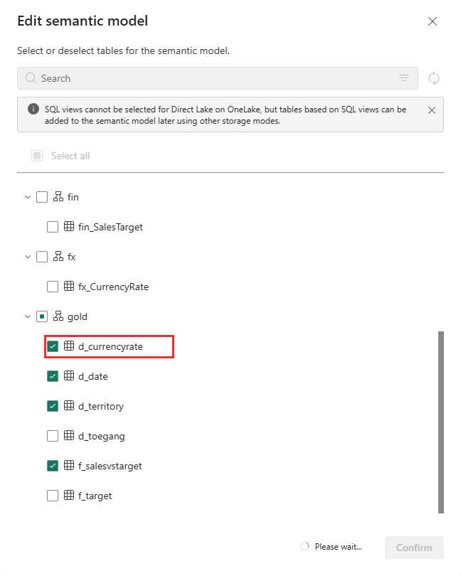
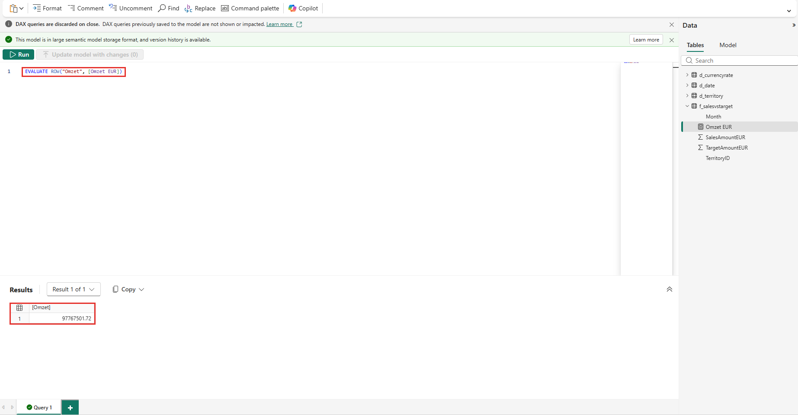

# Een semantisch model maken en uitbreiden

Het semantisch model is de laag tussen Gold en het rapport. Het framework levert geen model: de setup maakt per business-domein alleen de SEMANTIC- en REPORTING-workspaces. Het model bouw je zelf, als **Direct Lake-model** op de Gold-lakehouse van het domein. Er is geen kopie van de data: het model leest de Delta-tabellen die de Gold-notebooks maken. Deze handleiding laat zien hoe je een model maakt, er een relatie en een measure aan toevoegt, er later een tabel bij zet en het resultaat controleert. De schermafbeeldingen zijn opgenomen in november 2026.

**De volgorde is altijd: Silver → Gold → semantisch model → rapport.** De tabellen die je in het model wilt, moeten in Gold bestaan (zie [Een nieuwe Gold-tabel (MLV) maken](gold-mlv.md)).

Hoe een model na een promotie naar Gold van de doelomgeving blijft verwijzen, staat in [Een Direct Lake-model laten verwijzen naar het juiste lakehouse na promotie](direct-lake-parameter.md). De volgorde van een promotie staat in [Promoveren van Dev naar Test en Productie](promoveren.md).

## Voor je begint

- Je werkt in Dev (omgeving D) of in je eigen developer-workspace, nooit eerst in Test of Productie.
- De Gold-tabellen die je nodig hebt, bestaan en bevatten data.
- Je mag items maken in de SEMANTIC-workspace van het domein.

## Stap 1: het model maken

Open de Gold-lakehouse in de DATA-workspace van het domein (het type *Lakehouse*, niet het SQL-endpoint) en kies in het lint **New semantic model**.

1. Vul bij **Direct Lake semantic model name** de naam van het model in. Gebruik een vaste naamafspraak, bijvoorbeeld `SM_<DOMEIN>`.
2. Kies bij **Workspace** de **SEMANTIC**-workspace van het domein, niet de DATA-workspace. Het model hoort daar te staan, zodat de deployment pipeline van die workspace het kan promoveren.
3. Vink de tabellen aan die in het model moeten. De lijst toont de tabellen van de lakehouse per schema. Kies alleen wat je nodig hebt; een tabel kun je later toevoegen.
4. Klik op **Confirm**.



De dialoog maakt een **Direct Lake-model op OneLake**. Dat zie je aan de melding in de dialoog (*SQL views cannot be selected for Direct Lake on OneLake*): een tabel die op een SQL-view is gebaseerd, kun je niet kiezen. Voor een promotie heeft zo'n model een parameter en een parameterregel nodig, zie [Een Direct Lake-model laten verwijzen naar het juiste lakehouse na promotie](direct-lake-parameter.md).

Het model opent in de web-editor, in de modus **Editing**. Bovenin staat de melding dat het model het grote opslagformaat heeft en dat de versiegeschiedenis beschikbaar is.

## Stap 2: het model bekijken

Onderaan staat de weergave **Model view**, het diagram met de tabellen als kaarten. Rechts toont het deelvenster **Data** de tabellen met hun kolommen, en het deelvenster **Properties** de eigenschappen van wat je selecteert. In het lint staan de bewerkingen: **New measure**, **New column**, **New table**, **Manage relationships**, **Edit tables** en **New report**.

Een nieuw model heeft nog geen relaties.



## Stap 3: een relatie leggen

Een relatie koppelt een feitentabel aan een dimensie. Sleep in het diagram de sleutelkolom van de ene tabel op de sleutelkolom van de andere, of kies **Manage relationships**. Het venster **New relationship** vraagt:

- **From table** en **To table**, met daaronder de kolommen. Kies de kolom die in beide tabellen dezelfde sleutel is, bijvoorbeeld `TerritoryID`. Een voorbeeld van de data toont het venster bij Direct Lake niet.
- **Cardinality**: standaard *One to many (1:\*)*, met de dimensie aan de kant van de *één*.
- **Cross-filter direction**: standaard *Single*.
- **Make this relationship active**, standaard aan.

Klik op **Save**. In het diagram staat daarna een lijn met een `1` bij de dimensie en een `*` bij de feitentabel.



## Stap 4: een measure toevoegen

Kies **New measure** in het lint, of de drie puntjes bij de feitentabel. In de formulebalk typ je de naam en de formule:

```
Omzet EUR = SUM(f_salesvstarget[SalesAmountEUR])
```

Bevestig met het vinkje (**Commit**). De measure staat daarna in het deelvenster **Data** bij de feitentabel, met een eigen pictogram. In **Properties** stel je de naam, de **Home table**, een beschrijving, een **Display folder** en de opmaak in.



Een measure hoort in de feitentabel. Zet bij de kolommen die je alleen voor een berekening nodig hebt de eigenschap **Verborgen** aan in **Properties** (*Is hidden*), zodat gebruikers alleen de measures zien.

## Stap 5: een tabel toevoegen

Staat er een tabel niet in het model die je nodig hebt, bijvoorbeeld een nieuwe Gold-tabel, voeg hem dan toe met **Edit tables** in het lint. Vink de tabel aan en klik op **Confirm**. De dialoog meldt *Please wait…* terwijl hij het model bijwerkt; daarna staat de tabel in het deelvenster **Data** en in het diagram.



Leg daarna zo nodig de relaties van de nieuwe tabel (stap 3) en voeg measures toe (stap 4). Tabellen die al in het model staan, kun je in dezelfde dialoog uitvinken om ze te verwijderen.

Staat de tabel niet in de lijst, controleer dan dat hij in Gold bestaat en data bevat. Een tabel op basis van een SQL-view kun je voor een model op OneLake niet kiezen.

## Stap 6: controleren met een DAX-query

Controleer de measure zonder rapport in de **DAX query view**, onderaan het scherm. Typ een query en klik op **Run**:

```
EVALUATE ROW("Omzet", [Omzet EUR])
```

Het resultaat verschijnt onder de query, hier met één rij en de som van `SalesAmountEUR`. Vergelijk dat getal met de bron, bijvoorbeeld met een query op het SQL-endpoint van Gold. Een DAX-query is tijdelijk: ze wordt weggegooid zodra je het model sluit.



## Een measure of relatie wijzigen

Selecteer de measure of de relatie en pas hem aan in **Properties** of in de formulebalk. Controleer daarna opnieuw met een DAX-query.

De **TMDL view** (naast de DAX query view) toont het model als tekst en is bedoeld voor wijzigingen die niet in het diagram kunnen, zoals de expressie van het model. Een TMDL-script wordt weggegooid als je het model sluit, tenzij je het toepast.

## Valkuilen

| Verschijnsel | Oorzaak en oplossing |
|---|---|
| De nieuwe tabel staat niet in de lijst van **Edit tables** | De tabel bestaat niet in Gold, of hij is gebaseerd op een SQL-view (die kun je voor een model op OneLake niet kiezen). Controleer de lakehouse. |
| Het venster *New relationship* toont geen voorbeeld van de data | Dat hoort bij Direct Lake. Kies de kolommen op naam. |
| **Edit tables** faalt met een foutmelding over het schema | Controleer de `sourceLineageTag` van de tabellen in het model. Zie [Een Direct Lake-model laten verwijzen naar het juiste lakehouse na promotie](direct-lake-parameter.md). |
| Het model leest na een promotie uit Dev | De parameterregel of datasourceregel ontbreekt. Zie [Een Direct Lake-model laten verwijzen naar het juiste lakehouse na promotie](direct-lake-parameter.md). |
| De DAX-query is weg na het sluiten van het model | Een DAX-query en een TMDL-script worden weggegooid bij het sluiten. Kopieer ze vooraf als je ze wilt bewaren. |
