# Een bestaande tabel wijzigen

Een tabel die al is geregistreerd wijzig je in de registratie-editor op tab 2. Dit gaat over de wijzigingen die het vaakst voorkomen: kolommen of een bronfilter, cleansing rules, historie in Silver, een andere LoadGroup, een tabel uit- of aanzetten, een tabel volledig opnieuw laden en een andere primary key. Hoe je de editor opent en een tabel voor het eerst registreert, staat in [Bronnen en tabellen registreren](registreren.md). De schermafbeeldingen zijn opgenomen in november 2026.

## Het patroon

Elke wijziging verloopt hetzelfde:

1. Open de editor, kies de omgeving (eerst `D` of je eigen ontwikkelomgeving) en klik op **Laden uit de configdb**. De editor laadt niet vanzelf.
2. Ga naar tab **2. Tabellen**, kies de bron, zoek de tabel en klik hem aan. Rechts staan de eigenschappen. Een wijziging blijft in het geheugen van de editor tot je registreert.
3. Ga naar tab **3. Controleren en registreren**, klik op **Controleren** en daarna op **Proefdraaien (dry_run=True)**. Lees de uitkomst.
4. Is de uitkomst goed: vink de bevestiging aan en klik op **Registreren**.
5. Laad de tabel en controleer het resultaat (zie [Een tabel of bron handmatig laden](handmatig-laden.md)).
6. Zet de wijziging door naar Test en Productie (zie [Doorzetten naar Test en Productie](#doorzetten-naar-test-en-productie)).

Zo ziet de tabel eruit voor je iets wijzigt. In deze handleiding is dat een tabel die geregistreerd, actief en niet incrementeel is, met historie in Silver en zonder LoadGroup of cleansing rules.

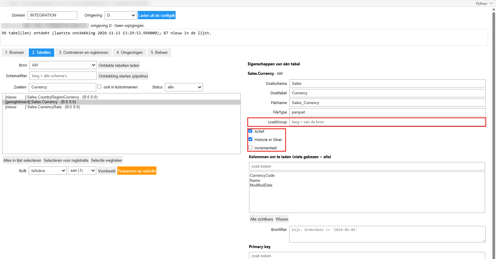

De status in de lijst is *geregistreerd* voor een tabel die al in de configdb staat. Heb je een wijziging gedaan die je nog niet hebt geregistreerd, dan staat er *gewijzigd*.

## De proefdraai lezen

De proefdraai schrijft niets. Hij toont per tabel wat er zou veranderen.

- **Changed** met per veld `oud -> nieuw`, bijvoorbeeld `IsHistorized 1 -> 0` of `LoadGroup (from source) -> nacht`. Zie je een veld dat je niet hebt aangeraakt, ga dan terug naar tab 2.
- **New** is een tabel die nog niet is geregistreerd.
- **WARNING** wijst op een gevolg dat je niet kunt zien in het overzicht, bijvoorbeeld dat een gewijzigde Silver-regel alleen werkt op rijen die daarna veranderen. Voor de hele tabel kies je daarna op tab 5 de actie *Silver opnieuw laten verwerken*.
- **Active in this workspace but not in this list (left as is)** is de lijst met tabellen die actief zijn maar niet in deze registratie voorkomen. De proefdraai laat ze ongemoeid. Dit is geen waarschuwing.

Het overzicht erboven kleurt elke cel die afwijkt van de configdb oranje, met de oude waarde eronder (*was: ja*). Controleer dat alleen de cellen oranje zijn die je wilt wijzigen.

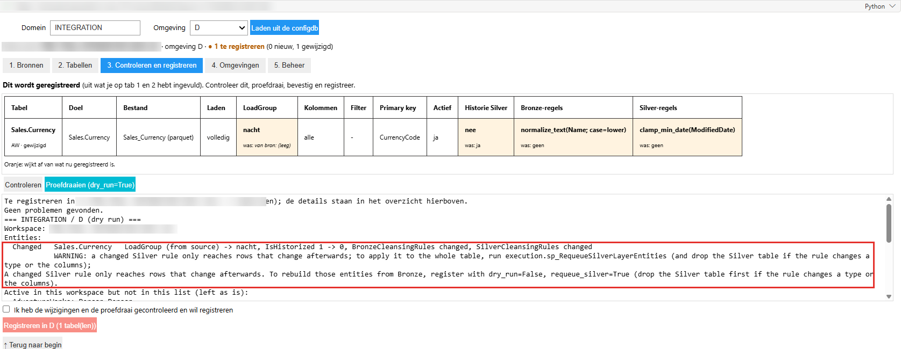

**Registreren** blijft uitgeschakeld tot je het vakje *Ik heb de wijzigingen en de proefdraai gecontroleerd en wil registreren* aanvinkt.

## Kolommen of bronfilter wijzigen

De velden **Kolommen om te laden** en **Bronfilter** staan op tab 2 onder de eigenschappen van de tabel. Ze bestaan alleen voor de brontypen SQL (`ASQL_01`, `ASQL_02`), Snowflake (`SNOWFLAKE_01`) en OData (`ODATA_01`).

- **Een filter wijzigen** verwijdert niets uit Bronze en Silver. Een ruimer filter haalt bij een incrementele tabel de oudere rijen niet alsnog op: reset dan het watermark (zie [Een tabel volledig opnieuw laden](#een-tabel-volledig-opnieuw-laden)).
- **De proefdraai voert het filter niet uit.** Controleer het filter eerst met een query op de bron.
- **Kolommen weghalen bij een tabel die al in Bronze staat** laat de Bronze-merge falen. Gebruik daarom eerst op tab 5 de actie **Opruimen na een PK-wijziging (Bronze en Silver wissen)**: die wist de Bronze- en Silver-tabel van de tabel, zet de open wachtrij op verwerkt en maakt het watermark leeg. Registreer daarna de nieuwe kolommen en laad de tabel opnieuw volledig. Die actie staat beschreven in [Registratie overzetten en beheren](overzetten-en-beheren.md).
- **Kolommen erbij** is niet apart gedocumenteerd. Probeer het eerst in Dev.
- **Per omgeving verschillend?** Kolommen en filter mogen per omgeving verschillen. Hoe je ze in Test of Productie zet, staat bij [Doorzetten naar Test en Productie](#doorzetten-naar-test-en-productie).

## Een cleansing rule wijzigen

Onderaan de eigenschappen staan twee keuzelijsten: **Bronze-cleansing** en **Silver-cleansing**. Elke laag heeft drie keuzes:

| Keuze | Wat ze doet |
|---|---|
| **Ongewijzigd laten** | De regels van de laag blijven zoals ze in de configdb staan. |
| **Vervangen door onderstaande regels** | De regels in de editor vervangen alle bestaande regels van de laag. |
| **Alle regels verwijderen** | De laag krijgt geen regels meer. |

Achter elke tabel in de lijst staat hoeveel regels ze heeft: `(B:1 S:0)` is één Bronze-regel en geen Silver-regel.

Kies **Vervangen door onderstaande regels** en klik op **Regel toevoegen**. De regels die je hier invult vervangen alle bestaande regels van de laag: neem de regels die al bestonden dus mee.

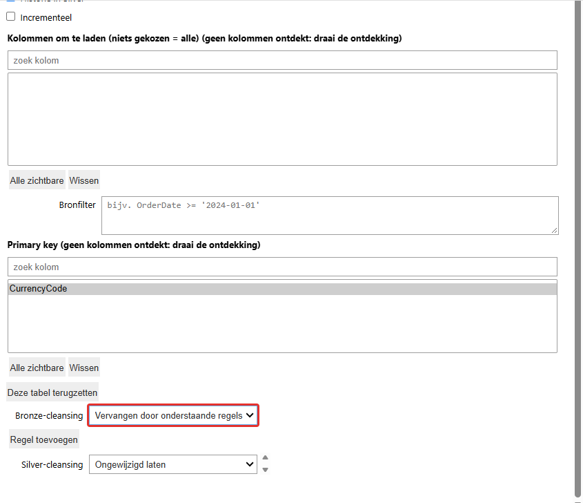

Een regel bestaat uit een **Functie**, de **Kolommen** waarop ze werkt en de parameters van die functie. De knoppen ↑ en ↓ veranderen de volgorde, ✕ verwijdert de regel.

De lijst met functies bevat `normalize_text`, `fill_nulls`, `parse_datetime`, `clamp_min_date`, `exclude_rows`, `deduplicate_keys` en *(eigen functie)*. Wat elke functie doet en welke parameters ze heeft, staat in [Cleansing-functies](cleansing-functies.md). In het voorbeeld gebruikt Bronze `normalize_text` op de kolom `Name`, met de parameter `case` op `lower`.

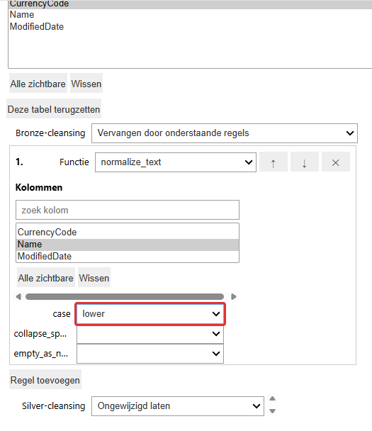

Silver gebruikt hier `clamp_min_date` op de kolom `ModifiedDate`. Die functie heeft de parameters `min`, `replacement` en `inclusive`.

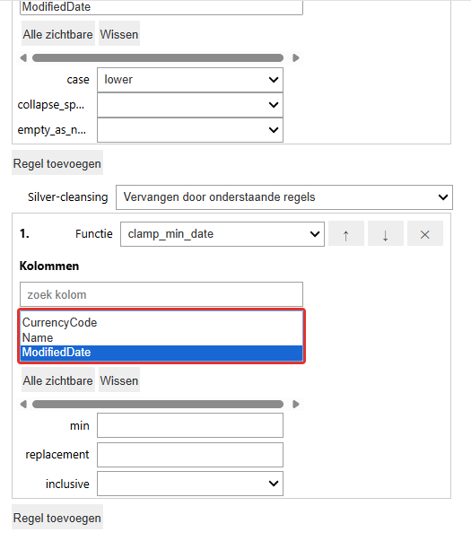

Registreer en bekijk wat de regel doet:

- **Een Bronze-regel** werkt vanaf de volgende levering.
- **Een Silver-regel** werkt alleen op rijen die daarna veranderen. Moet de regel op de hele tabel gelden, registreer dan eerst en kies daarna op tab 5 de actie **Silver opnieuw laten verwerken (na een gewijzigde Silver-regel)**. Die zet de tabel terug in de wachtrij van Silver; de volgende run van `PL_FMD_LOAD_SILVER` bouwt hem dan opnieuw op uit Bronze. Zie [Silver opnieuw laten verwerken](overzetten-en-beheren.md#silver-opnieuw-laten-verwerken).
- Verandert de regel het type van een kolom of de kolommen zelf, verwijder dan eerst de Silver-tabel.

Een eigen cleansing-functie zet je eerst in `NB_FMD_CUSTOM_DQ_CLEANSING`, in Dev, en promoveer je daarna met de CODE-workspace.

## Historie in Silver aan- of uitzetten

Het vinkje **Historie in Silver** staat tussen **Actief** en **Incrementeel**. Haal het weg of zet het aan en registreer.

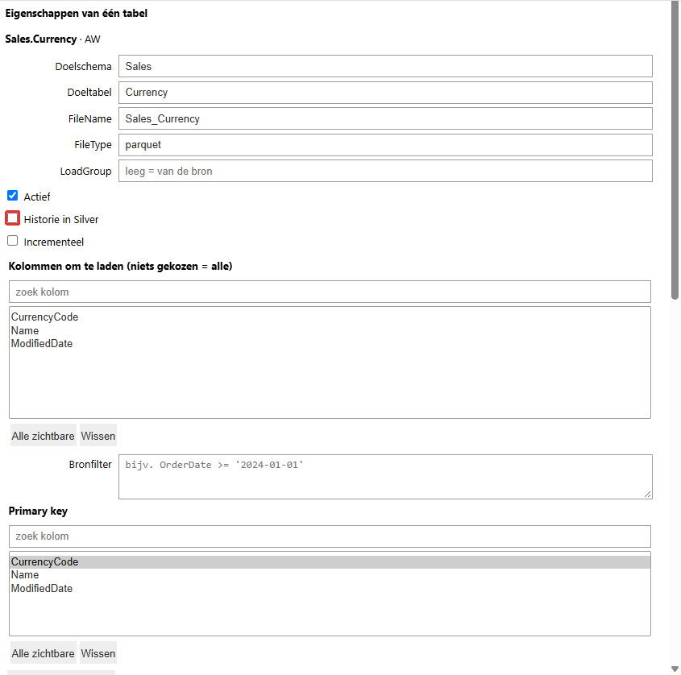

- **Aanzetten:** de historie begint vanaf dat moment.
- **Uitzetten:** de bestaande historie blijft staan. Ruim haar zelf op (`IsCurrent = 0 AND IsDeleted = 0`) als je de opslag terug wilt.
- Een Gold-query op `IsCurrent = 1` werkt in beide standen.

## Een tabel uitzetten of weer aanzetten

Haal het vinkje bij **Actief** weg en registreer. De tabel laadt dan in geen enkele laag meer. De data in Bronze en Silver blijft staan.

Op tab 3 is dan alleen de cel *Actief* oranje, en de proefdraai meldt `IsActive 1 -> 0`.

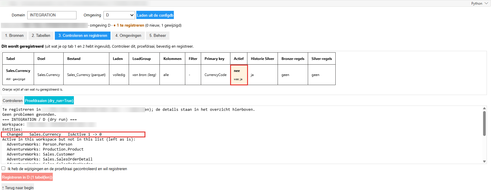

- **Verwijder een tabel nooit uit de configdb.** Uitzetten is het stoppen.
- **Weer aanzetten:** vink **Actief** aan en registreer. Leveringen die nog in de wachtrij stonden, worden eerst verwerkt.
- **Wordt de tabel in Gold gebruikt?** Controleer dan vooraf wat het uitzetten daar doet: de materialized lake views blijven bestaan, maar krijgen geen nieuwe data.

## Een tabel in een andere LoadGroup zetten

Vul bij **LoadGroup** de naam van de groep in. Leeg betekent: de groep van de bron. De waarde slaat op als je het veld verlaat.

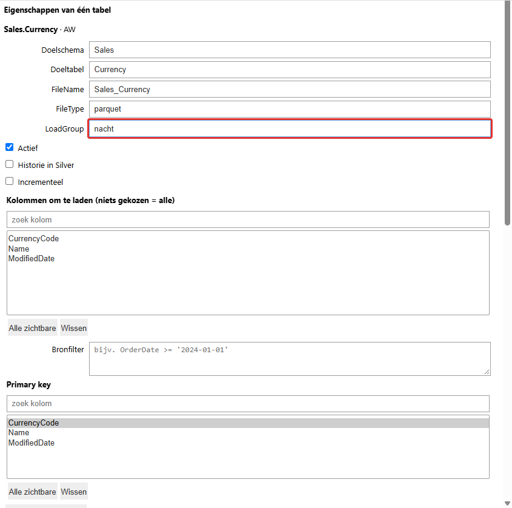

- Geven de schedules van een omgeving een `LoadGroup` mee, controleer dan dat er een schedule met de groep van deze tabel bestaat (zie [Dagelijkse routine en schedules](dagelijkse-routine.md)). Anders laadt de tabel in die omgeving niet op een schedule. Een schedule zonder parameters laadt alle tabellen, ook deze.
- Een tabel in een andere groep dan haar bron laadt niet mee in een run voor de groep van de bron. Een run zonder groep laadt alles.

## Een tabel volledig opnieuw laden

**Eenmalig, bij een incrementele tabel** (bijvoorbeeld omdat een ruimer filter ook oudere rijen moet ophalen): maak het watermark leeg. De volgende load haalt dan de hele tabel op.

1. Ga naar tab **5. Beheer**, kies de omgeving en klik op **Laden**. De lijst toont per tabel de status, het watermark en het aantal open regels in de wachtrij (`open 0/0`).
2. Zoek de tabel en selecteer hem. Onder de lijst staat hoeveel tabellen zijn geselecteerd.

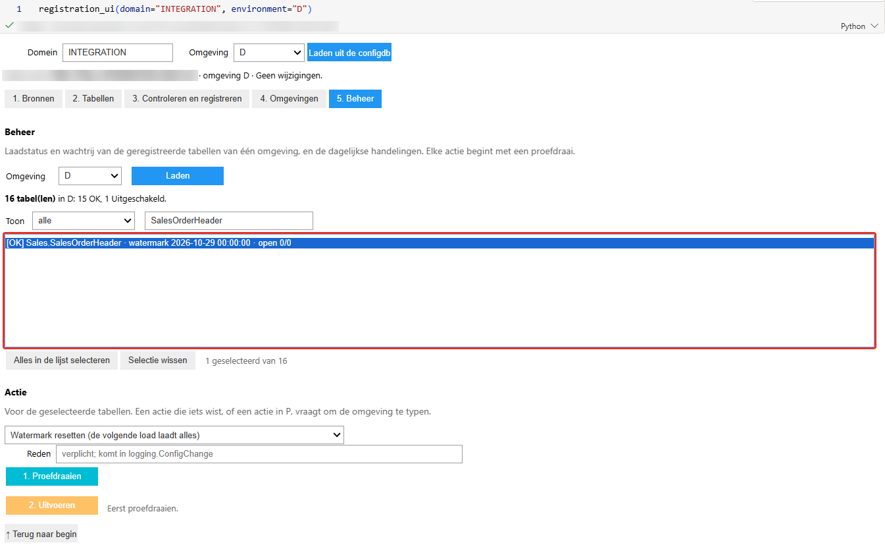

3. Kies bij **Actie** **Watermark resetten (de volgende load laadt alles)** en vul bij **Reden** in waarom je dit doet. Het veld is verplicht; de reden komt in het logboek van de configuratie.
4. Klik op **1. Proefdraaien**. De uitkomst toont per tabel wat er zou gebeuren, hier het huidige watermark en dat het leeg wordt. De knop **2. Uitvoeren** blijft uitgeschakeld tot je de proefdraai hebt gedaan.

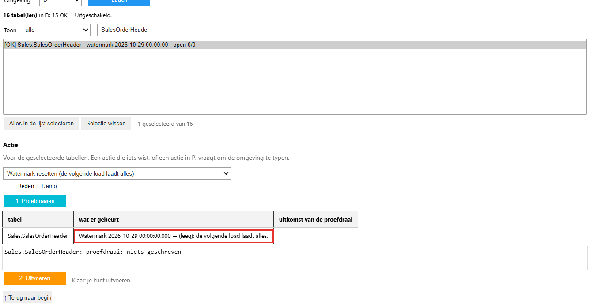

5. Is de uitkomst goed, klik dan op **2. Uitvoeren**.
6. Start `PL_FMD_LOAD_ALL` voor alleen deze tabel (zie [Een tabel of bron handmatig laden](handmatig-laden.md)). Verwijder de watermarkrij niet.

**Van incrementeel naar volledig:** haal het vinkje bij **Incrementeel** weg en registreer. Een volledige load markeert rijen die in de bron ontbreken als verwijderd.

**Let op bij Snowflake met `delta`:** een volledige load die 0 rijen oplevert, verwijdert alle rijen van die tabel in Bronze.

## Een primary key wijzigen

Een andere primary key verandert hoe Bronze en Silver rijen herkennen. Daarom moeten Bronze en Silver van de tabel daarna opnieuw worden opgebouwd. Ga zo te werk:

1. **Kies de nieuwe sleutel.** Klik op tab 2 de tabel aan en kies bij **Primary key** de kolommen. Houd Ctrl ingedrukt om meer dan één kolom te kiezen (een samengestelde sleutel). In het voorbeeld is de sleutel uitgebreid van `CurrencyCode` naar `CurrencyCode` en `Name`.

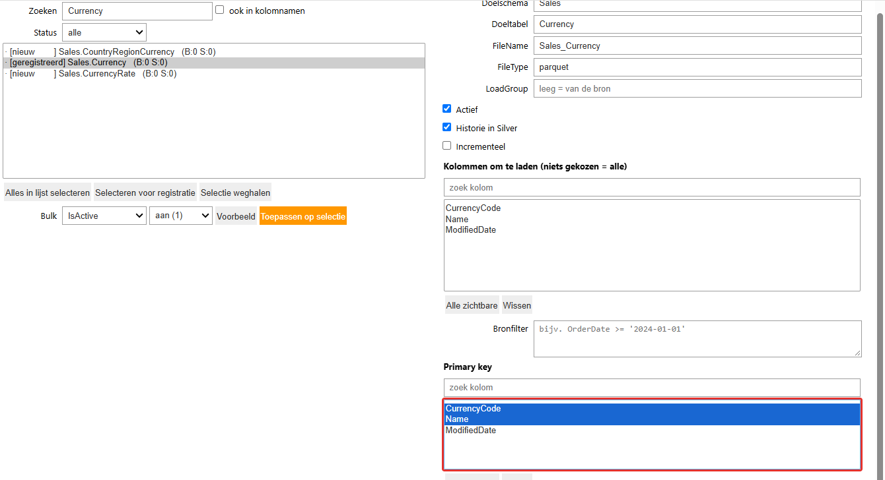

2. **Controleer en proefdraai op tab 3.** De cel *Primary key* is oranje, met de oude sleutel eronder. De proefdraai meldt `PrimaryKeys CurrencyCode -> CurrencyCode,Name`.

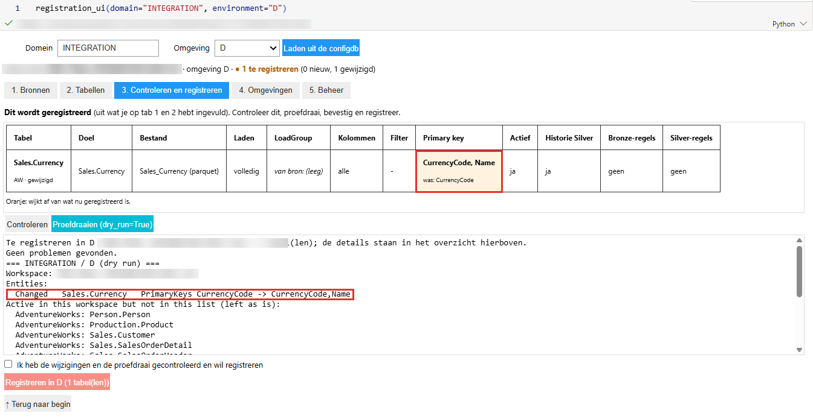

3. **Registreer** de nieuwe sleutel.
4. **Ruim Bronze en Silver op.** Ga naar tab 5, laad de omgeving, selecteer de tabel, kies de actie **Opruimen na een PK-wijziging (Bronze en Silver wissen)** en vul een **Reden** in. Klik op **1. Proefdraaien**. De uitkomst toont wat er verdwijnt:
   - de Silver- en de Bronze-tabel van de tabel;
   - de open regels in de wachtrij van Landingzone en Bronze, die op verwerkt worden gezet;
   - het watermark, dat leeg wordt.

   Daaronder staan drie waarschuwingen: de Silver-historie van de tabel gaat verloren, de primary key staat in de configuratie zoals hij nu is (controleer dat dit de nieuwe sleutel is), en er mag tijdens het opruimen geen load van de tabel lopen.

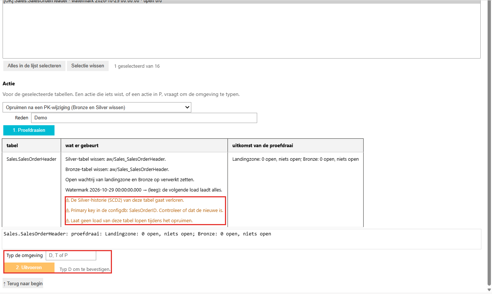

5. **Voer uit.** Typ de omgeving (`D`, `T` of `P`) in het veld **Typ de omgeving** en klik op **2. Uitvoeren**. Een actie die iets wist vraagt hierom, en elke actie in `P` ook. **Dit is niet terug te draaien.**
6. **Laad de tabel opnieuw volledig** (zie [Een tabel of bron handmatig laden](handmatig-laden.md)) en controleer de aantallen in Bronze en Silver. Doe dit eerst in Dev.

## Doorzetten naar Test en Productie

Een promotie neemt geen registraties mee. Zet een wijziging na het registreren op tab 4 door, vóór je de DATA-workspace van een domein promoveert. De werkwijze staat in [Registratie overzetten en beheren](overzetten-en-beheren.md).

| Wijziging | Op tab 4 |
|---|---|
| Nieuwe tabel | Weergave **Overzetten**, *alles wat nieuw is* |
| Gewijzigde laadwijze, primary key, cleansing of historie | Vink **Ook tabellen bijwerken die er al staan** aan |
| Kolommen, filter, *Actief* of LoadGroup in het doel | Vink **Voor een omgeving een eigen filter of instelling gebruiken** aan, of registreer in de editor met omgeving `T` of `P` |
| Verwijderde Bronze- of Silver-tabel | Herhaal dit in het doel, vóór de load |

Draai altijd eerst de proefdraai, en laad daarna in het doel.
