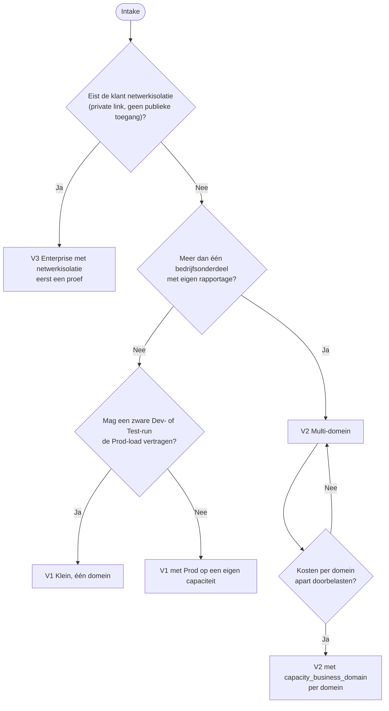
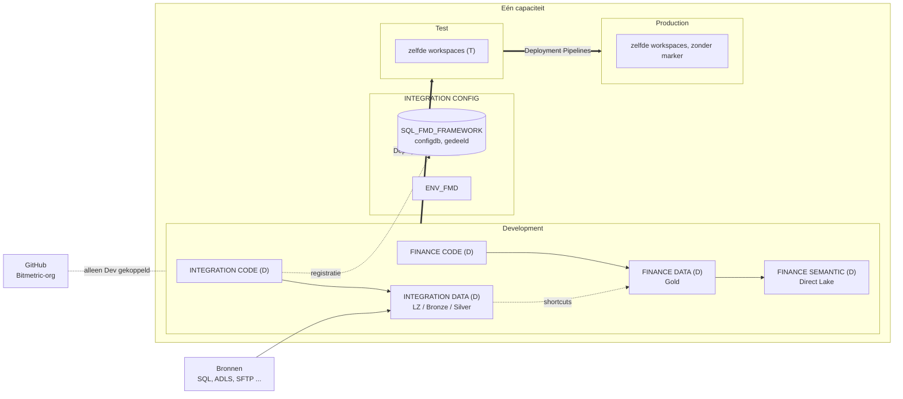
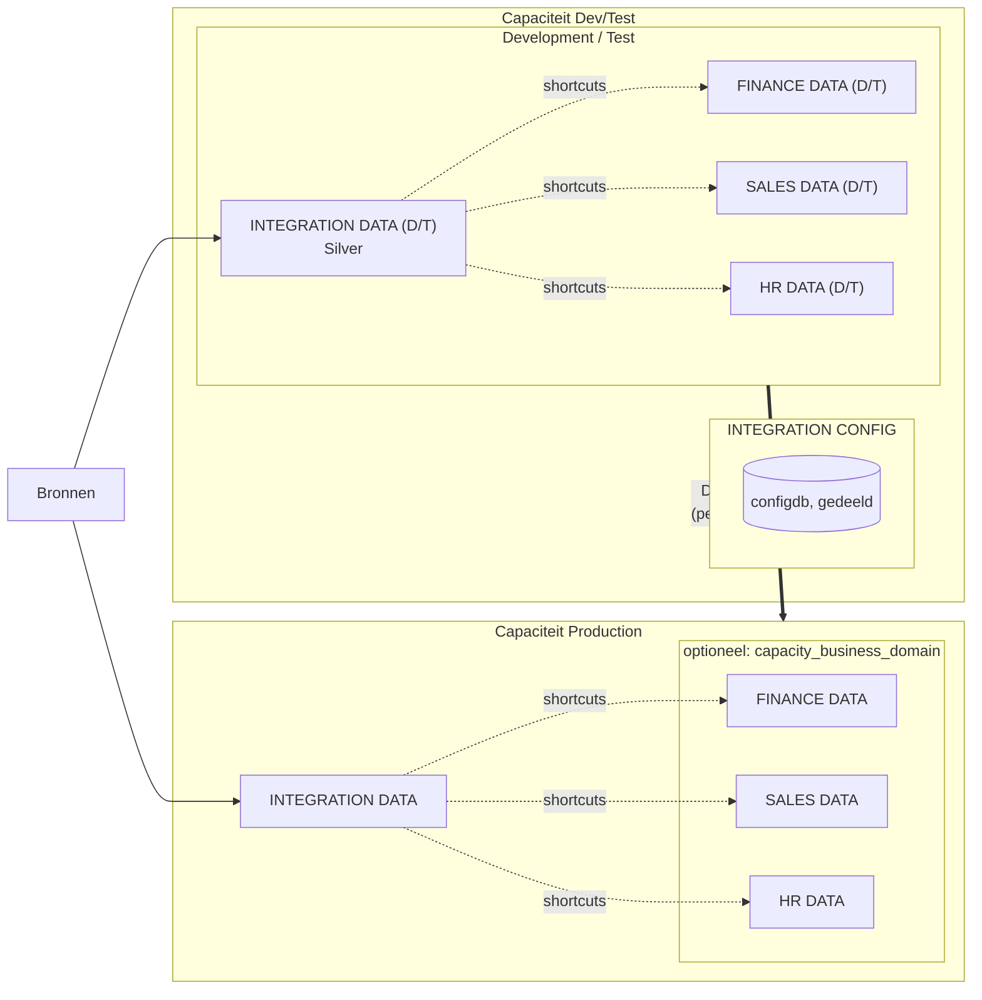
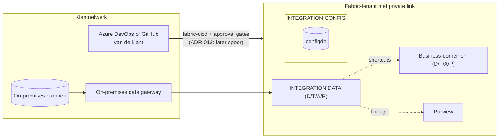
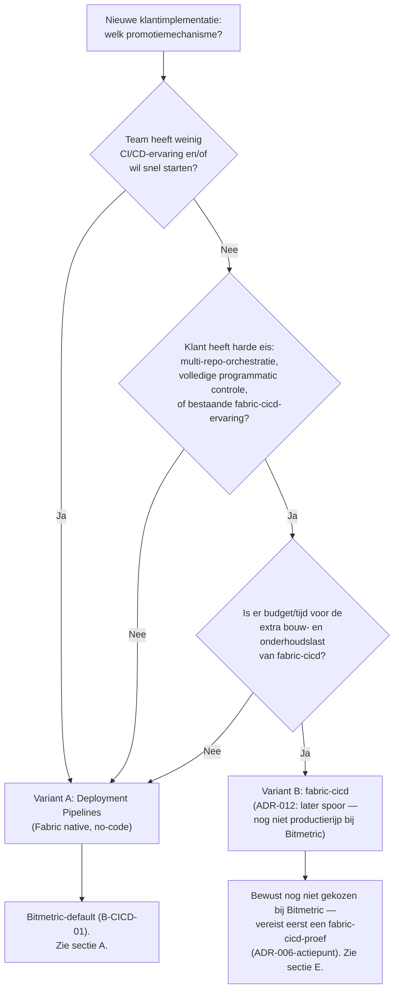
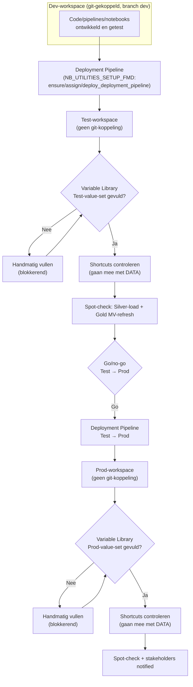
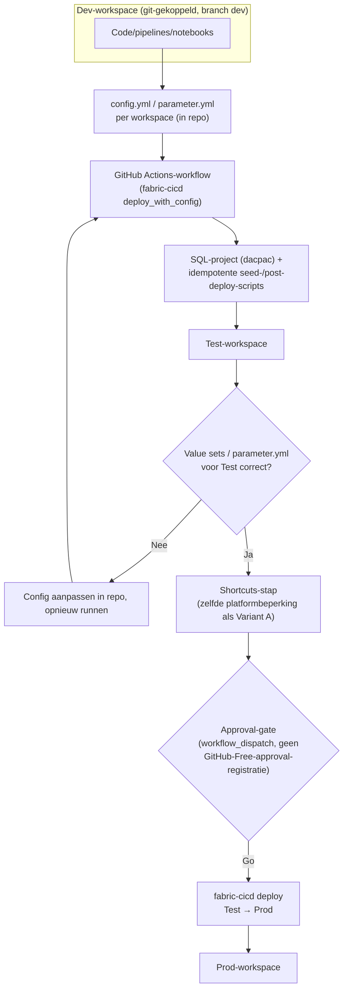

# Architectuurvarianten — klantschaal en promotiemechanisme

**Datum:** 2026-09-25  
**Versie:** 1.7  
**Standaard:** Deployment Pipelines (Fabric native) — bevestigd door Mitchell als huidige default (2026-09-22); fabric-cicd blijft een bewuste toekomstige heroverweging, geen geplande proef  
**Status:** Finaal, klaar voor intake-checklist en implementatieplan — nu met Mermaid-beslisboom en flow-diagrammen per variant (2026-09-22)

---

## Deel 1 — Standaardvarianten naar klantschaal

Dit deel laat zien hoe de klantbeslissingen uit `02_beslisregister.md` Deel A samen tot drie standaardvarianten leiden. Deel 2 (vanaf "Context") gaat over één onderdeel daarvan: het promotiemechanisme. *Toegevoegd op 2026-09-25 (review 1 R4): de vorige versie behandelde alleen het promotiemechanisme.*

**Wat in elke variant gelijk is (framework, vastgesteld in code):**
- Eén **CONFIG-workspace** per klant (`<domein> CONFIG`, bijv. `INTEGRATION CONFIG`). Die bevat de configuratiedatabase `SQL_FMD_FRAMEWORK` en de Spark-environment `ENV_FMD`, en wordt gedeeld door alle omgevingen (B-ENV-02). De Spark-sizing geldt dus in elke omgeving.
- INTEGRATION met CODE en DATA per omgeving (Landingzone, Bronze, Silver).
- Per business-domein CODE en DATA (Gold), en zo nodig SEMANTIC en REPORTING.
- Naamgeving `[DOMEIN] [LAAG] ([OMG])`, Productie zonder marker (B-ARCH-01).
- Promotie met Deployment Pipelines, code in GitHub (B-CICD-01, B-CICD-02).

### Beslismatrix

| Klantbeslissing | V1 Klein, één domein | V2 Multi-domein | V3 Enterprise met netwerkisolatie |
|---|---|---|---|
| B-WS-01 domeinen | INTEGRATION + 1 domein | INTEGRATION + meerdere domeinen | als V2 |
| B-ENV-01 omgevingen | D, T, P | D, T, P (A optioneel) | D, T, A, P |
| B-CAP-01 capaciteit | één capaciteit voor alles | Prod op een eigen capaciteit; eventueel per domein (`capacity_business_domain`) | als V2 |
| B-NET-01 netwerk | geen isolatie | gateway waar een bron dat vraagt | private link / private endpoints, gateway |
| B-SRC-01 bronnen | standaard copy-pipelines | + custom notebooks | + on-premises bronnen via gateway |
| B-LOAD-02 frequentie | nightly | nightly + intraday voor een deel | als V2 |
| B-GOLD-02 Gold / model | MLV + Direct Lake | als V1, per domein | als V1, per domein |
| B-CICD-02 Git / goedkeuring | GitHub; goedkeuring via rollen | als V1 | Azure DevOps of GitHub van de klant; approval gates via fabric-cicd (ADR-012: later spoor) |
| B-MON-01 alerting | melding bij gefaalde run | als V1 | + koppeling aan het incidentproces van de klant |
| B-GOV-01 Purview | uit | uit, tenzij aanwezig | aan |
| B-OPS-01 beheer | meestal Bitmetric of samen | samen | klant, Bitmetric als tweede lijn |

**Status per variant:** V1 is de opbouw van de trial (`FMDTRIAL` + één domein, één capaciteit; getest in eigen omgeving). V2 is de opbouw van de Bitmetric-tenant (INTEGRATION + FINANCE, SALES en HR), maar op één capaciteit: een aparte Prod- of domeincapaciteit (`capacity_business_domain`) is door de setup ondersteund, maar niet getest. **V3 is niet gevalideerd:** private link is niet getest met FMD (B-NET-01), en fabric-cicd is niet geïmplementeerd (een later spoor volgens ADR-012). V3 vraagt een eigen proef vóór een klant erop wordt toegezegd.

### Beslisboom



### V1 — Klein, één domein



### V2 — Multi-domein



Per domein en per laag (CODE, DATA, SEMANTIC, REPORTING) is er een eigen deployment pipeline; bij INTEGRATION (CODE en DATA) plus drie domeinen zijn dat er tot veertien. De configdb staat op de capaciteit van `config_workspace` en wordt door Dev, Test en Prod gedeeld.

### V3 — Enterprise met netwerkisolatie (niet gevalideerd)



**Open vragen voor V3:** werken de setup (Fabric REST-API en `fab`-CLI vanuit notebooks) en de runtime-notebooks met private link? Kan de deploy-workflow in de CI-omgeving van de klant draaien (ADR-007 gaat uit van een Bitmetric-organisatie)? Zolang dit niet getest is, bieden we V3 alleen aan met een proeffase vooraf.

---

## Deel 2 — Promotiemechanisme

## Context

Het FMD Framework moet een consistente weg bieden voor Development → Test → Production. Twee alternatieven voor het promotiemechanisme zelf zijn onderzocht, plus een losstaande vraag over waar CI/CD wordt gehost:

1. **Deployment Pipelines** (Fabric native, no-code) ← **GEKOZEN als default** (conform concept-beslisdocument §3.3, de bestaande automatisering in `NB_UTILITIES_SETUP_FMD`, en expliciet bevestigd door Mitchell op 2026-09-22)
2. fabric-cicd als promotiemechanisme (ADR-006, status **Proposed**; *Correctie 2026-10-05: ADR-006 is gesloten door ADR-012 (besluit Mitchell 2026-10-05, PR #32, gemerged `9ae2182`): Deployment Pipelines is het promotiemechanisme, fabric-cicd een later spoor.*) — Mitchell wil dit mogelijk later alsnog invoeren; geen actieve actie voor nu, zie sectie E
3. *(losstaand van de promotiekeuze)* CI/CD-hosting in een eigen GitHub-organisatie (ADR-007) en de repo-structuur (ADR-011, tot 2026-09-29 ADR-008) — dit zijn al geaccepteerde besluiten over waar code en CI draaien, niet over Deployment Pipelines vs. fabric-cicd

Deze variant beschrijft hoe Deployment Pipelines **operationeel wordt ingericht**, welke beperkingen er zijn, en hoe je omgaat met bekende Fabric-platformbeperkingen (shortcuts).

---

## Beslisboom: welk promotiemechanisme?



*(Status: eigen visualisatie op basis van B-CICD-01, ADR-006 en de argumentatie in secties A/E hieronder — geen letterlijk bronbestand. Dit is in de praktijk een binaire keuze (2 varianten), geen 2-4-wegs-matrix: de onderzochte bronnen documenteren geen derde of vierde reëel overwogen promotiemechanisme naast Deployment Pipelines en fabric-cicd.)*

---

## A. Deployment Pipelines — Standaard flow

### **Setup (1-time, Dev-workspace)**

1. **Workspace-structuur Dev-omgeving:**
   ```
   INTEGRATION CODE (D)          → shared, config-driven
   INTEGRATION DATA (D)          → LZ/Bronze/Silver landing zone
   FINANCE DATA (D)              → domain-specific Gold/Semantic
   FINANCE CODE (D)              → MATERIALIZED LAKE VIEW-notebooks
   FINANCE SEMANTIC (D)          → semantic model
   FINANCE REPORTING (D)         → Power BI reports/dashboards
   ```

2. **Git-koppeling:**
   - Enkel Dev-workspaces zijn gekoppeld aan branch `dev` in de fork/template-repo
   - Test/Prod workspaces hebben **geen eigen branches** (enkel gemapped door Deployment Pipeline)
   - Feature-branches: tijdelijk, workspace-gekoppeld, verwijderd na merge

3. **Variable Library setup (Dev):**
   - Basis `variables.json` in Dev workspace
   - Drie value sets aanmaken: Dev (default), Test (leeg), Production (leeg)
   - Test/Prod-sets expliciet vullen voordat je naar die omgeving promoveert (checklist-item!)

### **Deploy Dev → Test (via Deployment Pipeline)**

> **Correctie (2026-09-25, review 2 N-F5):** de automatisering in `NB_UTILITIES_SETUP_FMD` **richt** de Deployment Pipelines in, maar **promoveert niet**. De vorige tekst zei dat `deploy_deployment_pipeline` "de daadwerkelijke promotie uitvoert". Dat klopt niet: in de fork staat geen `/deploy`-aanroep.

**Inrichten (geautomatiseerd, al tijdens de setup): via `NB_UTILITIES_SETUP_FMD`**
```
ensure_deployment_pipeline(...)        → maakt de Deployment Pipeline aan als die nog niet bestaat (idempotent op naam)
assign_deployment_pipeline_stage(...)  → koppelt de workspaces aan de stages (slaat een stage die al gekoppeld is over)
deploy_deployment_pipeline(...)        → roept de twee hierboven aan: inrichten, géén promotie
```
`NB_SETUP_FMD` en `NB_SETUP_BUSINESS_DOMAINS` roepen dit per workspacegroep aan (CODE/DATA, en voor domeinen ook REPORTING/SEMANTIC). Afwijkingen worden niet gecorrigeerd: een stage die aan de verkeerde workspace hangt, of een pipeline met andere stages, blijft zoals hij is. Fouten worden alleen geprint.

**Promoveren (handwerk): via de Fabric UI-wizard hieronder, of via de REST-API `deploymentPipelines/{id}/deploy`:**
```
Workspace > Deployment > Create Pipeline
│
├─ Select source workspace: FINANCE DATA (D)
├─ Automatic stage mapping: 
│  └─ FINANCE DATA (D) → FINANCE DATA (T)
├─ Advanced: 
│  └─ Deployment note: "FINANCE domain v1.2"
│     (geen ingebouwde rollback bevestigd; vangnet = vorige versie in Git + nieuwe promotie)
├─ Deploy
│  └─ Monitor via Deployment progress pane
└─ After deployment:
   ├─ Shortcuts: RUN NB_CREATE_SHORTCUTS in FINANCE DATA (T)
   ├─ Value sets: ACTIVATE Test value set (if not default)
   └─ Verify: Spot-check Silver table load + Gold MV refresh
```

**Wat wordt meegenomen:**
- ✅ All notebooks (code) — as-is
- ✅ All pipelines (orchestration)
- ✅ Semantic models (Power BI datasets)
- ✅ Power BI reports
- ✅ Lakehouse schemas & tables (data layer)
- ✅ Shortcuts: gaan mee en wijzen naar Silver van het doel (*correctie 2026-09-28*, `testplan-trial.md` T-E04; was "❌ known MS limitation")
- ❓ Variable Library settings (overridable per stage)

**Wat wordt NIET meegenomen (en waarom):**
- ~~Shortcuts~~ *(correctie 2026-09-28: gaan wél mee, T-E04)*
- Git-koppelingen (Test/Prod hebben geen branches)

---

### Variant A — flow-diagram



*(Status: eigen visualisatie, samengesteld uit de stappen in dit document — de onderliggende stappen zelf zijn vastgesteld/code-geverifieerd zoals hierboven per stap aangegeven.)*

### **Post-deployment: Shortcuts-sync (CRITICAL)**

**Probleem:** Shortcuts kunnen niet mee in Deployment Pipeline. Silver-layer-references in Gold breken.

> **Correctie 2026-09-28 (getest in eigen omgeving, `testplan-trial.md` T-E04):** dit probleem treedt niet op. Shortcuts gaan mee met de promotie van de DATA-workspace, en de deployment pipeline zet ze om naar Silver van het doel, ook nieuwe shortcuts (D → T getest). `NB_CREATE_SHORTCUTS` hieronder is alleen nog nodig om de shortcuts in Dev aan te maken, en als terugval (bijvoorbeeld bij de eerste uitrol van een omgeving). De tekst hieronder blijft staan voor de geschiedenis.

**Oplossing (werkelijke implementatie, gecorrigeerd n.a.v. repo-audit 2026-09-22):**

De echte `NB_CREATE_SHORTCUTS` gebruikt **geen** `mssparkutils.lakehouse.createShortcut()` met hardcoded ID's. In plaats daarvan:
- een directe REST-call (`requests.post` naar `.../items/{lakehouse_id}/shortcuts`)
- geauthenticeerd met een token via `notebookutils.credentials.getToken("pbi")`
- de shortcut-doelen (welke paden/lakehouses per omgeving) komen **niet** uit hardcoded variabelen in de notebook, maar uit de Variable Library **`VAR_GOLD_SHORTCUTS_FMD`**

```python
# NB_CREATE_SHORTCUTS (notebook in GOLD-workspace, draait na deployment) — conceptuele schets
token = notebookutils.credentials.getToken("pbi")

# Shortcut-doelen komen uit VAR_GOLD_SHORTCUTS_FMD (Variable Library), niet hardcoded
shortcut_targets = notebookutils.variableLibrary.get(...)  # library: VAR_GOLD_SHORTCUTS_FMD

for target in shortcut_targets:
    requests.post(
        f"https://api.fabric.microsoft.com/v1/workspaces/{workspace_id}/items/{lakehouse_id}/shortcuts",
        headers={"Authorization": f"Bearer {token}"},
        json=target,
    )
```

**⚠️ Let op — twee gelijkend genaamde libraries:** er bestaan zowel `VAR_GOLD_CODE_FMD` als `VAR_GOLD_SHORTCUTS_FMD`. Er is eerder een incident geweest waarbij het item-ID van de verkeerde library werd gebruikt bij een `updateDefinition`-call, wat stilzwijgend het verkeerde item overschreef. Dubbelcheck daarom altijd het item-ID voordat je een `updateDefinition`-call doet (zie ook de projectinstructies).

**Timing:**
- ⏱️ Run **onmiddellijk na Deployment Pipeline compleet**
- Automatisering: voeg als step in Orchestration pipeline (zie sectie B)
- Handmatig: add to runbook "Post-Deployment Steps"

---

## B. Orchestration — gealigneerd met Deployment Pipeline

### **Pipeline-strategie per workspace**

> **Correctie (2026-09-22, repo-audit):** `PL_DAILY_LOAD` en `PL_POST_DEPLOYMENT` bestaan niet in de fork — dit waren fictieve namen. Hieronder de werkelijke pipelines, plus een voorstel om het ontbrekende post-deployment-stuk als nieuwe pipeline te bouwen (dat bestaat namelijk nog niet als kant-en-klaar onderdeel van FMD).

*Bijgewerkt 2026-10-12 (FMD_FRAMEWORK#58): `PL_FMD_ORCHESTRATION_TEMPLATE` heet nu `PL_FMD_ORCHESTRATION`, `PL_FMD_LOAD_GOLD_TEMPLATE` heet nu `PL_FMD_LOAD_GOLD`.*

**Bestaande orchestratie-pipelines in de fork:**

| Pipeline | Doel |
|----------|------|
| `PL_FMD_LOAD_LANDINGZONE` | Landingzone-stap |
| `PL_FMD_LOAD_BRONZE` | Bronze-stap |
| `PL_FMD_LOAD_SILVER` | Silver-stap |
| `PL_FMD_LOAD_ALL` | Roept LZ → Bronze → Silver aan, geketend op `Completed` (het reguliere-load-orchestratiepatroon; zie `03_technische_documentatie/10_operations.md`) |
| `PL_FMD_ORCHESTRATION` | Wrapper die op zijn beurt `PL_FMD_LOAD_ALL` aanroept |
| `PL_FMD_LOAD_GOLD` | Gold-laag-refresh (template, per domein in te vullen; vanaf `FMD_FRAMEWORK#58` klanteigendom: de setup maakt hem één keer per stage aan en overschrijft hem daarna niet, *vastgesteld*) |
| ~~`PL_FMD_SCHEDULE_NIGHTLY` / `PL_FMD_SCHEDULE_INTRADAY`~~ `PL_FMD_SCHEDULE_<short>` in INTEGRATION CONFIG *(Correctie 2026-10-11, eindcontrole E-V2: de wrappers `PL_FMD_SCHEDULE_NIGHTLY`/`_INTRADAY` zijn vervallen in `FMD_FRAMEWORK#52`, ADR-017.)* | Scheduling: één schedule-pipeline per omgeving, met de schedules nightly, intraday en onderhoud |

**Post-deployment (NB_CREATE_SHORTCUTS + verificatie): bestaat nog niet als losse pipeline in de fork.** Dit blijft dus een aanbeveling, geen bestaand FMD-onderdeel — te bouwen als losse pipeline of als handmatige runbook-stap:

```
Voorgesteld (nog te bouwen): "post-deployment"-stap
├─ Step 1: Run NB_CREATE_SHORTCUTS
├─ Step 2: Run test-query (SELECT TOP 10 * FROM <silver_schema>.<tabel>)
├─ Step 3: Run PL_FMD_LOAD_GOLD (of de Gold-laag-refresh voor het domein)
├─ Step 4: Log naar FMD_Logging (success/failure)
└─ Step 5: Notify (bijv. Teams-kanaal) — link naar FMD_Logging
```

---

## C. Test/Prod value sets — kritiek control punt

### **Probleem (ontdekt in Fase 1)**

Variable Libraries kunnen "lege" Test/Prod value sets hebben zonder dat je dat ziet — ze bestaan als structuur maar bevatten geen echte waarden. Dit leidt tot:
- Notebooks gebruiken Dev-defaults (verkeerde connectiestrings, paths, etc.)
- Data gaat naar verkeerde plek (Dev-datalake in plaats van Prod)

### **Controle-checklist**

> **Update (2026-09-25, fork-commit `81fe912`, ADR-010):** de setup vult de value sets van `VAR_CONFIG_FMD` en `VAR_GOLD_SHORTCUTS_FMD` voor elke omgeving en activeert per CODE-workspace de eigen value set. Een promotie overschrijft de defaults, maar niet de actieve value set (getest). De controle hieronder blijft zinvol na elke promotie, maar "handmatig vullen" is alleen nog nodig bij een `❌`-regel in de setup-output of bij een omgeving die met een oudere fork is opgebouwd. Let op: `GET …/variableLibraries/{id}` geeft alleen `properties.activeValueSetName`; de waarden lees je met `getDefinition`.

Voor elke stage-overgang, **altijd verifiëren:**

> **Correctie (2026-09-22, repo-audit):** de voorbeeldvariabelen hieronder (`CONNECTION_ID`, `SILVER_WORKSPACE`) bestonden niet echt — het REST-mechanisme zelf (PATCH `activeValueSetName`, 4 value sets) klopt wél. Werkelijke variabelen, verdeeld over (minstens) twee libraries:
> - **`VAR_CONFIG_FMD`:** o.a. `fmd_data_workspace_guid`, `fmd_landingzone_lakehouse_guid` (Dev als default, Test/Prod als valueSet-override)
> - **`VAR_GOLD_SHORTCUTS_FMD`:** shortcut-doelen voor de Gold-laag (per omgeving)
> - Let op de naamsverwarring met `VAR_GOLD_CODE_FMD` (zie waarschuwing bij sectie A) — dat is een andere library.

```
Stap: Variable Library activeValueSetName
├─ curl -H "Authorization: Bearer $TOKEN" \
│        "https://api.fabric.microsoft.com/v1/workspaces/{workspace_id}/variableLibraries/{lib_id}"
│
├─ Resultaat (Test stage, voorbeeld voor VAR_CONFIG_FMD):
│  {
│    "id": "var_lib_...",
│    "activeValueSetName": "Test",  ← MOET "Test" zijn
│    "definition": {
│      "variables": [...],
│      "valueSets": {
│        "Test": {
│          "variableOverrides": [
│            {"name": "fmd_data_workspace_guid", "value": "...test-workspace-guid..."},
│            {"name": "fmd_landingzone_lakehouse_guid", "value": "...test-lakehouse-guid..."}
│          ]
│        }
│      }
│    }
│  }
│
└─ Actie: PATCH activeValueSetName + verify waarden niet leeg zijn
```

**Runbook-item:**
```
Before deploying to Test:
1. List all Variable Libraries in workspace (REST API)
2. For each library:
   a. Check activeValueSetName (should match target stage)
   b. Check variableOverrides are NOT empty
   c. If empty: manual fill-in required (get values from ops team)
   d. PATCH to activate
3. Spot-check one notebook (print variables mid-run)
```

---

## D. Known Limitations & Workarounds

### **Limitation 1: Shortcuts niet in pipeline**
**Impact:** Gold-layer kunnen breaken na deployment  
**Workaround:** nog te bouwen post-deployment-stap + `NB_CREATE_SHORTCUTS` (zie B)  
**Detection:** FMD_Logging rapportage op cross-workspace tabel-reads  

### **Limitation 2: Intermittent DMTS_EntityNotFoundOrUnauthorized**
**Impact:** Dynamische connection-resolution (@item().ConnectionGuid) faalt soms  
**Cause:** niet vastgesteld. Zie het diagnosepad in `03_technische_documentatie/11_troubleshooting.md` (`DMTS_EntityNotFoundOrUnauthorized`).  
**Workaround:** niet blindelings retryen; volg het diagnosepad in `11_troubleshooting.md`.  
**Detection:** Pipeline error rate monitoring

### **Limitation 3: Capacity queue (NotStarted/queued)**
**Impact:** Notebook-jobs kunnen 15-30+ minuten wachten  
**Cause:** Shared capacity contention  
**Workaround:** None (geduldig pollen, capaciteitsupgrade als persistent)  
**Detection:** FMD_Logging `job_start_time - job_submit_time` metrics

---

## E. Why NOT (yet) fabric-cicd?

> **Correctie t.o.v. v1.0:** deze sectie verwarde eerder twee losse onderwerpen. ADR-007/008 gaan over CI/CD-*hosting* (een eigen GitHub-organisatie, repo-/mapstructuur) en zijn gewoon **Accepted** — dat is geen afgewezen alternatief, maar een al vastgesteld, orthogonaal besluit. Het enige echte alternatief voor het promotiemechanisme zélf is fabric-cicd (ADR-006). Zie ook B-CICD-01 in het beslisregister.

### Variant B — flow-diagram (conceptueel, niet geïmplementeerd bij Bitmetric)



*(Status: aanname — dit is een uitgewerkt ontwerpvoorstel uit een verkennende bronchat, niet bevestigd door een ADR en niet operationeel getest bij Bitmetric. ADR-006 staat nog op Proposed. Ter vergelijking met Variant A opgenomen, niet als aanbevolen pad.)*

### **Bewust (nog) niet gekozen: fabric-cicd als promotiemechanisme (ADR-012: later spoor)**

*Correctie 2026-10-05: ADR-006 is gesloten door ADR-012 (besluit Mitchell 2026-10-05, PR #32, gemerged `9ae2182`): Deployment Pipelines is het promotiemechanisme, fabric-cicd een later spoor.*

**Pros:**
- Programmatic, volledige controle
- Multi-repo-orchestratie
- Template-vriendelijk voor klanten

**Cons / reden dat dit (nog) niet de default is:**
- ADR-006 stond kort op "Accepted" maar is dezelfde dag heroverwogen: er bestaat al werkende, idempotente Deployment-Pipeline-automatisering (`NB_UTILITIES_SETUP_FMD`)
- Een eerdere fabric-cicd-pilot voor INTEGRATION CODE is teruggedraaid: alleen `src/` werd gepusht, klantspecifieke extensies bleven ongetracked
- Een concreet uitgewerkt plan voor fabric-cicd + GitHub Actions (n.a.v. een Reddit-post over onbetrouwbaarheid van Deployment Pipelines) is expliciet afgewezen via `ExitPlanMode` in een eerdere sessie
- Deployment Pipelines is native, vereist geen extra CI/CD-tooling, en is al operationeel

**Status (bevestigd door Mitchell, 2026-09-22):** "Voor nu zijn Deployment Pipelines de default. Later wil ik dit misschien omzetten naar fabric-cicd." Dit is dus geen definitief afgewezen alternatief, maar een bewuste toekomstige optie — zonder geplande proef of einddatum. Als Mitchell hier later op terugkomt, kan de door ADR-006 gesuggereerde fabric-cicd-proef (trial-omgeving + telling handmatige naloopstappen) als startpunt dienen.

---

### **Los daarvan, al vastgesteld: CI/CD-hosting (ADR-007, Accepted) en repo-structuur (ADR-011, Accepted)**

Deze ADR's gaan niet over Deployment Pipelines vs. fabric-cicd, maar over waar de code en CI van Bitmetric zelf staan:
- **ADR-007:** CI/CD wordt gehost in een eigen GitHub-organisatie van Bitmetric (niet Azure DevOps — dat is overwogen en verworpen op werkcomfort, niet op techniek). Herbruikbare workflow via versietag. *(Correctie 2026-10-05: hier stond ook "één repo per klant"; de repo-structuur is sinds 2026-09-29 ADR-011, zie hieronder.)*
- **ADR-011** (Accepted, `docs/adr/011-ontwikkelflow-repo-per-workspace.md`, commit `574029d`): **één repository per workspace** (bijv. `<KLANT>_FINANCE_CODE`), niet meer één repo per klant met een map per workspace. Deploy-scripts/migraties/docs staan bewust buiten `workspaces/`.

**Update (2026-09-30, geautomatiseerde repo-watch):** ADR-008 ("één repository per klant, één map per workspace") is per 2026-09-29 **Superseded by ADR-011**. Reden: de ontwikkelflow is end-to-end getest in de klantsimulatie FMD_TRIAL (`testplan-devflow.md`, F0–F8), en dat leverde drie concrete problemen op met de map-per-workspace-structuur — verwijzingen tussen workspaces wijzen na een *branch out* nog naar Dev (risico dat een developer-workspace in de gedeelde Gold schrijft), een value set per developer lekte naar Test/Prod, en items met dezelfde naam in verschillende domeinen hebben elk een eigen logical ID (`LogicalIdConflictDetected` bij een domeinwissel via de API). ADR-011 kiest daarom één repo per workspace, plus generieke developer-workspaces per developer (`setup/NB_SETUP_DEVELOPER_WORKSPACES.ipynb`, modes `create`/`new_feature`/`switch_domain`/`bind`) met isolatie via de defaults van de Variable Libraries en een `normalize-bindings`-workflow die na de merge naar Dev terugzet. Dit raakt vooral **Deel 2** hierboven (CI/CD-hosting en repo-structuur), niet de klantschaal-varianten V1/V2/V3 in Deel 1 — die gaan over workspace-topologie, niet over de repo-indeling van Bitmetric zelf. Zie `03_technische_documentatie/09_cicd-en-deployment.md` en `03_technische_documentatie/14_ontwikkelproces.md` voor de volledige uitwerking.

Deze keuzes zijn intern voor Bitmetric relevant (waar de fork en klant-templates leven) en staan los van welk promotiemechanisme een specifieke Fabric-workspace gebruikt.

---

## F. Checklists voor implementatie

### **Workspace setup checklist**

```
Per domein (FINANCE, SALES, HR):
─ [ ] Create 4 workspaces: CODE, DATA, SEMANTIC, REPORTING (if needed)
─ [ ] Per workspace: Dev variant created, git-connected to dev branch
─ [ ] Per workspace: Create corresponding Test workspace (no git)
─ [ ] Per workspace: Create corresponding Prod workspace (no git)
─ [ ] Variable Library: created with Dev/Test/Prod value sets
─ [ ] Variable Library: value sets explicitly populated (not empty structures!)
─ [ ] Deployment Pipeline: created (Dev → Test → Prod)
─ [ ] Post-deployment-stap (voorgesteld, nog te bouwen): created, linked to manual trigger
```

### **Pre-deployment checklist**

```
─ [ ] All notebooks tested in Dev (test data)
─ [ ] All pipelines tested in Dev (dry-run mode if applicable)
─ [ ] Git branch merged to dev
─ [ ] Dev workspace git-synced
─ [ ] Variable Library Test value set: reviewed & populated
─ [ ] Deployment Pipeline: dry-run simulation (if available)
─ [ ] Stakeholders notified (ETA, rollback plan)
```

### **Post-deployment checklist**

```
─ [ ] Deployment Pipeline: completed successfully
─ [ ] Post-deployment-stap: triggered manually
─ [ ] NB_CREATE_SHORTCUTS: ran successfully in Test workspace
─ [ ] Spot-check: Silver table load (SELECT COUNT(*) FROM <silver_schema>.<tabel>)
─ [ ] Spot-check: Gold MV refresh (status van de refresh-job-instance, plus SELECT COUNT(*) FROM gold.<mlv>)
─ [ ] FMD_Logging: monitored for errors
─ [ ] Stakeholders notified: ready for user testing
```

---

## G. Inspanning

*Vervallen op 2026-09-25 (review 1 R7).* Hier stond een schatting van 20 uur voor het inrichten van workspaces en deployment pipelines, zonder statuslabel of onderbouwing, en met een ononderbouwde korting van 30% per extra domein. Die schatting botste met de doorlooptijden in het implementatieplan. De inspanning per fase staat nu in `04_implementatieplan/plan_hoogover.md`, sectie "Inspanning".

---

## Versiegeschiedenis

- v1.0 (2026-09-21): Initial draft, Deployment Pipelines as standard, shortcuts workaround documented
- v1.1 (2026-09-21): Review — sectie E herschreven: ADR-007/008 gaan over CI/CD-hosting/repo-structuur (Accepted, los onderwerp), niet over het promotiemechanisme; het enige echte open alternatief is fabric-cicd (ADR-006, Proposed). Document status gewijzigd naar "voorlopige default" i.p.v. hard gekozen, consistent met B-CICD-01 in het beslisregister. Typo's gecorrigeerd ("Kompleksiteit" → "Complexiteit").
- v1.2 (2026-09-22): B-CICD-01 bevestigd door Mitchell — Deployment Pipelines is de huidige default, fabric-cicd blijft een bewuste toekomstige optie zonder geplande proef. Kanttekening "voorlopig" verwijderd.
- v1.3 (2026-09-22): Grote correctieslag n.a.v. de `_fmd-watch`-repo-audit (al verwerkt in `01_kennisbasis/`, nog niet hier): deployment-flow beschreven als handmatige wizard → werkelijk geautomatiseerd via `NB_UTILITIES_SETUP_FMD`; `NB_CREATE_SHORTCUTS`-codevoorbeeld hardcoded → werkelijke REST-call + `VAR_GOLD_SHORTCUTS_FMD`; pipeline-namen `PL_DAILY_LOAD`/`PL_POST_DEPLOYMENT` (bestonden niet) → werkelijke namen (`PL_FMD_LOAD_ALL` e.a.), post-deployment-stap gemarkeerd als nog te bouwen; Variable Library-voorbeeldnamen (`CONNECTION_ID`/`SILVER_WORKSPACE`) → werkelijke namen (`fmd_data_workspace_guid` e.a.).
- v1.4 (2026-09-22): Mermaid-diagrammen toegevoegd conform de brief-eis (`Promp.txt`): een beslisboom (welk promotiemechanisme kiezen) direct na de Context-sectie, en per variant een flow-diagram (Variant A: Deployment Pipelines in sectie A; Variant B: fabric-cicd, conceptueel/niet geïmplementeerd, in sectie E). Er zijn in de onderzochte bronnen geen 3e/4e reëel overwogen promotiemechanismen gevonden — dit blijft een binaire keuze, expliciet zo benoemd bij de beslisboom.
- v1.5 (2026-09-25), review 1 F10b-d: `LIMIT` vervangen door `TOP`, verzonnen tabelnamen door placeholders, de veronderstelde oorzaak en de retry-workaround bij `DMTS_EntityNotFoundOrUnauthorized` vervangen door een verwijzing naar het diagnosepad; kop op versie 1.5.
- v1.6 (2026-09-25), review 1 R4: nieuw Deel 1 met drie standaardvarianten naar klantschaal (V1 klein, V2 multi-domein, V3 enterprise met netwerkisolatie), een beslismatrix op de klantbeslissingen uit het beslisregister Deel A, een beslisboom en een Mermaid-diagram per variant. Het bestaande document is Deel 2 (promotiemechanisme). §G (20-urenschatting) vervallen; de inspanning staat in `plan_hoogover.md` (review 1 R7).
- v1.7 (2026-10-12, `FMD_FRAMEWORK#58`): Deel 2, tabel met orchestratie-pipelines: de nieuwe namen `PL_FMD_ORCHESTRATION` en `PL_FMD_LOAD_GOLD`, en de Gold-pipeline is klanteigendom; kop op versie 1.7.
