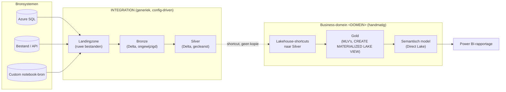
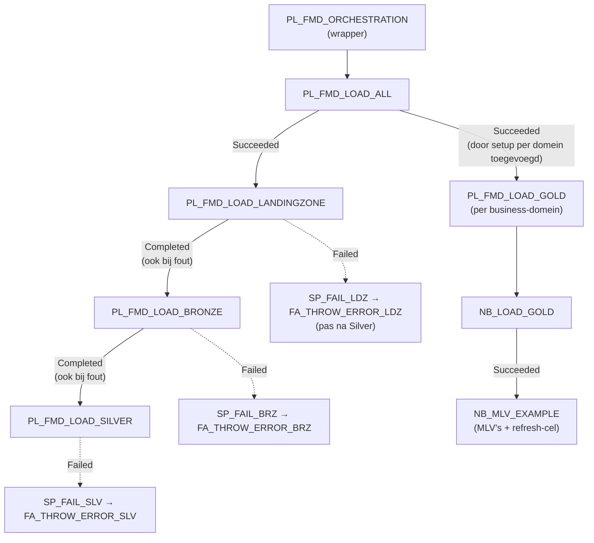

# Architectuuroverzicht — FMD Framework

**Fase:** 3 (Technische documentatie)
**Datum:** 2026-09-25
**Status:** Eerste versie, bijgewerkt op 2026-09-25 na review 1 en 2 (orchestratiediagram)
**Bron:** `output/01_kennisbasis/architectuur.md`, `configdb.md`, `registratie.md`, ADR-001 t/m ADR-009 (`FMD/docs/adr/`), repo-audit (commits `703017b`/`b3fbed7`)

*Bijgewerkt 2026-10-12 (FMD_FRAMEWORK#58): `PL_FMD_ORCHESTRATION_TEMPLATE` heet nu `PL_FMD_ORCHESTRATION`, `PL_FMD_LOAD_GOLD_TEMPLATE` heet nu `PL_FMD_LOAD_GOLD`.*

Dit document geeft het generieke, klant-onafhankelijke overzicht van de FMD-architectuur: de lagen, hoe metadata sturend is, en hoe INTEGRATION en de business-domeinen samenhangen. Voor de concrete Bitmetric-invulling, zie `13_referentie-implementatie-bitmetric.md`.

## Kernprincipe: metadata-gedreven, generiek vs. handmatig

Landingzone, Bronze en Silver zijn **generiek en config-driven**: welke bronnen, entiteiten en mappings er bestaan staat in de configuratiedatabase (schema `integration`, zie `05_INTEGRATION/01_ddl-spec.md`), niet in pipeline- of notebookcode. Dezelfde generieke pipelines verwerken elke geregistreerde bron.

De Gold-laag is het tegenovergestelde: **per business-domein handmatig gebouwd**, via notebooks met `CREATE MATERIALIZED LAKE VIEW`-statements (zie `06_BUSINESS_DOMEINEN/02_gold-laag-mlv.md`). Er is geen `GoldLayerEntity`-configuratietabel — de businesslogica die bepaalt hoe Gold-tabellen worden opgebouwd, staat in de notebookcode zelf, niet in metadata.

**Status:** vastgesteld — bevestigd via de afwezigheid van een Gold-configuratietabel in het `integration`-schema en de generieke, lege template-notebooks (`NB_LOAD_GOLD`, `NB_MLV_EXAMPLE`) die expliciet "vul dit zelf in per domein" zijn.

## Lagenoverzicht

**Status:** vastgesteld (structuur), diagram zelf is eigen visualisatie op basis van bovenstaande bronnen — geen letterlijk bronbestand.

## Config-driven registratie: waar per-klant-configuratie hoort

Volgens ADR-003 mag de generieke laag geen klant- of omgevingsspecifieke waarden bevatten. Alles wat per klant/omgeving verschilt gaat naar precies één van drie bestemmingen:

| Bestemming | Wanneer | Voorbeeld |
|---|---|---|
| **Manifest** (`manifest.yaml`) | Alleen vóór/tijdens oplevering, éénmalig | `repository`, `naming`, `environments[]`, `spark`, `key_vault` |
| **Variable Library** (per omgeving) | Per Dev/Test/Acceptance/Production, wijzigt zelden | Workspace-/Lakehouse-GUID's, Key Vault-URI |
| **Metadata `integration.*`** (tijdens gebruik) | Continu, operationeel | Bronnen, connecties, entiteiten, `IsActive`-vlaggen |

**Status:** vastgesteld (ADR-003, Accepted).

## Orchestratie — hoog niveau

**Lezen:**
- De lagen ketenen op **`Completed`**. Bronze draait ook als Landingzone faalt, en Silver ook als Bronze faalt. Dat is foutisolatie per entiteit.
- De `FA_THROW_ERROR_*`-activities maken de run daarna alsnog rood; zie `10_operations.md`.
- Een groene run bewijst dus niet dat elke entiteit geladen is.
- De Gold-pipelines hangen in `PL_FMD_ORCHESTRATION`, ná `PL_FMD_LOAD_ALL`, met als conditie **`Succeeded`**. `NB_SETUP_BUSINESS_DOMAINS` voegt ze toe via `wire_domain_into_orchestration()`, gezocht op de naam `PL_FMD_LOAD_GOLD`. Twee gevolgen:
  - Faalt één entiteit in één laag, dan draait Gold voor **geen enkel** domein.
  - De toegevoegde activity bevat een letterlijke `workspaceId`/`pipelineId` van de Gold-workspace in díe omgeving. Promoveer je `PL_FMD_ORCHESTRATION` met een Deployment Pipeline, dan ~~kan die cross-workspace-verwijzing naar de bronomgeving blijven wijzen~~ wordt die verwijzing omgezet naar de gekoppelde Gold-pipeline van het doel *(bijgewerkt 2026-10-06, P3-V2: getest in T-A07b en in rookproef 2 stap 14, T → P; ontbreekt de tegenhanger, dan faalt de promotie met Missing Dependencies)*. Controleer dat na elke promotie (zie de post-deployment-checklist in `09_cicd-en-deployment.md`), of laat de setup per omgeving opnieuw draaien.
- *Aanvulling 2026-10-12 (`FMD_FRAMEWORK#58`, vastgesteld in `NB_UTILITIES_SETUP_FMD`, `CUSTOMER_OWNED_ITEMS`):* `PL_FMD_LOAD_GOLD` is klanteigendom. De setup maakt hem één keer per stage aan en overschrijft hem daarna niet. Het diagram toont de template; een klant voegt er in Dev eigen notebook-activities aan toe (`06_BUSINESS_DOMEINEN/02_gold-laag-mlv.md`).
- De MLV-refresh zit als cel in `NB_MLV_EXAMPLE`. Die cel controleert het resultaat niet; zie `06_BUSINESS_DOMEINEN/02_gold-laag-mlv.md`.

**Status:** vastgesteld (dependency-condities en activities uit `FMD/src/PL_FMD_LOAD_ALL.DataPipeline/`, `PL_FMD_ORCHESTRATION.DataPipeline/`, `PL_FMD_LOAD_GOLD.DataPipeline/` en `NB_UTILITIES_SETUP_FMD`). *Correctie 2026-09-25 (review 1 F2): het vorige diagram toonde kale pijlen zonder `Completed`-semantiek, en een "handmatige vervolgstap" naar Gold die in werkelijkheid door de setup is ingericht.* De naam `PL_MASTER_ORCHESTRATION` komt **niet** voor in de repo.

## Workspace-topologie

Zie `06_BUSINESS_DOMEINEN/01_workspace-structuur.md` voor de volledige uitwerking van het CODE/DATA/SEMANTIC/REPORTING-patroon × D/T/A/P-omgevingen en de vastgestelde naamgevingsconventie (B-ARCH-01).

## Verwijzingen naar overige Fase 3-documenten

| Onderwerp | Document |
|---|---|
| Configuratiedatabase (DDL, ER-diagram) | `05_INTEGRATION/01_ddl-spec.md` |
| Bronnen registreren | `05_INTEGRATION/02_configdb-registratie.md` |
| Operationele aandachtspunten INTEGRATION | `05_INTEGRATION/03_operationele-aandachtspunten.md` |
| Workspace-structuur & naamgeving | `06_BUSINESS_DOMEINEN/01_workspace-structuur.md` |
| Gold-laag & MLV's | `06_BUSINESS_DOMEINEN/02_gold-laag-mlv.md` |
| Shortcuts & deployment-beperking | `06_BUSINESS_DOMEINEN/03_shortcuts-en-deployment.md` |
| Semantisch model / Direct Lake | `06_BUSINESS_DOMEINEN/04_semantisch-model-direct-lake.md` |
| Extensiepunten | `07_extension-points.md` |
| Security & secrets | `08_security-en-secrets.md` |
| CI/CD & deployment | `09_cicd-en-deployment.md` |
| Operations | `10_operations.md` |
| Troubleshooting | `11_troubleshooting.md` |
| Kosten & capaciteit | `12_kosten-en-capaciteit.md` |
| Bitmetric-referentie-implementatie (concreet) | `13_referentie-implementatie-bitmetric.md` |
