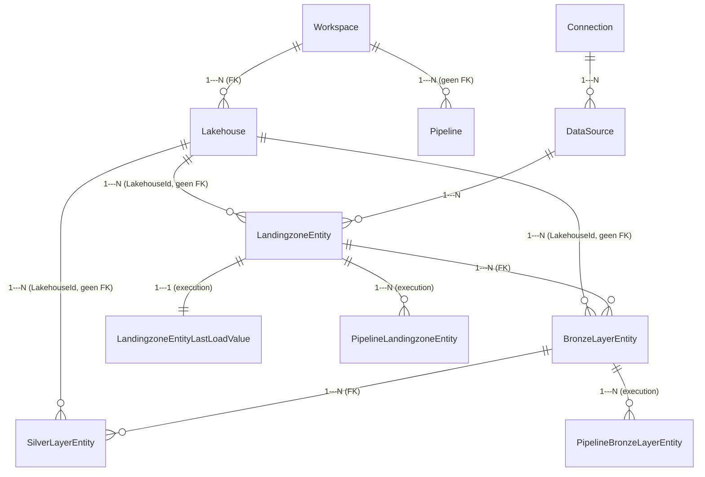

# DDL-specificatie — Configuratiedatabase

**Bron:** `FMD/src/Config_Database/` (fork-code, leidend boven chats/documentatie conform projectinstructie) · `output/01_kennisbasis/configdb.md`
**Status:** vastgesteld, tenzij anders aangegeven

De configuratiedatabase bestaat uit drie schema's, elk met een eigen verantwoordelijkheid:

| Schema | Verantwoordelijkheid |
|---|---|
| `integration` | Kernconfiguratie: welke bronnen, connecties en entiteiten bestaan er, en hoe worden ze gemapt naar Landingzone/Bronze/Silver |
| `execution` | Runtime/load-state: wat is er als laatste geladen, wat moet er nog geladen worden (views) |
| `logging` | Append-only audit-/executielogs per pipeline-run |

Alle drie worden aangemaakt via `CREATE SCHEMA [x] AUTHORIZATION [dbo]` in `Security/integration.sql` / `execution.sql` / `logging.sql`.

---

## Schema `integration`

### `Connection`
Verbindingsdefinities (DB, ADLS, ADF, SFTP/FTP, Notebook, Oracle).

| Kolom | Type | Constraint |
|---|---|---|
| `ConnectionId` | int, identity | PK |
| `ConnectionGuid` | uniqueidentifier | UC |
| `Name` | varchar(200) | |
| `Type` | varchar(50) | |
| `GatewayType` | varchar(50) | NULL |
| `DatasourceReference` | varchar(max) | NULL |
| `IsActive` | bit | |

**Let op:** `GatewayType` en `DatasourceReference` zijn **niet** vulbaar via `sp_UpsertConnection` — die kolommen kunnen alleen via een directe INSERT/UPDATE worden gezet.

### `DataSource`
Logische databron, gekoppeld aan een `Connection`.

| Kolom | Type | Constraint |
|---|---|---|
| `DataSourceId` | int, identity | PK |
| `ConnectionId` | int | (geen DB-FK) |
| `Name` | varchar(100) | UC op (`ConnectionId`,`Name`,`Type`) |
| `Namespace` | varchar(100) | |
| `Type` | varchar(30) | NULL |
| `Description` | nvarchar(200) | NULL |
| `LoadGroup` | varchar(50) | DEFAULT `''`, NOT NULL — **fork-only, niet in upstream** |
| `IsActive` | bit | |

### `Workspace`
| Kolom | Type | Constraint |
|---|---|---|
| `WorkspaceId` | int, identity | PK |
| `WorkspaceGuid` | uniqueidentifier | UC |
| `Name` | varchar(100) | |

### `Lakehouse`
| Kolom | Type | Constraint |
|---|---|---|
| `LakehouseId` | int, identity | PK |
| `LakehouseGuid` | uniqueidentifier | UC |
| `WorkspaceGuid` | uniqueidentifier | **FK → `Workspace.WorkspaceGuid`** (enige FK op dit niveau) |
| `Name` | varchar(100) | |
| `IsActive` | bit | |

**Belangrijk voor registratie:** binnen een workspace moeten lakehouses met de exacte namen `LH_DATA_LANDINGZONE`, `LH_BRONZE_LAYER` en `LH_SILVER_LAYER` geregistreerd staan — `sp_UpsertLandingzoneBronzeSilver` zoekt ze op via `sp_GetLakehouse` (by Workspace+Name). Zonder deze drie, exact zo genoemd, faalt de registratie van entiteiten in die workspace.

### `Pipeline`
| Kolom | Type | Constraint |
|---|---|---|
| `PipelineId` | int, identity | PK |
| `PipelineGuid` | uniqueidentifier | UC |
| `WorkspaceGuid` | uniqueidentifier | **geen FK** (inconsistent met `Lakehouse`) |
| `Name` | varchar(200) | |
| `IsActive` | bit | |

### `LandingzoneEntity`
Bron-entiteit → landingzone-bestand-mapping.

| Kolom | Type | Constraint |
|---|---|---|
| `LandingzoneEntityId` | bigint, identity | PK |
| `DataSourceId` | int | (geen DB-FK) |
| `LakehouseId` | int | (geen DB-FK) |
| `SourceSchema` | nvarchar(100) | NULL |
| `SourceName` | nvarchar(200) | UC op (`SourceSchema`,`SourceName`,`DataSourceId`,`LakehouseId`) |
| `FileName` | nvarchar(200) | |
| `FileType` | nvarchar(20) | |
| `FilePath` | nvarchar(500) | |
| `IsIncremental` | bit | DEFAULT `0` |
| `IsIncrementalColumn` | nvarchar(50) | NULL |
| `SourceCustomSelect` | nvarchar(4000) | NULL — wordt door het framework **niet gelezen** (zie `07_extension-points.md` §3) |
| `CustomNotebookName` | varchar(200) | NULL — extensiepunt (zie `01_kennisbasis/bronnen-en-extensies.md`) |
| `IsActive` | bit | |

### `BronzeLayerEntity`
| Kolom | Type | Constraint |
|---|---|---|
| `BronzeLayerEntityId` | bigint, identity | PK |
| `LandingzoneEntityId` | bigint | **FK → `LandingzoneEntity`** |
| `LakehouseId` | int | (geen DB-FK) |
| `Schema` | nvarchar(100) | UC op (`LakehouseId`,`Schema`,`Name`) |
| `Name` | nvarchar(200) | |
| `PrimaryKeys` | nvarchar(200) | |
| `FileType` | | DEFAULT `'Delta'` |
| `CleansingRules` | nvarchar(max) | NULL |
| `IsActive` | bit | |

### `SilverLayerEntity`
| Kolom | Type | Constraint |
|---|---|---|
| `SilverLayerEntityId` | bigint, identity | PK |
| `BronzeLayerEntityId` | bigint | **FK → `BronzeLayerEntity`** |
| `LakehouseId` | int | (geen DB-FK) |
| `Schema` | nvarchar(100) | NULL, UC op (`LakehouseId`,`Schema`,`Name`) |
| `Name` | nvarchar(200) | NULL |
| `FileType` | | DEFAULT `'Delta'` |
| `CleansingRules` | nvarchar(max) | NULL |
| `IsActive` | bit | |
| `IsHistorized` | bit | NOT NULL, DEFAULT `0` *(toegevoegd 2026-10-12, `FMD_FRAMEWORK#51`, ADR-016, `6cc9ff7`; vastgesteld in code)*. *Correctie 2026-10-13: de default was `1`; die is `0` geworden omdat historie die niemand vraagt opslag en merge-tijd kost (ADR-016, *Herzien 2026-10-13*; branch `feature/silver-default-zonder-historie`, `FMD_FRAMEWORK#62`; vastgesteld in `SilverLayerEntity.sql`; default `(0)` getest in eigen omgeving 2026-10-13 na publicatie op trial-Dev).* `1` = SCD2-historie in Silver, `0` = alleen de huidige rij. Bestaande rijen houden hun waarde tot de registratielijst ze verandert. Het notebook krijgt de waarde via `vw_LoadToSilverLayer` en `sp_GetSilverlayerEntity`. Een wijziging bereikt een omgeving pas met een nieuwe dacpac (ADR-013). |

### Relatiediagram

*(Status: aanname — afgeleid uit kolomnamen + join-logica in de views; niet alle relaties zijn DB-FK's. Alleen `Lakehouse→Workspace`, `BronzeLayerEntity→LandingzoneEntity` en `SilverLayerEntity→BronzeLayerEntity` zijn daadwerkelijk als foreign key afgedwongen door de database — de overige "1---N"-relaties zijn applicatieniveau-verbanden zonder DB-constraint.)*

---

## Schema `execution`

### `LandingzoneEntityLastLoadValue`
Laatste incrementele waarde per landingzone-entiteit (effectief 1-op-1 met `LandingzoneEntity`).

| Kolom | Type |
|---|---|
| `LandingzoneEntityValueId` | PK |
| `LandingzoneEntityId` | UC |
| `LoadValue` | varchar(50) |
| `LastLoadDatetime` | datetime2(7) |

### `PipelineBronzeLayerEntity` / `PipelineLandingzoneEntity`
Load-tracking per pipeline-run, per laag. Beide met: PK, entiteits-FK-achtige kolom, `InsertDateTime`, `IsProcessed` (bit), `LoadEndDateTime`. `PipelineLandingzoneEntity` heeft `FilePath` + `FileName`, `PipelineBronzeLayerEntity` heeft `TableName` + `SchemaName`.

### Views (bepalen wat er geladen moet worden)

- **`vw_LoadSourceToLandingzone`** — join `LandingzoneEntity`+`Lakehouse`+`Workspace`+`DataSource`+`Connection` (+optioneel `LandingzoneEntityLastLoadValue`), filtert `IsActive=1`, bouwt dynamisch `LastLoadValue`/`SourceDataRetrieval`-SQL-strings.
- **`vw_LoadToBronzeLayer`** — join `BronzeLayerEntity`+`LandingzoneEntity`+`PipelineLandingzoneEntity`+`LandingzoneEntityLastLoadValue`+`DataSource`+2×`Lakehouse`+2×`Workspace`, filtert `IsActive=1` (LZE+BLE) én `PLZE.IsProcessed=0`.
- **`vw_LoadToSilverLayer`** — join `SilverLayerEntity`+`BronzeLayerEntity`+`LandingzoneEntity`+`PipelineBronzeLayerEntity`+`DataSource`+2×`Lakehouse`+2×`Workspace`, filtert `IsActive=1` (LZE+BLE+SLE) én `PBLE.IsProcessed=0`.

**Praktisch gevolg:** de views filteren alleen op `IsActive` van de **entiteitstabellen** (LZE, BLE, SLE). `LandingzoneEntity.IsActive = 0` stopt alle drie de lagen voor die entiteit, en `BronzeLayerEntity`/`SilverLayerEntity` stoppen alleen die laag en de lagen erna. `Connection.IsActive`, `DataSource.IsActive` en `Lakehouse.IsActive` worden nergens gefilterd en stoppen de load dus niet. Procedure en valkuilen: `02_configdb-registratie.md` §Deactivering (B-INFRA-02). *Correctie 2026-09-25 (review 1 F3).*

---

## Schema `logging`

Drie structureel identieke, **append-only tabellen zonder PK**: `CopyActivityExecution`, `NotebookExecution`, `PipelineExecution`.

Elk met: `WorkspaceGuid`, `PipelineRunGuid`, `PipelineParentRunGuid`, een entiteitsspecifieke Guid+Name (`PipelineGuid`/`PipelineName`, `NotebookGuid`/`NotebookName`, `PipelineGuid`/`CopyActivityName`), een parameterkolom (`PipelineParameters`/`NotebookParameters`/`CopyActivityParameters`, varchar(8000)), `TriggerType`/`TriggerGuid`/`TriggerTime`, `LogType`, `LogDateTime` (datetime2(6)), `LogData` (varchar(8000)), `EntityId`, `EntityLayer`.

**Bekende datakwaliteitsissues (belangrijk voor wie hierop rapportages bouwt):**
- Inconsistente spelling: `LogType` bevat zowel `FailPipeline` als `FailedPipeline`
- `EntityLayer` heeft 4 waarden: `Bronze`, `Control`, `Landingzone`, `Silver`
- `TriggerType` bevat naast de string `"Manual"` ook de ongenormaliseerde kale waarde `"1"` (voor `PL_FMD_LOAD_ALL`)

**Schema drift geconstateerd (getest in eigen omgeving):** `integration.DataSource.LoadGroup` bestond ten tijde van onderzoek in de repo-broncode maar niet in de live `SQL_INTEGRATION_FRAMEWORK`-database bij Bitmetric — de gedeployde database liep op dat moment achter op de repo. **Actiepunt voor elke klantimplementatie:** verifieer bij intake dat de gedeployde configdb-DDL daadwerkelijk gelijk is aan de repo-versie, niet alleen dat de repo zelf klopt.

---

## Verschillen fork vs. upstream-wiki

Getoetst tegen de wiki-kopie in `bronnen/fmd-upstream-wiki/wiki-clone/` (commit `e7a8973`, 2026-08-25) en tegen `upstream/main` van `edkreuk/FMD_FRAMEWORK`.

1. **`DataSource.LoadGroup` is fork-only** (commit `effbbe8`). De kolom zit ook in `sp_UpsertDataSource`, de `execution`-views, `sp_GetBronzelayerEntity`/`sp_GetSilverlayerEntity` en de COMMAND-pipelines. Het enige andere verschil in `src/Config_Database` is de fork-fix in `sp_UpsertLandingzoneBronzeSilver` (PR #8, `4dd41cf`): herregistratie laat `IsActive` van bestaande entiteiten staan.

2. **⚠️ Het registratievoorbeeld van de wiki zet in de fork stil `LoadGroup = '1'`.** `Supported-data-sources.md` roept `sp_UpsertDataSource` bij elke brontype **positioneel** aan, met zeven argumenten die eindigen op `1` (bedoeld als `@IsActive`). In de fork staat `@LoadGroup` op de zevende plek, vóór `@IsActive`:

   | Positie | Upstream | Fork |
   |---|---|---|
   | 7 | `@IsActive BIT = 1` | `@LoadGroup VARCHAR(50) = ''` |
   | 8 | — | `@IsActive BIT = 1` |

   Wie het wiki-voorbeeld overneemt, krijgt `LoadGroup = '1'` en `IsActive` via de default op 1. Er komt geen foutmelding. De bron laadt wel in een run zonder groep (`LoadGroup = ''`), maar **niet** in `PL_FMD_SCHEDULE_NIGHTLY` of `_INTRADAY`: de COMMAND-pipelines filteren op `'' = @LoadGroup OR LoadGroup = @LoadGroup`. Dit is vrijwel zeker de oorzaak van het incident met het bulkscript van 2026-09-15 (`03_operationele-aandachtspunten.md` §2, R8 in het draaiboek). **Gebruik altijd benoemde parameters**, zoals het sjabloon in `04_implementatieplan/draaiboek_detail.md` Bijlage A.

3. **De registratieroute is dezelfde.** De wiki beveelt `sp_UpsertConnection` en `sp_UpsertDataSource` zelf aan ("All metadata is registered using …", `Supported-data-sources.md`), en beide procedures bestaan ook upstream. Alleen voor een custom notebook noemt `Data-Integration.md` een directe INSERT in `integration.LandingzoneEntity` als alternatief voor `sp_UpsertLandingzoneBronzeSilver`.

4. **De typelijsten in de wiki zijn onvolledig.** `Data-Model.md` noemt als connectietypes `SQL`, `ADLS`, `ADF`, `SFTP`/`FTP`, `NOTEBOOK` en `ORACLE`. `ONELAKE` en `AZURESQLMI` ontbreken, net als de bijbehorende DataSource-types (`ONELAKE_TABLES_01`, `ONELAKE_FILES_01`, `SQLMI_01`), terwijl fork en upstream ze allebei ondersteunen. De volledige lijst staat in `../07_extension-points.md` §1. Het ADLS-voorbeeld in `Supported-data-sources.md` gebruikt bovendien `@Type = 'SQL'` en `'ASQL_01'`: overgenomen laadt die bron via het SQL-pad, of helemaal niet.

5. **`execution` en `logging` staan maar deels in de wiki.** `Data-Model.md` documenteert alleen `integration`. `Full-load-versus-Incremental.md` noemt wel `[execution].[LandingzoneEntityLastLoadValue]`. `Data-Observability.md` verwijst naar de logtabellen als `audit.PipelineExecution` enzovoort; een schema `audit` bestaat in geen enkele codeversie, het is `logging`.

**Status:** vastgesteld (wiki-kopie, `git show upstream/main:…/sp_UpsertDataSource.sql`, filters in `PL_FMD_LDZ_COMMAND_*`). Dat het incident van 15-09 uit het wiki-voorbeeld kwam, is afgeleid, niet bevestigd. *Correctie 2026-09-25 (review 2 N-F7): de vorige versie stelde dat de wiki directe INSERT's als hoofdpad beschrijft en de SP's niet aanbeveelt, en dat `execution` en `logging` in de wiki niet voorkomen.*
