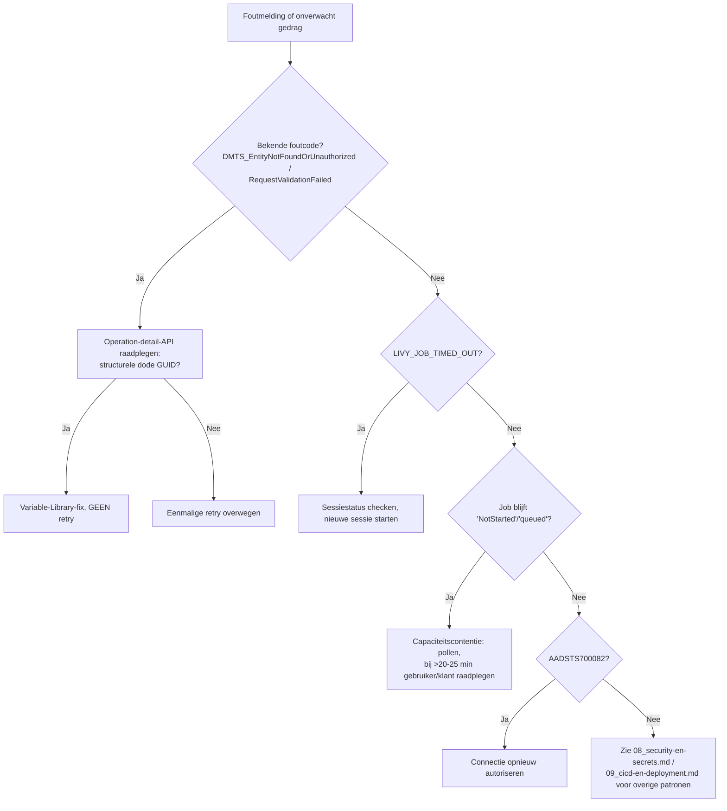

# Troubleshooting

**Fase:** 3 (Technische documentatie)
**Datum:** 2026-09-25
**Status:** Eerste versie, bijgewerkt op 2026-09-25 na review 1 en 2 (`FA_THROW_ERROR_*`, Variable Libraries na promotie, stil overgeslagen bronnen, OAuth-inactiviteit) en na de hertest op de lege trial (`InsufficientPrivileges` door hergebruikte connecties; Bronze/Silver leeg door een `NULL`-LoadGroup) *Daarna bijgewerkt tot 2026-10-08 (rookproef 2, review 3, eindcontrole, PR #30–#49); zie de datums per sectie.*
**Bron:** `output/01_kennisbasis/operations.md`, `security.md`, `05_INTEGRATION/03_operationele-aandachtspunten.md`

*Bijgewerkt 2026-10-12 (FMD_FRAMEWORK#58): `PL_FMD_ORCHESTRATION_TEMPLATE` heet nu `PL_FMD_ORCHESTRATION`, `PL_FMD_LOAD_GOLD_TEMPLATE` heet nu `PL_FMD_LOAD_GOLD`.*

Dit document bundelt de bekende foutpatronen en hun diagnose/oplossing, geordend van meest naar minst frequent verwacht.

## `DMTS_EntityNotFoundOrUnauthorized` (en verwant: `RequestValidationFailed`)

**Symptoom:** intermitterende fout bij dynamische connection-resolutie (`@item().ConnectionGuid`).

**Diagnose:** raadpleeg de Fabric operation-detail-API om de onderliggende fout te achterhalen. Een deel van de gevallen die intermitterend lijken, blijkt bij troubleshooting een **structurele "dode" GUID-referentie** te zijn — een GUID die niet meer bestaat of ontoegankelijk is.

**Oplossing:** verplaats de referentie naar een Variable Library-variabele in plaats van een hardcoded of dynamisch herberekende GUID. Dit lost het probleem **permanent** op; een retry lost het soms tijdelijk op maar niet structureel.

**Belangrijk:** niet blindelings retryen zonder eerst te verifiëren dat het probleem niet structureel is — dit is een directe, geverifieerde uitwerking van de bekende platformbeperking uit de projectinstructies.

**Status:** getest in eigen omgeving.

## `LIVY_JOB_TIMED_OUT`

**Symptoom:** een notebook-sessie reageert niet meer / faalt bij aanroep.

**Diagnose:** Livy-sessies sterven na inactiviteit of een lange wachttijd.

**Oplossing:** check de sessiestatus vóór gebruik; maak zo nodig een nieuwe sessie aan. Geen structurele fix nodig — dit is verwacht gedrag bij langdurige inactiviteit.

**Status:** getest in eigen omgeving.

## Capaciteitscontentie (`NotStarted`/`queued`, 15-30+ minuten)

**Symptoom:** notebook-jobs of Livy-sessies blijven lang in de wachtrij staan.

**Diagnose:** drukte op de gedeelde capaciteit — geen fout, geen storing.

**Oplossing:** geduldig pollen (elke 60–180s). Bij meer dan 20–25 minuten: aan de gebruiker/klant voorleggen of doorwachten gewenst is, in plaats van te escaleren als incident.

**Status:** vastgesteld.

## `AADSTS700082` — verlopen OAuth-token

**Symptoom:** een gekoppelde connectie faalt stilzwijgend.

**Diagnose:** het refresh-token van een OAuth-connectie verloopt na 90 dagen inactiviteit, dus bij een connectie die 90 dagen niet is gebruikt.

**Oplossing:** connectie opnieuw autoriseren. Structurele preventie: periodieke controle/verversing (< 90 dagen) inbouwen als operationele routinetaak.

**Status:** getest in eigen omgeving.

## `FA_THROW_ERROR_*` / `LandingzoneFailed`, `BronzeFailed`, `SilverFailed`: een laag is gefaald

**Symptoom:** `PL_FMD_LOAD_ALL` (of een laag-pipeline) eindigt rood, met een melding als *"The Bronze layer failed. The failure is already recorded in logging.PipelineExecution; query it for the failing entity."*

**Diagnose:** dit is een **echte** fout. De Fail-activity gooit de fout opnieuw nadat ze gelogd is. Zoek de falende entiteit op met de monitoringquery in `10_operations.md`. Bekende oorzaken per laag:
- **Landingzone:** de connectie, credentials of timeout. Zie ook `DMTS_EntityNotFoundOrUnauthorized` en de OAuth-sectie in dit document. Falen alle drie de lagen binnen enkele seconden en staat er niets in `CopyActivityExecution`, zie dan *`InsufficientPrivileges` op `PL_FMD_LOAD_LANDINGZONE`* hieronder.
- **Bronze:** datakwaliteit in het bronbestand. `NB_FMD_LOAD_LANDING_BRONZE` stopt bewust bij een ontbrekende PK-kolom (`PK: … doesn't exist in the source.`) of bij dubbele PK's (`Source file contains duplicated rows for PK: …`).
- **Alle lagen:** een harde timeout. Zie *Harde timeouts* in `10_operations.md`.

**Oplossing:**
- Een technische oorzaak lost het beheerteam op.
- Een datakwaliteitsoorzaak escaleer je naar de eigenaar van de brondata. Het gefaalde bestand blijft tot die tijd bij elke run terugkomen; zie *Herstarten na een fout* in `10_operations.md`.
- Door de `Completed`-ketening hebben de volgende lagen voor de andere entiteiten wel gedraaid.

**Status:** vastgesteld (`FMD/src/PL_FMD_LOAD_ALL.DataPipeline`, `PL_FMD_LOAD_BRONZE`, `NB_FMD_LOAD_LANDING_BRONZE`). Dit vervangt de eerdere beschrijving als "bewuste valse fout, niet escaleren". Die was onjuist (review 1 F1, review 2).

## `InsufficientPrivileges` op `PL_FMD_LOAD_LANDINGZONE` (alle lagen falen direct)

**Symptoom:** `PL_FMD_LOAD_ALL` faalt binnen een à twee minuten. `logging.PipelineExecution` toont `LDZ failed`, `BRZ failed` en `SLV failed` vlak na elkaar, en `CopyActivityExecution` en `NotebookExecution` zijn leeg. De foutmelding van de run zelf (*"The Landingzone layer failed…"*) is de vaste tekst van de Fail-activity en zegt niets over de oorzaak. Pas in Monitor, bij de activity `PL_FMD_LOAD_LANDINGZONE` in de run van `PL_FMD_LOAD_ALL`, staat de echte fout: `InsufficientPrivileges`, *"The caller does not have sufficient permissions to access the requested resource"*, HTTP 403, foutcode 3125.

**Diagnose:** het is de `InvokePipeline`-aanroep zelf die faalt, niet de copy. `SP_START_AUDIT_PIPELINE` in dezelfde run slaagt wel. `InvokePipeline` gaat via `CON_FMD_FABRIC_PIPELINES`, en de identiteit achter die connectie heeft geen rechten op de CODE-workspace. Dat gebeurt als de connectie niet door deze installatie is aangemaakt: connectienamen zijn tenant-breed, `create_or_get_fmd_connection` hergebruikt een bestaande connectie met dezelfde naam, en neemt de credential van die connectie over. Controleer:
```
GET /v1/connections/{id}   → credentialDetails.credentialType, connectionRecency.createdDateTime
```
Staat er `ServicePrincipal` en een datum van vóór de installatie, dan is dit de oorzaak.

**Oplossing:**
- Direct: geef die SP (of een groep waar hij lid van is) Contributor op de workspaces van de installatie, via Workspace → Manage access of `POST /v1/workspaces/{id}/roleAssignments`. Een nieuwe run is genoeg; opnieuw deployen hoeft niet.
- Structureel: voeg die SP toe aan de groep in `security.admin_group_id`; die groep komt op alle workspaces, ook op die van de business-domeinen.
  - ~~`security.service_principal_id` dekt alleen de integratie-workspaces. De domein-CODE-workspaces, waar de orchestratie de Gold-pipelines aanroept, krijgen hem niet.~~
  - *Correctie 2026-10-07 (`FMD_FRAMEWORK#34`; draft van de repo-watch verwerkt):* vanaf #34 geeft `NB_SETUP_BUSINESS_DOMAINS` `security.service_principal_id` Contributor op de CODE- en DATA-workspaces van een domein. Tot en met #33 dekte hij alleen de integratie-workspaces.
  - De groep in `admin_group_id` blijft nodig voor een hergebruikte connectie met een SP die niet in `service_principal_id` staat.
  - `contributor_group_id` komt op geen enkele CODE-workspace, dus die helpt niet (draaiboek, fase 3 stap 1).
- **Niet** de workspace-identities rechten geven op de connecties. Dat lijkt logisch, maar lost dit niet op: de connectie authenticeert als de SP, niet als de workspace (getest 2026-09-25).

**Status:** getest in eigen omgeving, twee keer: 2026-09-13 (proefinstallatie `FMDTRIAL`) en 2026-09-25 (`FMD_TRIAL`, `testplan-trial.md` T-C03). In beide gevallen was `CON_FMD_FABRIC_PIPELINES` in maart 2026 aangemaakt door de productie-installatie, met de SP *"Fabric Metadata-Driven Framework (FMD)"* als credential. In een schone tenant maakt de setup de connectie zelf aan met Workspace Identity, en speelt dit niet.

## Casing-mismatch in `PL_TOOLING_POST_ASQL_TO_FMD` — GÉÉN bug

Een eerdere, op statische codeanalyse gebaseerde conclusie veronderstelde een casing-mismatch tussen camelCase JSON-velden en PascalCase-property-toegang in de bulkregistratiepipeline. Een empirische testrun heeft dit weerlegd: Fabric's expressietaal evalueert `@`-strings ook zonder expliciete Expression-wrapper, en dot-notation-toegang is case-insensitief tegen camelCase JSON-properties. De pipeline registreert correct.

**Status:** getest in eigen omgeving — géén bug bevestigd, opnieuw bevestigd in de hertest (2026-09-26, run `7935bd0b`, `testplan-trial.md` T-C06). Zie `05_INTEGRATION/03_operationele-aandachtspunten.md` voor de volledige technische toelichting.

## `PL_TOOLING_POST_ASQL_TO_FMD` faalt op `item().PrimaryKeys` of op "No primary key found"

**Symptoom:** de bulkregistratie faalt op één van twee manieren:
- In forks zonder de controle: `ForEach LZE` faalt met *"The expression 'item().PrimaryKeys' cannot be evaluated because property 'PrimaryKeys' doesn't exist"*. De andere tabellen uit dezelfde run zijn dan wél geregistreerd.
- Met de controle: `Copy metadata` faalt met *"No primary key found for: …"* of *"Tables not found in the source database: …"*. Er is dan niets geregistreerd.

**Diagnose:** de metadata-query leidt de PK af uit de bron. Dat lukt niet voor een tabel zonder PK, en ook niet voor een view die niet op precies één basistabel terug te voeren is. In AdventureWorks is `Sales.SalesOrderHeader` zo'n view. Zonder PK kan Bronze niet laden: alle rijen krijgen dan dezelfde hash, en de run faalt op *"Source file contains duplicated rows for PK"*. De tweede melding ontstaat door een naam in `Tables` die in de bron niet bestaat, bijvoorbeeld door een typfout.

**Oplossing:** haal de genoemde objecten uit `Tables` en draai de pipeline opnieuw. Registreer ze daarna handmatig met expliciete `PrimaryKeys` (draaiboek §A.4). Een view zonder één basistabel heeft geen afleidbare sleutel: kies de sleutel samen met de klant.

**Status:** getest in eigen omgeving (2026-09-26, `testplan-trial.md` T-C06): run `7935bd0b` (zonder controle) en `6e79c9b2` (met controle, PR #14).

**Methodologische les:** statische inspectie van pipeline-JSON is geen betrouwbare vervanging voor empirisch testen van Fabric/ADF-expressietaal-gedrag op runtime. Een conclusie als "vastgesteld" vereist een daadwerkelijke testrun.

## Item-ID-verwisseling tussen gelijkend genaamde Variable Libraries

**Symptoom:** een Variable-Library-item wijzigt onverwacht van waarde na een update-actie elders.

**Diagnose:** twee libraries met een gelijkende naam (bijvoorbeeld `VAR_GOLD_CODE_FMD` versus `VAR_GOLD_SHORTCUTS_FMD`) hebben een compleet verschillende inhoud. Een verkeerd item-ID bij een `updateDefinition`-call overschrijft **stilzwijgend** het verkeerde item.

**Oplossing/preventie:** dubbelcheck het item-ID tegen de juiste library vóórdat een `updateDefinition`-call wordt gedaan — vooral bij gelijkende namen.

**Status:** getest in eigen omgeving (incident heeft daadwerkelijk plaatsgevonden).

## Test/Prod wijst na een promotie naar Development

**Symptoom:** na een promotie naar Test/Prod leest of schrijft een pipeline of notebook in de Dev-workspace, of een cross-workspace-referentie resolveert niet.

**Diagnose:** een promotie overschrijft de defaults (`variables.json`) van een Variable Library in de doelstage met die van de bron. Staan waarden per omgeving als default, dan wijst de doelomgeving daarna naar Development. Drie oorzaken:
1. De omgeving is opgebouwd met een fork van vóór `81fe912`. Toen schreef de setup de waarden als default en bleven de value sets leeg (`"variableOverrides": []`).
2. De actieve value set van de library in de doelworkspace is niet die van de omgeving, bijvoorbeeld omdat de library met de hand opnieuw is aangemaakt. *Aanvulling 2026-10-07 (draft van de repo-watch verwerkt):* in een fork van vóór #34 kon dit ook stil gebeuren tijdens de setup. `set_variable_library_stage_values` wachtte niet op `updateDefinition` (202) en zette meteen de actieve value set. In rookproef 2 (2026-10-05) stond `VAR_CONFIG_FMD` in Prod daardoor op de default, en was `VAR_GOLD_SHORTCUTS_FMD` in Test leeg, terwijl de setup groen eindigde (sectie *Setup groen, maar een omgeving heeft de verkeerde (of geen) actieve value set*).
3. Een zelf toegevoegde variabele die per omgeving verschilt, staat alleen als default.

**Oplossing:** controleer per CODE-workspace (1) dat de actieve value set die van de eigen omgeving is, teruggelezen met `GET …/variableLibraries/{id}` (`/items/{id}` toont hem niet), en (2) dat ~~de override voor die omgeving niet leeg is~~ de waarde die in de actieve value set geldt niet leeg is *(2026-10-08, eindcontrole E-V3)*. Oorzaak 1: draai de setup opnieuw met de fork vanaf `81fe912`. Oorzaak 2: zet de actieve value set met `PATCH …/variableLibraries/{id}`. Oorzaak 3: zet de waarde per omgeving als override in de Dev-library en promoveer opnieuw. Zie ADR-010. *(Correctie 2026-10-06, review 3 P3-V8: controleer de waarde die in de actieve value set **geldt**. In de eerste omgeving (Dev) staan de waarden by design in de defaults, zonder override. Vanaf `FMD_FRAMEWORK#34` controleert de setup dit zelf en faalt anders.)*

**Status:** getest in eigen omgeving (incident, en de promotietest van 2026-09-25) + vastgesteld in code (de fix).

## Load in Test/Prod groen, maar Test/Prod blijft leeg (en Dev wordt geladen)

**Symptoom:** `PL_FMD_LOAD_ALL` (of een schedule) in INTEGRATION CODE (T) of (P) eindigt groen. De Silver-lakehouse van die omgeving blijft leeg, en in `execution.PipelineLandingzoneEntity` komen rijen bij voor entiteiten van de **Dev**-DATA-workspace.

**Diagnose:** de parameter `Data_WorkspaceGuid` van `PL_FMD_LOAD_ALL`, `PL_FMD_LOAD_LANDINGZONE` en `PL_FMD_TOOLING_LOAD_TO_PURVIEW` heeft *(bijgewerkt 2026-10-12: in een installatie van vóór `FMD_FRAMEWORK#52` ook `PL_FMD_SCHEDULE_NIGHTLY`/`INTRADAY`; die staan sinds #52 niet meer in de repo)* als default de Dev-DATA-workspace. De setup vult die waarde in Dev in, en een promotie kopieert hem naar Test en Prod. Controleer de default in Test/Prod (pipeline openen → Parameters, of `getDefinition`).

**Oplossing:** werk de fork bij tot minstens PR #20 en draai de setup opnieuw, of promoveer opnieuw vanuit Dev. De default is dan leeg, en de pipelines nemen `VAR_CONFIG_FMD.fmd_data_workspace_guid` van de omgeving. Direct alternatief: geef `Data_WorkspaceGuid` expliciet mee bij de trigger of schedule. Let op: entiteiten moeten per omgeving geregistreerd zijn, met de `WorkspaceGuid` van die omgeving.

**Status:** getest in eigen omgeving (2026-09-26, `testplan-trial.md` T-E01).

## Bron geregistreerd, run groen, maar er landt niets (of alles)

**Symptoom:** `PL_FMD_LOAD_ALL` is groen, maar voor een nieuw geregistreerde bron komt er geen bestand in `LH_DATA_LANDINGZONE`. Of er landt juist de volledige tabel, terwijl er een selectie was bedoeld.

**Diagnose:**
1. `DataSource.Type` past niet bij `Connection.Type`. De copy-pipelines filteren op een vaste lijst, en een andere waarde wordt stil overgeslagen. Draai de controlequery uit `07_extension-points.md` §1.
2. Een selectie in `LandingzoneEntity.SourceCustomSelect`: die kolom wordt niet gelezen, dus de hele tabel wordt geladen (`07_extension-points.md` §3).
3. De entiteit of een laag erboven staat op `IsActive = 0` (`05_INTEGRATION/02_configdb-registratie.md` §Deactivering).

**Oplossing:** bij 1 `DataSource.Type` corrigeren naar een toegestane waarde (bijvoorbeeld `ASQL_01` voor `SQL`). Bij 2 een view in de bron registreren of een custom notebook gebruiken.

**Status:** getest in eigen omgeving (2026-09-26, `testplan-trial.md`): punt 1 in T-C07 (run `8dfa3fb6`), punt 2 in T-C09 (run `5fd9d3c4`, 504 van 504 rijen ondanks een `WHERE`).

## `LakehouseOperationFailedConcurrentWrite` in de landingzone (SQL-bronnen)

**Symptoom:** `PL_FMD_LOAD_ALL` faalt op `FA_THROW_ERROR_LDZ`. In `logging.CopyActivityExecution` staat bij één SQL-entiteit *"multiple concurrent copy activities writing to the same file"*. Dezelfde entiteit heeft in die run twee `StartCopyActivity`-regels, van twee verschillende `PipelineRunGuid`'s. Soms faalt de run niet, en is de entiteit alleen twee keer gekopieerd.

**Diagnose:** `PL_FMD_LDZ_COMMAND_<X>` roept de copy-child één keer aan per verschillende `DatasourceType` onder dat connectietype, en die aanroepen lopen parallel. De child laadt bij elke aanroep echter alle types die hij kent. Twee oorzaken:
1. Onder `ConnectionType = 'SQL'` staan bronnen met `ASQL_01` én `ASQL_02`: de child draait dan twee keer.
2. Naast een geldig type staat een ongeldig type, bijvoorbeeld `ASQL` of `ADLS`. Dat type zelf wordt stil overgeslagen, maar het veroorzaakt wel een extra aanroep.

Beide aanroepen schrijven naar dezelfde bestandsnaam, want de tijdstempel gaat maar tot op de minuut. Controle:
```sql
SELECT C.[Type], DS.[Type], COUNT(*) AS Entiteiten
FROM integration.LandingzoneEntity LZE
JOIN integration.DataSource DS ON DS.DataSourceId = LZE.DataSourceId
JOIN integration.Connection C  ON C.ConnectionId  = DS.ConnectionId
WHERE LZE.IsActive = 1
GROUP BY C.[Type], DS.[Type]
ORDER BY 1, 2;   -- meer dan één regel per connectietype (behalve ONELAKE) = dit probleem
```

**Oplossing:** werk de fork bij tot minstens PR #17 en draai de setup opnieuw. De command-pipelines roepen de child dan hooguit één keer per run aan. Voor een fork zonder PR #17: gebruik per connectietype maar één `DataSource.Type`, en corrigeer ongeldige types. ONELAKE heeft er geen last van, omdat die per type naar een eigen child routeert.

**Status:** getest in eigen omgeving (2026-09-26, `testplan-trial.md` T-C08): run `8c307f73` zonder fix, `278ffb2c` met fix.

## `UserErrorWithLargeConcurrentRuns` in de landingzone (throttling)

*Toegevoegd 2026-11-03.* **Symptoom:** `PL_FMD_LOAD_ALL` eindigt `Failed` via `FA_THROW_ERROR_LDZ`. In `logging.CopyActivityExecution` heeft één entiteit `FailedCopyActivity` met *"There are substantial concurrent copy activity executions which is causing failures due to throttling under subscription …, region we and limitation 400. Please reduce the concurrent executions."* De andere entiteiten van die run zijn geslaagd.

**Diagnose:**
- *Vastgesteld* (klant T, 2026-11-03, run `9ca4e00f`): 84 van de 85 Snowflake-kopieën geslaagd, `FACTUUR` gefaald. Er liep één `PL_FMD_LOAD_ALL`; tegelijk liepen in die Landing alleen de Snowflake- (85) en de OData-kopieën (34) van dezelfde run.
- *Vastgesteld:* het "subscription"-id in de melding is hetzelfde als de `effectiveIntegrationRuntime` (`WorkspaceIR (West Europe)`) in de kopieeroutput. De limiet van 400 geldt dus voor de gedeelde integration runtime van de regio, niet per workspace of tenant.
- *Aanname:* onze eigen piek is veel kleiner dan 400 (geneste `ForEach`'s zonder `batchCount`, standaard 20 parallel). De piek komt dus vooral van ander gebruik in de regio; andere tijden of minder parallel lossen het niet op.
- Bronze en Silver lopen na de fout gewoon door (`Completed`-ketening, zie `10_operations.md`). Alleen de gefaalde entiteit ontbreekt.

**Oplossing:**
- *Structureel:* de Copy-activiteiten in de `PL_FMD_LDZ_COPY_FROM_*`-pipelines hebben vanaf branch `fix/landing-copy-retry` 3 retries met 120 s ertussen (eerder `retry: 0`). Een herhaling is veilig: het doel komt uit `item()` en wordt overschreven, en de watermark wordt pas na een geslaagde kopie bijgewerkt (*vastgesteld*, code gelezen).
- *Na een fout, vóór die wijziging:* alleen de gefaalde entiteit opnieuw laden, met `PL_FMD_LOAD_ALL` en `DataSourceName`/`Entities` (zie `10_operations.md`). De andere bestanden worden al door de lopende Bronze en Silver verwerkt.

**Status:** de oorzaak is vastgesteld uit de logging; dat de retry de throttling opvangt is een *aanname*, want throttling is niet op te wekken. Nog niet getest in de trial.

## Run groen, Landingzone geladen, maar Bronze en Silver doen niets

**Symptoom:** `PL_FMD_LOAD_ALL` eindigt `Completed`. De Landingzone kopieert, maar `PL_FMD_LOAD_BRONZE` en `PL_FMD_LOAD_SILVER` duren elk maar zo'n 20 seconden. `NotebookExecution` blijft leeg, en de rij in `execution.PipelineLandingzoneEntity` blijft op `IsProcessed = 0`.

**Diagnose:** de werklijst-lookup gaf een lege lijst, en `IF_RESULT_NOT_EMPTY` sloeg de notebook over. Controleer in Monitor, in de run van `PL_FMD_LOAD_BRONZE`, de activity `LK_GET_ENTITIES_BRZ`:
- **Input:** `"LoadGroup": { "value": null }`
- **Output:** `"NotebookParams": "[]"`

Fabric geeft een lege pipelineparameter aan een stored procedure door als `NULL`, niet als `''`. In forks van vóór `931cf9c` filteren `sp_GetBronzelayerEntity` en `sp_GetSilverlayerEntity` op `(@LoadGroup = '' OR LoadGroup = @LoadGroup)`, en dat is met `NULL` nooit waar. Zonder LoadGroup laden Bronze en Silver dan dus nooit. De Landingzone heeft er geen last van: die plakt de parameter als tekst in de query. Snelle controle in de configdb:
```sql
EXEC execution.sp_GetBronzelayerEntity @WorkspaceId = '<DATA-workspace>', @LoadGroup = NULL;  -- '[]' = dit probleem
```

**Oplossing:** fork bijwerken tot minstens `931cf9c` (PR #13) en de setup opnieuw draaien, zodat de nieuwe dacpac wordt uitgerold. Of, als directe hotfix, beide procedures in de configdb aanpassen naar `ISNULL(@LoadGroup, '') = ''`. De volgende run pakt de nog onverwerkte bestanden alsnog op.

**Status:** getest in eigen omgeving (2026-09-25, `testplan-trial.md` T-C03). De fout zat in de LoadGroup-feature van de fork (`effbbe8`); upstream heeft `LoadGroup` niet.

**Aanvulling 2026-10-07, tweede oorzaak: `PL_FMD_LOAD_BRONZE` los gedraaid zonder `Data_WorkspaceGuid`.** Dan staat in de input van `LK_GET_ENTITIES_BRZ` `"WorkspaceId": { "value": null }`, en `sp_GetBronzelayerEntity` filtert op `SourceWorkspaceId = @WorkspaceId`, wat met `NULL` niets oplevert. De run is groen. Via `PL_FMD_LOAD_ALL` of `PL_FMD_ORCHESTRATION` wordt de parameter wel gevuld. **Oplossing:** geef bij een losse run `Data_WorkspaceGuid` mee (de DATA-workspace). *Getest in eigen omgeving* (`testplan-trial.md` T-F03, run `03e7a547`). Voor `PL_FMD_LOAD_SILVER` niet apart getest (*aanname*: zelfde opbouw).

## Incrementele entiteit laadt elke run (bijna) alles opnieuw

**Symptoom:** een entiteit met `IsIncremental = 1` kopieert bij elke run veel meer rijen dan er in de bron zijn bijgekomen, soms de hele tabel. Silver blijft wel correct, want de merge op PK voorkomt dubbele rijen.

**Diagnose:** vergelijk de opgeslagen watermark met de fijnste tijdstempel in de bron:
```sql
SELECT LoadValue FROM execution.LandingzoneEntityLastLoadValue WHERE LandingzoneEntityId = <id>;  -- bv. '2014-09-12 11:15:07'
SELECT SourceDataRetrieval FROM execution.vw_LoadSourceToLandingzone WHERE EntityId = <id>;
```
Staat de watermark op hele seconden, terwijl de bronkolom milliseconden heeft (`11:15:07.263`), dan vallen alle rijen uit die laatste seconde elke run opnieuw binnen `> '<watermark>'`. Hebben veel rijen dezelfde tijdstempel, zoals in AdventureWorks, dan is elke run in feite een full load.

**Oplossing:**
- Fork bijwerken tot minstens `7852a77` (PR #24) en de dacpac opnieuw uitrollen.
- Of, als directe hotfix, in `execution.vw_LoadSourceToLandingzone` beide `CONVERT(VARCHAR, …, 120)` vervangen door `CONVERT(VARCHAR(23), …, 121)`.

De eerste run daarna laadt de laatste seconde nog één keer opnieuw en slaat de nauwkeurigere watermark op. De run daarna laadt alleen echte nieuwe rijen. Een migratie is niet nodig.

**Status:** getest in eigen omgeving (2026-09-27, `rookproef-main.md`):
- vóór de fix: run `308e3c52` kopieerde 19.820 rijen;
- met de fix: run `716a25f6` kopieerde nog 19.820 rijen, run `06619ef2` kopieerde er 0.

## `Missing Dependencies` bij een promotie (verwijzing naar een andere workspace)

**Symptoom:** een promotie faalt met *Failure details: Item: [Display Name: '<item>' …] Missing Dependencies: [ItemType: 'Pipeline', ObjectId: '<id>' WorkspaceObjectId: '<workspace>']*.

**Diagnose:** het item verwijst naar een item in een andere workspace, bijvoorbeeld een Invoke Pipeline van `PL_FMD_ORCHESTRATION` (INTEGRATION CODE) naar een Gold-pipeline in de CODE-workspace van een domein. Bij een promotie zet Fabric zo'n verwijzing om naar de gekoppelde tegenhanger in de doelstage. Bestaat die tegenhanger daar nog niet, dan weigert de pipeline te deployen. Hij wijst niet stil naar Dev.

**Oplossing:** promoveer eerst het item waarnaar verwezen wordt (in de pipeline van die andere workspace), en daarna opnieuw het item dat verwijst. De `ObjectId` en `WorkspaceObjectId` in de melding zijn het item en de workspace in de **bron**stage.

**Status:** getest in eigen omgeving (2026-09-28, `testplan-trial.md` T-A07b, Activity ID `2158d967-f10f-4ee0-9647-c63cfe90fe62`). Getest met Invoke Pipeline tussen twee CODE-workspaces, D → T. Voor OneLake-shortcuts is alleen het geslaagde geval getest (T-E04). *Aanvulling 2026-10-06:* het falende geval voor shortcuts staat in de volgende sectie.

## `CopyOverwriteResult.GenericError` bij de promotie van een DATA-workspace van een domein

**Symptoom:** een promotie van `<DOMEIN> DATA` faalt met `DeploymentOperationFailed`, met daaronder `CopyOverwriteResult.GenericError` ("An error occurred while processing the operation"). Het `relatedResource` is `LH_GOLD_LAYER` in de **bron**stage. Er staat geen verdere uitleg bij.

**Diagnose:** de shortcuts in Gold worden bij een promotie omgezet naar Silver van de doelstage (T-E04). Bestaat een doeltabel in Silver daar nog niet, dan faalt de hele promotie. Dat gebeurt bij de eerste uitrol van een omgeving, of bij een nieuwe entiteit die in het doel nog niet is geregistreerd en geladen. Controleer of de tabel er is, bijvoorbeeld via OneLake: `GET https://onelake.dfs.fabric.microsoft.com/<workspace>/?resource=filesystem&directory=<LH_SILVER_LAYER-id>/Tables/<schema>` geeft een 404 als het schema er niet is.

**Oplossing:**
1. Registreer de entiteiten in de doelomgeving.
2. Draai `PL_FMD_LOAD_ALL` daar.
3. Promoveer de DATA-workspace opnieuw.
4. Controleer daarna de shortcuts (`GET …/items/{LH_GOLD_LAYER}/shortcuts`).

De volgorde staat in draaiboek fase 7 stap 2.

**Status:** getest in eigen omgeving (2026-10-06, `rookproef-main-2.md` stap 10, FINANCE DATA T → P). De promotie tijdens de load in P (`ca36bd65`) faalde. Dezelfde promotie slaagde na de load (`a78ac649`), en de 3 shortcuts wezen naar Silver (P). De oorzaak is afgeleid uit de timing en de 404 op `Tables/aw`; Fabric noemt hem niet (*aanname*, één keer waargenomen).

---

## `TargetArtifactNameConflict` op `NB_FMD_CUSTOM_DQ_CLEANSING` bij een promotie

**Symptoom:** een volledige promotie van INTEGRATION CODE (Dev → Test, of Test → Prod) faalt direct met `InvalidDeploymentOperationRequest` / `TargetArtifactNameConflict`. `relatedResource` is het notebook `NB_FMD_CUSTOM_DQ_CLEANSING`.

**Diagnose:**
- Het notebook staat niet in een `item_deployment*.json`, dus de setup rolt het niet uit en de deployment pipeline koppelt het niet (zie `config/guid_allowlist.txt`).
- `NB_FMD_PROCESSING_PARALLEL_MAIN` maakt het bij de eerste run in elke omgeving zelf aan.
- Daardoor hebben Dev en Test elk een ongekoppeld item met dezelfde naam, en een volledige deploy weigert dat.

**Oplossing:**
- Promoveer selectief: alle items, behalve dit notebook (`items` in de deploy-body).
- Structureel: registreer het notebook in de item-deployment, of laat `PARALLEL_MAIN` het niet meer zelf aanmaken. Dat is een frameworkkeuze (PR-kandidaat).
- *Bijgewerkt 2026-09-29:* de keuze (Mitchell) is PR `FMD_FRAMEWORK#28`, gemerged 2026-09-30 (squash `075c52b`). Het notebook komt in `item_deployment.json`. De setup maakt het alleen aan als het nog niet bestaat en overschrijft het nooit, omdat het klantcode bevat. Een nieuwe installatie heeft daardoor gekoppelde exemplaren (*vastgesteld*, code en `test_manifest_wiring`; een volledige setup-run is niet getest).
- Bestaande installaties, eenmalig:
  1. Zet eigen code in T of P over naar D.
  2. Verwijder het notebook in T en P.
  3. Promoveer vanuit D.

  *Getest in eigen omgeving* (FMD_TRIAL, Mitchell, 2026-09-29). *Aangescherpt 2026-09-30:* de koppeling is *vastgesteld* in de deployment pipeline `FMD_TRIAL INTEGRATION CODE`: D `ef6979eb` → T `8fdace11` → P `d3212d67`, T en P gedeployed op 2026-09-29 12:23. Een volledige promotie van INTEGRATION CODE daarna is niet apart getest.

**Status:** getest in eigen omgeving (2026-09-28, promoties `e70f938d` D→T en `6f43e43e` T→P, selectief, `Succeeded`; `plan-demoklant-trial.md`).

## Bronze faalt op één activity onder parallelle belasting (`Login timeout expired`, `UnsupportedOperationException`), zonder logregel

**Symptoom:**
- `PL_FMD_LOAD_ALL` faalt met `BronzeFailed`, maar de monitoringquery uit `10_operations.md` vindt niets.
- In `logging.NotebookExecution` heeft één entiteit een `StartNotebookActivity` zonder `End`.
- `logging.PipelineExecution` noemt alleen de activitynaam, bijvoorbeeld *"Failed notebooks: ['Sales_SalesTerritory_0_6']"*.

**Diagnose:**
- De stdout-driverlog van de `NB_FMD_PROCESSING_PARALLEL_MAIN`-run toont `('HYT00', '[Microsoft][ODBC Driver 18 for SQL Server]Login timeout expired')` in `execute_with_outputs` (`timeout=12`).
- De verbinding met de configdb kwam dus niet tijdig tot stand. Dat gebeurt bij veel parallelle notebooks, zeker als er ook in een andere omgeving een load loopt.
- De fout valt vóór de logging van het notebook, en een retry staat bewust uit (`retry: 0`).

**Oplossing:**
- Start de load opnieuw. Het bestand staat nog op `IsProcessed = 0` en wordt meegenomen (zie *Herstarten* in `10_operations.md`).
- Draai loads in verschillende omgevingen niet tegelijk.
- Structureel: een retry op verbindingsniveau in `execute_with_outputs`, en een fout die vóór de eigen logging valt toch loggen.
- *Bijgewerkt 2026-09-30:* de retry is PR `FMD_FRAMEWORK#29` (gemerged 2026-09-30, squash `3dd92cb`): alleen `HYT00`, drie pogingen. *Getest in eigen omgeving*: logica met een mock, en het gepatchte notebook in trial-Dev met een volledige `PL_FMD_LOAD_ALL` (run `cf256e14`, geslaagd). Een echte login-timeout is niet uitgelokt. Het loggen van een fout vóór de eigen logging blijft open.
- *Bijgewerkt 2026-10-05:* PR `FMD_FRAMEWORK#30` (gemerged 2026-10-05, squash `48fbd91`; `FMD_TRIAL/main` = `f7fcbf9`): `NB_FMD_PROCESSING_PARALLEL_MAIN` zet de exception van elk mislukt child (300 tekens per child) in de foutmelding, na het voorvoegsel `Failed notebooks: [...]`. `PL_FMD_LOAD_BRONZE`/`_SILVER` schrijven die melding al naar `logging.PipelineExecution`, dus de reden staat daar voortaan bij de activitynaam. *Getest in eigen omgeving* (trial-Dev): parent met `driver = '{Bestaat niet}'`, job `3b8e4b2e`, de `ValueError` bevat de ODBC-fout van het child; `PL_FMD_LOAD_ALL` run `608468d0` geslaagd. *Vastgesteld* (pipeline-JSON), niet opnieuw getest: dat de pipeline de melding in `PipelineExecution` zet. Er is geen aparte regel per child in `NotebookExecution`; de reden staat alleen in de pipelinelog.

**Correctie 2026-09-28 (later die dag):** de herstart faalde opnieuw op dezelfde activity (`Sales_SalesTerritory_0_6`), nu met een `UnsupportedOperationException` in de dup-PK-controle (cel 21, `groupBy('HashedPKColumn').count()…collect()`). Die melding staat alleen in de notebook-snapshot van de parent-run, in de cel *Execution Summary*, veld `exception`; de driverlog van die sessie was via de API niet beschikbaar (404).
- De bestanden zelf zijn in orde: in een losse Spark-sessie lezen ze foutloos, zonder dubbele PK's.
- `ENV_FMD` en de Spark-instellingen zijn in D, T en P gelijk.
- Geïsoleerd, met alleen `PL_FMD_LOAD_BRONZE` voor die twee bestanden, slaagt dezelfde verwerking (run `59b97339`).

De betere verklaring is dus **instabiliteit bij veel parallelle notebooks in één Spark-sessie** (10 activities op 1 à 2 executors, met de Native Execution Engine actief). De configdb-timeout is één verschijningsvorm daarvan.

**Oplossing (aangevuld):**
- Draai bij herhaling `PL_FMD_LOAD_BRONZE` los voor de omgeving. Geef daarbij `Data_WorkspaceGuid` mee: los gestart is die leeg en vindt de pipeline niets.
- Open vraag: de concurrency van `runMultiple` in `NB_FMD_PROCESSING_PARALLEL_MAIN` verlagen.

**Status:** getest in eigen omgeving (2026-09-28: Prod-runs `4c08c739` en `edf38f64` gefaald op dezelfde activity met twee verschillende fouten; geïsoleerde run `59b97339` geslaagd). De oorzaak "parallelle belasting" is een *aanname*: de fout is niet geïsoleerd gereproduceerd.

## Herregistratie onder een andere DataSource laat een wees-entiteit achter

**Symptoom:** na een (her)registratie staat dezelfde brontabel twee keer in `integration.LandingzoneEntity`. Eén van de twee heeft geen `BronzeLayerEntity` meer, maar staat nog wel op `IsActive = 1`. Die landt elk run een bestand dat nergens heen gaat.

**Diagnose:** `sp_UpsertLandingzoneBronzeSilver` zoekt de landingzone-entiteit per DataSource, maar Bronze/Silver op doeltabel. Registreer je een tabel onder een andere DataSource dan eerder (bijvoorbeeld `ASQL_01` in plaats van `ASQL_02`), dan ontstaat er een nieuwe landingzone-entiteit en hangt de bestaande Bronze/Silver-entiteit daaraan. De oude landingzone-entiteit blijft als wees achter.

**Oplossing:** verwijder de wees-entiteit, met haar execution-rijen, als hij geen Bronze meer heeft. Controleer vóór een herregistratie onder welke DataSource een tabel al hangt.

**Status:** getest in eigen omgeving (2026-09-28, entiteit 7 → 14, `plan-demoklant-trial.md`).

## MLV-namen in PascalCase verschijnen in kleine letters

**Symptoom:** `CREATE OR REPLACE MATERIALIZED LAKE VIEW gold.F_Sales` levert in de lakehouse en het SQL-endpoint `gold.f_sales` op. Een query op `gold.F_Sales` geeft *Invalid object name*.

**Diagnose:** Fabric normaliseert MLV-namen naar kleine letters. Dat is geen fout.

**Oplossing:** verwijs in SQL naar de kleine letters. Zet de naamconventie (`F_*`, `D_*`) in de tabelnamen van het semantisch model, met `entityName` in kleine letters.

**Status:** getest in eigen omgeving (2026-09-28, Gold SALES/FINANCE, `plan-demoklant-trial.md`).

## Refresh van een Direct Lake-model faalt: *"We cannot access the source Delta table"*

*Toegevoegd 2026-10-12 (generale repetitie GR-C2).*

**Symptoom:** de refresh van een Direct Lake-model (op het SQL-endpoint) faalt met `ModelRefresh_ShortMessage_ProcessingError`: *"We cannot access the source Delta table '<tabel>' … Either the source Delta table does not exist, or you don't have access permissions."* Een DAX-query geeft `Invalid object name 'gold.<tabel>'`. Gezien in Test, na de eerste Gold-run daar en de data source rule.

**Diagnose:**
- Staat de tabel in OneLake, onder `Tables/gold/<tabel>` van `LH_GOLD_LAYER`? Controleer dat met de OneLake-API of in de lakehouse.
- Zo ja, dan heeft het SQL-endpoint de tabel nog niet in zijn metadata. In de repetitie was dat ±5 minuten nadat de MLV's waren aangemaakt nog zo.
- Direct Lake op het SQL-endpoint leest de tabellen via die metadata.

**Oplossing:**
- `POST …/workspaces/{ws}/sqlEndpoints/{endpoint}/refreshMetadata` op het Gold-endpoint.
- Controleer in het resultaat dat elke tabel "Success" of "NotRun" heeft.
- Ververs daarna het model opnieuw.
- Ook bij Silver synchroniseerde één `refreshMetadata` niet altijd alle tabellen tegelijk (GR-C1). Herhaal dan de aanroep.

**Status:** getest in eigen omgeving (2026-10-12, FMD_GR, `SM_FRAMEWORK` in Test: eerste refresh Failed, na `refreshMetadata` Completed, met dezelfde getallen als Dev).

## Direct Lake-model: de deployment rules zijn grijs, of Test/Prod leest Dev-data

*Toegevoegd 2026-10-26 (T-E08, `FMD_GR`).*

**Symptoom:** bij een model in de SEMANTIC-workspace zijn *Data source rules* en *Parameter rules* in de deployment pipeline grijs. Na een promotie wijst het model in Test of Production nog naar Gold van Development (`GET …/datasets/{id}/datasources` toont het pad of de server van Dev), zonder foutmelding.

**Oorzaak:** het model staat op OneLake: `expressions.tmdl` bevat `AzureStorage.DataLake("https://onelake.dfs.fabric.microsoft.com/<ws>/<lh>")`, met een letterlijk pad. Zo ontstaat een model dat via de rapport-editor (**OneLake catalog**) is aangemaakt. De portal biedt dan geen data source rule aan. Waarschijnlijke reden (*vastgesteld* in de documentatie, niet als oorzaak getest): Microsoft Learn (*Create deployment rules*, 2026-09-29) noemt als ondersteunde bronnen voor data source rules o.a. Azure SQL, SQL Server, Synapse, AAS en SharePoint, maar niet Azure Data Lake Storage, en verwijst voor andere bronnen naar parameters. Ook zijn de rules grijs als je niet de eigenaar van het model bent. De controle op een SQL-endpoint-model in dezelfde stage is niet gedaan.

**Diagnose:** open de TMDL view, sleep een tabel erin en kijk naar `expressionSource`. `DatabaseQuery` is het SQL-endpoint; `'DirectLake - <lakehouse>'` is OneLake. Sleep de expressie ook erin en lees of er `Sql.Database(…)` of `AzureStorage.DataLake(…)` staat.

**Oplossing:**
- Maak het model opnieuw vanaf het **SQL-endpoint** van `LH_GOLD_LAYER` en kies in de dialoog bewust Direct Lake op SQL. De standaard hangt af van de identiteitsmodus van het endpoint (OneLake bij *user identity mode*, SQL bij *delegated mode*; Microsoft Learn, *Develop Direct Lake semantic models*). Controleer daarna de expressie (`DatabaseQuery`). Zet dan een data source rule (draaiboek fase 7, stap 4b). Niet zelf getest (*aanname*).
- Of houd OneLake en zet het pad in een parameter, met een **parameter rule** per stage. Stappen: `06_BUSINESS_DOMEINEN/04_semantisch-model-direct-lake.md`, *Variant: Direct Lake op OneLake*.
- Zonder beide: `updateDefinition` na elke promotie.

**Status:** getest in eigen omgeving (2026-10-26, `FMD_GR`, `SM_TE08_ONELAKE`, D → T; T → P niet getest).

## Edit tables faalt: *"ConceptualSchemaSettings should not be provided for non-Direct Lake queries"*

*Toegevoegd 2026-10-26 (waargenomen bij de klant, `NL FW SEMANTIC (D)`, `SM_PORTEFEUILLE`; in `FMD_GR` niet gereproduceerd).*

**Symptoom:** bij het toevoegen van een tabel via **Edit tables** in de web modeling-omgeving komt *Validation failed: ConceptualSchemaSettings should not be provided for non-Direct Lake queries*. Daarna geeft een wijziging in de TMDL view *Please apply or discard the pending query changes and then try again*, ook na F5.

**Context:** de Direct Lake-expressie (`AzureStorage.DataLake`) gebruikte de parameter `OneLakeUrl` (parameter rule voor promotie, `06_BUSINESS_DOMEINEN/04_semantisch-model-direct-lake.md`). De tabellen waren eerder, vóór de parameter, wel toegevoegd.

**Oplossing (getest in eigen omgeving, 2026-10-26, klant):**
1. Zet de `Source`-regel van `'DirectLake - <lakehouse>'` terug op het letterlijke pad. In de browser lukte dat niet (de melding over *pending query changes*), via `updateDefinition` wel: alleen die ene regel gewijzigd, back-up vooraf, daarna 28 van 29 onderdelen identiek.
2. Voeg de tabellen toe met **Edit tables**: gelukt.
3. Zet de `Source`-regel daarna terug op `OneLakeUrl`.

**Oorzaak:** niet bewezen. Waarschijnlijk herkent de service een expressie met een parameter niet als Direct Lake-query (*aanname*). Microsoft Learn noemt dit niet. *Aanvulling 2026-10-26:* de test scheidt de oorzaken niet. Met het letterlijke pad werd tegelijk de hele definitie opnieuw weggeschreven (`updateDefinition`), wat ook een vastzittende editorstatus kan hebben opgeruimd. Het model had bovendien afwijkingen na de web-bewerking (`PBI_ResultType` op modelniveau, `PBI_QueryOrder` zonder `OneLakeUrl`). *Gereproduceerd 2026-10-26 (getest in eigen omgeving, `FMD_GR`):* **Edit tables** op `SM_TE08_ONELAKE` (met `OneLakeUrl`, door de web-editor nog niet bewerkt) faalt met dezelfde melding. De parameter in de Direct Lake-expressie is daarmee de oorzaak van de fout bij **Edit tables**. Hoe de service dit beslist, is niet bekend. Een model met de parameter vernieuwt en bevraagt wel gewoon (T-E08), en tabellen toevoegen via `updateDefinition` (API) werkte wel; alleen **Edit tables** faalt. Niet getest: tabellen toevoegen via de TMDL view met de parameter erin.
- *Aanvulling 2026-10-26 (getest in eigen omgeving, `FMD_GR`):* het probleem zit in de **verwijzing** naar de parameter vanuit de Direct Lake-expressie, niet in het bestaan van de parameter. Met het letterlijke pad als actieve regel en de parameterregel uitgecommentarieerd (`// Source = AzureStorage.DataLake(OneLakeUrl, …)`) werkt **Edit tables**, ook met de parameter-expressie nog in het model. Bij de klant was het ook zo: met het letterlijke pad werkte het terwijl `OneLakeUrl` bleef bestaan. Het is niet getest of het ook geldt voor het wijzigen van een bestaande tabel (alleen het toevoegen is gezien).

**Werkwijze:** voeg eerst alle tabellen toe, en zet de parameter er als laatste in. Moet er later een tabel bij, doe dan stap 1 t/m 3 opnieuw.

**Status:** getest in eigen omgeving (2026-10-26): bij de klant waargenomen, daarna gereproduceerd in `FMD_GR`. Of Microsoft dit als bekende beperking beschouwt, is niet opgezocht.

## `updateDefinition` van een semantisch model faalt: *"database compatibility level of 1606 is below the minimal compatability level of 1705"*

*Toegevoegd 2026-10-26 (klant, `SM_PORTEFEUILLE`).*

**Symptoom:** `updateDefinition` geeft `Workload_FailedToParseFile` met: *The database compatibility level of 1606 is below the minimal compatability level of 1705 needed for [table relatie].[column RelatieAdres]::[ExpressionContext]*. Het model blijft dan ongewijzigd.

**Oorzaak:** een berekende kolom in een Direct Lake-tabel heeft `expressionContext` nodig, en dat vraagt compatibiliteitsniveau 1705. Een model dat via de wizard of **Edit tables** is gemaakt, staat op 1606.

**Oplossing:** zet in `definition/database.tmdl` `compatibilityLevel: 1705` (het oude model stond daar ook op). Dat is een eenmalige verhoging.

**Status:** getest in eigen omgeving (2026-10-26, klant): na de verhoging slaagde de update, de refresh was `Completed`, de 27 measures `Valid`.

**Controle zonder data te lezen:** `INFO.VIEW.MEASURES()`, `INFO.VIEW.RELATIONSHIPS()`, `INFO.VIEW.TABLES()` en `INFO.VIEW.COLUMNS()` werken via de executeQueries-API en geven `[State]`. `INFO.MEASURES()` (zonder `VIEW`) werd door die API niet ondersteund (*getest*).

## TMDL view (Apply) faalt: *"Changing the StringIndexingBehavior property requires model compatibility level 1707 or higher"*

*Toegevoegd 2026-10-27 (klant, `SM_PORTEFEUILLE`).*

**Symptoom:** een **Apply** in de TMDL view van de web-editor (bijvoorbeeld om de expressie `'DirectLake - …'` te wijzigen) faalt met *Changing the StringIndexingBehavior property requires model compatibility level 1707 or higher. The current model compatibility level is 1705.*

**Oorzaak:** *vastgesteld* (definitie teruggelezen): de definitie bevat geen `stringIndexingBehavior`; de web-editor zet die eigenschap zelf bij het opslaan, en dat vraagt niveau 1707.

**Oplossing (getest in eigen omgeving, 2026-10-27, klant):** zet `compatibilityLevel: 1707` in `definition/database.tmdl` (via `updateDefinition`, met back-up). Daarna werkte **Apply** in de TMDL view voor `SM_PORTEFEUILLE`. Daarna ook de andere vier modellen op 1707 gezet (refresh `Completed`, metingen `Valid`, relaties `Ready`); of **Apply** daar ook werkt, is niet getest.

**Wat het niveau betekent** (*vastgesteld* alleen voor de drie gevallen die we zagen; de rest *aanname*):
- 1606: wat de wizard en **Edit tables** aanmaken.
- 1705: nodig voor een berekende kolom in een Direct Lake-tabel (`expressionContext`), zie de sectie hierboven.
- 1707: nodig voor `StringIndexingBehavior`.
- Een niveau is niet terug te draaien. Oudere clients kunnen een model met een hoger niveau mogelijk niet openen (*aanname*, niet getest). Of een niveau het gedrag van bestaande metingen verandert, is niet gezien bij de vijf modellen.

**Als het toch faalt:** wijzig de expressie via `updateDefinition`, zoals in de sectie over **Edit tables**.

## Een load duurt ± 20 minuten, ook bij weinig data

**Symptoom:** `PL_FMD_LOAD_ALL` doet er rond de 20 minuten over, ook als er maar een paar honderd rijen binnenkomen.

**Diagnose:** de tijd zit in het opstarten van Spark, niet in de verwerking. Voorbeeld: run `7d56043f` (Dev, 10 entiteiten, 19 min), gemeten in `logging.PipelineExecution` en `logging.NotebookExecution`:

| Laag | Totaal | Tot de eerste logregel van een notebook | Verwerking |
|---|---|---|---|
| Landingzone | 6½ min | — | copy's van 1½ à 3 min per brontype, parallel; het custom FX-notebook ± 4 min, inclusief het starten van de sessie |
| Bronze | 5¼ min | 3¼ min | 1½ min |
| Silver | 4¾ min | 3 min | 1 min |
| Overgangen (Invoke Pipeline) | ± 2 min | — | — |

Elke laag start een eigen Spark-sessie voor `NB_FMD_PROCESSING_PARALLEL_MAIN`.
- *Aanname:* de lange start komt doordat de notebooks aan `ENV_FMD` hangen. Een environment met eigen libraries kan geen starter pool gebruiken die direct klaarstaat, en installeert de libraries bij elke sessie. Wachtrijtijd op de trial-capaciteit kan daar nog bij komen.

**Oplossing:**
- Voor een demo: laat de load vooraf of op de achtergrond draaien (`demoscript-trial.md`).
- Structureel (PR-kandidaat, nog niet gemeten):
  1. sessies delen tussen de lagen (high concurrency voor pipelines, met een session tag);
  2. `ENV_FMD` slanker maken, of de libraries alleen laden in de notebooks die ze nodig hebben.

**Status:** de verdeling van de tijd is getest in eigen omgeving (2026-09-28, run `7d56043f`); de oorzaak en het effect van de oplossingen zijn een *aanname*. Meten na de generale repetitie (`plan-demoklant-trial.md`).

## Setup of `NB_CREATE_SHORTCUTS` groen, maar de configdb of Gold is onvolledig

**Symptoom:**
- **Setup:** na een groene `NB_SETUP_FMD` ontbreken rijen in `integration.Connection`, `Workspace`, `Pipeline` of `Lakehouse`. Loads falen daarna op onverwachte plekken.
- **Shortcuts:** na een groene `NB_CREATE_SHORTCUTS` ontbreken shortcuts in Gold, met in de celuitvoer alleen `Failed: <status>`.

**Diagnose:**
- De setup ving een fout in de SQL-registratie af en zette de taak op `failed: …`. De laatste cel toonde alleen de takenlijst.
- `NB_CREATE_SHORTCUTS` printte een mislukte aanmaak zonder te falen. Een veelvoorkomende oorzaak: `ShortcutNames` bevat nog de WWI-voorbeeldnamen, of `SourceSchema`/`Shortcut_TargetSchema` in `VAR_GOLD_SHORTCUTS_FMD` is leeg (pad `Tables//<naam>`). *(Aanvulling 2026-10-07:)* een `(schema, tabel)`-paar in `ShortcutNames` gebruikt zijn eigen schema en heeft die variabelen niet nodig. Een gewone naam met een leeg schema geeft nog steeds `Tables//<naam>`.

**Oplossing:**
- Vanaf PR `FMD_FRAMEWORK#31` (gemerged 2026-10-05, `2e2155a`) faalt de setup op zo'n taak (`Setup finished with N failed task(s)`), en faalt `NB_CREATE_SHORTCUTS` met de mislukte namen.
- Los de oorzaak op en draai opnieuw. De setup werkt als update (T-A09). `NB_CREATE_SHORTCUTS` gebruikt `CreateOrOverwrite`.
- In oudere forks: controleer de takenlijst onder de laatste cel op `failed`, en de celuitvoer van `NB_CREATE_SHORTCUTS` op `Failed:`.
- *Aanvulling 2026-10-06 (`FMD_FRAMEWORK#39`):* ook een mislukte item-import laat de setup falen, met status `failed: x import: [<fout>] …` per item en omgeving.
  - Vóór #39 kwam de foutuitvoer van `fab` als gewone status in de takenlijst. De setup eindigde dan groen, en de oude versie van het item bleef staan.
  - Zoek in een oudere fork in de kolom `status` op `x import:`.
  - Getest in eigen omgeving: `rookproef-main-2.md` stap 16, run `1d219e2b`.
- *Aanvulling 2026-10-07 (`FMD_FRAMEWORK#45`, gemerged, `a5acd94`):* `ShortcutNames` accepteert ook een `(schema, tabel)`-paar, voor bronnen die in meerdere Silver-schema's landen. Zet bij een leeg schema in de library de paren in de lijst.
  - Het notebook is klant-eigen: een bestaande installatie krijgt de wijziging pas als je haar met de hand in Dev zet en promoveert.
- *Aanvulling 2026-10-20 (klant Söderberg, `NL FW CODE (D)`; vastgesteld met `getDefinition`):* precies deze oorzaak, met de demolijst én lege schema's in een lakehouse met schema's. Met PR `FMD_FRAMEWORK#79` (gemerged 2026-10-20, `b295a14`) is de lijst standaard leeg en maakt het notebook per Silver-schema een schema-shortcut. Er is dan geen lijst meer om te vergeten. Zie `06_BUSINESS_DOMEINEN/03_shortcuts-en-deployment.md` en `testplan-trial.md` T-E07.
  - Na een nieuwe schema-shortcut toonde het Gold SQL-endpoint één tabel pas na een tweede `refreshMetadata` (getest in eigen omgeving, 2026-10-20). Ontbreekt er een tabel, ververs dan nogmaals voordat je verder zoekt.

**Status:** getest in eigen omgeving (2026-10-05, trial, met tijdelijke testnotebooks):
- **Setup:** faalt met een kapotte driver (job `a6f0addc`) en slaagt met de juiste (`da70ffd8`).
- **Shortcuts:** slaagt bij een bestaand doel (`73ad29d9`) en faalt bij een nul-GUID als doel (`324ae737`).
- **Bijvangst:** in trial-Dev heeft `VAR_GOLD_SHORTCUTS_FMD` lege schema's, dus het gewone `NB_CREATE_SHORTCUTS` faalt daar nu zichtbaar voor een gewone naam (een paar niet, zie hieronder). De Gold-shortcuts daar zijn met de demoklant-tooling gemaakt (*vastgesteld*, `GET …/shortcuts`).
- **Paren** (*getest in eigen omgeving*, 2026-10-07, trial, `DEV_MITCHELL_TRIAL_CODE`, tijdelijk notebook): vier paren geven `Completed` (`9f0962fd`), een niet-bestaande tabel laat de run falen (`fb71db68`).
  - *Niet getest in Fabric:* een gewone naam (`1c6c0e60`, `7b341165`), omdat de schema's daar leeg zijn. Alleen lokaal met stubs.
- ~~**Niet getest:** een volledige setup-run met de wijziging. Die volgt in de rookproef op `main`.~~ *Bijgewerkt 2026-10-06 (P3-V2):* getest in rookproef 2, run `d3e6fbfd` (`Completed`, de controle ging niet af), en met een echte fout in stap 16 (run `1d219e2b`).

## Setup groen, maar een omgeving heeft de verkeerde (of geen) actieve value set

**Symptoom:** na een groene setup heeft een CODE-workspace bij `VAR_CONFIG_FMD` of `VAR_GOLD_SHORTCUTS_FMD` als actieve value set "Default value set" in plaats van de eigen omgeving. Of de library is daar leeg. Een load in Prod laadt dan de Dev-DATA-workspace, of Gold heeft geen ID's.

**Diagnose:**
- Controleer per CODE-workspace `GET …/variableLibraries/{id}` (`properties.activeValueSetName`) en `getDefinition`. Dit is draaiboek fase 3 stap 7.
- *Vastgesteld in code* (tot PR #34): `set_variable_library_stage_values` wachtte niet op `updateDefinition` (202), en een mislukking gaf alleen een `❌` in de celoutput.

**Oplossing:**
- Vanaf PR #34 (gemerged 2026-10-06, `aaa1772`) controleert de setup het resultaat per workspace, probeert het tot drie keer, en faalt anders.
- In een oudere installatie: draai de setup opnieuw (werkt als update), of zet de actieve value set met de hand (`PATCH …/variableLibraries/{id}` met `activeValueSetName`) en controleer de overrides.

**Status:** getest in eigen omgeving (rookproef 2, 2026-10-05: `VAR_CONFIG_FMD` (P) en `VAR_GOLD_SHORTCUTS_FMD` (T) fout na een groene setup). De oorzaak "race" is een *aanname*. De hertest van de fix staat in `rookproef-main-2.md`.

## Setup stopt met `Connection … is not available, so the setup stops here`

**Symptoom:** `NB_SETUP_FMD` faalt in de connectiecel (na de workspaces) met `RuntimeError: Connection CON_FMD_… is not available, so the setup stops here. …`. Vanaf `FMD_FRAMEWORK#37`.

**Diagnose:** de setup kon de connectie niet vinden en niet aanmaken. De regels erboven in de celoutput geven de reden.
- **`CON_FMD_FABRIC_SQL`:** aanmaken gaat met de SP uit de Key Vault (`key_vault.secrets.sql_sp_*`) en test de connectie. Oorzaken:
  - een verkeerd secret: de secret-**ID** in plaats van de waarde, of verlopen;
  - de SP is nergens lid van. `security.service_principal_id` is leeg, een nul-GUID, of het object-ID van een andere SP. Het moet het object-ID uit Entra ID → Enterprise applications zijn, niet dat van de App registration.
  - De setup probeert het 4 keer met 15 s ertussen; een net toegekende rol heeft soms even nodig.
  - **`HTTP 400 DM_GWPipeline_Gateway_MashupDataAccessError`** *(toegevoegd 2026-10-12, generale repetitie GR-A3; getest in eigen omgeving, runs `3dda758d` en `100edf1c`, herstel `fba6fd80`)*:
    - het inloggen met de secrets lukte. Een fout of verlopen secret geeft een OAuth-fout (`DMTS_OAuthTokenRefreshFailedError`).
    - De SP achter de secrets ziet daarna geen workspace. In de repetitie hoorden `key_vault.secrets.sql_sp_*` bij een andere SP (`SP-FMD-TRIAL`) dan `security.service_principal_id` (de gedeelde FMD-SP). Alleen die laatste kreeg workspacerechten.
    - Herstel: zet `service_principal_id` op het object-ID van de SP achter de secrets (Entra ID → Enterprise applications), of zet de secrets van de juiste SP in de Key Vault. Draai daarna de setup opnieuw.
    - Wacht na een wijziging in `manifest.yaml` tot 5 minuten. `raw.githubusercontent.com` cachet het bestand (`Cache-Control: max-age=300`), en een run in die tijd kan het oude manifest lezen (*aanname*: een run 2 minuten na de vorige las vermoedelijk nog de oude waarde).
    - Let op: `_PIPELINES` en `_NOTEBOOKS` zijn dan al met dezelfde secrets aangemaakt. Pas je de secrets aan in plaats van `service_principal_id`, verwijder die twee connecties dan eerst, anders worden ze met de verkeerde credential hergebruikt.
    - Vanaf `FMD_FRAMEWORK#59` (open, 2026-10-12) controleren de dry-run en de setup dit vooraf: ze halen een token op met de secrets en vergelijken de `oid` met `service_principal_id`.
  - *Aanvulling 2026-10-12 (`FMD_FRAMEWORK#53`, `083d53d`; vastgesteld in code, `NB_SETUP_FMD` cel 29):* de dry-run meldt het tweede geval vooraf als PROBLEEM: de SQL-connectie bestaat nog niet en `security.service_principal_id` is leeg of staat op nullen. De dry-run faalt dan, en er is niets aangemaakt. Sinds `FMD_FRAMEWORK#56` heet de connectie `<naming.connection_prefix>_FABRIC_SQL` (standaard `CON_FMD_FABRIC_SQL`).
- ~~**`CON_FMD_FABRIC_PIPELINES` / `_NOTEBOOKS`:** aanmaken gaat met `fab create` en Workspace Identity. De fout van `fab` staat erboven.~~
- *Correctie 2026-10-12 (`FMD_FRAMEWORK#54`, `a6d5236`; vastgesteld in code, `create_or_get_fmd_connection`): reden: de setup maakt deze connecties niet meer met Workspace Identity.* **`CON_FMD_FABRIC_PIPELINES` / `_NOTEBOOKS`:** aanmaken gaat met dezelfde SP en dezelfde Key Vault-secrets als de SQL-connectie. Hier gelden dus dezelfde oorzaken als hierboven. Alleen zonder SP-secrets valt de setup terug op Workspace Identity, zoals vóór #54. Met Workspace Identity faalt daarna de aanroep van CONFIG naar CODE, en die naar Gold (*getest in eigen omgeving*, FMD_SMOKE4, run `ef7b3238`).

**Oplossing:** herstel de oorzaak en draai de setup opnieuw (werkt als update). Of maak de connectie met de hand aan met exact deze naam; de setup gebruikt hem dan.

Vóór #37 ging de setup hier door. De foutuitvoer van `fab` kwam dan als connectie-ID in alle pipelines, en de setup eindigde groen. Zie je in een oudere installatie pipelines met een kapotte connectie, controleer dan `integration.Connection` en de connecties in de tenant, en draai de setup opnieuw.

**Status:** getest in eigen omgeving (2026-10-06, `rookproef-main-2.md` stap 15, run `0e47c957`: ongeldig secret onder een nieuwe connectienaam). Een SP zonder enige workspacetoegang is niet getest.

## Snowflake: alle kolommen `varchar` in Bronze en Silver

**Symptoom:** een Snowflake-bron laadt de juiste aantallen, maar in Bronze en Silver is elke kolom `varchar`, ook bedragen, datums en sleutels.

**Diagnose:** de copy-pipeline gebruikt een Copy-activiteit met een parquet-bestand als doel. Die leest Snowflake via `COPY INTO` naar de workspace staging, als CSV, en schrijft daarna het bestand. Een nieuw bestand heeft geen schema, dus de tekst blijft tekst. Een mapping met types verandert dat niet, ook die van *Import schemas* niet.

**Oplossing:** `PL_FMD_LDZ_COPY_FROM_SNOWFLAKE_01` uit `FMD_FRAMEWORK#40` gebruiken: Snowflake schrijft het parquet-bestand dan zelf, via de storage integration (draaiboek fase 5 stap 2a). Staan er al `varchar`-tabellen in Bronze en Silver, verwijder die dan, en wis de watermark, vóór de eerste load met types. Anders botst het schema.

**Status:** *getest in eigen omgeving* 2026-10-06 (`testplan-trial.md` T-F02: runs `16aa9c95`, `084e2897`, `ff178960`). Naar een lakehousetabel blijven de types wel (run `856b4a1f`), maar daarvoor moet Bronze worden aangepast (ADR-014, alternatieven).

## Snowflake met `FileType = 'delta'`: de copy faalt of Bronze leest niet

*Getest in eigen omgeving, 2026-10-13 (FMD_GR en FMD_TRIAL Dev; `generale-repetitie.md`); ADR-014, Delta-variant.*

- **De copy faalt met een fout over de tabelnaam:** `FileName` of de namespace van de bron bevat een spatie, punt of streepje. De landingtabel heet `<namespace>_<FileName>_<jjjjmmddhhmm>`; gebruik letters, cijfers en `_`.
- **`FileType` staat als `Delta`:** de vergelijking is hoofdlettergevoelig (*vastgesteld in de code*). Registreer `delta` in kleine letters, anders volgt de entiteit de `COPY INTO`-route.
- **Bronze faalt met "is not a Delta table" na het omschakelen van `parquet` naar `delta`:** bij een versie vóór de fix leest Bronze het formaat uit de registratie. Met `landing_format()` (ADR-014) volgt het formaat de levering. Controleer dat `NB_FMD_UTILITY_FUNCTIONS` en `NB_FMD_LOAD_LANDING_BRONZE` die versie hebben.
- **De pipeline opent niet in de editor ("SnowflakeV2Table not found"):** de Copy-activiteit moet `SnowflakeSource`/`SnowflakeTable` 1.1 gebruiken, zoals `LK_GET_LASTLOADDATE`.
- **Een tweede run in dezelfde minuut:** dezelfde tabelnaam en dezelfde wachtrijsleutel; de tweede levering bereikt Bronze niet als de eerste al verwerkt is. Wacht minimaal een minuut tussen twee runs van dezelfde entiteit.
- **Bronze faalt met `Login timeout expired` (`HYT00`) voor een of meer entiteiten:** een tijdelijke time-out van de verbinding met de configdb (getest 2026-10-13, FMD_TRIAL). Draai `PL_FMD_LOAD_BRONZE` opnieuw; de onverwerkte leveringen staan nog in de wachtrij en worden in volgorde verwerkt.

## Snowflake-connectie: `Unable to connect` of `Invalid connection credentials`

**Symptoom:** het aanmaken van een Snowflake-connectie met KeyPair faalt.

**Diagnose en oplossing:**
- **`Unable to connect`** met een versleutelde private sleutel plus wachtwoordzin: maak de sleutel zonder wachtwoordzin (`openssl … pkcs8 -topk8 -nocrypt`) en zet hem alleen in Key Vault.
  - *Correctie 2026-10-07 (hertest):* de oorzaak is het formaat. Een sleutel met `-v2 des3` uit OpenSSL 3 (PBES2, 3DES, HMAC-SHA256), zoals de Snowflake-documentatie voorschrijft, kan Fabric niet openen. De vingerafdruk klopte, en in `LOGIN_HISTORY_BY_USER` stond geen poging: de verbindingstest kwam niet tot een inlog.
  - *Aanvulling 2026-10-07:* ook een sleutel in het formaat dat Snowflake voorschrijft (`-v2 aes-256-cbc`) werkt niet, met de wachtwoordzin via Key Vault én ingetypt. Vingerafdruk klopte, geen poging in Snowflake. Fabric accepteert in de praktijk dus geen versleutelde private key; gebruik `-nocrypt` en bewaar de sleutel alleen in Key Vault.
- **`Invalid connection credentials`**: Snowflake keurt de sleutel af. Vergelijk de vingerafdruk van de publieke sleutel met `RSA_PUBLIC_KEY_FP` (of `_2_FP`) in `DESC USER`:
  ```bash
  openssl pkey -pubin -in fmd_rsa_key.pub -outform DER | openssl dgst -sha256 -binary | openssl enc -base64
  ```
  In de trial was `RSA_PUBLIC_KEY_2` nog niet gezet. `LOGIN_HISTORY_BY_USER` geeft de foutcode van Snowflake.

**Status:** *getest in eigen omgeving* 2026-10-06 (`testplan-trial.md` T-F01).

## Snowflake-pipeline opent niet in de editor (`SnowflakeV2Table not found`)

**Symptoom:** een pipeline met een Snowflake-bron draait wel, maar de editor meldt `Could not load resource … SnowflakeV2Table not found`, of een ForEach toont geen activiteiten.

**Diagnose:** de JSON gebruikt `SnowflakeV2Source`/`SnowflakeV2Table` (de ADF-namen). De runtime accepteert die, de editor niet.

**Oplossing:** `SnowflakeSource` met dataset `SnowflakeTable` en `"version": "1.1"`, zoals de editor het zelf opslaat. `FMD_FRAMEWORK#40` doet dat.

**Tweede valkuil: de Script-activiteit toont het verkeerde connectietype.** Is de connectie een expressie (`@item().ConnectionGuid`), dan kan de editor het type niet afleiden en vult hij zelf iets in (in de trial: *Azure Database for PostgreSQL*). Opslaan in de editor legt dat dan vast. Zet in de JSON `externalReferences.connectionType: "Snowflake"` en `typeProperties.connectionVersion: "1.1"`, zoals de editor ze schrijft als je Snowflake kiest. Sinds commit `658abca` in `FMD_FRAMEWORK#40`. *Getest in eigen omgeving* 2026-10-07 (run `f2302259`).

**Status:** *getest in eigen omgeving* 2026-10-06/07 (`testplan-trial.md` T-F02, T-F05).

## Een verwijderde bronrij staat nog één run als huidig in Silver (`IsDeleted = 1`, `IsCurrent = 1`)

**Symptoom:** een rij die in de bron is verwijderd, heeft in Silver `IsDeleted = 1` maar nog `IsCurrent = 1`. Een Gold-query die alleen op `IsCurrent = 1` filtert, toont haar nog. Na de volgende run is `IsCurrent = 0`, en is `RecordEndDate` overschreven met het tijdstip van die tweede run.

**Oorzaak (*vastgesteld*, `NB_FMD_LOAD_BRONZE_SILVER`, de merge-clause voor Action `D`):** die clause zette alleen `IsDeleted` en `RecordEndDate`. `IsCurrent` ging pas in de volgende run naar 0, via de clause voor gewijzigde rijen.

**Oplossing:** fork bijwerken met `FMD_FRAMEWORK` PR "Silver: een verwijderde bronrij wordt in één run afgesloten". Rijen die in de tussenstand staan, worden bij de eerstvolgende run gesloten; een migratie is niet nodig. Tot die tijd: filter in Gold op `IsCurrent = 1 AND IsDeleted = 0`.

**Status:** *getest in eigen omgeving* 2026-10-09 (trial-Dev, testentiteit met drie rijen, `testplan-trial.md`):
- vóór de fix: run `caff1465` liet de verwijderde rij één run op `IsDeleted = 1, IsCurrent = 1` staan;
- met de fix: run `8987356b` sloot haar in dezelfde run (`IsCurrent = 0`), liet haar in de run daarna ongemoeid, en voegde haar bij terugkeer in de bron als nieuwe huidige rij toe.

## Een geplande run start niet meer, of faalt op een verlopen token

*Toegevoegd 2026-10-11 (plan ADR-017, stap 2).*

**Symptoom:** `PL_FMD_SCHEDULE_<short>` draait niet meer op zijn tijd, of een geplande run faalt met een melding over een verlopen refresh token (bijvoorbeeld `AADSTS700082`).

**Oorzaak** (*aanname*; niet op Microsoft Learn, alleen gemeld op het Fabric-communityforum):
- een schedule draait onder de gebruiker die hem heeft gemaakt;
- is die gebruiker 90 dagen niet actief, of is zijn account uit de organisatie, dan verloopt het token en draait de schedule niet meer;
- de eigenaar is niet over te zetten;
- de Learn-pagina *Job scheduler* noemt alleen de rechten (Contributor of Write) en niets over het verlopen.

Bronnen:
- [community: refresh token has expired](https://community.fabric.microsoft.com/t5/Fabric-platform/Scheduled-Pipelines-fail-due-to-quot-The-refresh-token-has/m-p/5182830);
- [community: change user that runs the scheduled pipeline](https://community.fabric.microsoft.com/t5/Pipelines/Change-user-that-runs-the-scheduled-pipeline-SPN/m-p/4355611/highlight/true);
- [Learn: job scheduler](https://learn.microsoft.com/en-us/fabric/fundamentals/job-scheduler).

**Voorkomen:**
- laat de schedules maken door een account dat blijft, zoals een beheeraccount van de klant, niet door een consultant;
- noteer de eigenaar in het implementatieplan, bij de tabel met schedules;
- de Failure notifications vangen een mislukte geplande run;
- een schedule die helemaal niet meer start, valt alleen op in het FMD_Logging-rapport of in de monitoring hub.

**Oplossing:** maak de schedule opnieuw aan met een actief account. Volgens het forum vernieuwt ook het opnieuw opslaan van de pipeline het token (*aanname*).

## `integration.vw_LoadStatus` bestaat niet in een klantinstallatie

*Toegevoegd 2026-10-11 (bijvangst van `FMD_FRAMEWORK#51`).*
- De view staat niet in de repo, en dus niet in de dacpac. Hij bestaat alleen in de configdb van FMD_TRIAL Dev (*vastgesteld*).
- Het deploy-script van de dacpac waarschuwde dat een wijziging in `SilverLayerEntity` daar run-time fouten kan geven.
- Wie een query of rapport op `vw_LoadStatus` baseert, ziet hem in een klantinstallatie niet. Gebruik daar `vw_LoadToSilverLayer` en de logging-tabellen.

## De Gold-pipeline van een domein draait de notebooks van een ander domein

*Toegevoegd 2026-10-12 (`FMD_FRAMEWORK#57`).*

**Symptoom:** bij twee of meer business domains wijst `PL_FMD_LOAD_GOLD_TEMPLATE` van het tweede domein naar `NB_LOAD_GOLD` en `NB_MLV_EXAMPLE` in de CODE-workspace van het eerste. Gold van dat domein wordt dan nooit geladen, en de notebooks van het eerste domein draaien twee keer.
- In FMD_TRIAL wees SALES CODE (D) en (P) naar FINANCE CODE, gelezen met `getDefinition` (*getest in eigen omgeving*, 2026-10-12).
- Een installatie met één domein heeft hier geen last van.

**Oorzaak** (*vastgesteld*, `NB_UTILITIES_SETUP_FMD`, `replace_ids_and_mark_inactive`): elk domein mapt dezelfde template-ID's: de notebook-ID's en de workspace-placeholder `00000000-…`. De setup filterde alleen op omgeving en nam de eerste match, dus altijd het eerste domein.

**Oplossing:** ~~de setup met `#57` opnieuw draaien. Een snellere route: `PL_FMD_LOAD_GOLD_TEMPLATE` in elke CODE-workspace laten herschrijven, zoals in de trial-test (run `3d677ba4`, zie testplan, log 2026-10-12).~~ *Correctie 2026-10-12 (`FMD_FRAMEWORK#58`): een setup-run helpt hier niet meer. `PL_FMD_LOAD_GOLD` is klanteigendom, dus de setup slaat een bestaande pipeline over en laat de verkeerde verwijzing staan (vastgesteld, `CUSTOMER_OWNED_ITEMS`).* Herstel in plaats daarvan met de hand:
- open `PL_FMD_LOAD_GOLD` in de Dev-CODE-workspace van het getroffen domein;
- kies bij `NB_LOAD_GOLD` en `NB_MLV_EXAMPLE` de notebook in de eigen workspace;
- commit en promoveer naar T en P. De deployment pipeline zet de verwijzing daar om naar de gekoppelde notebooks van die stage (*aanname*, op basis van T-A07: hetzelfde mechanisme, niet getest voor deze pipeline).

Een installatie die met `#57` of later is aangemaakt, krijgt de juiste verwijzing al bij het aanmaken. Controleer per domein en per omgeving dat de twee `notebookId`'s en de `workspaceId` van de eigen workspace zijn. De orchestratie hoeft niet opnieuw aangehaakt te worden: de pipeline houdt zijn ID.

## Na een setup-update staan er twee orchestratie- of Gold-pipelines

*Toegevoegd 2026-10-12 (`FMD_FRAMEWORK#58`).*

**Symptoom:** na een setup-run op een installatie van vóór #58 staan in INTEGRATION CODE zowel `PL_FMD_ORCHESTRATION_TEMPLATE` als `PL_FMD_ORCHESTRATION`, of in de CODE-workspace van een domein zowel `PL_FMD_LOAD_GOLD_TEMPLATE` als `PL_FMD_LOAD_GOLD`. De geplande runs gaan nog via de oude orchestratie.

**Oorzaak** (*vastgesteld*, `FMD_FRAMEWORK#58`): #58 hernoemt beide pipelines. De setup zoekt items op naam, vindt onder de nieuwe naam niets, en maakt nieuwe items aan. `PL_FMD_SCHEDULE_<short>` verwijst op ID en blijft de oude orchestratie aanroepen.

**Voorkomen:** hernoem vóór de setup-run in elke stage de bestaande items, in de workspace zelf (`10_operations.md`, *De setup opnieuw draaien als update*).

**Herstel** (*aanname*, niet getest): de oude items hangen aan `PL_FMD_SCHEDULE_<short>` en aan de koppeling in de deployment pipeline. Verwijder daarom de nieuwe items, hernoem de oude, en draai de setup opnieuw. Controleer daarna de verwijzing van `PL_FMD_SCHEDULE_<short>` en de Gold-activities in `PL_FMD_ORCHESTRATION`.

## Een `THROW`-bericht met `%` komt leeg binnen bij `sqlcmd`

*Toegevoegd 2026-10-13, gevonden bij het testen van ADR-018 (registratie via notebook).*

**Symptoom:** een stored procedure raiset met `THROW <nummer>, '<tekst met een % erin>', 1`. De client
(`sqlcmd` met ODBC Driver 18, en vermoedelijk pyodbc met dezelfde driver) toont `Msg <nummer>` met een
lege of afgeknotte berichtregel, zonder foutmelding dat er iets misging met het bericht zelf.

**Oorzaak** (*getest in eigen omgeving*, FMD_TRIAL, 2026-10-13): `PRINT` van exact dezelfde string toont
de tekst wél correct, dus de waarde in SQL Server is intact. Het gaat mis bij het client-side tonen van
een `THROW`-foutmelding die een `%` bevat; andere tekens (aanhalingstekens, haakjes) zijn geen probleem.
Niet vastgesteld of dit ook pyodbc raakt (de notebooks in dit framework lezen foutmeldingen via een
Python-exception, niet via een los foutbericht) — behandel het voorlopig als een algemene regel voor elke
`THROW` in dit framework, niet alleen voor `sqlcmd`.

**Voorkomen:** geen letterlijk `%`-teken in een `THROW`-bericht. Schrijf het uit (bijvoorbeeld "een naam
die 'DATA' bevat" in plaats van een `LIKE`-patroon met `%`), of vervang het door een ander teken.

**Status:** *getest in eigen omgeving*, 2026-10-13 (`testplan-trial.md`, log van die datum). Gevonden en
gefixt in `integration.sp_RegisterEntities` (ADR-018); nog niet nagelopen of een bestaande `THROW` elders
in het framework hetzelfde heeft.

## Een dry run via een notebook faalt met fout 266 ("Transaction count after EXECUTE")

*Toegevoegd 2026-10-13, gevonden bij het testen van ADR-018 in Fabric.*

**Symptoom:** `register(..., dry_run=True)` in `NB_REGISTRATIE` faalt met `Transaction count after
EXECUTE indicates a mismatching number of BEGIN and COMMIT statements. Previous count = 1, current
count = 0. (266)`. Dezelfde aanroep via `sqlcmd` werkt wel.

**Oorzaak** (*getest in eigen omgeving*, FMD_TRIAL, 2026-10-13, job `08a6bfaf`):
- pyodbc draait standaard met `autocommit=False`, dus de aanroep loopt al in een transactie.
- Een `ROLLBACK` in de procedure rolt alles terug, ook die buitenste transactie.
- SQL Server ziet daarna een andere teller dan bij de start, en geeft fout 266.
- `sqlcmd` autocommit, daarom komt het daar niet naar boven.

**Oplossing:** in `integration.sp_RegisterEntities` een savepoint: `BEGIN TRANSACTION` +
`SAVE TRANSACTION RegisterEntities`, bij een dry run `ROLLBACK TRANSACTION RegisterEntities`, en
daarna altijd `COMMIT`. Hertest: job `cefff852`, Completed. Wie een framework-versie van vóór deze fix
heeft, werkt de dacpac bij.

**Status:** *getest in eigen omgeving*, 2026-10-13 (`testplan-trial.md`, log "vervolg 5"; ADR-018).
Regel voor nieuwe procedures die via de notebooks worden aangeroepen: gebruik geen kale `ROLLBACK`
voor een gewenste terugdraai; gebruik een savepoint.

## `NB_SETUP_FMD` stopt direct na de dacpac, de registratienotebooks ontbreken in CONFIG

*Toegevoegd 2026-10-13, gevonden in de rookproef van ADR-018.*

**Symptoom:**
- `NB_SETUP_FMD` faalt na een paar minuten ("System cancelled the Spark session due to statement execution
  failures");
- de configdb heeft de nieuwe dacpac wel, maar CONFIG mist `NB_FMD_REGISTRATION_FUNCTIONS` en
  `NB_REGISTRATIE`;
- de CODE-workspaces zijn niet bijgewerkt.

**Oorzaak** (*getest in eigen omgeving*, FMD_TRIAL, setup-run `abfe30b4`): in de framework-versie van #60
rolt de CONFIG-cel elke rij uit `config/data_deployment.json` uit die geen database is, ook de
`SQLEndpoint`-rij. Die heeft geen eigen bron, en `deploy_item` faalt daarop.

**Oplossing:** de framework-versie met PR #63 (alleen type `Notebook`). Daarna de setup opnieuw draaien.
Getest: setup-runs `320b4360` en `aeb401dc`, beide geslaagd.

**Status:** *getest in eigen omgeving*, 2026-10-13 (`testplan-trial.md`, "vervolg 7").

## De registratie-editor toont lege velden na het openen, of faalt met `Invalid selection: index out of bounds`

*Toegevoegd 2026-10-16, gevonden bij het uitbreiden van de editor (ADR-018) in FMD_EIND.*

**Symptoom:**
- na `registration_ui(...)` zijn de velden van tab 1 leeg (bron staat wel op `AW`, maar alias, connectie, database en
  brontype niet), terwijl de statusregel "Geladen: …" meldt;
- een volgende klik op **Laden uit de configdb** faalt met
  `TraitError: Invalid selection: index out of bounds`, in `set_options` (de eerste keuzelijst, *Connectie*).

**Oorzaak** (*getest in eigen omgeving*, FMD_EIND, 2026-10-16, Fabric-runtime met `ipywidgets` 8.1.7; het mechanisme zelf is
een *aanname*): `registration_ui()` laadde de configdb nog in dezelfde cel als `display(...)`. Op het moment van de
foutmelding stond de keuzelijst op `old=None, index=None` terwijl er 6 opties waren; de waarden die de cel had gezet waren
dus teruggezet. Dat past bij een Fabric-frontend dat na het openen van de widgets eigen toestand terugstuurt. Dezelfde code
in een lokale `ipywidgets` 8.1.9 gaf de fout niet.

**Oplossing:** niet laden in de cel die de editor opent. De editor toont nu "klik op Laden uit de configdb", en laden gaat
op een knopklik. *Hertest:* laden, ontdekken, markeren, proefdraaien en ontdekking starten werkten daarna (2026-10-16).
Heb je dit symptoom al, laad dan de pagina opnieuw en draai de cellen opnieuw; de status van het notebook is dan weer schoon.

**Aanvullend:** een opgeslagen notebook kan `metadata.widgets` bevatten, de widgetstatus van eerdere runs (465 KB in
`NB_REGISTRATIE` van FMD_EIND). Dat hoort niet in een nieuw geplaatste kopie. Na een upload via de API toont een open
browsertabblad soms eerst een verouderde kopie met de melding "Een andere gebruiker heeft wijzigingen in dit notebook
opgeslagen"; laad de pagina dan opnieuw voordat je cellen draait, anders draai je de oude cellen.

**Status:** *getest in eigen omgeving*, 2026-10-16 (`testplan-trial.md`, log).

## Samenvattende beslisboom



**Status:** eigen visualisatie op basis van bovenstaande, individueel gebronde punten — het diagram zelf is geen letterlijk bronbestand.

## Gefilterde run is groen, maar de tabel is niet geladen of de queue is niet leeg

**Symptoom:** een run met `DataSourceName` en/of `Entities` is groen, maar de tabel is niet bijgewerkt. Of er staan na de run nog onverwerkte rijen in `execution.PipelineLandingzoneEntity` of `PipelineBronzeLayerEntity`.

**Diagnose:**
1. De naam komt niet overeen. `Entities` matcht de `SourceName` of `SourceSchema.SourceName` van de landing-zone-entiteit. Het is niet de naam in Bronze of Silver. Een run zonder match is groen en doet niets (`5f91c9c4`).
2. `PL_FMD_LOAD_BRONZE` of `PL_FMD_LOAD_SILVER` los gestart: die verwerken alleen wat al in de queue staat. Een tabel die niet eerst is geland, doen ze niet opnieuw.
3. De rijen van andere tabellen staan nog in de queue. Een gefilterde run verwerkt ze niet, en dat is bedoeld. Ze gaan mee in de eerstvolgende run zonder dat filter.
4. `DataSourceName` en `LoadGroup` samen: beide moeten kloppen, dus een bron met een andere `LoadGroup` valt af.

**Oplossing:** controleer de naam met `SELECT DataSourceName, SourceSchema, SourceName FROM execution.vw_LoadSourceToLandingzone WHERE WorkspaceGuid = '<data-workspace>'`. Voor een verse herlaad gebruik je `PL_FMD_LOAD_ALL` met het filter.

**Status:** punt 1, 2 en 3 getest in eigen omgeving (2026-10-13, trial-Dev, `testplan-trial.md` vervolg 9): punt 1 in run `5f91c9c4`, punt 2 en 3 in de runs `9f49c40f` en `7c5af120` (de 21 oude rijen bleven staan). Punt 4 *vastgesteld* in de code (de filters in `vw_LoadSourceToLandingzone` en de procedures zijn AND), niet apart getest.

## `fill_nulls` vult een decimal-kolom niet

**Symptoom:** een cleansing rule `fill_nulls` met `default_numeric` vult NULL in `int`- en `double`-kolommen, maar een `decimal`-kolom blijft NULL. Er volgt geen fout.

**Oorzaak (*vastgesteld*, `NB_FMD_DQ_CLEANSING`, `fill_nulls`):** de functie vergelijkt `dtype.simpleString()` met `('int', 'bigint', 'double', 'float', 'decimal')`. Voor een decimal is dat `decimal(18,2)`, dus die past niet.

**Oplossing:** geef de waarde per kolom mee: `"parameters": {"defaults": {"<kolom>": 0}}`. Die route kijkt niet naar het type. De fix zit in het framework vanaf `FMD_FRAMEWORK#68` (gemerged 2026-10-15 (`FMD_FRAMEWORK#68`)).

**Status:** *getest in eigen omgeving* 2026-10-14: de functie letterlijk uit de fork, in Spark, met `decimal(18,2)`, `int` en `double` (`testplan-trial.md` T-D12).

## CSV: alles in één kolom, of waarden die stil NULL worden

**Symptoom:**
1. Een CSV-bestand komt in Bronze als één kolom binnen, met een naam als `id;amount`.
2. Een kolom heeft in Bronze NULL waar het bestand een waarde had, zonder fout in de run.

**Oorzaak (*vastgesteld*, `NB_FMD_LOAD_LANDING_BRONZE`, de CSV-read):**
1. Het notebook leest CSV altijd met komma, header en standaard-encoding. De parameters `ColumnDelimiter`, `Encoding`, `EscapeCharacter`, `first_row_is_header` en `infer_schema` worden niet gebruikt. De configdb heeft er ook geen kolommen voor.
2. De types komen uit een steekproef van 10% van de rijen (`samplingRatio`). Een waarde buiten de steekproef die niet bij het afgeleide type past, wordt NULL.

**Oplossing:**
1. Laat de bron komma-gescheiden UTF-8 met een kopregel aanleveren. Kan dat niet, dan is een custom notebook in de landing zone de route (`07_extension-points.md`). Ondersteuning voor andere scheidingstekens vraagt nieuwe metadata. Dat is pas zinvol bij een klant die het nodig heeft.
2. Vanaf `FMD_FRAMEWORK#68` (gemerged 2026-10-15 (`FMD_FRAMEWORK#68`)) is de steekproef weg. De types komen dan uit alle rijen: een kolom met één waarde die geen getal is, wordt een string en behoudt die waarde (*getest in eigen omgeving* 2026-10-15, Spark, `testplan-trial.md` T-D12). Wisselt het afgeleide type van een kolom tussen twee leveringen, dan kan de Bronze-merge daar mogelijk op falen of de kolom anders schrijven; dat is *niet getest*.

**Status:** beide *getest in eigen omgeving* 2026-10-14, in Spark met de opties van het notebook, niet via een pipeline (`testplan-trial.md` T-D12): `;` gaf één kolom; 1000 rijen met `abc` in de laatste gaven een `int`-kolom met NULL in rij 1000.

## Een wijziging wordt niet gezien: een waarde schuift naar een lege buurkolom

**Symptoom:** in de bron verandert een rij van (`A` = NULL, `B` = `x`) naar (`A` = `x`, `B` = NULL). Bronze en Silver nemen die wijziging niet over.

**Oorzaak (*vastgesteld*):** Bronze en Silver bepalen een wijziging met `md5(concat_ws('||', <kolommen>))`. `concat_ws` slaat NULL over, dus beide rijen geven `x` en dezelfde hash.

**Oplossing:** geen; dit is een bekende beperking. Het **niet** repareren is een bewuste keuze: een andere hashformule geeft bij de eerstvolgende load elke rij een nieuwe hash, en dus elke rij een nieuwe versie in Silver, bij elke installatie die al draait. Speelt het bij een bron echt, maak dan een plan met een herbouw (`10_operations.md`, *Silver opnieuw opbouwen*).

**Status:** *getest in eigen omgeving* 2026-10-14, met de expressie zelf in Spark (`testplan-trial.md` T-D12). Een geval in een echte bron is niet gezien.

## DQ-regels hebben geen effect

**Symptoom:** regels in de parameter `dq_rules` of in `execution.sp_GetBronzeDQRule` worden niet toegepast.

**Oorzaak (*vastgesteld*, `NB_FMD_LOAD_LANDING_BRONZE`):** het notebook declareert `dq_rules` en de naam van de procedure, maar roept geen van beide aan. De enige kwaliteitscontroles in Bronze zijn die op de sleutel: geen `PrimaryKeys`, een ontbrekende PK-kolom, of dubbele sleutels laten het notebook falen.

**Oplossing:** gebruik cleansing rules voor correcties, of een eigen notebook voor controles. Een DQ-mechanisme bouwen we pas als een klant erom vraagt.

**Status:** *vastgesteld* in de code (upstream), niet getest.

## `LoadEndDateTime` in `PipelineBronzeLayerEntity` klopt niet voor oudere rijen

**Symptoom:** oudere, al verwerkte queuerijen van een entiteit hebben allemaal dezelfde `LoadEndDateTime`, namelijk die van de laatste Silver-run.

**Oorzaak (*vastgesteld*, `execution.sp_UpsertPipelineBronzeLayerEntity`):** de `UPDATE` bij verwerking filtert op entiteit, schema en tabel, maar niet op `IsProcessed = 0`. Daardoor raakt hij alle rijen van de entiteit. De variant voor de landing zone filtert per bestand en heeft dit niet, dus de opruiming van `PL_FMD_MAINTENANCE` werkt goed.

**Oplossing:** reken geen looptijden op deze kolom. Gebruik `logging.NotebookExecution`. Vanaf `FMD_FRAMEWORK#68` (gemerged 2026-10-15 (`FMD_FRAMEWORK#68`)) filtert de `UPDATE` op de open rij; oudere rijen houden hun waarde.

**Status:** *getest in eigen omgeving* 2026-10-14: rij 264 van 2026-10-13 kreeg in run `77c986df` de waarde 2026-10-14 16:20:15 (`testplan-trial.md` T-D11).

## Een rij met een delete-vlag uit de bron (CDC) blijft actief in Silver

**Symptoom:** de bron levert een verwijdering als rij met een vlag, bijvoorbeeld `EVENT_CRUD = 'delete'`, en laadt incrementeel. In Silver staat de rij nog met `IsCurrent = 1` en `IsDeleted = 0`.

**Oorzaak (*vastgesteld*, `NB_FMD_LOAD_LANDING_BRONZE` r.587-591 en `NB_FMD_LOAD_BRONZE_SILVER` r.263, r.460-482):** een incrementele Bronze verwijdert niet; de delete-rij werkt de bestaande rij bij en blijft staan. Silver leest elke run heel Bronze en ziet een delete alleen als een sleutel ontbreekt. Een rij met de vlag is voor Silver gewoon een rij.

**Oplossing:** de ingebouwde functie `exclude_rows` als **Silver**-regel, bijvoorbeeld `[{"function": "exclude_rows", "columns": "EVENT_CRUD", "parameters": {"values": ["delete"]}}]`. De rij valt vóór de hash en de merge weg; Silver ziet de sleutel als verdwenen en zet de bestaande rij op `IsDeleted = 1`, `IsCurrent = 0`, met en zonder historie. Als **Bronze**-regel werkt het niet: de bestaande Bronze-rij blijft dan staan. Zet een gewijzigde regel daarna in de wachtrij (`execution.sp_RequeueSilverLayerEntities`, of `register(..., requeue_silver=True)`).

**Wat je daarbij moet weten:**
- De delete-rij zelf komt nooit in Silver. De afgesloten rij heeft de waarden van de laatste niet-delete-versie en een `RecordEndDate`; `RecordModifiedDate` verandert niet.
- Silver bevat de afgesloten rijen. Een consument die alleen actuele rijen wil, filtert op `IsCurrent = 1` (bij `IsHistorized = 0` is dat één rij per sleutel).
- Een sleutel die in Silver nog niet bestond, komt er niet in: een volledig opnieuw opgebouwde Silver heeft dus geen verwijderde sleutels, een incrementeel opgebouwde wel.
- De registratie keurt een regel zonder `columns` of met een lege `values` af, ook in de dry run (*correctie 2026-10-16: eerder stond hier dat dat pas in de run faalt; voor de merge toegevoegd en getest, `testplan-trial.md` T-D15*). Een niet-bestaande kolom wordt pas in de run gezien, met een duidelijke melding (`UNRESOLVED_COLUMN` en de echte kolomnamen) in de pipeline-run; in `logging.NotebookExecution` staat dan alleen een `Start`-regel.
- Meerdere events voor één sleutel in één batch laten Landing→Bronze falen op een dubbele PK (T-D03). Dat los je met deze regel niet op.

**Status:** *getest in eigen omgeving* 2026-10-16 in trial-Dev op `TPCH.NATION`, met een bestaande kolom in plaats van `EVENT_CRUD` als vlag (runs `b4de4aa8`, `9745f58d`, `c07bdf90`, `a2d848a0`, `b6e0a4ca`, `90c2d083`, `6a4d7dad`; de registratiecontrole met dry runs; `testplan-trial.md` T-D15). Niet getest: een echte vlagkolom in de bron en een incrementele entiteit. Branch `feature/cleansing-exclude-rows`, nog niet gemerged.

## Bronze faalt na het weghalen van kolommen (`SourceColumns`)

*Toegevoegd 2026-10-20, branch `feature/loadgroup-kolommen-filter` (nog niet gemerged; bijgewerkt 2026-10-29: gemerged als `FMD_FRAMEWORK#77`, `5a700f9`).*

**Symptoom:** `PL_FMD_LOAD_ALL` faalt in de Bronze-stap (`FA_THROW_ERROR_BRZ`). In `logging.NotebookExecution` staat bij `NB_FMD_LOAD_LANDING_BRONZE`:
`[DELTA_MERGE_UNRESOLVED_EXPRESSION] Cannot resolve N_COMMENT in UPDATE clause given columns updates.N_NATIONKEY, ...`. De Landing-stap was wel geslaagd.

**Oorzaak (*getest in eigen omgeving*, 2026-10-20, D, `TPCH.NATION`, run `d924c9e1`):** de Bronze-tabel heeft de kolom nog, het landingbestand niet meer, en de merge werkt alle kolommen van de doeltabel bij.
Een nieuwe tabel met kolomkeuze vanaf de eerste load werkt (DEV, `Sales.SalesTerritory`). Kolommen *erbij* is niet getest.

**Oplossing:** verwijder de Bronze- en Silver-tabel van die entiteit, of begin met de kolomkeuze vóór de eerste load. Zet de registratie terug als je het wilt ongedaan maken.

**Let op: de wachtrij blijft open.** De rij in `execution.PipelineLandingzoneEntity` voor het mislukte bestand blijft `IsProcessed = 0`; de volgende Bronze-run pakt dat bestand met de verkeerde kolomset op en faalt opnieuw.
Sluit die rij eerst (`IsProcessed = 1`, `LoadEndDateTime` zetten), alleen met akkoord van de beheerder van de configdb. Bij `IsIncremental = 1` verschuift een geslaagde Landing-stap ook de watermark; controleer die.

## Snowflake-landing faalt op een `TIME`-kolom (`DeltaNotSupportedInterimDataType`)

*Toegevoegd 2026-10-26, branch `feature/sourcecolumns-cast` (lokaal, nog niet gepusht; bijgewerkt 2026-10-29: gemerged als `FMD_FRAMEWORK#83`, `c45572c`).*

**Symptoom:** de landing van een Snowflake-entiteit met `FileType = 'delta'` faalt in `CP_COPY_TO_LANDINGZONE` met `DeltaNotSupportedInterimDataType`. De tabel komt niet door de landing; de rest van de run kan wel slagen. Gemeld door een andere sessie (2026-10-26, tabel `WERKLYST` in D) en daarna door mij gereproduceerd.

**Oorzaak (*getest in eigen omgeving*, 2026-10-26, D, testtabel `FMD_BRON.TSTTIME.WERKLYST_TEST`, run `bbd8091b`):** een kolom (`TIJD`) heeft het Snowflake-type `TIME`. De melding in `logging.CopyActivityExecution` is `DeltaNotSupportedInterimDataType … The interim data type TimeSpan is not supported in Delta format. Reason: Cannot find supported delta type for column name TIJD`. Delta kent geen tijd-zonder-datum-type en de Copy-activiteit zet het niet om. Bij `FileType = 'parquet'` (`COPY INTO`) is `TIME` niet getest.

**Oplossing:** schrijf de kolom als `naam::TYPE` in `SourceColumns`, bijvoorbeeld `ID,TIJD::VARCHAR,OMSCHRIJVING`. De view maakt er `"TIJD"::VARCHAR AS "TIJD"` van; de kolomnaam blijft gelijk, dus de key, de cleansing-regels en Bronze en Silver merken niets (ADR-020, aanvulling 2026-10-26). Alleen voor `SNOWFLAKE_01`; `TYPE` is een kaal woord (letters, cijfers, `_`), dus geen `VARCHAR(10)`.
Zit de kolom in de primary key, dan staat hij met zijn cast in de lijst en gewoon met naam in `PrimaryKeys`.

**Let op:**
- `TIME::VARCHAR` volgt `TIME_OUTPUT_FORMAT` van de Snowflake-sessie en laat standaard de fracties van een seconde weg. Staat de kolom in de key, controleer in de bron dat er geen twee rijen zijn die alleen in de fracties verschillen: `SELECT COUNT(*) FROM <tabel> WHERE <kolom> <> DATE_TRUNC('SECOND', <kolom>)` moet 0 zijn.
- Geen cast op de watermarkkolom (de registratie weigert dat).
- Een cast toevoegen bij een tabel die al in Bronze staat verandert het kolomtype in het landingbestand. Of de Bronze-merge dat aankan is niet getest.
- De dry run meldt een `TIME`-kolom die zonder cast geladen wordt: als fout bij `delta`, als waarschuwing bij `parquet`.

**Status:** *getest in eigen omgeving*, 2026-10-26.
- **Lokaal** (SQL Server 2022 in Docker): 10 registratiegevallen en de view, plus `scripts/test_registration_editor.py` (de dry run en de editor, 75 checks).
- **FMD_TRIAL, D, Snowflake:** testtabel `FMD_BRON.TSTTIME.WERKLYST_TEST` (`ID NUMBER`, `TIJD TIME`, key `ID,TIJD`, vier rijen). Dacpac en `NB_FMD_REGISTRATION_FUNCTIONS` in de trial bijgewerkt. Registratie met `sp_RegisterEntities` (dry run en echt). Zonder cast faalt de landing (`bbd8091b`). Met `TIJD::VARCHAR` slagen Landing, Bronze en Silver (`7d51748b`): 4 rijen, 4 unieke keys, `TIJD` als `varchar` (`08:00:00`, `13:30:15`, `08:00:00`, `23:59:59`), gelijk aan de INSERT van Mitchell; niet via een query in Snowflake zelf vergeleken.
- **Cast + `SourceFilter` op dezelfde kolom** (`TIJD > '9:00:00'`, run `269cb88d`): de landing leest 2 rijen. Snowflake vergelijkt in de `WHERE` dus de `TIME`-kolom, niet de alias (een tekstvergelijking had 0 rijen gegeven). Daarna zag Bronze de 2 ontbrekende rijen als verwijderd (`RowsDeleted = 2`) en werkte Silver 2 rijen bij. *Aanname:* dat is het normale gedrag van een volledige load als rijen uit de bron (of uit het filter) verdwijnen, niet iets van de cast; niet apart getest.
- *Niet getest:* `parquet` met `TIME`; een cast bij een tabel die al in Bronze staat; een `TIME` met fracties van een seconde; de dry run van het notebook in Fabric (alleen lokaal, en `sp_RegisterEntities` in de trial); de editor in de Fabric-frontend.
- Testtabel in Snowflake en de entiteit (id 84, groep `tst_time`) staan er nog; de entiteit is inactief gezet. De Bronze- en Silver-tabel van die entiteit staan er ook nog (Silver: `sf.TSTTIME_WERKLYST_TEST`).

## `PL_FMD_DISCOVER_SOURCE` faalt voor een Snowflake-database met een tabel met primary key

*Toegevoegd 2026-10-26.* **Symptoom:** run `175b031b` in D faalt in `SP_UPSERT_DISCOVERED_SNOWFLAKE`: `The expression 'activity('SC_METADATA_SNOWFLAKE').output.resultSets[0].rows[0].Json' cannot be evaluated because property 'Json' doesn't exist, available properties are 'created_on, database_name, schema_name, table_name, column_name, key_sequence, constraint_name, rely, comment'`.

**Oorzaak:** *vastgesteld* (pipeline gelezen, foutmelding): het script begint met `SHOW PRIMARY KEYS`, de pipeline leest `resultSets[0]`, en dat is nu de uitvoer van `SHOW`. *Aanname:* bij nul rijen levert `SHOW` geen resultaatset, en daarom werkte de ontdekking eerder (2026-10-16) voor `FMD_BRON.TPCH`, waar geen primary keys gedeclareerd zijn; zodra één tabel in de database (of het schemafilter) een primary key heeft, schuift de eindselect op naar `resultSets[1]`. Dat is niet apart getest.

**Omweg:** de ontdekte metadata met `integration.sp_UpsertDiscoveredEntities` zelf vullen (dezelfde JSON), of de primary key van de tabel in Snowflake weghalen. **Niet opgelost**; een fix hoort in een eigen PR, met een test in de trial.

## `LogData` van een Copy-activiteit is geen geldige JSON

*Toegevoegd 2026-10-20, `FMD_FRAMEWORK#80` (nog niet gemerged; bijgewerkt 2026-10-29: gemerged, `4c1c4c5`).*

**Symptoom:** `ISJSON(LogData)` geeft 0 voor `EndCopyActivity`-records in `logging.CopyActivityExecution`, en `JSON_VALUE(LogData, '$.CopyOutput.rowsCopied')` geeft een fout of `NULL`.

**Oorzaak (*getest in eigen omgeving*, 2026-10-20, trial-Dev: 288 van 288 `EndCopyActivity`-records ongeldig):** de pipelines bouwden de tekst `{ "Action": "End", "CopyOutput": @{...}, }`, met een komma voor de afsluitende accolade. Pipeline `PL_FMD_LDZ_COPY_FROM_ADF` had het ook, met `"CopyOutput" :0,}`. De records `StartCopyActivity` en `FailedCopyActivity` waren wel geldig.

**Oplossing:** de komma is weggehaald in de 11 `PL_FMD_LDZ_COPY_FROM_*`-pipelines (`FMD_FRAMEWORK#80`). Bestaande records blijven ongeldig; `logging.vw_ExecutionSummary` verwijdert de komma bij het lezen (`REPLACE(LogData, ',    }', '}')`) en alle 288 oude records waren daarna geldig. Een afgekapte `LogData` (`VARCHAR(8000)`) blijft ongeldig; dan blijven de rijtellingen leeg.

**Getest in eigen omgeving** (2026-10-20, run `aa627314`): na de fix in `PL_FMD_LDZ_COPY_FROM_ASQL_01` is het nieuwe End-record geldige JSON (`ISJSON = 1`). **Niet getest:** de andere tien pipelines in een echte run; dat de komma-correctie geldt voor elke variant in de klantomgeving.

## Een gefilterde run laadde meer entities dan opgegeven (parameters niet doorgekomen)

*Toegevoegd 2026-10-20; bijgewerkt dezelfde dag.* Een `PL_FMD_LOAD_BRONZE`-run met `Entities = Currency,SalesTerritory` (trial-Dev, `31c4f465`) verwerkte alle 11 entities in de wachtrij. De parameters kwamen niet aan: ik had ze via de MCP-tool `run_on_demand_job` meegegeven in een eigen `executionData`-object (*aanname:* de tool wikkelt dat nog een keer in; de code van de tool is niet gelezen). **Getest in eigen omgeving** (2026-10-20, run `aa627314`): dezelfde parameter via een directe REST-aanroep (`POST .../jobs/instances?jobType=Pipeline` met body `{"executionData":{"parameters":{"Entities":"Currency"}}}`) liet precies één entity lopen. Het filter zelf werkt dus; de fout zat in de manier van starten. Controleer bij een filterrun welke entities in `logging.NotebookExecution` of `CopyActivityExecution` staan.

## Een dacpac-publish zet een niet-gemergde wijziging van een andere sessie terug

*Toegevoegd 2026-10-26.* **Symptoom:** na `sqlpackage /a:Publish` naar de trial-configdb ontbreekt iets dat een andere sessie of branch eerder had gepubliceerd. Het geval van 2026-10-26: `SourceColumns` met `TIJD::VARCHAR` (T-F08, commit `a999683`, `feature/sourcecolumns-cast`) werd niet meer herkend door `vw_LoadSourceToLandingzone` en `sp_RegisterEntities`.

**Oorzaak:** *vastgesteld* (tekstvergelijking van een backup van de gedeployde definities met de bron van `origin/main`, en `OBJECT_DEFINITION` na de publish). De dacpac is de enige bron van de configdb: een publish maakt de gedeployde objecten gelijk aan het model in de dacpac. Wie een dacpac bouwt vanaf `origin/main` (plus een eigen wijziging) haalt alles weg wat alleen in de configdb staat, ook als dat uit een niet-gemergde branch komt. Het DeployReport toont alleen "Alter" voor een object, niet van wie de wijziging in de database is. `git fetch` en een controle van `origin/main` en `trial/main` vangen dit niet af: de andere wijziging staat in geen van beide.

**Voorkomen:** vergelijk vóór de publish de gedeployde definities met de bron van de dacpac die je gaat publiceren.

1. Maak een backup van elk object dat het DeployReport als Alter toont: `SELECT OBJECT_DEFINITION(OBJECT_ID('<schema>.<object>'))`, met `sqlcmd -h -1 -y 0 -W -o <bestand>`.
2. Vergelijk die tekst met de `.sql` in de branch die je publiceert (zonder lege regels en spaties aan het einde). Elk verschil dat niet van jou is, is werk van iemand anders: combineer eerst, of publiceer niet.
3. Publiceer pas daarna.

**Herstel:** *getest in eigen omgeving* 2026-10-26: `ALTER VIEW` en `ALTER PROCEDURE` met de tekst uit de backup (het eerste `CREATE` vervangen door `ALTER`; bij `sp_RegisterEntities` staan er commentaarregels vóór `CREATE PROCEDURE`). Daarna `OBJECT_DEFINITION` opnieuw vergeleken met de backup: gelijk, op de inspringing van de eerste regel van de view na. De dacpac-guard van de repository merkt dit niet op, want die vergelijkt de dacpac met de bron, niet met een database.

**Let op bij elke vergelijking met `sqlcmd`:** `sqlcmd -i` maakt van een LF in een tekstliteral een CRLF (de view `vw_LoadSourceToLandingzone` heeft een meerregelige literal in `LastLoadValue`). Een tijdelijke view uit het bronbestand gaf daarom 28 "verschillen" van 4 tekens, terwijl de gepubliceerde view (uit een LF-checkout, dus LF) gelijk was. *Getest in eigen omgeving* 2026-10-26: na `REPLACE(..., CHAR(13), '')` waren alle 46 rijen gelijk. Vergelijk de uitvoer dus zonder CR, of vergelijk de definities als tekst na het weghalen van `\r`. Een herstel met `sqlcmd -i` zet CRLF in die literal; een volgende publish vanuit de dacpac maakt er weer LF van.

**Controle de tweede keer** (2026-10-26, na de merge van de cast): de gedeployde definities van de view en de procedure waren gelijk aan de bron van `origin/main` (0 verschilregels), het DeployReport toonde dezelfde twee Alters, en de publish liet de bestaande entiteiten ongewijzigd.

**Niet getest:** wat er gebeurt met een run die tijdens het venster tussen publish en herstel start (in dit geval stond er geen; het laatste logrecord was van vóór de publish).

## `PL_FMD_LOAD_ALL` faalt in Bronze of Silver op `Timeout when exe cell … costs 600s`

*Toegevoegd 2026-10-27.* **Symptoom:** `PL_FMD_LOAD_ALL` eindigt met `FA_THROW_ERROR_BRZ` of een Silver-fout. In `logging.PipelineExecution` (`FailPipeline`/`FailPipelineActivity`) staat `Failed notebooks: ['<tabel>_…', …]` met per notebook `Timeout when exe cell - <n> in notebook NB_FMD_LOAD_LANDING_BRONZE` (of `NB_FMD_LOAD_BRONZE_SILVER`), `costs 600.0s`. In `logging.NotebookExecution` hebben die entiteiten een `Start` maar geen `End`.

**Oorzaak (direct):** *vastgesteld* (code gelezen: `NB_FMD_PROCESSING_PARALLEL_MAIN`, `"timeoutPerCellInSeconds": 600` per notebook in `runMultiple`). Een cel die langer dan 600 s duurt breekt het notebook af.

**Oorzaak (waarom nu):** *aanname*, niet met de Capacity Metrics-app bevestigd. Het geval van 2026-10-27 (klant, `NL INTEGRATION CODE (D)`, run `39a3d3dc`, 05:07 tot 06:51 UTC): dezelfde tabellen met dezelfde rijaantallen waren 5 tot 15 keer trager dan in eerdere runs (entiteit met 4.240 rijen: 23 s naar 5:52; entiteit met 9,1 mln rijen: 2:03 naar 10:10). Het was de grootste run in D (118 Bronze- en 117 Silver-notebooks, alle LoadGroups; eerder maximaal 80). D en T delen één F32-capaciteit, waarop tegelijk de nachtjobs van de oude omgeving liepen, waaronder twee copy jobs die al uren `InProgress` stonden. Dat wijst op contentie, niet op datagroei. *Getest in eigen omgeving* 2026-10-27 (alleen gelezen, bron: `logging.NotebookExecution` en de jobs-API).

**Diagnose:** vergelijk per entiteit de `Total Runtime` en `RowsWritten` in de `End`-`LogData` met een eerdere run (zelfde rijen, veel langer = contentie; meer rijen = groei). Kijk welke jobs er tegelijk op de capaciteit liepen (`GET /workspaces/{id}/items/{item}/jobs/instances`).

**Herstel:** de gefaalde entiteiten opnieuw laden op een rustig moment (gefilterde run, of requeue). Niet gedaan op 2026-10-27; wacht op akkoord van Mitchell. Structureel: de time-out en het aantal notebooks tegelijk (50) zijn niet instelbaar; een PR met trial-test is voorgesteld, nog niet gebouwd.

**Correctie 2026-10-27 (Capacity Metrics-app, dataset ververst 07:05 UTC; tabellen `Usage Summary (Last 24 hours)` en `Usage Operation (Last 24 hours)`; reden: de aanname over capaciteitscontentie was niet getoetst):** *vastgesteld* voor `fabriccapacitydevwe002` (F32) in het venster 05:00 tot 07:00 UTC: gemiddeld ca. 28% van de capaciteit (32.696 CU(s) per uur tegen 115.200 CU(s) per uur voor 32 CU), `Throttling (s)` 0, interactive en background rejection 0, interactive delay 0, cumulatieve schuld 0. **Throttling door de capaciteit is dus uitgesloten als oorzaak.** Wel *vastgesteld*: het ongesmoothe achtergrondverbruik in het uur 05:00 tot 06:00 was 263.199 CU(s), ruim twee keer wat de capaciteit per uur levert (3.237 operaties), en in het uur 02:00 tot 03:00 107.374 CU(s); Fabric smoothed dat over 24 uur, daarom geen throttling. *Aanname* (rekenkundig, niet per item vastgesteld, en de burst-factor 3x voor Spark op een F32 is uit het geheugen, niet nagelezen): 263.199 CU(s) in een uur is gemiddeld ca. 73 CU, dus ca. 146 Spark-VCores, tegen een basis van 64 en een burstplafond van ca. 192 VCores. De Spark-cores zelf, niet de CU-throttling, kunnen dan de bottleneck zijn geweest (notebooks wachten op cores en overschrijden de 600 s). De tabellen per item (`Metrics By Item And Hour`) bleven via de API leeg, dus wie dat verbruik veroorzaakte is niet vastgesteld.

**Tweede correctie 2026-10-27 (Capacity Metrics-rapport, tabel "Items (1 day)" voor `fabriccapacitydevwe002`, schermafbeelding van Mitchell; vervangt de *aanname* over 146 Spark-VCores hierboven, reden: die rekende al het verbruik van het uur aan Spark toe):** *vastgesteld* (afgelezen uit het rapport, totaal 502.299 CU(s) voor die dag): het verbruik komt vooral van copy-werk, niet van Spark. `PL_FMD_LDZ_COPY_FROM_SNOWFLAKE_01` (D) 197.922 CU(s) (39%, draaide 05:09 tot 05:35 UTC, dus vóór Bronze, 05:37); de oude omgeving samen ca. 183.000 CU(s) (`copyjob_anva_polis_Dim_snowflake` 83.520, `copyjob_anva_schadedata` 41.040, `CopyJob_anva_rc` 23.760, `Copyjob_ANVA_Dimensions` 22.320, `copyjob_anva_factuurdata` 12.240). `NB_FMD_PROCESSING_PARALLEL_MAIN` kostte maar 16.436 CU(s) over 4.108 s looptijd, ca. 4 CU gemiddeld, dus ca. 8 Spark-VCores (1 CU = 2 VCores, uit het geheugen). De sessie draaide dus gemiddeld op een klein cluster; dat past bij de eerdere bevinding hierboven (*"10 activities op 1 à 2 executors"*, sectie over `Login timeout expired`). De oude copy jobs zijn geen Spark en nemen dus geen Spark-cores af. *Vastgesteld* (Livy-sessies via de API): de sessies startten normaal (±70 s wachttijd) en draaiden 1.991 s en 2.226 s; T op 2026-10-21 draaide 80 notebooks per laag in ca. 670 s.

**Vastgesteld 2026-10-27 (Spark-monitor, sessie `7d7f67f1…`, Bronze-run van 05:37 UTC, schermafbeelding van Mitchell; en `GET …/environments/{id}/sparkcompute` voor D, T en P):** de sessie had hooguit 1 à 2 executors van 4 cores (maximum 8 executor-cores, plus een driver van 4), en zat gedurende de hele run op dat plafond: *Efficiency* 86,10%, *Total idle time* 6 min 24 s van 34 min 23 s, de lijn *Running* raakt steeds de 8 cores. De bron is `src/ENV_FMD.Environment/Setting/Sparkcompute.yml` (`max_executors: 2`, "conservative default … raise it on a bigger one"; bij de setup overschreven uit `manifest.yaml`, `spark.default`). `ENV_FMD` in D, T en P heeft exact dezelfde waarden, dus ook T op 2026-10-21 draaide op maximaal 8 cores. De 600 s per cel is wandkloktijd: 50 notebooks die op 8 cores wachten op taken geven die tijd sneller dan een cel kan afmaken.

**Wat overblijft (*aanname*):** 118 notebooks (drie batches van 50) tegelijk in één sessie op een cluster van maximaal 8 cores, tegen 80 (twee batches) op 2026-10-21, met dezelfde rijaantallen per tabel. Een deel van de vertraging kan ook in de configdb zitten (de verbindingen van alle notebooks); niet gemeten. Niet vastgesteld: waarom de sessie niet meer executors kreeg, en waarom dezelfde tabel nu 5 tot 15 keer trager was.

**Herlaad en derde correctie 2026-10-27 (op verzoek van Mitchell; D, `PL_FMD_LOAD_BRONZE` met `Entities = ODS.FACSPEC`, daarna `PL_FMD_LOAD_SILVER` met de tien entiteiten, 07:22 tot 07:47 UTC; `DataSourceName = DB_04268_SENPVOLMACHTCONCERN`):** *getest in eigen omgeving.* Bronze (`FACSPEC`, 2:02 min) en 6 van de 10 Silver-notebooks slaagden (2:25 tot 8:05 min). Vier faalden opnieuw op `Timeout when exe cell - 51 ... 600s`, ook met maar 10 notebooks tegelijk: `FACTUUR` (695 s), `FACSPEC` (691 s), `POLBESVARDEEL` (689 s), `POLHIS` (701 s); hun wachtrijregels staan weer open. **Correctie op mijn vergelijking met 2026-10-20/21 ("zelfde rijaantallen, 5 tot 15 keer trager"):** die runs waren de eerste laad (`RowsInserted` = alle rijen, bijvoorbeeld `NAWBESVARDEEL` 9.099.393 rijen in 3:05 min); de runs van vandaag zijn een merge op een bestaande tabel (`RowsWritten` 0 bij Silver) en doen er 8:04 min over. Een merge op een grote tabel zonder wijzigingen kost dus meer dan de eerste insert; de twee tijden zijn niet vergelijkbaar. Concurrency telt wel mee: `POLBESVARDEEL` 1.118 s en `POLHIS` 1.049 s in de run met 50 notebooks, ca. 690 tot 700 s met 10. *Vastgesteld* voor de Silver-notebooks van deze tien tabellen op 8 executor-cores (`ENV_FMD`: `max_executors: 2` x 4 cores): een merge op de grootste tabellen duurt rond of boven 600 s, ook bij lage concurrency. *Aanname:* een hogere `timeoutPerCellInSeconds` (en/of meer cores) is voldoende; niet getest.

**Herstel 2026-10-27 (op verzoek van Mitchell; D):** `executor_cores` 4 naar 8 en `executor_memory` 28g naar 56g in `ENV_FMD` van D (staging gepatcht en gepubliceerd via `PATCH …/environments/{id}/staging/sparkcompute` en `POST …/staging/publish`, publicatie 2 s; `max_executors` bleef 2, driver 4c/28g; back-up van de oude instelling in de scratchpad). Daarna `PL_FMD_LOAD_SILVER` voor de 4 open entiteiten (07:53 tot 08:07 UTC, 4 notebooks tegelijk, Completed): *getest in eigen omgeving*: `FACTUUR` 4:30 min, `POLBESVARDEEL` 7:11, `FACSPEC` 8:14, `POLHIS` 8:39. Dezelfde notebooks haalden de 600 s niet op 8 cores (689 tot 701 s). De wachtrij is leeg (0 open Bronze-regels). **Marge klein:** de langste (`POLHIS`, 519 s) zit op 87% van de grens; bij een volle run met 50 tegelijk is die niet gegarandeerd. *Niet vastgesteld:* het effect van `max_executors` en van de volledige `PL_FMD_LOAD_ALL`; en de aanpassing geldt alleen D en verdwijnt bij een volgende setup, die `ENV_FMD` uit het manifest (`spark.default`) overschrijft. *Open vraag, niet onderzocht:* Silver schreef bij de drie grootste tabellen bijna alle rijen opnieuw (`RowsUpdated` 26.438.555 van 26.496.229 bij `POLBESVARDEEL`, 11.159.374 van 11.168.470 bij `POLHIS`); Bronze deed bij `AGBES` hetzelfde (1.814 van 1.821). Als elke laad bijna alle rijen wijzigt (bijvoorbeeld door een veld dat per laad verandert in de hash), is dat de echte kostenpost.

## Semantisch model (Direct Lake): `ModelingEngineException`, *"A child can't be both removed and included"*

*Toegevoegd 2026-10-27.* **Symptoom:** in de web-editor (bijvoorbeeld *Edit tables*) van een Direct Lake-model geeft de service een 500 met `ModelingEngineException` en de melding *"A child can't be both removed and included"* (gezien in `SM_SCHADE`, `NL FW SEMANTIC (D)`).

**Oorzaak:** *vastgesteld* (TMDL van het model gelezen via `getDefinition`). In `definition/expressions.tmdl` staat bij de expressie `DirectLake - LH_GOLD_LAYER` de annotatie `PBI_RemovedChildren` met een lijst tabellen die als verwijderd zijn gemarkeerd (`sourceLineageTag` als `[schema].[tabel]`). Een deel van die tabellen zit wél in het model (een partitie met dezelfde `schemaName` en `entityName`). Bij `SM_SCHADE`: 18 van 175 (`gold_anva.agenda`, `agent`, `polis`, `schadepolis`, `schadealgemeen`, `gold_hulptabellen.datums`, enz.). Dezelfde annotatie staat in alle acht modellen van `NL FW SEMANTIC (D)`; conflicten nu: `SM_PORTEFEUILLEVERDELING` 20, `SM_SCHADE` 18, `SM_OMZET` 16, `SM_DEBITEUREN` 6, `SM_ZURICH_PREMIE_SCHADERESERVE` 5, en 0 bij `SM_FACTUUR`, `SM_PORTEFEUILLE` en `SM_STORNO`. *Aanname:* de lijst is overgenomen toen modellen via TMDL werden opgebouwd uit de expressie van een bestaand model; niet nagegaan.

**Oplossing (voorgesteld, nog niet getest):** de regel `annotation PBI_RemovedChildren = [...]` uit `expressions.tmdl` halen. De annotatie onthoudt alleen eerder gedeselecteerde tabellen; met `PBI_IncludeFutureArtifacts = False` komt er niets vanzelf bij. Bij het bouwen van een model via TMDL de annotatie niet overnemen.

**Niet vastgesteld:** of de fout daarna weg is; of een melding in `SM_PORTEFEUILLE` (D en T, geen conflict in de opgeslagen definitie) dezelfde oorzaak heeft.

**Correctie 2026-10-27 (later; reden: de annotatie bleek door de service zelf te worden bijgehouden):** *vastgesteld* door `SM_SCHADE` (D) te vergelijken vóór en ná een tabeltoevoeging in de web-editor (back-up van vóór, definitie van na): de editor schreef `PBI_RemovedChildren` opnieuw: de 18 conflicterende items verdwenen (conflicten nu 0), 51 nieuwe kwamen erbij (lakehouse-tabellen die niet in het model zitten, zoals de nieuwe `afas_*`-tabellen); 175 naar 208 items. De annotatie is dus geen restant maar een door de service afgeleide lijst "lakehouse-tabellen die in dit model niet zijn opgenomen"; weghalen is zinloos en niet nodig, hij wordt bij een volgende opslag in de editor teruggeschreven. De `Oplossing (voorgesteld)` hierboven (annotatie weghalen) vervalt. *Aanname:* de fout ontstond omdat de lijst verouderd was ten opzichte van het model nadat tabellen via TMDL waren toegevoegd; de volgende editor-actie botste daarop. Herstel: een opslag via de web-editor (bijvoorbeeld *Edit tables* en OK) synchroniseert de lijst; getest in eigen omgeving alleen bij `SM_SCHADE` (met een echte tabeltoevoeging), niet bij een lege opslag. Het script `scripts/convert_semantic_model_to_gold.py` schrijft de annotatie niet (regel 177: alleen `PBI_IncludeFutureArtifacts = False`); mijn eerdere aanname dat de lijst door overnemen uit een bestaand model kwam klopt dus niet. Nog conflicten in D: `SM_PORTEFEUILLEVERDELING` 20, `SM_OMZET` 16, `SM_DEBITEUREN` 6, `SM_ZURICH_PREMIE_SCHADERESERVE` 5.

## MLV-refresh van de lakehouse faalt met `MLV_ERROR_CODE_NOT_FOUND` / *Unknown Error*

*Toegevoegd 2026-10-27.* **Symptoom:** *Refresh* van de MLV-lineage van `LH_GOLD_LAYER` (UI of `RefreshMaterializedLakeViews`) eindigt op *Failed*, `MLV_ERROR_CODE_NOT_FOUND`, *Unknown Error*, `ErrorSource` 0. De API en de UI geven geen andere tekst. Klantomgeving, T: alle runs van 2026-10-27 (vijf keer *Failed*, één keer geannuleerd); D: alle vier de runs sinds 2026-10-22.

**Diagnose:** *vastgesteld* (klant, T, run `e736f3ef`, alleen gelezen).
- De Spark-kant is gezond: de drie sessies van de run staan op *Succeeded*, 0 mislukte jobs of SQL-executies (Spark History-API), geen fout in de driver-`stderr`.
- Per node staat de uitkomst in de lakehouse zelf, in `_mlv_system.sys_node_metrics`, `sys_run_metrics` en `sys_error_metrics` (Delta, via OneLake te lezen). In elke run faalden dezelfde nodes met `MLV_ERROR_CODE_NOT_FOUND`, `error_source = System`. In de laatste run 4 van de 87 nodes, plus 1 overgeslagen node. `mlv_name` is daar leeg. De naam staat in `details_page_link` (`mvname=`): `gold_anva.relatievardeel`, `polbesvardeel`, `polishistorievardeel` en `dekkingvardeel`.
- Die vier zijn de enige PySpark-MLV's (`@fmlv.materialized_lake_view` in `NB_MLV_DIMENSIES` en `NB_MLV_POLIS`). De tabeleigenschappen (`_metadata/table.json.gz`) bevatten `fabric.mlv.source.language = PYSPARK` en `fabric.mlv.sourceinfo = {source_notebook_id, source_workspace_id, source_entry_function}`. Een refresh voert dus de code van de bronnotebook opnieuw uit.
- In de driver-`stdout` van de sessie die de vier nodes draaide staat per node `NameError: name 'notebookutils' is not defined`. Beide bronnotebooks hebben een PySpark-cel met `ctx = notebookutils.runtime.context`. Dat is het DEV-vangnet uit het sjabloon `NB_MLV_EXAMPLE` (ADR-011, PR #27). De bevroren refresh-cel aan het eind gebruikt `notebookutils.variableLibrary` en `notebookutils.credentials`.

**Oorzaak:** *aanname*, sterk ondersteund maar niet getest. De MLV-refresh draait een PySpark-MLV in een sessie zonder `notebookutils`, en voert daarbij ook de andere Python-cellen van de bronnotebook uit. De eerste `notebookutils`-regel geeft dan een `NameError`. Fabric vertaalt die fout naar `MLV_ERROR_CODE_NOT_FOUND`. Niet vastgesteld: welke cellen precies worden uitgevoerd (alle Python-cellen, of alleen de cellen tot de functie).

**Gevolgen:**
- Een notebook-run met `CREATE OR REPLACE` werkt wel, want daar bestaat `notebookutils`.
- Elke refresh van de hele lineage faalt: handmatig, gepland en via `NB_MLV_REFRESH` aan het eind van `PL_FMD_LOAD_GOLD`. De 82 SQL-MLV's worden wel ververst.
- Het sjabloon zet het vangnet in elke MLV-notebook. Iedere installatie die PySpark-MLV's in zo'n notebook maakt, loopt hier dus tegenaan.

**Oplossing (voorgesteld, niet getest):** zorg dat de bronnotebook van een PySpark-MLV zonder `notebookutils` uitvoerbaar is. Twee routes:
1. Bewaak elke `notebookutils`-regel, bijvoorbeeld `if "notebookutils" in globals():`.
2. Zet de PySpark-MLV's in een eigen notebook zonder vangnet en zonder refresh-cel.

Daarna de MLV's één keer opnieuw aanmaken vanuit die notebook (de `sourceinfo` wijst naar notebook-id en functienaam). Voor het framework: het vangnet in `NB_MLV_EXAMPLE` op dezelfde manier bewaken (PR met test in de trial).

## MLV-refresh faalt direct met `MLV_LINEAGE_CREATION_NOTEBOOK_EXCEPTION` (*No PySpark-based cell found*)

*Toegevoegd 2026-10-28.* **Symptoom:** de lineage-refresh van `LH_GOLD_LAYER` (klant, D, via `NB_MLV_REFRESH` in de geplande `PL_FMD_LOAD_GOLD` van 28-10) faalt binnen een seconde, met *"Failed to create lineage due to Notebook exception in notebook '815b8a58…' … No PySpark-based cell found for the MLV gold_anva.factuur_incl_prognose"*. Er draait geen enkele node.

**Diagnose:** *vastgesteld* (klant, D, alleen gelezen).
- De MLV bestaat. Hij is op 26-10 om 12:50 aangemaakt door een handmatige run van `NB_MLV_PROGNOSE`. `fabric.mlv.sourceinfo` wijst naar die notebook en naar de functie `factuur_incl_prognose`.
- De cel staat nog in de notebook, maar de decorator heeft een variabele als naam: `MLV_NAAM = "gold_anva.factuur_incl_prognose"` en `@fmlv.materialized_lake_view(name=MLV_NAAM, …)`.
- De vier PySpark-MLV's die de lineage wel herkent, hebben een letterlijke string als naam.

**Oorzaak:** *aanname*. De lineage-opbouw zoekt de cel op de letterlijke naam in de decorator, zonder de code uit te voeren.

**Oplossing (voorgesteld, niet getest):** zet de naam letterlijk in de decorator (`name="gold_anva.factuur_incl_prognose"`), draai de notebook één keer opnieuw en start een refresh. Gebruik voor PySpark-MLV's altijd een letterlijke naam. Let op: daarna loopt de refresh nog tegen de `notebookutils`-fout uit de vorige sectie aan, want ook deze notebook heeft het vangnet.

**Uitgevoerd 2026-10-28 (klant, D, alleen `NB_MLV_PROGNOSE`):**
- De naam staat letterlijk in de decorator.
- De vangnetcel en de refresh-cel staan onder `if "notebookutils" in globals():`. Zonder die voorwaarde start een MLV-refresh die de notebook uitvoert opnieuw een refresh.
- *Vastgesteld:* de definitie is teruggelezen en de cellen compileren.
- *Nog niet getest:* een notebook-run en een refresh.

**Uitgevoerd 2026-10-28, later (klant, D):**
- Dezelfde bewaking in `NB_MLV_DIMENSIES` en `NB_MLV_POLIS`; daarmee heeft elke notebook met een PySpark-MLV in D de bewaking.
- *Vastgesteld:* teruggelezen en gecompileerd.
- *Nog niet getest:* of de refresh daarna slaagt.

## Bronze faalt op `Source file contains duplicated rows for PK` (klant: `NAWBESVARDEEL`, `POLBESVARDEEL`, `AGENDA`)

*Toegevoegd 2026-11-02.* **Symptoom:** drie Bronze-entiteiten faalden in de nachtelijke run van 2026-11-02 (D, run `8577686b-4863-472e-bcb7-0ed4285fb216`). In `logging.NotebookExecution` staat per entiteit `{"Action": "Error", "ErrorMessage": "Source file contains duplicated rows for PK: …"}`. De melding noemt alleen de PK-kolommen, niet de dubbele sleutel; die moet je zelf in het landingbestand zoeken (`NB_FMD_LOAD_LANDING_BRONZE`, cel "Check for Duplicates"). Bronnen: `logging.NotebookExecution`, `integration.BronzeLayerEntity`, de landingtabellen `ldz.anva_ODS_*_202611020505` en `…_202611020926`.

**Waarom nu pas (*getest in eigen omgeving*):** de loads van 27 tot 29 oktober waren incrementeel en hadden 0 dubbelen op de PK. Op 11-01 rond 18:35 maakte de bron een volledige dump (`EVENT_CRUD = 'dump'`); die kwam in de load van 11-02 binnen (alle rijen hebben een `EVENT_TIMESTAMP` nieuwer dan het watermark). Daarin zaten de dubbele sleutels: `NAWBESVARDEEL` 13 van 23.745.095 rijen, `POLBESVARDEEL` 96 van 38.584.172, `AGENDA` 1 van 400.991.

**Oorzaak per tabel:**
- `NAWBESVARDEEL`, `POLBESVARDEEL` (*getest in eigen omgeving*): `WAARDE` is een meerwaardig attribuut; een label kan meerdere waardes hebben. De PK `RELNR,LABEL(,VOLG,VOLG_SUB)` was onvolledig. Met `WAARDE` erbij is de PK uniek over alle rijen (23.745.095 en 38.584.172). Sommige waardes hebben voorloopspaties of bestaan alleen uit spaties (1.840 rijen in `NAWBESVARDEEL`); `LTRIM`/`RTRIM` gaf daardoor een verkeerd beeld van "leeg".
- `AGENDA` (*vastgesteld*, met een Snowflake-query van Mitchell op `ODS.AGENDA`): de bron heeft drie rijen voor `P/70605835/80002/2001/0/0/0`: `VOLGNR 1` met `GVOLAWI` (20260309, invoer 2026-02-11), `VOLGNR 1` met `SPV113DT` (20260803, invoer 2026-07-27) en `VOLGNR 2` met `SPV113DT` (20260810). Alle drie zijn `dump` met dezelfde `EVENT_TIMESTAMP`; `X_FILLER_1` is leeg. De bron geeft `VOLGNR 1` dus twee keer uit; `ODS.AGENDA` is een view en heeft geen gedeclareerde PK (`DiscoveredEntity` 613, `PrimaryKeys` leeg). De registratie laadt 25 van de 41 kolommen. Dedup op de laatste `EVENT_TIMESTAMP` kan hier niet, de timestamps zijn gelijk.
  - *Correctie 2026-11-02, reden: onderzoek met onvolledige gegevens:* eerder stond hier dat de dubbele sleutel waarschijnlijk tijdelijk was en dat de Fabric-copy andere data zou zien dan de bron; dat klopte niet. Een eerdere paste liet de rijen niet zien, en ik had ten onrechte gesteld dat de derde rij later was aangemaakt (mijn query toonde alleen de dubbele sleutel, niet `VOLGNR 2`).

**Oplossing:** een kolom bij de PK.
- `NAWBESVARDEEL`: `RELNR,LABEL,WAARDE`. `POLBESVARDEEL`: `RELNR,VOLG,VOLG_SUB,LABEL,WAARDE`.
- `AGENDA`: de acht kolommen plus `INVOER_DATUM` (aanmaakdatum, stabieler dan `MEDEWERKER` of `DATUM_TIJD`). *Getest in eigen omgeving:* 401.390 unieke sleutels van 401.390 rijen (zonder: 401.389). 59 rijen hebben `INVOER_DATUM = NULL`; `concat_ws` slaat `NULL` over in de hash, dus zo'n rij wordt zonder die kolom gehasht en een later ingevulde datum geeft een nieuwe rij. Een workaround voor een fout in het bronsysteem; meld die aan de klant.

**Een PK wijzigen vraagt een rebuild van Bronze én Silver (*vastgesteld*, code gelezen):** Bronze en Silver matchen op `HashedPKColumn`, de hash van de PK-kolommen (`NB_FMD_LOAD_LANDING_BRONZE` regel 416, `NB_FMD_LOAD_BRONZE_SILVER` regel 631). Met een andere PK krijgt elke bestaande rij een andere hash. Een merge laat de oude rijen dan staan (`IsIncremental = 1` verwijdert niet), dus je krijgt dubbelen. Een Bronze-tabel die ontbreekt, wordt bij de eerste load met `overwrite` volledig geschreven.

**Werkwijze (*getest in eigen omgeving*, D, T en P op 2026-11-02):**
1. PK aanpassen in `integration.BronzeLayerEntity` (alleen de rij van die omgeving, `LakehouseId` controleren). Silver heeft geen eigen PK-kolom.
2. De Bronze- en Silver-tabel verplaatsen met een OneLake-rename (`x-ms-rename-source`) naar `Files/_bak_pk_<datum>/` van **`LH_BRONZE_LAYER`** (geen delete). Zet Silver-backups **niet** in de `Files` van `LH_SILVER_LAYER`: die map was na enkele uren verdwenen (zie hieronder).
3. Zorg dat er een volledige momentopname klaarstaat in de landingzone en in de wachtrij (`execution.PipelineLandingzoneEntity`, `IsProcessed = 0`). Staat het watermark (`execution.LandingzoneEntityLastLoadValue`) vóór het begin van de bron-dump, dan haalt een landingzone-run de hele tabel op. Anders: watermark terugzetten (opnieuw gedaan voor `AGENDA` in D) en eerst het onverwerkte bestand sluiten (`IsProcessed = 1`), anders pakt Bronze dat oude bestand op.
4. `PL_FMD_LOAD_LANDINGZONE`, daarna `PL_FMD_LOAD_BRONZE` en `PL_FMD_LOAD_SILVER` met `DataSourceName` en `Entities` (kommalijst `SCHEMA.NAAM`, `fn_EntityInFilter`). Controleer in `logging.vw_ExecutionSummary` (Succeeded, `RowsInserted` = alle rijen) en tel Silver (`IsCurrent = 1`, unieke `HashedPKColumn` gelijk aan het aantal rijen).
- *Resultaat D:* Bronze en Silver `Succeeded`, aantallen gelijk aan de landingzone: `NAWBESVARDEEL` 23.745.095, `POLBESVARDEEL` 38.584.172, `AGENDA` 401.390 (Bronze 3:47, 3:55 min; Silver 2:07, 2:12 min). Runs `a4eb1bb3…` (Bronze), `c11494e0…` (Silver) voor NAW en POL, `ec559999…`, `50766ea4…` voor AGENDA.
- *Resultaat T:* PK's aangepast, tabellen verplaatst, `PL_FMD_LOAD_BRONZE` (`21097659…`, 11:20 tot 11:29 UTC) en `PL_FMD_LOAD_SILVER` (`c7593a3c…`, 11:29 tot 11:37 UTC) `Succeeded`: 23.746.273, 39.551.491 en 401.648 rijen.

**Let op:**
- **Backup verdween (*vastgesteld*, oorzaak onbekend):** de Silver-backupmap `LH_SILVER_LAYER` `Files/_bak_pk_20261102/` met de oude tabellen was direct na het verplaatsen aanwezig en enkele uren later weg (`Files` was leeg). De Bronze-backup in `LH_BRONZE_LAYER` bleef bestaan. *Aanname:* opruiming door Fabric (bijvoorbeeld tabelonderhoud); niet vastgesteld.
- **Watermark:** een afgebroken run kan het watermark en de wachtrij half bijgewerkt achterlaten (T, 11:04 tot 11:15 UTC: de landing van `AGENDA` en `NAWBESVARDEEL` was klaar, het watermark van `POLBESVARDEEL` niet). Controleer dat het watermark gelijk is aan de hoogste `EVENT_TIMESTAMP` van het bestand; dat is zo bij een geslaagde run.
- **Een Delta-tabel is pas zichtbaar na een voltooide commit:** de rijaantallen van een landingtabel in het SQL-endpoint (na `refreshMetadata`) laten dus zien dat het bestand compleet is.
- Een gefilterde run met `Data_WorkspaceGuid` leeg valt terug op de library-variabele van de omgeving; de omgeving wordt bepaald door de workspace waarin de pipeline draait.

**Niet getest:** Gold, semantische modellen en rapporten na de Silver-rebuild; of een nachtelijke run met de nieuwe PK's slaagt; hoe de bron het dubbele `VOLGNR` heeft kunnen uitgeven; een wijziging van `INVOER_DATUM` in de bron.
- T, P en het sjabloon `NB_MLV_EXAMPLE` zijn niet aangepast.

### Zelfde fout bij `VERDSCH` en `WACBESVARDEEL` (klant, 2026-11-03)

*Toegevoegd 2026-11-03.* **Symptoom:** de run in T (2026-11-03 07:41 en 07:52 UTC) faalde voor Bronze-entiteit 386 (`ODS.WACBESVARDEEL`) en 416 (`ODS.VERDSCH`) op `Source file contains duplicated rows for PK`. D faalde op 08:40 voor `WACBESVARDEEL`. Bron: `logging.NotebookExecution`, de landingtabellen `ldz.anva_ODS_*_202611030646` (T).

**Oorzaak (*getest in eigen omgeving*, SQL-endpoint op de landingzone, en met een Snowflake-query van Mitchell op `ODS.WACBESVARDEEL`):**
- `WACBESVARDEEL`: één sleutel (`RELNR 71184883`, `VOLG 06002`, `VOLG_SUB 6002`, `VOLG_WACHT 1`, `LABEL 83189`) heeft twee rijen die alleen in `WAARDE` verschillen: `000000000500000+` en één carriage return (hex `0D`, lengte 1). Een kale `TRIM(WAARDE)` in Snowflake knipt alleen spaties en laat de `CR` staan; `TRIM(WAARDE, ' ' || CHR(9) || CHR(10) || CHR(13))` knipt hem wel (*getest in eigen omgeving*, Snowflake, door Mitchell). Het aantal rijen met alleen een `CR` (hex `0D` of `0D0D`) is ongeveer 24.000 in de bron.
- `VERDSCH`: vijf sleutels met twee volledig identieke rijen (alle kolommen gelijk, ook `EVENT_TIMESTAMP`), dus een bronduplicaat. Een andere PK-kolom helpt niet; `VOLGORDE` maakt de rijen wel uniek (*getest in eigen omgeving*: 64.613 unieke rijen in Silver T).

**Oplossing (per `UPDATE` op de klant-configdb, D en T; P niet aangepast):**
- `VERDSCH` (60 D, 416 T): `VOLGORDE` aan `LandingzoneEntity.SourceColumns` én aan `BronzeLayerEntity.PrimaryKeys`.
- `WACBESVARDEEL` (183 D, 386 T): PK ongewijzigd; `SourceFilter` wordt `(bestaand filter) AND (TRIM(WAARDE, ' ' || CHR(9) || CHR(10) || CHR(13)) <> '')`. Het filter schrijft geen backslashes en past in `SourceFilter` (geen `;`).

**Rebuild (*getest in eigen omgeving*, T):** volgens de werkwijze hierboven, met twee aanvullingen:
- Een filter wijzigen verwijdert niets uit Bronze en Silver. Bij `WACBESVARDEEL` in D stonden na de wijziging nog 6.098 whitespace-rijen in Bronze en Silver; in T stonden er 0, maar wel 18.730 oude rijen van 388 polissen (`EVENT_TIMESTAMP` 10-17 tot 10-27) die niet in de dump van 11-01 zaten. Beide tabellen zijn daarom opnieuw opgebouwd.
- Bronze leest alleen landingbestanden met `IsProcessed = 0`. Voor een rebuild uit een bestaand bestand moet dat bestand dus terug op 0 (`execution.PipelineLandingzoneEntity`); anders krijgt Bronze niets.
- *Resultaat T:* `PL_FMD_LOAD_ALL` (`67c65b80…`, 09:20 tot 10:09 UTC, `VERDSCH`, `WACBESVARDEEL` en `FACTUUR`) `Completed`: Silver 64.613, 318.432 en 33.974.951 rijen, unieke hash, `IsCurrent = 1`. Daarna een tweede rebuild van `WACBESVARDEEL` (Bronze `d71532ce…`, Silver `c3b12eaa…`): 299.702 rijen, gelijk aan de landing, 0 whitespace-rijen.

**Niet getest:** Gold, modellen en rapporten op deze tabellen; of een nachtelijke run slaagt; waarom 388 polissen niet in de dump van 11-01 zitten (verwijderd in de bron, of buiten het `POLBES`-filter; niet gecontroleerd); P (469, 499) is niet aangepast en faalt bij de volgende dump op dezelfde manier.
- **Backups:** de oude tabellen staan in `Files/_bak_pk_20261103/` van het eigen lakehouse. De Silver-backup in `LH_SILVER_LAYER` kan verdwijnen (zie boven).

**Test 2026-10-28 (klant, D, refresh `dd0a3341`):** *getest in eigen omgeving.* De refresh liep 17 min en faalde nog op `MLV_ERROR_CODE_NOT_FOUND`.
- De lineage-fout en de `NameError` zijn weg (88 nodes, 83 geslaagd).
- De vier PySpark-MLV's falen nu op `FileNotFoundError: /lakehouse/default/Files/FW Hulptabellen/Labels en Vertalingen/Labelreferenties/Labelreferentie.xlsx` (*vastgesteld*, driver-`stdout`).
- De refresh voert dus ook de gewone Python-cellen vóór de MLV-cel uit, zonder gemount default lakehouse. Daaronder zit de cel die `Labelreferentie.xlsx` leest en wegschrijft (`NB_MLV_DIMENSIES` cel 4, `NB_MLV_POLIS` cel 3).
- Een bevinding voor het ontwerp: elke Python-cel in een notebook met een PySpark-MLV moet ook zonder `notebookutils` en zonder gemount lakehouse kunnen draaien, of worden overgeslagen. Dat bevestigt de scheiding uit het rapport (sectie I.4): invoer en MLV's in aparte notebooks.
- *Uitgevoerd 2026-10-28 (klant, D):* de Excel-cel in beide notebooks bewaakt met `if "notebookutils" in globals():`.
- **Uitkomst, getest in eigen omgeving (2026-10-28, D, refresh `c986e78b`, 13,5 min):** `Completed`, 88 van 88 nodes geslaagd (12 `FullRefresh`, 71 `NoRefresh`, 0 incrementeel). De vier PySpark-MLV's en `factuur_incl_prognose` slagen.
- *Niet getest:* een refresh na een nachtelijke load, een volledige `PL_FMD_LOAD_GOLD`-run, en T en P.
- **Samenvatting van de oorzaken** voor wie dit opnieuw tegenkomt, in volgorde van optreden: (1) een variabele als MLV-naam in de decorator, (2) `notebookutils` ontbreekt in de refresh-sessie, (3) een bestandsmount (`/lakehouse/default`) ontbreekt in de refresh-sessie. Regel: een notebook met een PySpark-MLV mag buiten de MLV-cel niets uitvoeren dat een mount, `notebookutils` of een bijwerking nodig heeft, zonder die te bewaken.

## Een kindtabel kan rijen missen als het venster op de ouder wordt toegepast

*Toegevoegd 2026-11-02 (klant, Snowflake-bron).*

**Risico (*aanname*, niet in de data gezien):** een kindtabel wordt incrementeel geladen op de eigen `EVENT_TIMESTAMP`, terwijl het venster aan de ouder hangt (`<ouder-kolom> >= <grens>`). Komt een ouder later in het venster, bijvoorbeeld door een wijziging of een heractivering, terwijl de kindrijen niet veranderen, dan hebben die kindrijen een oude `EVENT_TIMESTAMP` en laadt de delta ze niet. Ze komen pas bij een volle load (watermark `NULL`).

**Meting (*getest in eigen omgeving*, 2026-11-02, alleen lezen):**
- `DEKKINGVERD` (D): Snowflake met het filter van dat moment 532 rijen, Silver `IsCurrent = 1 AND IsDeleted = 0` 532. Gelijk, dus daar mist niets. Eén kleine tabel zegt weinig over de rest.
- Een vergelijking op aantallen vindt een gemiste rij niet als er evenveel te veel als te weinig zijn: rijen die inmiddels uit het venster vallen blijven in Silver staan en maskeren een tekort. Silver gelijk aan of groter dan Snowflake bewijst dus geen volledige dekking; Silver kleiner bewijst wel een tekort.
- Steekproef die goedkoper is dan de hele tabel: dezelfde `MOD(RELNR, 100) = 7` aan beide kanten (`RELNR` is `decimal(8,0)`). De Silver-aantallen voor deze steekproef zijn opgehaald (o.a. `WACDEKVARDEEL` 287, `VERDEEL` 703, `WACBESVARDEEL` 1.295, `POLBESVARDEEL` 376.508); de Snowflake-kant is niet teruggekomen, dus de meting is niet afgerond.

**Maatregelen, van eenvoudig naar zwaar:**
1. Een periodieke volle load van de kindtabellen (watermark `NULL`) als vangnet. Dat kan zonder frameworkwijziging; het kost een volle load.
2. Geen venster op de kindtabel en inperken in Silver of Gold. Eenvoudig en sluitend; het kost volume.
3. De delta uitbreiden met "ouder gewijzigd" (`child.EVENT_TIMESTAMP > wm OR sleutel IN (ouder gewijzigd sinds wm, binnen het venster)`). Sluitend zonder volle load, maar een frameworkwijziging (de view plakt de incrementele voorwaarde nu met `AND` aan het filter) met ADR en trial-test, en het werkt alleen als `EVENT_TIMESTAMP` van de ouder verandert zodra de vensterkolom verandert (niet gecontroleerd).
- Geen filter (P) heeft dit risico niet.
- Een tweede, los risico (*aanname*): `kolom > watermark` bij Snowflake laat een rij met precies dezelfde `EVENT_TIMESTAMP` liggen die na de vorige run wordt gecommit. OData gebruikt daarom `ge` (dubbelen zijn onschuldig, Bronze en Silver mergen op de PK).

**De duur van een load hangt niet aan het filter (*vastgesteld*, `logging.vw_ExecutionSummary`, Landingzone D, vanaf 2026-10-20, gemiddelden over volle loads en deltas):** een tabel met hooguit 2.856 rijen (`VRHSCH01`) duurt ongeveer 280 s, net als `POLSCH` (51.207 rijen) en `ALGSCH01`. De langzaamste zijn `FACTUUR`, `FACSPEC`, `POLHISVARDEEL` en `FACTUURVARDEEL` met 370 tot 400 s. De duur is dus grotendeels vaste overhead per entiteit; het herschrijven van een semijoin levert waarschijnlijk weinig op. Niet getest: wat een incrementele run apart kost en een alternatief filter in Snowflake.

## Een Snowflake-script- of query-activiteit faalt met `Actual statement count 2 did not match the desired statement count 1`, of met `A task was canceled`

*Toegevoegd 2026-11-02.* **Symptoom (zo gemeld door Mitchell bij handmatige metingen in een Snowflake-activiteit in Fabric):** `Snowflake operation failed ... Actual statement count 2 did not match the desired statement count 1. SqlState: 0A000, VendorCode: 8`, of `A task was canceled`.
- **Eerste fout (*vastgesteld*, uit de foutmelding):** de activiteit accepteert één statement. Twee statements (ook een afsluitende `;` met een vervolg) geven deze fout. Draai ze apart, zonder afsluitende `;`.
- **Tweede fout (*aanname*, niet vastgesteld):** een annulering of een timeout van de activiteit bij een zware query, hier een telling met een semijoin over `POLBESVARDEEL` (ca. 38 miljoen rijen) en `POLHIS` (ca. 16 miljoen). De nachtelijke load draait hetzelfde filter wel (3 tot 5 minuten per tabel). Draai zo'n query per tabel, begin met de kleine, gebruik een steekproef, of draai hem in een Snowflake-worksheet.

## Een volledige load stopt na precies een uur: `PL_FMD_LOAD_LANDINGZONE` staat op `TimedOut`, het kind op `Cancelled`

*Toegevoegd 2026-11-03.* **Symptoom (klant, P, volledige ANVA-load met 85 entiteiten):** `PL_FMD_LOAD_LANDINGZONE` wordt na bijna precies een uur geannuleerd, zonder dat iemand dat doet. `PL_FMD_LOAD_BRONZE` loopt daarna gewoon door.
- **Oorzaak (*vastgesteld*, activiteitenruns van run `e8de5cf8-9434-42dd-b726-f773573a0f79` en `pipeline-content.json`):** de Invoke Pipeline-activiteit heeft `policy.timeout = 0.01:00:00`. De activiteit stond op `TimedOut` na 3602 s; Fabric zette het kind (`674eb9a8-aa93-4202-8f86-049e40764a1e`) daarna op `Cancelled`. Dezelfde 1 uur staat op `PL_FMD_LOAD_BRONZE` en `PL_FMD_LOAD_SILVER` in `PL_FMD_LOAD_ALL`, en op `NB_FMD_PROCESSING_PARALLEL_MAIN` in `PL_FMD_LOAD_BRONZE` en `PL_FMD_LOAD_SILVER`. De `COMMAND_*`-activiteiten voor Snowflake, Oracle, OData en Notebook staan al op 12 uur; `ASQL`, `ADLS`, `ADF`, `SFTP`, `FTP` en `SQLMI` op 1 uur.
- **Gevolg (*vastgesteld*):** Bronze hangt van landing af met voorwaarde `Completed`, dus ook na een timeout. Bronze verwerkt dan alleen de landing-bestanden die al klaar waren; de rest ontbreekt zonder foutmelding in Bronze en Silver.
- **Oplossing (*getest in eigen omgeving*, 2026-11-03, teruggelezen via `getDefinition`):** de vijf timeouts naar `0.03:00:00`, in P, D en T van de klant. Alleen `PL_FMD_LOAD_ALL` aanpassen is niet genoeg voor een losse Bronze- of Silver-run, omdat de notebookactiviteit in `PL_FMD_LOAD_BRONZE` en `_SILVER` ook op 1 uur staat. In de repo: PR #88 (concept). Zonder die PR zet een promotie of deploy de waarde terug.
- **Herstel na een afgekapte load:** een lopende run houdt de oude definitie. Start de ontbrekende stappen opnieuw met dezelfde parameters. *Aanname*, niet geverifieerd: het watermark van een entiteit schuift alleen bij succes, dus een nieuwe run pakt de niet geladen entiteiten op.
- **Niet getest:** of 3 uur genoeg is voor 85 ANVA-entiteiten; een run in de trial langer dan 1 uur; of `runMultiple` in `NB_FMD_PROCESSING_PARALLEL_MAIN` een eigen timeout heeft.
