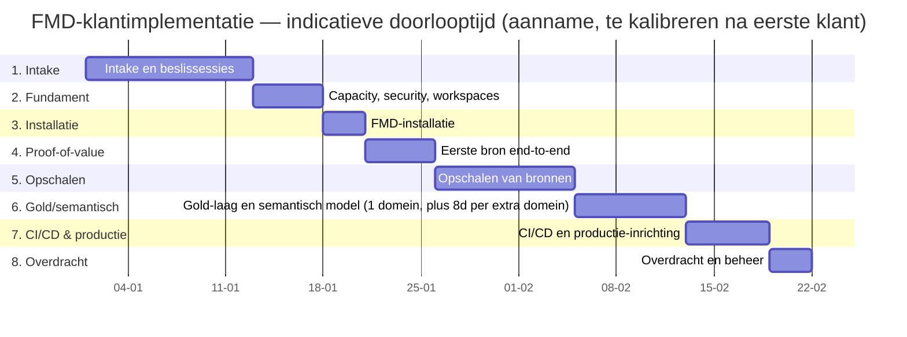

# Implementatieplan — Hoog-over (`plan_hoogover.md`)

**Fase:** 4A (Implementatieplan)
**Datum:** 2026-09-25
**Status:** Eerste versie, bijgewerkt op 2026-09-25 (inspanning in persoonsdagen, doorlooptijd fase 1 en 6; review 1 R7)
**Doel:** het hoog-over faseplan voor een FMD-klantimplementatie — doel, deliverables, rollen, doorlooptijd, go/no-go en risico's per fase. Voor de stapsgewijze uitwerking per fase, zie `draaiboek_detail.md`. Voor de onderliggende architectuurkeuzes, zie `02_beslisdocument/02_beslisregister.md` (besluiten `B-*`).

*Bijgewerkt 2026-10-12 (FMD_FRAMEWORK#58): `PL_FMD_ORCHESTRATION_TEMPLATE` heet nu `PL_FMD_ORCHESTRATION`, `PL_FMD_LOAD_GOLD_TEMPLATE` heet nu `PL_FMD_LOAD_GOLD`.*

**Belangrijke kanttekening over doorlooptijd/inspanning:** Bitmetric heeft dit framework tot nu toe alleen in de eigen trial-/referentie-omgeving doorlopen, niet bij een externe klant. Alle tijdsindicaties hieronder zijn daarom **aannames**, opgebouwd uit de eigen trial-ervaring (zie `draaiboek_detail.md`) — geen bevestigde klantcijfers. Kalibreer na de eerste klantimplementatie. De inspanning in persoonsdagen staat in de sectie "Inspanning" hieronder. *(Correctie 2026-09-25, review 1 R7: de verwijzing naar de 20-urenschatting in `03_architectuurvarianten.md` §G is vervallen; die ging alleen over het inrichten van deployment pipelines.)*

---

## Fasenoverzicht (Gantt, indicatief)

*(Status: aanname — indicatieve, sequentiële planning ter illustratie. In de praktijk overlappen fase 5 en 6 vaak deels, afhankelijk van teamcapaciteit; zie de kanttekeningen per fase hieronder.)*

## Inspanning (persoonsdagen Bitmetric)

**Status: aanname, te kalibreren na de eerste klant.** Er zijn nog geen gemeten klantcijfers. De getallen zijn afgeleid van de doorlooptijden hieronder en van de eigen trial- en referentie-opbouw; ze zijn een voorstel van 2026-09-25 en nog niet bevestigd door Mitchell. Een persoonsdag (pd) is een dag werk van één Bitmetric-consultant. Wachttijd bij de klant (toegang, beslissingen) telt mee in de doorlooptijd, niet in de inspanning.

### Rekenmodel

| # | Fase | Vast (pd) | Variabel (pd) | Waar het van afhangt |
|---|---|---|---|---|
| 1 | Intake en beslissessies | 2–4 | + 0,5 per extra domein | 16 klantbeslissingen (beslisregister Deel A), 2–3 sessies plus uitwerking |
| 2 | Fundament | 2–3 | + 5–10 bij variant V3 | capaciteit, Key Vault en SP, workspaces, Git; V3: netwerkproef |
| 3 | FMD-installatie | 1–2 | — | manifest, bootstrap, twee setup-runs, controles |
| 4 | Eerste bron end-to-end | 3–5 | — | full + incrementele load, validatie met de klant |
| 5 | Opschalen van bronnen | 0 | + 0,5–1 per standaardbron; + 3–5 per custom-notebookbron | aantal en soort bronnen (B-SRC-01); een bron is een `DataSource` met zijn tabellen |
| 6 | Gold en semantisch model | 0 | + 5–8 per domein | shortcuts, MLV's, refresh-cel, semantisch model, validatie; grootste post bij multi-domein |
| 7 | CI/CD en productie | 3–5 | + 1 per domein | promoties, post-deployment-checklist, deployment rules, alerting, acceptatiechecklist |
| 8 | Overdracht en beheer | 1–2 | + 0,5 per domein | overdrachtssessies, beheerdocumentatie |
| — | Projectleiding | | + 10–15% over het totaal | afstemming, voortgang |

### Twee referentieklanten

| | V1: 1 domein, 5 standaardbronnen | V2: 3 domeinen, 9 standaardbronnen + 1 custom notebook |
|---|---|---|
| Fase 1 | 2–4 | 3–5 |
| Fase 2 | 2–3 | 2–3 |
| Fase 3 | 1–2 | 1–2 |
| Fase 4 (eerste bron) | 3–5 | 3–5 |
| Fase 5 (overige bronnen) | 2–4 (4 bronnen) | 7–13 (8 standaard + 1 custom) |
| Fase 6 | 5–8 | 15–24 |
| Fase 7 | 4–6 | 6–8 |
| Fase 8 | 1,5–2,5 | 2,5–3,5 |
| Subtotaal | 20,5–34,5 | 39,5–63,5 |
| + projectleiding 10–15% | **± 23–40 pd** | **± 43–73 pd** |

V3 (enterprise met netwerkisolatie) is niet gevalideerd; reken op V2 plus 5–10 pd voor de netwerkproef in fase 2, en een ruimere marge in fase 3 en 7.

**Grootste onzekerheden:** het aantal en de complexiteit van de bronnen (fase 5), de Gold-logica per domein (fase 6), en de beschikbaarheid van de klant in fase 1 en 2. De bandbreedtes zijn daarom breed.

---

## Samenvattend overzicht

| # | Fase | Rollen (primair) | Doorlooptijd (indicatief) | Go/no-go-kern |
|---|---|---|---|---|
| 1 | Intake en beslissessies | Klant + Bitmetric | 2-3 weken | Beslisregister volledig ingevuld en akkoord |
| 2 | Fundament | Bitmetric (klant faciliteert toegang) | 1 week | Capacity/tenant/security klaar en getoetst |
| 3 | FMD-installatie | Bitmetric | 2-3 dagen | Setup-notebooks succesvol doorlopen, geen fouten |
| 4 | Eerste bron end-to-end (proof-of-value) | Bitmetric + klant (validatie) | 1 week | Eén bron volledig LZ→Bronze→Silver, klant valideert data |
| 5 | Opschalen van bronnen | Bitmetric (klant levert bronkennis) | 2 weken (schaalt met aantal bronnen) | Alle afgesproken bronnen geregistreerd en gevalideerd |
| 6 | Gold en semantisch model | Bitmetric + klant (business-logica) | 1,5 week per domein | Gold-tabellen + semantisch model door business goedgekeurd |
| 7 | CI/CD en productie-inrichting | Bitmetric | 1 week | Test→Prod-promotie succesvol, post-deployment-checklist groen |
| 8 | Overdracht en beheer | Bitmetric → klant | 2-3 dagen | Klant kan zelfstandig een nieuwe bron registreren (getoetst) |

---

## Fase 1 — Intake en beslissessies

**Doel:** alle architectuurkeuzes uit `02_beslisdocument/02_beslisregister.md` expliciet maken voor deze klant, met de intake-checklist als werkdocument.

**Deliverables:**
- Ingevulde intake-checklist (`02_beslisdocument/04_intake-checklist.md`), per klant gekopieerd.
- Ingevuld beslisregister voor deze klant (elke `B-*`-beslissing: gekozen optie + onderbouwing).
- Eerste versie van het manifest (`manifest.yaml`) op basis van de gekozen opties.

**Rollen:** Klant levert bedrijfscontext, capaciteitsbudget en beslissingsbevoegdheid; Bitmetric faciliteert de workshop(s) en legt de keuzes vast.

**Doorlooptijd (aanname):** 2-3 weken: 2-3 sessies met daartussen wachttijd op security- en netwerkbeslissingen bij de klant. *(Correctie 2026-09-25, review 1 R7: stond op ~1 week.)*

**Go/no-go-criteria:** beslisregister volledig ingevuld (geen open `B-*`-items zonder gekozen optie), klant akkoord met Bitmetric-defaults of expliciete afwijkingen gemotiveerd.

**Risico's:**
- Klant kan besluiten niet in één sessie nemen (bijv. security-/netwerkbeslissingen vereisen intern overleg) → planningsrisico voor fase 2.
- Onvolledige antwoorden op de intake-checklist leiden tot heropening van beslissingen in latere fasen (duurder dan nu).

---

## Fase 2 — Fundament (capacity, security, workspaces)

**Doel:** de Fabric-tenant-/capaciteitsbasis en security-inrichting klaarzetten, vóór er FMD-code op draait.

**Deliverables:**
- Capaciteit toegewezen/besteld (SKU conform B-CICD-01-gerelateerde capaciteitskeuze en `12_kosten-en-capaciteit.md`).
- ~~Workspaces aangemaakt~~ Workspacenamen vastgelegd conform B-ARCH-01-naamgeving (`[DOMEIN] [LAAG] ([OMG])`). *Correctie 2026-10-06 (review 3, P3-B3): de setup maakt de workspaces aan in fase 3.*
- Key Vault + RBAC ingericht conform B-SECURITY-01/B-SECURITY-02 (Workspace Identity waar mogelijk, expliciete Service Principal waar `FabricSql`-connecties dit vereisen).
- Git-repositories aangemaakt conform ADR-007/ADR-011 (eigen GitHub-organisatie, één repository per workspace). *Correctie 2026-10-05: hier stond "ADR-007/008, map-per-workspace"; ADR-008 is per 2026-09-29 vervangen door ADR-011.*

**Rollen:** Bitmetric voert uit; klant faciliteert toegang (Azure-tenant-rechten, netwerkgoedkeuring indien van toepassing).

**Doorlooptijd (aanname):** ~1 week — afhankelijk van hoe snel de klant tenant-/netwerktoegang verleent (vaak de langste wachttijd, niet het technische werk zelf).

**Go/no-go-criteria:** ~~alle workspaces bestaan met correcte naamgeving,~~ de workspacenamen en het object-ID van de SP staan in het manifest *(correctie 2026-10-06)*, Key Vault bereikbaar vanuit een testnotebook, git-koppeling van de Dev-workspace werkt.

**Risico's:**
- RBAC-discrepantie tussen het interne RBAC-brondocument en de fork-deploymentdocumentatie (zie `08_security-en-secrets.md`) — kan onverwachte rechten-issues geven bij `NB_BOOTSTRAP_FMD`.
- Netwerkgoedkeuring (private endpoints, firewall) bij de klant kan dit traject vertragen — vroeg escaleren.

---

## Fase 3 — FMD-installatie

**Doel:** het framework zelf operationeel krijgen op de zojuist ingerichte fundamenten.

**Deliverables:**
- `NB_BOOTSTRAP_FMD.ipynb` handmatig geïmporteerd en gedraaid.
- `NB_SETUP_FMD.ipynb` en `NB_SETUP_BUSINESS_DOMAINS.ipynb` succesvol doorlopen.
- Configuratiedatabase (`integration`/`execution`/`logging`-schema's) gedeployed.
- Variable Libraries aangemaakt met Dev-waarden gevuld.

**Rollen:** Bitmetric (technische uitvoering); klant niet actief betrokken behalve op afroep (goedkeuring, vragen).

**Doorlooptijd (aanname):** 2-3 dagen.

**Go/no-go-criteria:** setup-notebooks lopen zonder fouten door; drie lakehouses (`LH_DATA_LANDINGZONE`, `LH_BRONZE_LAYER`, `LH_SILVER_LAYER`) bestaan met de exact vereiste namen.

**Risico's:**
- Capaciteitscontentie kan setup-notebook-runs vertragen (zie `10_operations.md`) — geen technisch probleem, wel planningsimpact.
- `FabricSql`-connectie vereist expliciete Service Principal (platformbeperking, zie `08_security-en-secrets.md`) — als dit niet in fase 2 is voorzien, ontstaat hier vertraging.

---

## Fase 4 — Eerste bron end-to-end (proof-of-value)

**Doel:** één representatieve bron volledig door de keten (Landingzone → Bronze → Silver) laten lopen, als eerste bewijs richting de klant.

**Deliverables:**
- Eén bron geregistreerd (handmatig via `sp_Upsert*` of bulk via `PL_TOOLING_POST_ASQL_TO_FMD`, zie `05_INTEGRATION/02_configdb-registratie.md`).
- Full load + minimaal één incrementele load gevalideerd (watermark-mechanisme werkt).
- Klant heeft de data in Silver gecontroleerd en geaccordeerd.

**Rollen:** Bitmetric voert de registratie/validatie uit; klant valideert de inhoudelijke juistheid van de data.

**Doorlooptijd (aanname):** ~1 week, inclusief een cyclus van klantfeedback.

**Go/no-go-criteria:** klant bevestigt expliciet dat de Silver-data van deze ene bron correct is — dit is het eerste échte go/no-go-moment van het traject; bij een "no-go" wordt fase 4 herhaald vóórdat fase 5 start.

**Risico's:**
- Een bron met een niet-standaard structuur (die een custom notebook vereist, zie `07_extension-points.md`) kan deze fase fors verlengen als dit niet al in de intake is herkend.
- Verkeerde verwachtingen bij de klant over wat "Silver" wel/niet betekent (nog geen Gold/rapportage) — communiceer dit expliciet vooraf.

---

## Fase 5 — Opschalen van bronnen

**Doel:** de overige, in de intake afgesproken bronnen registreren en valideren, met het in fase 4 bewezen patroon.

**Deliverables:**
- Alle afgesproken bronnen geregistreerd en gevalideerd.
- Scheduling ingericht: schema's op `PL_FMD_ORCHESTRATION`, met `LoadGroup` alleen voor intraday-bronnen. *(Correctie 2026-10-06: was `PL_FMD_SCHEDULE_NIGHTLY`/`_INTRADAY`, die Gold niet draaien; review 3.)*
- Deactiverings-/foutafhandelingsprocedure (B-INFRA-02) getest op minstens één bron.

**Rollen:** Bitmetric voert uit; klant levert bronkennis/toegang per bron (met name bij custom-notebook-bronnen).

**Doorlooptijd (aanname):** ~2 weken, schaalt sterk met het aantal en de complexiteit van de bronnen — de grootste onzekerheidsmarge in dit plan.

**Go/no-go-criteria:** alle afgesproken bronnen staan met `IsActive=1` geregistreerd en hebben minstens één succesvolle load doorlopen; geen openstaande `DMTS_EntityNotFoundOrUnauthorized`-achtige structurele fouten.

**Risico's:**
- Bronnen die pas tijdens deze fase hun daadwerkelijke complexiteit tonen (bijv. een bron waarvan maar een deel geladen mag worden: dat vraagt een view in de bron of een custom notebook, want `SourceCustomSelect` wordt niet gelezen, zie `07_extension-points.md` §3).
- Capaciteitscontentie neemt toe naarmate meer bronnen parallel laden — monitor via `10_operations.md`.

---

## Fase 6 — Gold-laag en semantisch model

**Doel:** de business-specifieke Gold-laag (MLV's) en het Direct Lake-semantisch model bouwen voor het/de business-domein(en).

**Deliverables:**
- Domeinspecifieke `NB_LOAD_GOLD`/`NB_MLV_EXAMPLE`-notebooks (gekopieerd van de template, zie `06_BUSINESS_DOMEINEN/02_gold-laag-mlv.md`).
- Shortcuts naar Silver opgezet (`NB_CREATE_SHORTCUTS`, `VAR_GOLD_SHORTCUTS_FMD` gevuld) conform B-GOLD-01.
- Semantisch model (Direct Lake) gebouwd en door business gevalideerd.

**Rollen:** Bitmetric bouwt de technische laag; klant (business/functioneel beheerder) levert en valideert de businesslogica/MLV-inhoud.

**Doorlooptijd (aanname):** ~1,5 week per business-domein.

**Go/no-go-criteria:** business valideert de Gold-tabellen/het semantisch model inhoudelijk; MLV-refresh (API-route, zie `06_BUSINESS_DOMEINEN/02_gold-laag-mlv.md`) werkt aantoonbaar.

**Risico's:**
- Cross-workspace Direct-Lake-referenties herbinden niet automatisch bij latere promotie (zie `06_BUSINESS_DOMEINEN/04_semantisch-model-direct-lake.md`) — moet als aparte stap in fase 7 worden meegenomen, niet vergeten.
- Businesslogica in MLV's is per definitie klantspecifiek — onderschat deze fase niet als "nog even een paar views".

---

## Fase 7 — CI/CD en productie-inrichting

**Doel:** de Dev-opbouw promoveren naar Test en Prod, en het promotiemechanisme voor doorlopend gebruik inrichten.

**Deliverables:**
- Deployment Pipelines ingericht conform B-CICD-01 (Bitmetric-default; fabric-cicd alleen indien expliciet gekozen, zie `02_beslisdocument/03_architectuurvarianten.md`).
- Variable Libraries in Test/Prod geverifieerd: de eigen value set is actief en de overrides zijn niet leeg (ADR-010).
- Post-deployment-checklist doorlopen (shortcuts herdraaien, Direct-Lake-pointers, item-ID-dubbelcheck) — zie `09_cicd-en-deployment.md`.
- Productie-acceptatietest doorlopen (zie `draaiboek_detail.md`, productie-acceptatiechecklist).

**Rollen:** Bitmetric voert uit; klant geeft formele productie-goedkeuring.

**Doorlooptijd (aanname):** ~1 week.

**Go/no-go-criteria:** Test→Prod-deployment succesvol, post-deployment-checklist volledig groen, klant geeft expliciet productie-akkoord.

**Risico's:**
- Een Variable Library die na de promotie naar Development wijst. Vanaf fork-commit `81fe912` vult de setup de value sets zelf, maar controleer het na elke promotie (zie `11_troubleshooting.md`). Met een oudere fork is dit het meest voorkomende faalpunt.
- fabric-cicd is volgens ADR-012 (2026-10-05) een later spoor; ADR-006 is gesloten — als de klant hier tijdens het traject alsnog voor kiest, heeft dat significante impact op deze fase (geen kant-en-klaar pad, zie Variant B in `03_architectuurvarianten.md`).

---

## Fase 8 — Overdracht en beheer

**Doel:** de klant in staat stellen zelfstandig (of met beperkte Bitmetric-ondersteuning) de implementatie te beheren en uit te breiden.

**Deliverables:**
- Overdrachtssessie(s): operations (`10_operations.md`), troubleshooting (`11_troubleshooting.md`), en hoe een nieuwe bron te registreren.
- Beheerdocumentatie/contactpunten vastgelegd (wie lost welk type incident op).
- Eventueel een lichte supportafspraak (conform ADR-002: geen automatische framework-updates naar bestaande implementaties).

**Rollen:** Bitmetric draagt over; klant (of de door de klant aangewezen beheerder) neemt operationeel beheer over.

**Doorlooptijd (aanname):** 2-3 dagen.

**Go/no-go-criteria:** klant demonstreert zelfstandig het registreren van een nieuwe bron (of een vergelijkbare representatieve taak) onder begeleiding.

**Risico's:**
- Onvoldoende kennisoverdracht leidt tot herhaalde ad-hoc Bitmetric-support buiten een formele afspraak om — leg de overdrachtsscope vooraf vast.
- Klant heeft geen intern proces voor toekomstige framework-updates (ADR-002-uitzonderingspad: `git remote add framework && git cherry-pick`) — expliciet bespreken of dit voor deze klant relevant is.

---

## Verwijzingen

| Onderwerp | Document |
|---|---|
| Architectuurkeuzes per fase | `02_beslisdocument/02_beslisregister.md` |
| Architectuurvarianten + beslisboom | `02_beslisdocument/03_architectuurvarianten.md` |
| Intake-workshop | `02_beslisdocument/04_intake-checklist.md` |
| Technische achtergrond per onderwerp | `03_technische_documentatie/` (zie `index.md`) |
| Stapsgewijze uitwerking, RACI, risicoregister, acceptatiechecklist | `04_implementatieplan/draaiboek_detail.md` |
| Aanvullend technisch naslagwerk (lager abstractieniveau, deels overlappend — zie T3 in `05_consistentiecheck/`) | `04_implementatieplan/implementatieplan-template.md` |
